# 多技术栈支持

<cite>
**本文引用的文件**   
- [pipeline_types.h](file://pipelinetypes/pipeline_types.h)
- [fdm_pipeline.h](file://DllHsBaSlicer/fdm_pipeline.h)
- [fdm_pipeline.cpp](file://DllHsBaSlicer/fdm_pipeline.cpp)
- [sla_pipeline.h](file://DllHsBaSlicer/sla_pipeline.h)
- [sla_pipeline.cpp](file://DllHsBaSlicer/sla_pipeline.cpp)
- [sls_pipeline.h](file://DllHsBaSlicer/sls_pipeline.h)
- [sls_pipeline.cpp](file://DllHsBaSlicer/sls_pipeline.cpp)
- [slm_pipeline.h](file://DllHsBaSlicer/slm_pipeline.h)
- [slm_pipeline.cpp](file://DllHsBaSlicer/slm_pipeline.cpp)
- [lom_pipeline.h](file://DllHsBaSlicer/lom_pipeline.h)
- [lom_pipeline.cpp](file://DllHsBaSlicer/lom_pipeline.cpp)
- [tdp_pipeline.h](file://DllHsBaSlicer/tdp_pipeline.h)
- [tdp_pipeline.cpp](file://DllHsBaSlicer/tdp_pipeline.cpp)
- [waam_pipeline.h](file://DllHsBaSlicer/waam_pipeline.h)
- [waam_pipeline.cpp](file://DllHsBaSlicer/waam_pipeline.cpp)
- [custom_pipeline.h](file://DllHsBaSlicer/custom_pipeline.h)
- [custom_pipeline.cpp](file://DllHsBaSlicer/custom_pipeline.cpp)
</cite>

## 目录
1. [引言](#引言)
2. [项目结构](#项目结构)
3. [核心组件](#核心组件)
4. [架构总览](#架构总览)
5. [详细组件分析](#详细组件分析)
6. [依赖关系分析](#依赖关系分析)
7. [性能与扩展性](#性能与扩展性)
8. [故障排除指南](#故障排除指南)
9. [结论](#结论)
10. [附录：配置与切换示例](#附录配置与切换示例)

## 引言
本文件面向有经验的开发者，系统性梳理 HsBaSlicer 对 FDM、SLA、SLS、SLM、LOM、TDP（3DP）、WAAM 等多增材制造技术的统一抽象与差异化实现。文档从接口契约、流水线阶段、参数体系、算法选择、输出格式到 Lua 扩展点进行全面说明，并提供架构图、流程图和配置表，帮助读者快速理解并扩展新的制造技术。

## 项目结构
HsBaSlicer 的多技术栈能力集中在 DllHsBaSlicer 模块中，每种技术对应一个 C ABI 头文件和实现文件；所有公共类型定义在 pipelinetypes/pipeline_types.h 中，保证下游模块无需依赖共享库即可使用配置与结果结构体。

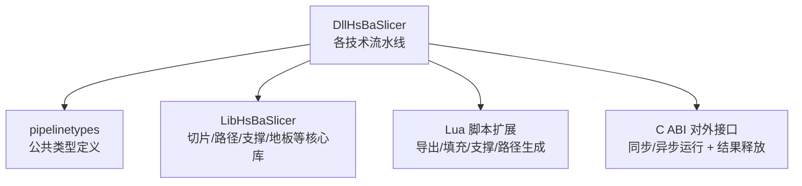

**图示来源**
- [fdm_pipeline.h:1-68](file://DllHsBaSlicer/fdm_pipeline.h#L1-L68)
- [pipeline_types.h:1-120](file://pipelinetypes/pipeline_types.h#L1-L120)

**章节来源**
- [fdm_pipeline.h:1-68](file://DllHsBaSlicer/fdm_pipeline.h#L1-L68)
- [pipeline_types.h:1-120](file://pipelinetypes/pipeline_types.h#L1-L120)

## 核心组件
- 统一类型层：所有技术的配置与结果结构体、枚举、回调函数均定义于 pipeline_types.h，提供默认初始化器，确保跨语言调用稳定。
- 技术流水线层：每个技术一个 C ABI 头文件声明默认配置创建、同步/异步运行、结果释放；实现文件封装内部配置、协程执行、进度上报与错误处理。
- 核心库层：LibHsBaSlicer 提供模型加载、网格切片、填充、支撑、地板、路径生成、SLA/SLS/WAAM 打包导出等通用能力。
- Lua 扩展层：通过全局 HsBa 表暴露管线构建块，允许用户自定义支撑、填充、地板、导出或整条流水线。

**章节来源**
- [pipeline_types.h:1-120](file://pipelinetypes/pipeline_types.h#L1-L120)
- [fdm_pipeline.h:1-68](file://DllHsBaSlicer/fdm_pipeline.h#L1-L68)
- [custom_pipeline.h:1-69](file://DllHsBaSlicer/custom_pipeline.h#L1-L69)

## 架构总览
下图展示多技术栈的统一入口、内部阶段与输出差异。FDM 输出 G-code；SLA 输出层图像 zip；SLS/SLM/LOM/TDP 通过 Lua 导出 zip+数据库；WAAM 输出机器人程序。

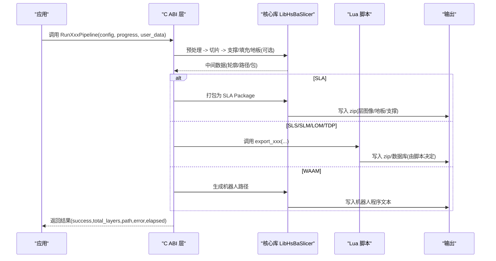

**图示来源**
- [fdm_pipeline.cpp:219-447](file://DllHsBaSlicer/fdm_pipeline.cpp#L219-L447)
- [sla_pipeline.cpp:299-483](file://DllHsBaSlicer/sla_pipeline.cpp#L299-L483)
- [sls_pipeline.cpp:182-296](file://DllHsBaSlicer/sls_pipeline.cpp#L182-L296)
- [slm_pipeline.cpp:236-348](file://DllHsBaSlicer/slm_pipeline.cpp#L236-L348)
- [lom_pipeline.cpp:193-305](file://DllHsBaSlicer/lom_pipeline.cpp#L193-L305)
- [tdp_pipeline.cpp:203-316](file://DllHsBaSlicer/tdp_pipeline.cpp#L203-L316)
- [waam_pipeline.cpp:174-284](file://DllHsBaSlicer/waam_pipeline.cpp#L174-L284)

## 详细组件分析

### FDM（熔融沉积）
- 流水线阶段：预处理 → 切片 → 支撑 → 填充 → 路径生成 → G-code 输出。
- 关键参数：层高、首层层高、填充间距/模式/角度、壁厚、顶底层数、填充密度、支撑开关/角度/间隙/直径/密度/图案、线宽、打印速度、移动速度、挤出倍率、螺旋花瓶模式、固件目标、喷嘴/耗材直径、温度、回抽、首层速度。
- 算法选择：内置 Zigzag/Zigzag-Advanced/Line 填充；平面/树形/蜂窝支撑；G-code 路径生成器；支持 Lua 自定义支撑与填充。
- 输出格式：UTF-8 G-code 字符串，按固件目标（Marlin/RepRap/Klipper）格式化。
- 性能特点：切片与填充可并行；Lua 填充串行以避免解释器竞争；螺旋模式跳过支撑/填充以提升效率。

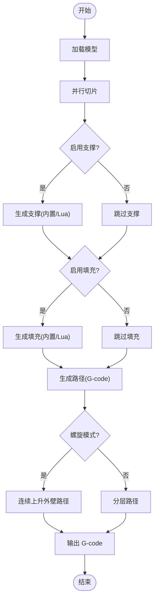

**图示来源**
- [fdm_pipeline.cpp:219-447](file://DllHsBaSlicer/fdm_pipeline.cpp#L219-L447)

**章节来源**
- [pipeline_types.h:23-127](file://pipelinetypes/pipeline_types.h#L23-L127)
- [fdm_pipeline.h:17-61](file://DllHsBaSlicer/fdm_pipeline.h#L17-L61)
- [fdm_pipeline.cpp:142-197](file://DllHsBaSlicer/fdm_pipeline.cpp#L142-L197)
- [fdm_pipeline.cpp:219-447](file://DllHsBaSlicer/fdm_pipeline.cpp#L219-L447)

### SLA（光固化）
- 流水线阶段：预处理 → 切片 → 地板/底板 → 支撑 → 导出（zip）。
- 关键参数：层高、首层层高、底部/正常曝光时间、提升距离/速度、回抽速度、地板偏移/边框宽度/填充间距/角度/边框数/凸包、支撑开关/角度/间隙/直径/密度/图案、图像格式(PNG/JPG/SVG)、图像尺寸。
- 算法选择：内置 SLA 支撑；Lua 自定义地板/支撑/导出；SLA Package 打包层图像与配置 JSON。
- 输出格式：zip 压缩包，包含层图像、地板/支撑图像及配置 JSON。

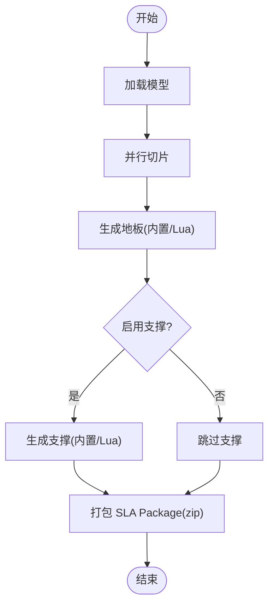

**图示来源**
- [sla_pipeline.cpp:299-483](file://DllHsBaSlicer/sla_pipeline.cpp#L299-L483)

**章节来源**
- [pipeline_types.h:145-245](file://pipelinetypes/pipeline_types.h#L145-L245)
- [sla_pipeline.h:17-56](file://DllHsBaSlicer/sla_pipeline.h#L17-L56)
- [sla_pipeline.cpp:244-282](file://DllHsBaSlicer/sla_pipeline.cpp#L244-L282)
- [sla_pipeline.cpp:299-483](file://DllHsBaSlicer/sla_pipeline.cpp#L299-L483)

### SLS（选择性激光烧结）
- 流水线阶段：预处理 → 切片 → Lua 导出（zip+数据库）。
- 关键参数：层高、首层层高、激光功率、扫描速度、 hatch 间距/旋转、床温。
- 算法选择：无标准输出格式，完全由 Lua 导出脚本决定；需提供 export_lua_script。
- 输出格式：由 Lua 脚本生成的 zip/数据库。

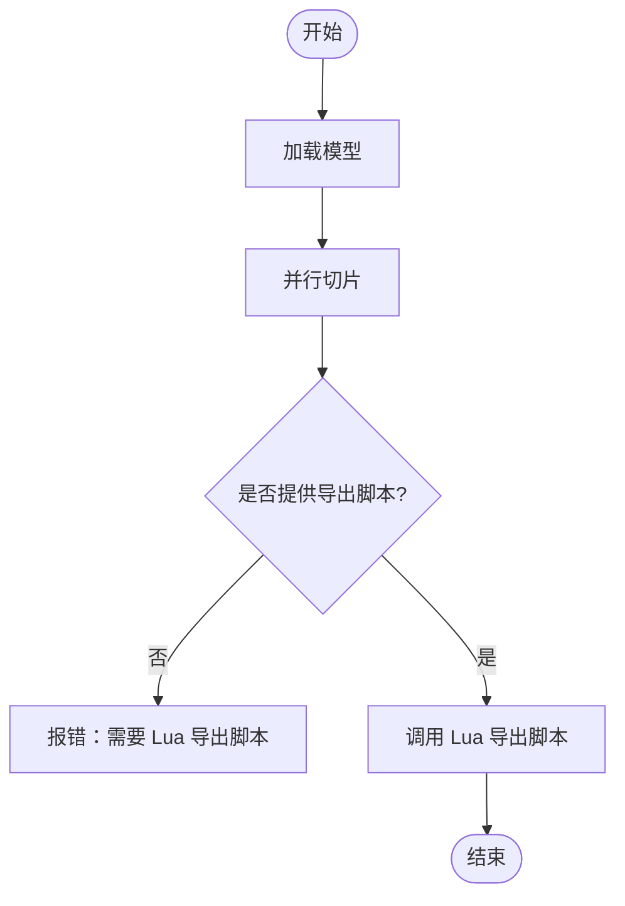

**图示来源**
- [sls_pipeline.cpp:182-296](file://DllHsBaSlicer/sls_pipeline.cpp#L182-L296)

**章节来源**
- [pipeline_types.h:247-310](file://pipelinetypes/pipeline_types.h#L247-L310)
- [sls_pipeline.h:17-56](file://DllHsBaSlicer/sls_pipeline.h#L17-L56)
- [sls_pipeline.cpp:147-165](file://DllHsBaSlicer/sls_pipeline.cpp#L147-L165)
- [sls_pipeline.cpp:182-296](file://DllHsBaSlicer/sls_pipeline.cpp#L182-L296)

### SLM（选择性激光熔化）
- 流水线阶段：预处理 → 切片 → Lua 导出（zip+数据库），流程镜像 SLS。
- 关键参数：层高、首层层高、激光功率、扫描速度、hatch 间距/旋转、床温、材料（铁/铝/钛）、光源（激光/电子束）、保护气体（氩/氦/氮/二氧化碳）。
- 算法选择：复用 SLS 的 Lua 包装方式，金属参数通过配置 JSON 传递给导出脚本。
- 输出格式：由 Lua 脚本生成的 zip/数据库。

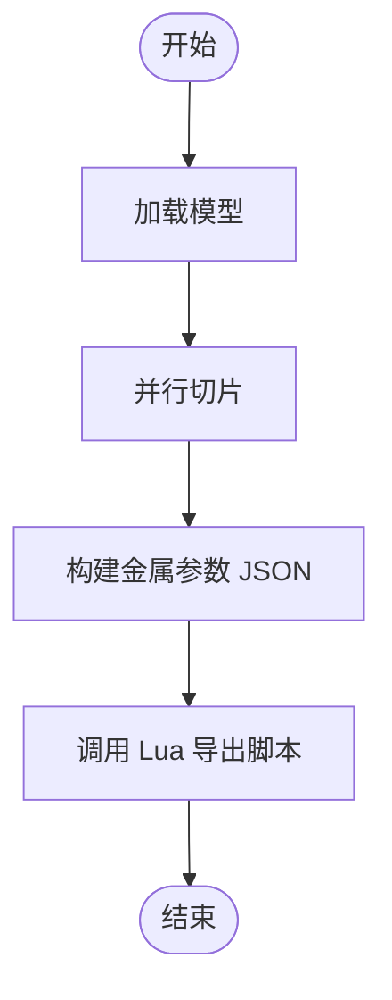

**图示来源**
- [slm_pipeline.cpp:236-348](file://DllHsBaSlicer/slm_pipeline.cpp#L236-L348)

**章节来源**
- [pipeline_types.h:312-401](file://pipelinetypes/pipeline_types.h#L312-L401)
- [slm_pipeline.h:17-56](file://DllHsBaSlicer/slm_pipeline.h#L17-L56)
- [slm_pipeline.cpp:173-219](file://DllHsBaSlicer/slm_pipeline.cpp#L173-L219)
- [slm_pipeline.cpp:236-348](file://DllHsBaSlicer/slm_pipeline.cpp#L236-L348)

### LOM（叠层实体制造）
- 流水线阶段：预处理 → 切片（按片材厚度）→ Lua 导出（zip+数据库）。
- 关键参数：层高（片厚）、首层层高、切割速度/余量/功率、粘合温度/压力/时间、封边轮廓、切割模式（轮廓/半色调）。
- 算法选择：轮廓数据以 SLS 风格打包，具体工艺由 Lua 导出脚本决定。
- 输出格式：由 Lua 脚本生成的 zip/数据库。

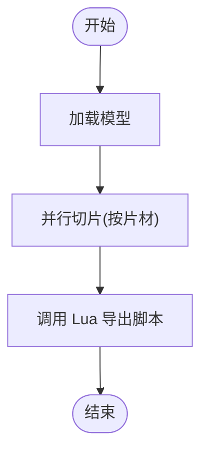

**图示来源**
- [lom_pipeline.cpp:193-305](file://DllHsBaSlicer/lom_pipeline.cpp#L193-L305)

**章节来源**
- [pipeline_types.h:403-461](file://pipelinetypes/pipeline_types.h#L403-L461)
- [lom_pipeline.h:17-56](file://DllHsBaSlicer/lom_pipeline.h#L17-L56)
- [lom_pipeline.cpp:128-176](file://DllHsBaSlicer/lom_pipeline.cpp#L128-L176)
- [lom_pipeline.cpp:193-305](file://DllHsBaSlicer/lom_pipeline.cpp#L193-L305)

### TDP / 3DP（粘结剂喷射）
- 流水线阶段：预处理 → 切片 → Lua 导出（zip+数据库）。
- 关键参数：层高、首层层高、喷头数量、滴落间距、粘结剂饱和度、固化时间、床温、粘结模式（全彩/单通道/烧结后处理）、螺旋模式。
- 算法选择：粘结剂轮廓以 SLS 风格打包，工艺参数由 Lua 导出脚本决定。
- 输出格式：由 Lua 脚本生成的 zip/数据库。

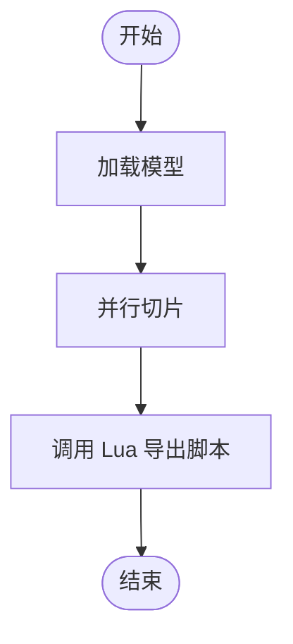

**图示来源**
- [tdp_pipeline.cpp:203-316](file://DllHsBaSlicer/tdp_pipeline.cpp#L203-L316)

**章节来源**
- [pipeline_types.h:463-521](file://pipelinetypes/pipeline_types.h#L463-L521)
- [tdp_pipeline.h:17-56](file://DllHsBaSlicer/tdp_pipeline.h#L17-L56)
- [tdp_pipeline.cpp:127-186](file://DllHsBaSlicer/tdp_pipeline.cpp#L127-L186)
- [tdp_pipeline.cpp:203-316](file://DllHsBaSlicer/tdp_pipeline.cpp#L203-L316)

### WAAM（电弧增材制造）
- 流水线阶段：预处理 → 切片（丝材沉积层）→ 机器人路径导出。
- 关键参数：层高、首层层高、焊道宽度、行走速度、送丝速度、电流/电压、气体流量、材料（钢/铝/钛/铜）、焊接工艺（电弧/激光）、保护方式（保护气/真空）、保护气体、层间温度、机器人控制器类型（ABB/KUKA/FANUC）、可选 Lua 路径脚本、螺旋模式。
- 算法选择：内置 ABB/KUKA/FANUC 机器人代码生成；可选 Lua 自定义路径生成。
- 输出格式：机器人程序文本文件。

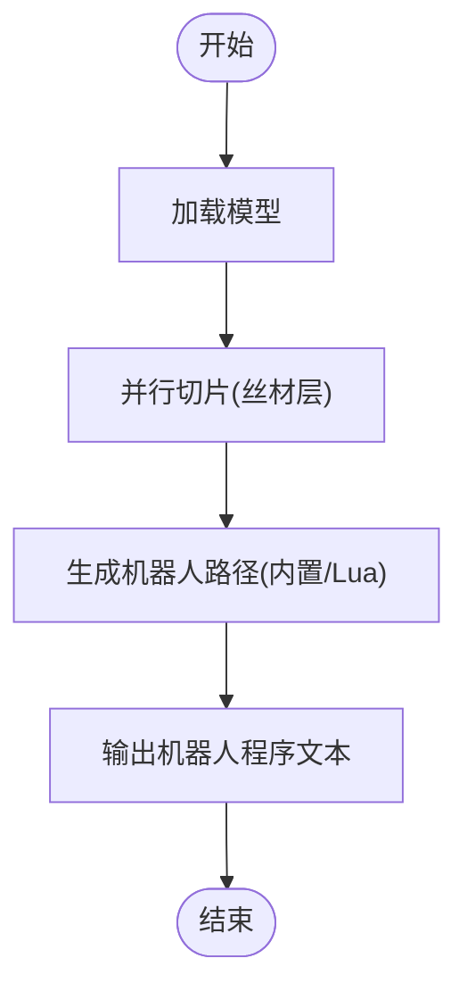

**图示来源**
- [waam_pipeline.cpp:174-284](file://DllHsBaSlicer/waam_pipeline.cpp#L174-L284)

**章节来源**
- [pipeline_types.h:523-625](file://pipelinetypes/pipeline_types.h#L523-L625)
- [waam_pipeline.h:17-57](file://DllHsBaSlicer/waam_pipeline.h#L17-L57)
- [waam_pipeline.cpp:131-157](file://DllHsBaSlicer/waam_pipeline.cpp#L131-L157)
- [waam_pipeline.cpp:174-284](file://DllHsBaSlicer/waam_pipeline.cpp#L174-L284)

### 自定义 Lua 流水线
- 设计目标：完全由 Lua 脚本定义流水线阶段顺序与内容；C++ 仅暴露模型加载、切片、支撑、填充、地板、G-code 路径输出、SLA/SLS 打包等构建块。
- 关键参数：Lua 脚本路径或内联源码、入口函数名、自由 JSON 配置、模型名称/路径、默认输出路径。
- 适用场景：需要完全控制流水线编排、混合多种技术步骤或集成外部工具链。

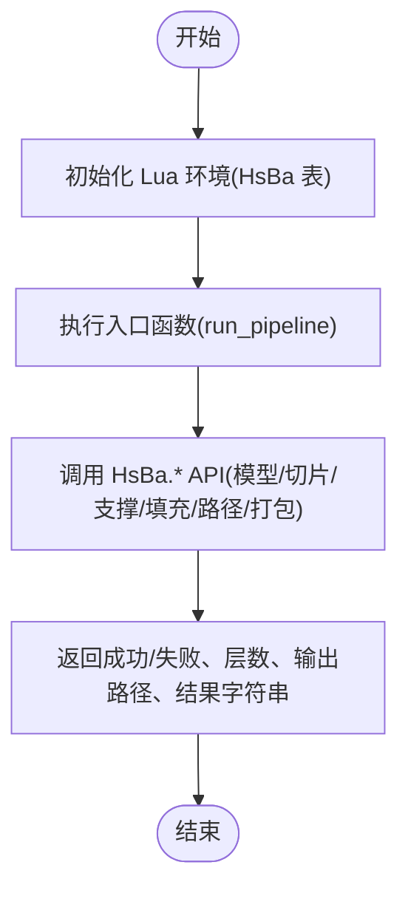

**图示来源**
- [custom_pipeline.cpp:117-163](file://DllHsBaSlicer/custom_pipeline.cpp#L117-L163)

**章节来源**
- [pipeline_types.h:676-732](file://pipelinetypes/pipeline_types.h#L676-L732)
- [custom_pipeline.h:17-62](file://DllHsBaSlicer/custom_pipeline.h#L17-L62)
- [custom_pipeline.cpp:86-115](file://DllHsBaSlicer/custom_pipeline.cpp#L86-L115)
- [custom_pipeline.cpp:117-163](file://DllHsBaSlicer/custom_pipeline.cpp#L117-L163)

## 依赖关系分析
- 公共类型依赖：所有技术配置/结果/回调均基于 pipeline_types.h，保证 ABI 稳定。
- 流水线实现依赖：各 *_pipeline.cpp 依赖 LibHsBaSlicer 的模型、切片、支撑、地板、路径与导出模块；同时通过 LuaCommonTypes 注册通用类型供 Lua 使用。
- Lua 扩展依赖：SLS/SLM/LOM/TDP 依赖 SaveSlsPackageLua；SLA 依赖 SaveSlaPackage/SaveSlaPackageLua；WAAM 依赖 SaveWaamRobotPath；FDM 依赖 G-code 路径生成器。

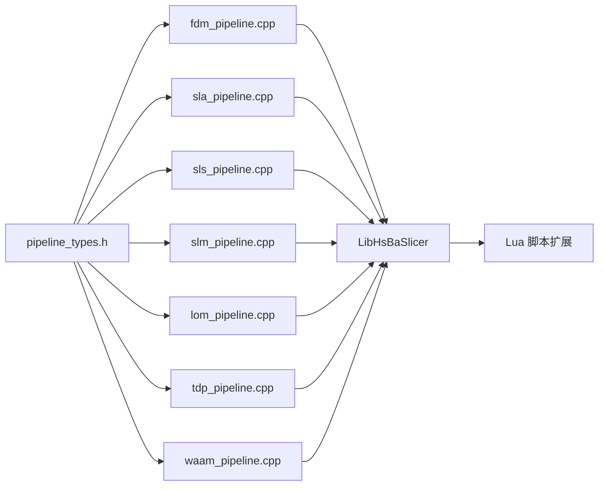

**图示来源**
- [pipeline_types.h:1-120](file://pipelinetypes/pipeline_types.h#L1-L120)
- [fdm_pipeline.cpp:1-27](file://DllHsBaSlicer/fdm_pipeline.cpp#L1-L27)
- [sla_pipeline.cpp:1-27](file://DllHsBaSlicer/sla_pipeline.cpp#L1-L27)
- [sls_pipeline.cpp:1-24](file://DllHsBaSlicer/sls_pipeline.cpp#L1-L24)
- [slm_pipeline.cpp:1-24](file://DllHsBaSlicer/slm_pipeline.cpp#L1-L24)
- [lom_pipeline.cpp:1-24](file://DllHsBaSlicer/lom_pipeline.cpp#L1-L24)
- [tdp_pipeline.cpp:1-24](file://DllHsBaSlicer/tdp_pipeline.cpp#L1-L24)
- [waam_pipeline.cpp:1-22](file://DllHsBaSlicer/waam_pipeline.cpp#L1-L22)

**章节来源**
- [pipeline_types.h:1-120](file://pipelinetypes/pipeline_types.h#L1-L120)
- [fdm_pipeline.cpp:1-27](file://DllHsBaSlicer/fdm_pipeline.cpp#L1-L27)
- [sla_pipeline.cpp:1-27](file://DllHsBaSlicer/sla_pipeline.cpp#L1-L27)
- [sls_pipeline.cpp:1-24](file://DllHsBaSlicer/sls_pipeline.cpp#L1-L24)
- [slm_pipeline.cpp:1-24](file://DllHsBaSlicer/slm_pipeline.cpp#L1-L24)
- [lom_pipeline.cpp:1-24](file://DllHsBaSlicer/lom_pipeline.cpp#L1-L24)
- [tdp_pipeline.cpp:1-24](file://DllHsBaSlicer/tdp_pipeline.cpp#L1-L24)
- [waam_pipeline.cpp:1-22](file://DllHsBaSlicer/waam_pipeline.cpp#L1-L22)

## 性能与扩展性
- 并行切片：所有技术均采用“构建切片拓扑一次 + 逐层并行切片”的模式，显著降低 I/O 与几何计算开销。
- 填充并行化：FDM 内置填充可并行执行；Lua 填充因解释器状态限制需串行执行，避免竞态。
- 螺旋模式优化：FDM/WAAM/TDP 支持螺旋模式，减少旅行移动与支撑/填充计算，适合花瓶类或连续沉积路径。
- Lua 扩展点：支撑、填充、地板、导出、路径生成均可通过 Lua 替换，便于适配不同设备厂商协议与工艺策略。
- 资源管理：结果结构体中的 C 字符串采用 RAII 包装并在释放函数中统一 free，防止内存泄漏。

[本节为通用指导，不直接分析具体文件]

## 故障排除指南
- 模型加载失败：检查 model_path 是否正确；若模型高度无效，流水线会返回错误。
- 缺少 Lua 导出脚本：SLS/SLM/LOM/TDP 必须提供 export_lua_script，否则流水线直接报错。
- Lua 脚本读取失败：SLA 支撑脚本为空时会返回错误；请确认脚本路径与权限。
- 路径生成失败：FDM 螺旋模式或非螺旋模式路径生成失败时，会返回相应错误信息。
- 资源释放：务必调用对应的 Free 函数释放结果中的字符串字段，避免内存泄漏。

**章节来源**
- [fdm_pipeline.cpp:229-257](file://DllHsBaSlicer/fdm_pipeline.cpp#L229-L257)
- [fdm_pipeline.cpp:385-433](file://DllHsBaSlicer/fdm_pipeline.cpp#L385-L433)
- [sla_pipeline.cpp:400-419](file://DllHsBaSlicer/sla_pipeline.cpp#L400-L419)
- [sls_pipeline.cpp:244-252](file://DllHsBaSlicer/sls_pipeline.cpp#L244-L252)
- [slm_pipeline.cpp:296-304](file://DllHsBaSlicer/slm_pipeline.cpp#L296-L304)
- [lom_pipeline.cpp:253-261](file://DllHsBaSlicer/lom_pipeline.cpp#L253-L261)
- [tdp_pipeline.cpp:263-271](file://DllHsBaSlicer/tdp_pipeline.cpp#L263-L271)

## 结论
HsBaSlicer 通过统一的 C ABI 与公共类型定义，将 FDM、SLA、SLS、SLM、LOM、TDP、WAAM 等不同增材制造技术纳入一致的流水线框架。核心库负责通用的模型处理、切片与路径生成，Lua 脚本则承担工艺特定的导出与定制逻辑。该设计既保证了跨技术的一致性，又提供了充分的扩展空间，便于集成新设备与新工艺。

[本节为总结性内容，不直接分析具体文件]

## 附录：配置与切换示例
- 技术栈切换：根据目标设备选择对应 RunXxxPipeline 接口，并设置相应的 config 结构体字段。例如：
  - FDM：设置 fill_mode、support_pattern、gcode_firmware、spiral_mode 等。
  - SLA：设置 image_type、floor_*、support_*、exposure/lift 参数。
  - SLS/SLM/LOM/TDP：设置 process 相关参数，并确保 export_lua_script 非空。
  - WAAM：设置 robot_type、welding_process、protection、protect_gas、spiral_mode 等。
- 默认配置：优先使用 HsBaCreateDefaultXxxConfig() 获取默认值，再按需覆盖关键字段。
- 异步调用：使用 RunXxxPipelineAsync 配合进度与结果回调，适合 UI 线程非阻塞场景。
- 自定义流水线：使用 HsBaRunCustomPipeline，通过 Lua 脚本编排任意阶段组合。

**章节来源**
- [pipeline_types.h:735-800](file://pipelinetypes/pipeline_types.h#L735-L800)
- [fdm_pipeline.h:17-61](file://DllHsBaSlicer/fdm_pipeline.h#L17-L61)
- [sla_pipeline.h:17-56](file://DllHsBaSlicer/sla_pipeline.h#L17-L56)
- [sls_pipeline.h:17-56](file://DllHsBaSlicer/sls_pipeline.h#L17-L56)
- [slm_pipeline.h:17-56](file://DllHsBaSlicer/slm_pipeline.h#L17-L56)
- [lom_pipeline.h:17-56](file://DllHsBaSlicer/lom_pipeline.h#L17-L56)
- [tdp_pipeline.h:17-56](file://DllHsBaSlicer/tdp_pipeline.h#L17-L56)
- [waam_pipeline.h:17-57](file://DllHsBaSlicer/waam_pipeline.h#L17-L57)
- [custom_pipeline.h:17-62](file://DllHsBaSlicer/custom_pipeline.h#L17-L62)