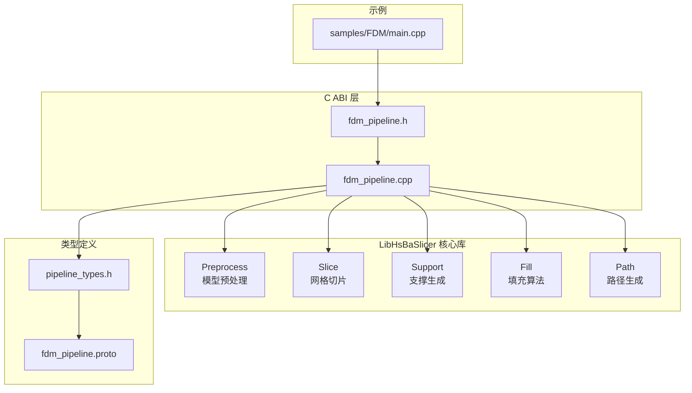
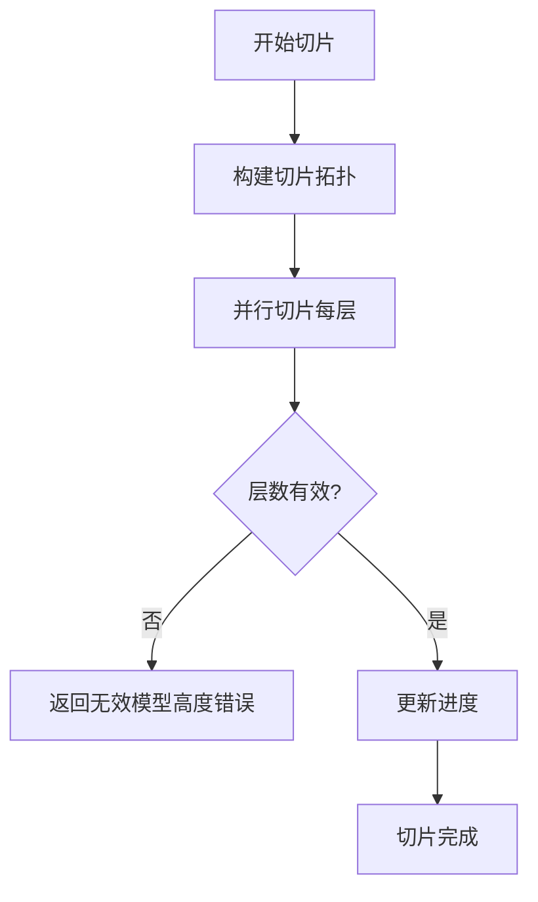
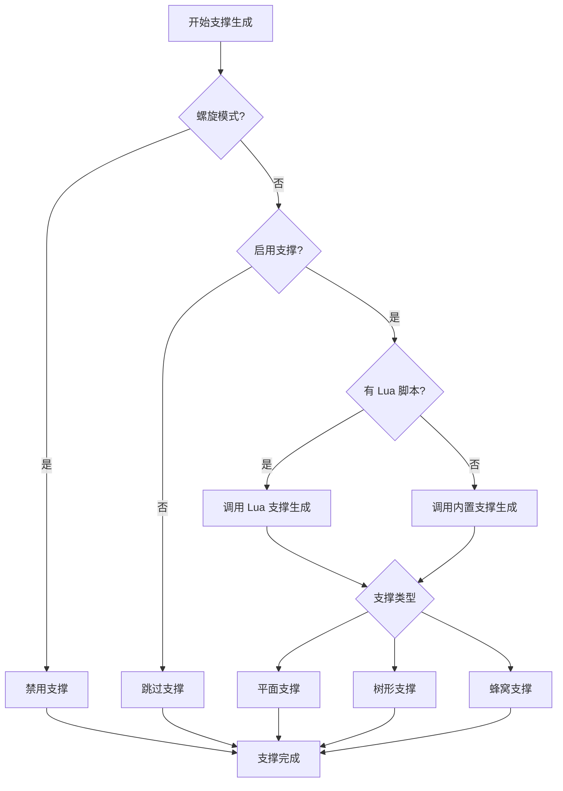
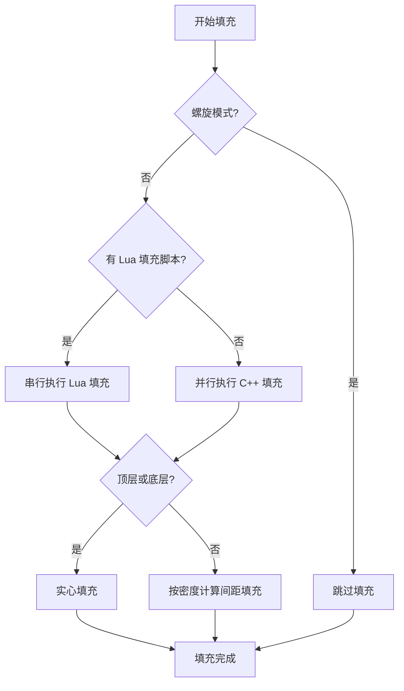
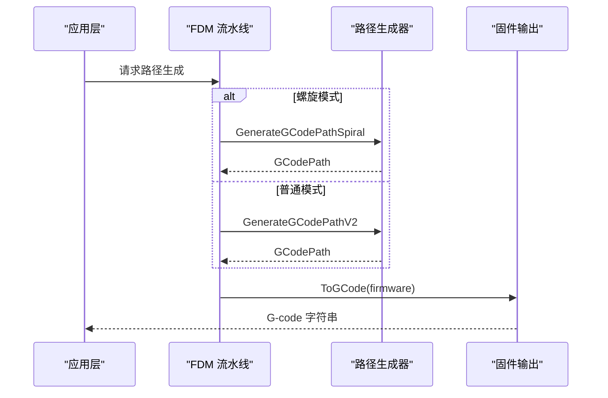
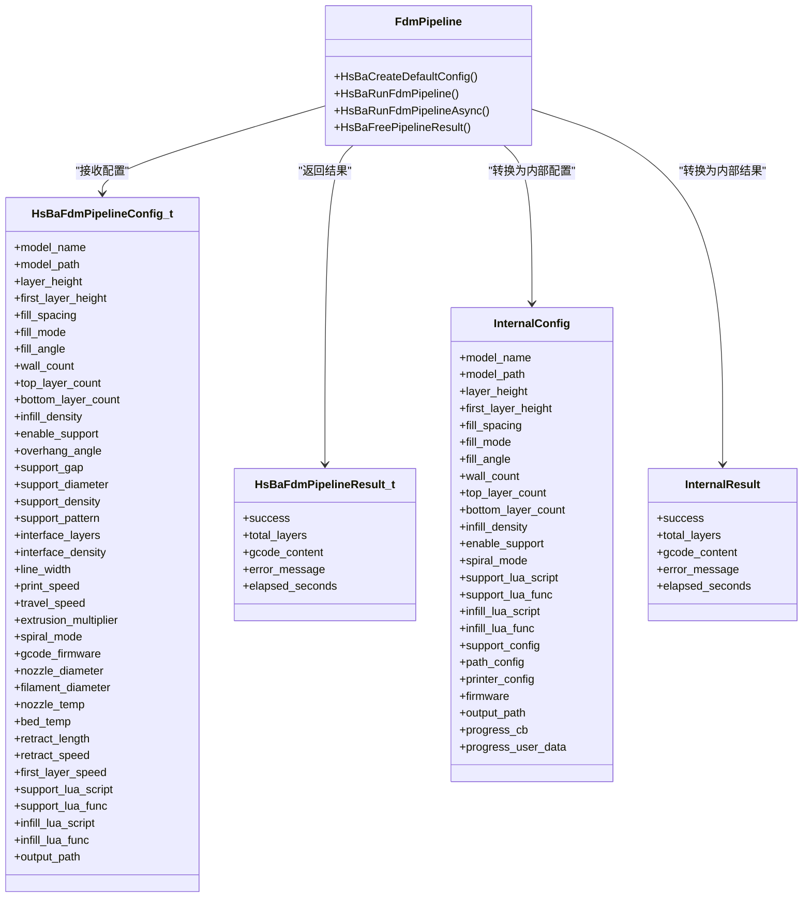
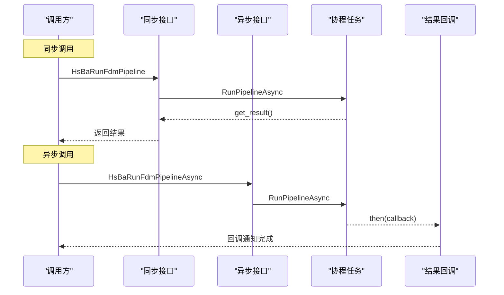
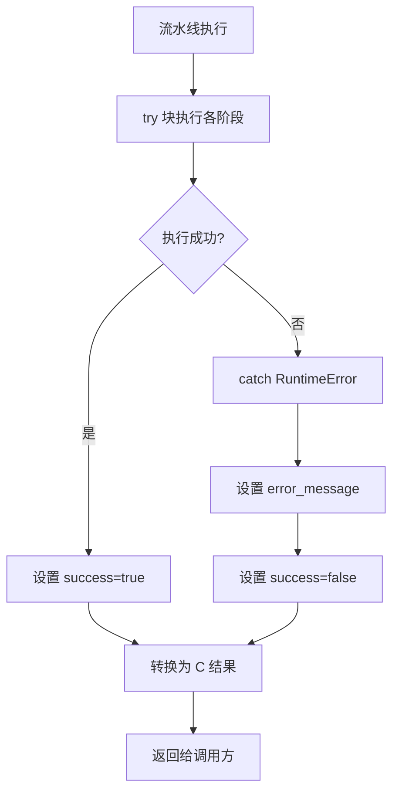
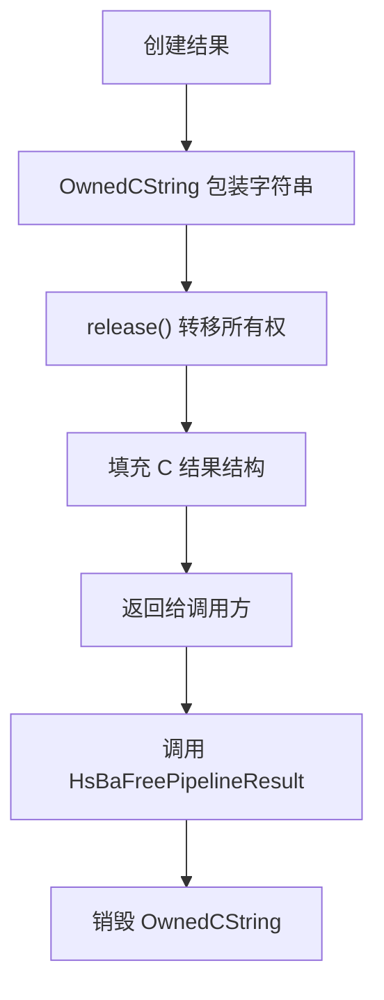
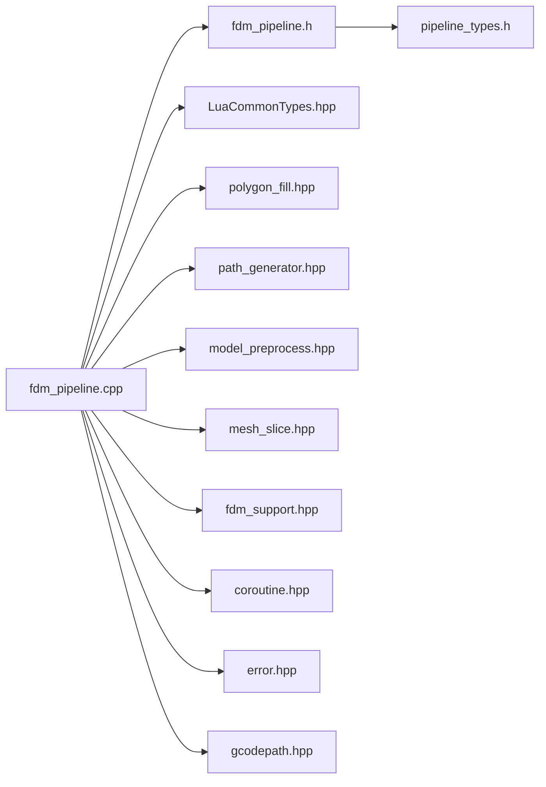

# FDM 熔融沉积成型流水线

<cite>
**本文引用的文件**   
- [pipeline_types.h](file://pipelinetypes/pipeline_types.h)
- [fdm_pipeline.h](file://DllHsBaSlicer/fdm_pipeline.h)
- [fdm_pipeline.cpp](file://DllHsBaSlicer/fdm_pipeline.cpp)
- [main.cpp（FDM 示例）](file://samples/FDM/main.cpp)
- [fdm_support.hpp](file://LibHsBaSlicer/Support/fdm_support.hpp)
- [fdm_support.cpp](file://LibHsBaSlicer/Support/fdm_support.cpp)
- [polygon_fill.hpp](file://LibHsBaSlicer/Fill/polygon_fill.hpp)
- [path_generator.hpp](file://LibHsBaSlicer/Path/path_generator.hpp)
- [Msg2PipelineConfig.cpp](file://convert/Msg2PipelineConfig.cpp)
- [param_reflect.hpp](file://fileoperator/param_reflect.hpp)
- [fdm_pipeline.proto](file://proto/fdm_pipeline.proto)
</cite>

## 目录
1. [项目概述与快速开始](#项目概述与快速开始)
2. [项目结构](#项目结构)
3. [核心概念](#核心概念)
4. [核心模块详解](#核心模块详解)
5. [架构总览](#架构总览)
6. [详细组件分析](#详细组件分析)
7. [依赖关系分析](#依赖关系分析)
8. [性能优化建议](#性能优化建议)
9. [API 参考文档](#api-参考文档)
10. [集成指南](#集成指南)
11. [开发测试与贡献](#开发测试与贡献)
12. [部署故障排除与 FAQ](#部署故障排除与-faq)
13. [附录](#附录)

## 项目概述与快速开始

FDM 熔融沉积成型流水线负责把三维模型转换为可打印的 G-code。其完整处理流程包括：

- **预处理**：加载模型、计算包围盒、估算层数。
- **切片**：基于拓扑结构并行生成每层轮廓。
- **支撑生成**：根据悬垂角度和支撑类型生成支撑截面。
- **填充**：对顶层、底层和中层分别生成实心或稀疏填充。
- **路径生成**：将轮廓、填充、支撑转换为 G-code 路径，并输出目标固件格式。

对于初学者，最直接的入口是 C ABI 接口：

| 用途 | 函数 | 说明 |
|---|---|---|
| 获取默认配置 | `HsBaCreateDefaultConfig` | 返回已初始化的 `HsBaFdmPipelineConfig_t` |
| 同步执行 | `HsBaRunFdmPipeline` | 阻塞直到完成，适合简单调用方 |
| 异步执行 | `HsBaRunFdmPipelineAsync` | 非阻塞，通过回调返回结果 |
| 释放结果内存 | `HsBaFreePipelineResult` | 必须调用以释放 `gcode_content` 和 `error_message` |

推荐快速上手方式：

1. 调用 `HsBaCreateDefaultConfig()` 创建默认配置。
2. 设置 `model_name` 和 `model_path`。
3. 根据需要调整层高、线宽、填充密度、支撑类型等参数。
4. 调用 `HsBaRunFdmPipeline` 或 `HsBaRunFdmPipelineAsync`。
5. 检查 `result.success`，读取 `result.gcode_content`。
6. 调用 `HsBaFreePipelineResult` 释放内存。

**章节来源**
- [fdm_pipeline.h:17-61](file://DllHsBaSlicer/fdm_pipeline.h#L17-L61)
- [main.cpp（FDM 示例）:53-96](file://samples/FDM/main.cpp#L53-L96)

## 项目结构

FDM 流水线相关代码分布在多个模块中：



**图表来源**
- [fdm_pipeline.h:1-68](file://DllHsBaSlicer/fdm_pipeline.h#L1-L68)
- [fdm_pipeline.cpp:1-27](file://DllHsBaSlicer/fdm_pipeline.cpp#L1-L27)
- [pipeline_types.h:53-113](file://pipelinetypes/pipeline_types.h#L53-L113)
- [fdm_pipeline.proto:1-61](file://proto/fdm_pipeline.proto#L1-L61)

**章节来源**
- [fdm_pipeline.cpp:1-27](file://DllHsBaSlicer/fdm_pipeline.cpp#L1-L27)
- [pipeline_types.h:53-113](file://pipelinetypes/pipeline_types.h#L53-L113)

## 核心概念

### HsBaFdmPipelineConfig_t 配置结构体

`HsBaFdmPipelineConfig_t` 是 FDM 流水线的统一配置入口，包含模型、切片、填充、支撑、路径、G-code 输出和 Lua 扩展等全部关键参数。

| 分类 | 字段 | 类型 | 默认值 | 作用 | 调优建议 |
|---|---|---|---:|---|---|
| 模型 | `model_name` | `const char*` | NULL | 模型名称，用于模型管理 | 使用稳定、可读的名称 |
| 模型 | `model_path` | `const char*` | NULL | 模型文件路径 | 确保路径存在且格式受支持 |
| 切片 | `layer_height` | `float` | 0.2 mm | 常规层高 | 越小精度越高，但耗时增加 |
| 切片 | `first_layer_height` | `float` | 0.25 mm | 首层层高 | 略大于层高有助于粘附 |
| 填充 | `fill_spacing` | `double` | 0.4 mm | 填充线间距 | 与线宽配合控制密度 |
| 填充 | `fill_mode` | `HsBaFillMode_t` | `HSBA_FILL_ZIGZAG` | 填充模式 | 直线、简单折线、高级折线 |
| 填充 | `fill_angle` | `double` | 45.0° | 填充方向角 | 相邻层旋转可减少分层纹 |
| 填充 | `wall_count` | `int` | 3 | 外壁圈数 | 影响表面质量和强度 |
| 填充 | `top_layer_count` | `int` | 3 | 顶层实心层数 | 越大顶面越平整 |
| 填充 | `bottom_layer_count` | `int` | 3 | 底层实心层数 | 越大底面越平整 |
| 填充 | `infill_density` | `double` | 0.2 | 中间层填充密度 [0,1] | 0 表示无填充，1 表示全密 |
| 支撑 | `enable_support` | `int` | 1 | 是否启用支撑 | 悬垂结构建议开启 |
| 支撑 | `overhang_angle` | `float` | 45.0° | 悬垂阈值 | 小于该角度需要支撑 |
| 支撑 | `support_gap` | `float` | 0.5 mm | 支撑与模型间隙 | 影响支撑可移除性 |
| 支撑 | `support_diameter` | `float` | 2.0 mm | 支撑柱直径 | 影响支撑强度和材料用量 |
| 支撑 | `support_density` | `double` | 0.3 | 支撑填充密度 [0,1] | 平衡强度与去除难度 |
| 支撑 | `support_pattern` | `HsBaSupportPattern_t` | `HSBA_SUPPORT_PLANE` | 支撑类型 | 平面、树形、蜂窝 |
| 支撑 | `interface_layers` | `int` | 2 | 界面层数量 | 改善支撑与模型接触面 |
| 支撑 | `interface_density` | `double` | 0.5 | 界面层密度 [0,1] | 影响支撑附着质量 |
| 路径 | `line_width` | `float` | 0.4 mm | 挤出线宽 | 通常等于喷嘴直径 |
| 路径 | `print_speed` | `float` | 50.0 mm/s | 打印速度 | 速度与精度需权衡 |
| 路径 | `travel_speed` | `float` | 100.0 mm/s | 空走速度 | 提高可缩短非挤出时间 |
| 路径 | `extrusion_multiplier` | `float` | 1.0 | 挤出倍率 | 补偿挤出不均匀 |
| 路径 | `spiral_mode` | `int` | 0 | 螺旋/花瓶模式 | 1 时跳过填充和支撑 |
| G-code | `gcode_firmware` | `HsBaGCodeFirmware_t` | `HSBA_GCODE_MARLIN` | 目标固件 | Marlin、RepRap、Klipper |
| G-code | `nozzle_diameter` | `float` | 0.4 mm | 喷嘴直径 | 影响最小线宽和层高 |
| G-code | `filament_diameter` | `float` | 1.75 mm | 耗材直径 | 1.75 或 2.85 |
| G-code | `nozzle_temp` | `float` | 200.0°C | 喷嘴温度 | 按材料设定 |
| G-code | `bed_temp` | `float` | 60.0°C | 热床温度 | 按材料设定 |
| G-code | `retract_length` | `float` | 1.0 mm | 回抽长度 | 防止拉丝 |
| G-code | `retract_speed` | `float` | 40.0 mm/s | 回抽速度 | 过快可能断料 |
| G-code | `first_layer_speed` | `float` | 20.0 mm/s | 首层速度 | 低速提升粘附 |
| Lua | `support_lua_script` | `const char*` | NULL | 自定义支撑脚本路径 | 为空时使用内置算法 |
| Lua | `support_lua_func` | `const char*` | NULL | 自定义支撑函数名 | 默认 `generate_support` |
| Lua | `infill_lua_script` | `const char*` | NULL | 自定义填充脚本路径 | 为空时使用内置算法 |
| Lua | `infill_lua_func` | `const char*` | NULL | 自定义填充函数名 | 默认 `generate_fill` |
| 输出 | `output_path` | `const char*` | NULL | 输出 G-code 路径 | 可为空，由上层决定写入位置 |

**章节来源**
- [pipeline_types.h:53-113](file://pipelinetypes/pipeline_types.h#L53-L113)
- [pipeline_types.h:742-783](file://pipelinetypes/pipeline_types.h#L742-L783)

### HsBaFdmPipelineResult_t 结果结构体

| 字段 | 类型 | 含义 |
|---|---|---|
| `success` | `int` | 成功标志，0 失败，1 成功 |
| `total_layers` | `int` | 总层数 |
| `gcode_content` | `char*` | UTF-8 编码的 G-code 内容，调用方负责释放 |
| `error_message` | `char*` | UTF-8 编码的错误信息，调用方负责释放 |
| `elapsed_seconds` | `double` | 流水线耗时秒数 |

**章节来源**
- [pipeline_types.h:115-127](file://pipelinetypes/pipeline_types.h#L115-L127)

## 核心模块详解

### 预处理模块

预处理阶段负责加载模型、获取模型信息、计算包围盒和估算层数。实现位于 `fdm_pipeline.cpp` 的协程主流程中：

1. 通过 `GetModel` 或 `LoadModel` 加载模型。
2. 通过 `GetModelInfo` 获取模型包围盒。
3. 根据 `first_layer_height` 和 `layer_height` 计算总层数。
4. 若模型高度无效，直接返回错误。

该阶段是后续所有步骤的基础，模型加载失败会立即终止流水线。

**章节来源**
- [fdm_pipeline.cpp:231-257](file://DllHsBaSlicer/fdm_pipeline.cpp#L231-L257)

### 切片模块

切片阶段基于构建好的切片拓扑，并行生成每层轮廓。关键特性：

- 先构建一次切片拓扑。
- 使用 `ParallelForLayers` 并行切片。
- 每层 Z 坐标由 `GetLayerZ` 计算。
- 进度回调在切片过程中持续上报。



**图表来源**
- [fdm_pipeline.cpp:259-279](file://DllHsBaSlicer/fdm_pipeline.cpp#L259-L279)

**章节来源**
- [fdm_pipeline.cpp:259-279](file://DllHsBaSlicer/fdm_pipeline.cpp#L259-L279)

### 支撑生成模块

支撑生成支持三种内置模式和 Lua 自定义模式：

| 支撑类型 | 枚举值 | 特点 |
|---|---:|---|
| 平面支撑 | `HSBA_SUPPORT_PLANE` | 柱状支撑，结构简单 |
| 树形支撑 | `HSBA_SUPPORT_TREE` | 分支结构，节省材料 |
| 蜂窝支撑 | `HSBA_SUPPORT_HONEYCOMB` | 蜂窝结构，强度较好 |

实现逻辑：

1. 若开启螺旋模式，则禁用支撑。
2. 若启用支撑且设置了 Lua 脚本，则调用 `GenerateAllLuaSupport`。
3. 否则调用 `GenerateAllFdmSupport`。
4. 根据 `support_pattern` 选择具体支撑实现。



**图表来源**
- [fdm_pipeline.cpp:281-310](file://DllHsBaSlicer/fdm_pipeline.cpp#L281-L310)
- [fdm_support.cpp:14-52](file://LibHsBaSlicer/Support/fdm_support.cpp#L14-L52)

**章节来源**
- [fdm_pipeline.cpp:281-310](file://DllHsBaSlicer/fdm_pipeline.cpp#L281-L310)
- [fdm_support.hpp:19-67](file://LibHsBaSlicer/Support/fdm_support.hpp#L19-L67)
- [fdm_support.cpp:14-75](file://LibHsBaSlicer/Support/fdm_support.cpp#L14-L75)

### 填充模块

填充阶段区分顶层、底层和中层：

- 顶层和底层使用实心填充。
- 中层根据 `infill_density` 调整填充间距。
- 支持 C++ 内置填充和 Lua 自定义填充。
- C++ 填充可并行执行，Lua 填充串行执行。



**图表来源**
- [fdm_pipeline.cpp:312-383](file://DllHsBaSlicer/fdm_pipeline.cpp#L312-L383)

**章节来源**
- [fdm_pipeline.cpp:312-383](file://DllHsBaSlicer/fdm_pipeline.cpp#L312-L383)
- [polygon_fill.hpp:17-53](file://LibHsBaSlicer/Fill/polygon_fill.hpp#L17-L53)

### 路径生成模块

路径生成阶段负责将轮廓、填充、支撑转换为 G-code：

- 螺旋模式：调用 `GenerateGCodePathSpiral`，生成连续上升的外壁路径。
- 普通模式：调用 `GenerateGCodePathV2`，生成标准多层 G-code。
- 最终通过 `ToGCode` 输出目标固件格式。



**图表来源**
- [fdm_pipeline.cpp:385-433](file://DllHsBaSlicer/fdm_pipeline.cpp#L385-L433)
- [path_generator.hpp:44-80](file://LibHsBaSlicer/Path/path_generator.hpp#L44-L80)

**章节来源**
- [fdm_pipeline.cpp:385-433](file://DllHsBaSlicer/fdm_pipeline.cpp#L385-L433)
- [path_generator.hpp:20-91](file://LibHsBaSlicer/Path/path_generator.hpp#L20-L91)

## 架构总览

FDM 流水线采用分层架构：



**图表来源**
- [pipeline_types.h:53-127](file://pipelinetypes/pipeline_types.h#L53-L127)
- [fdm_pipeline.h:17-61](file://DllHsBaSlicer/fdm_pipeline.h#L17-L61)
- [fdm_pipeline.cpp:33-70](file://DllHsBaSlicer/fdm_pipeline.cpp#L33-L70)

**章节来源**
- [pipeline_types.h:53-127](file://pipelinetypes/pipeline_types.h#L53-L127)
- [fdm_pipeline.h:17-61](file://DllHsBaSlicer/fdm_pipeline.h#L17-L61)
- [fdm_pipeline.cpp:33-70](file://DllHsBaSlicer/fdm_pipeline.cpp#L33-L70)

## 详细组件分析

### 同步与异步执行模式

#### 同步执行

`HsBaRunFdmPipeline` 是同步接口：

- 内部调用协程 `RunPipelineAsync`。
- 通过 `task.get_result()` 阻塞等待结果。
- 适合简单调用场景，如命令行工具、批处理任务。

#### 异步执行

`HsBaRunFdmPipelineAsync` 是异步接口：

- 将配置复制到堆上，避免生命周期问题。
- 通过 `task.then()` 注册完成回调。
- 回调中转换内部结果为 C 结构并调用用户回调。
- 适合 GUI 应用、服务后端等需要非阻塞执行的场景。



**图表来源**
- [fdm_pipeline.cpp:460-486](file://DllHsBaSlicer/fdm_pipeline.cpp#L460-L486)

**章节来源**
- [fdm_pipeline.h:23-51](file://DllHsBaSlicer/fdm_pipeline.h#L23-L51)
- [fdm_pipeline.cpp:460-486](file://DllHsBaSlicer/fdm_pipeline.cpp#L460-L486)

### 错误处理机制

流水线使用统一的错误处理机制：

1. 捕获 `RuntimeError` 异常。
2. 将错误信息写入 `InternalResult.error_message`。
3. 设置 `success = false`。
4. 通过 `ToCResult` 转换为 C 结果结构。
5. 调用方检查 `result.success` 和 `result.error_message`。



**图表来源**
- [fdm_pipeline.cpp:436-446](file://DllHsBaSlicer/fdm_pipeline.cpp#L436-L446)

**章节来源**
- [fdm_pipeline.cpp:436-446](file://DllHsBaSlicer/fdm_pipeline.cpp#L436-L446)

### 内存管理机制

流水线使用 RAII 和显式释放策略：

- `OwnedCString` 自动管理 C 字符串内存。
- `HsBaFreePipelineResult` 负责释放 `gcode_content` 和 `error_message`。
- 异步回调中传递的结果也由调用方负责释放。



**图表来源**
- [fdm_pipeline.cpp:72-108](file://DllHsBaSlicer/fdm_pipeline.cpp#L72-L108)
- [fdm_pipeline.cpp:488-496](file://DllHsBaSlicer/fdm_pipeline.cpp#L488-L496)

**章节来源**
- [fdm_pipeline.cpp:72-108](file://DllHsBaSlicer/fdm_pipeline.cpp#L72-L108)
- [fdm_pipeline.cpp:488-496](file://DllHsBaSlicer/fdm_pipeline.cpp#L488-L496)

## 依赖关系分析

FDM 流水线的依赖关系如下：



**图表来源**
- [fdm_pipeline.cpp:17-26](file://DllHsBaSlicer/fdm_pipeline.cpp#L17-L26)

**章节来源**
- [fdm_pipeline.cpp:17-26](file://DllHsBaSlicer/fdm_pipeline.cpp#L17-L26)

## 性能优化建议

### 并行化优化

- **切片阶段**：使用 `ParallelForLayers` 并行处理各层切片。
- **填充阶段**：C++ 填充算法可并行执行，Lua 填充因解释器状态限制只能串行。
- **支撑生成**：当前实现为逐层处理，可考虑进一步优化。

### 内存优化

- 使用对象池管理几何对象。
- 避免不必要的字符串复制。
- 及时释放中间结果。

### I/O 优化

- 大模型分块加载。
- 流式输出 G-code，避免一次性加载全部内容到内存。
- 使用缓冲写入减少系统调用次数。

### 参数调优建议

| 参数 | 优化方向 | 适用场景 |
|---|---|---|
| `layer_height` | 增大可减少层数 | 快速原型 |
| `infill_density` | 降低可减少填充量 | 轻量模型 |
| `print_speed` | 提高可加快打印 | 非高精度需求 |
| `wall_count` | 减少可减少路径 | 内部零件 |
| `support_density` | 降低可减少支撑 | 易移除支撑 |

**章节来源**
- [fdm_pipeline.cpp:267-278](file://DllHsBaSlicer/fdm_pipeline.cpp#L267-L278)
- [fdm_pipeline.cpp:374-382](file://DllHsBaSlicer/fdm_pipeline.cpp#L374-L382)

## API 参考文档

### C ABI 接口

| 函数 | 参数 | 返回值 | 说明 |
|---|---|---|---|
| `HsBaCreateDefaultConfig` | 无 | `HsBaFdmPipelineConfig_t` | 创建默认配置 |
| `HsBaRunFdmPipeline` | `config`, `callback`, `user_data` | `HsBaFdmPipelineResult_t` | 同步执行流水线 |
| `HsBaRunFdmPipelineAsync` | `config`, `callback`, `user_data`, `result_callback`, `result_user_data` | `void` | 异步执行流水线 |
| `HsBaFreePipelineResult` | `result` | `void` | 释放结果内存 |

### 配置结构体字段参考

详见 [HsBaFdmPipelineConfig_t:53-113](file://pipelinetypes/pipeline_types.h#L53-L113) 表格部分。

### 结果结构体字段参考

详见 [HsBaFdmPipelineResult_t:115-127](file://pipelinetypes/pipeline_types.h#L115-L127) 表格部分。

**章节来源**
- [fdm_pipeline.h:17-61](file://DllHsBaSlicer/fdm_pipeline.h#L17-L61)
- [pipeline_types.h:53-127](file://pipelinetypes/pipeline_types.h#L53-L127)

## 集成指南

### C++ 集成示例

以下示例展示了完整的 FDM 流水线调用流程：

```cpp
// 1. 创建默认配置
HsBaFdmPipelineConfig_t cfg = HsBaCreateDefaultConfig();

// 2. 设置模型
cfg.model_name = "stanford_bunny";
cfg.model_path = "models/stanford_bunny.stl";

// 3. 配置工艺参数
cfg.layer_height = 0.2f;
cfg.first_layer_height = 0.25f;
cfg.line_width = 0.4f;
cfg.fill_spacing = 0.4;
cfg.infill_density = 0.2;
cfg.enable_support = 1;
cfg.support_pattern = HSBA_SUPPORT_TREE;

// 4. 同步执行
HsBaFdmPipelineResult_t result = HsBaRunFdmPipeline(&cfg, OnProgress, nullptr);

// 5. 检查结果
if (result.success) {
    // 使用 result.gcode_content
}

// 6. 释放内存
HsBaFreePipelineResult(&result);
```

### 异步集成示例

```cpp
// 异步完成回调
void OnComplete(HsBaFdmPipelineResult_t result, void* user_data) {
    if (result.success) {
        // 处理成功结果
    }
    HsBaFreePipelineResult(&result);
}

// 启动异步流水线
HsBaRunFdmPipelineAsync(&cfg, OnProgress, nullptr, OnComplete, &done_flag);
```

**章节来源**
- [main.cpp（FDM 示例）:53-96](file://samples/FDM/main.cpp#L53-L96)
- [main.cpp（FDM 示例）:245-269](file://samples/FDM/main.cpp#L245-L269)

## 开发测试与贡献

### 单元测试

项目包含丰富的单元测试，覆盖：

- 路径生成测试
- 填充算法测试
- 支撑生成测试
- 模型加载测试

### 示例程序

`samples/FDM/main.cpp` 提供了完整的 FDM 流水线示例，包括：

- 基本用法
- 自定义参数
- Lua 自定义支撑和填充
- 异步执行
- 螺旋模式

**章节来源**
- [main.cpp（FDM 示例）:1-337](file://samples/FDM/main.cpp#L1-L337)

## 部署故障排除与 FAQ

### 常见问题

**Q: 模型加载失败怎么办？**

A: 检查 `model_path` 是否正确，确认文件格式受支持，查看 `error_message` 获取详细信息。

**Q: 生成的 G-code 无法打印？**

A: 检查 `gcode_firmware` 是否与打印机固件匹配，验证 `nozzle_diameter` 和 `filament_diameter` 设置。

**Q: 支撑难以移除？**

A: 调整 `support_density`、`support_gap` 和 `support_pattern`，尝试树形支撑或降低支撑密度。

**Q: 填充效果不理想？**

A: 调整 `fill_spacing`、`fill_mode` 和 `infill_density`，改变 `fill_angle` 减少分层纹。

**Q: 性能太慢？**

A: 增大 `layer_height`，降低 `infill_density`，减少 `wall_count`，考虑关闭不必要的支撑。

### 调试技巧

1. 启用进度回调监控各阶段耗时。
2. 检查 `elapsed_seconds` 定位瓶颈。
3. 使用小模型测试参数组合。
4. 逐步调整参数而非一次性大幅修改。

**章节来源**
- [fdm_pipeline.cpp:231-446](file://DllHsBaSlicer/fdm_pipeline.cpp#L231-L446)

## 附录

### 枚举类型参考

#### 填充模式

| 枚举值 | 含义 |
|---:|---|
| `HSBA_FILL_LINE` | 平行线填充 |
| `HSBA_FILL_SIMPLE_ZIGZAG` | 简单折线填充 |
| `HSBA_FILL_ZIGZAG` | 高级折线填充 |

#### 支撑类型

| 枚举值 | 含义 |
|---:|---|
| `HSBA_SUPPORT_PLANE` | 平面支撑 |
| `HSBA_SUPPORT_TREE` | 树形支撑 |
| `HSBA_SUPPORT_HONEYCOMB` | 蜂窝支撑 |

#### G-code 固件

| 枚举值 | 含义 |
|---:|---|
| `HSBA_GCODE_MARLIN` | Marlin 固件 |
| `HSBA_GCODE_REPRAP` | RepRap/RRF 固件 |
| `HSBA_GCODE_KLIPPER` | Klipper 固件 |

**章节来源**
- [pipeline_types.h:23-51](file://pipelinetypes/pipeline_types.h#L23-L51)

### 协议定义参考

FDM 流水线也支持 Protocol Buffers 定义，便于跨语言通信。主要字段映射关系参见 [fdm_pipeline.proto](file://proto/fdm_pipeline.proto)。

**章节来源**
- [fdm_pipeline.proto:1-61](file://proto/fdm_pipeline.proto#L1-L61)