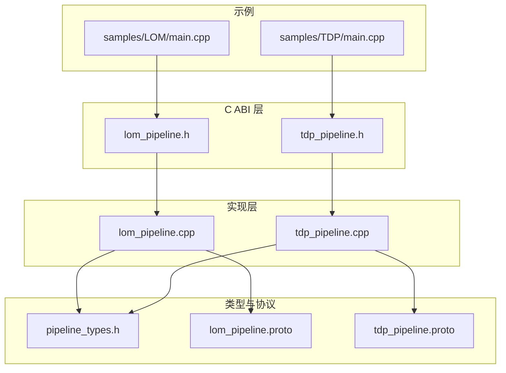
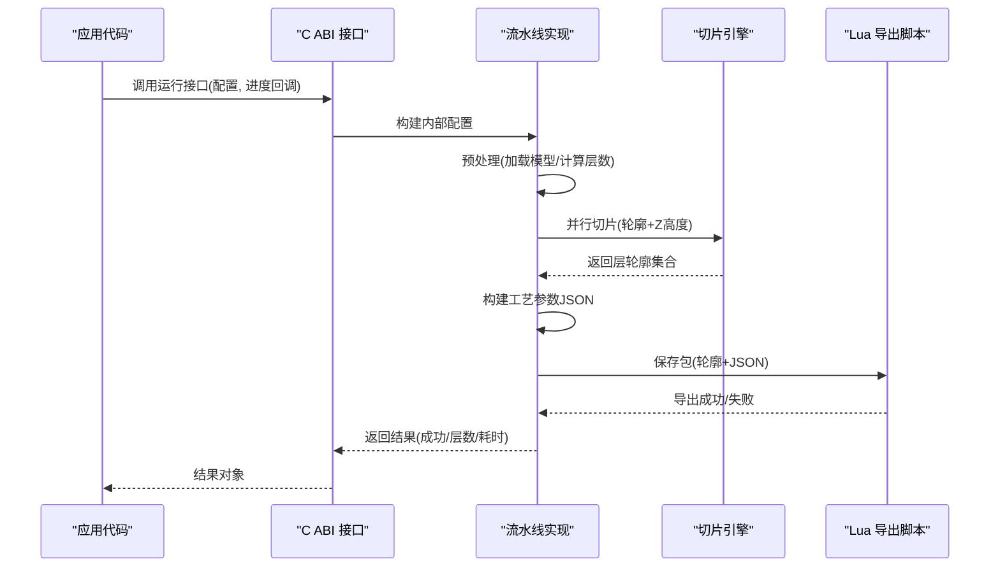
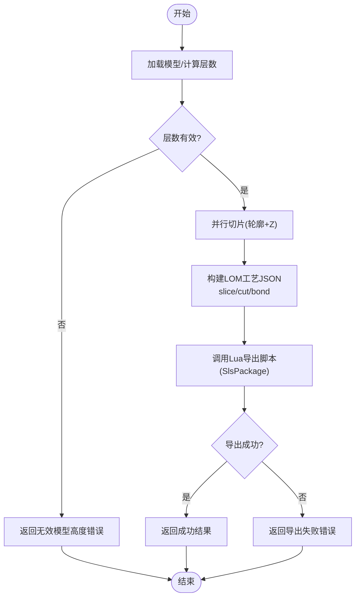
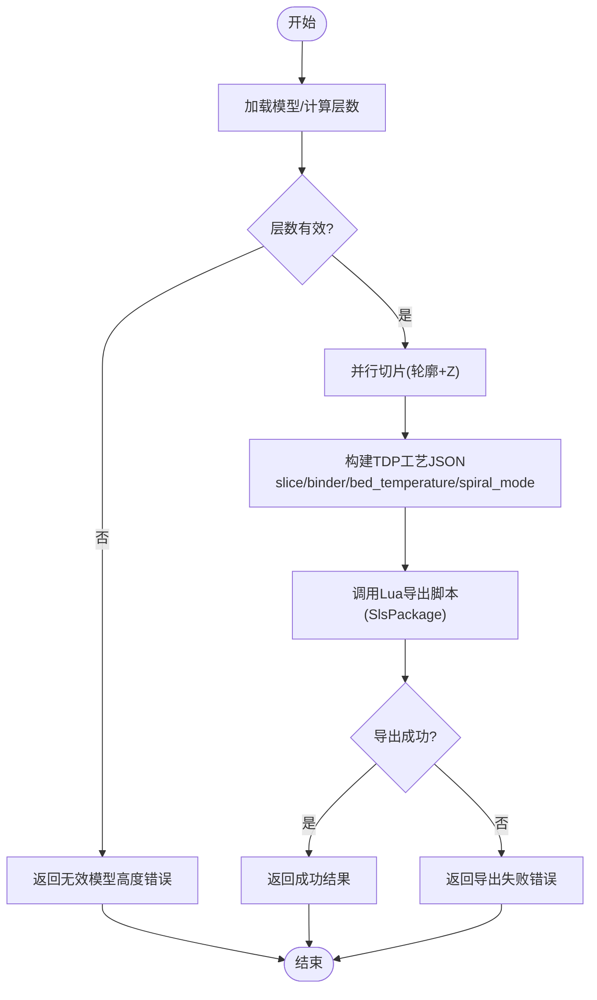
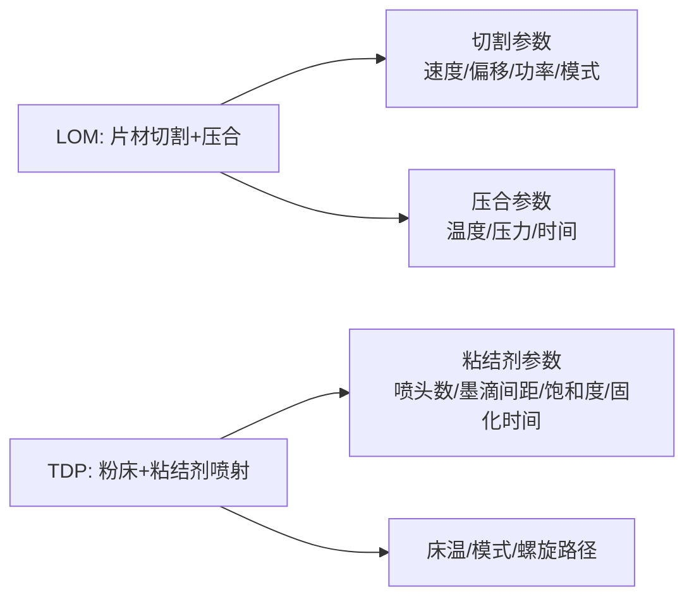
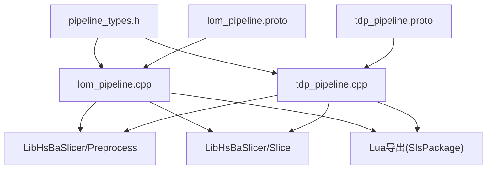
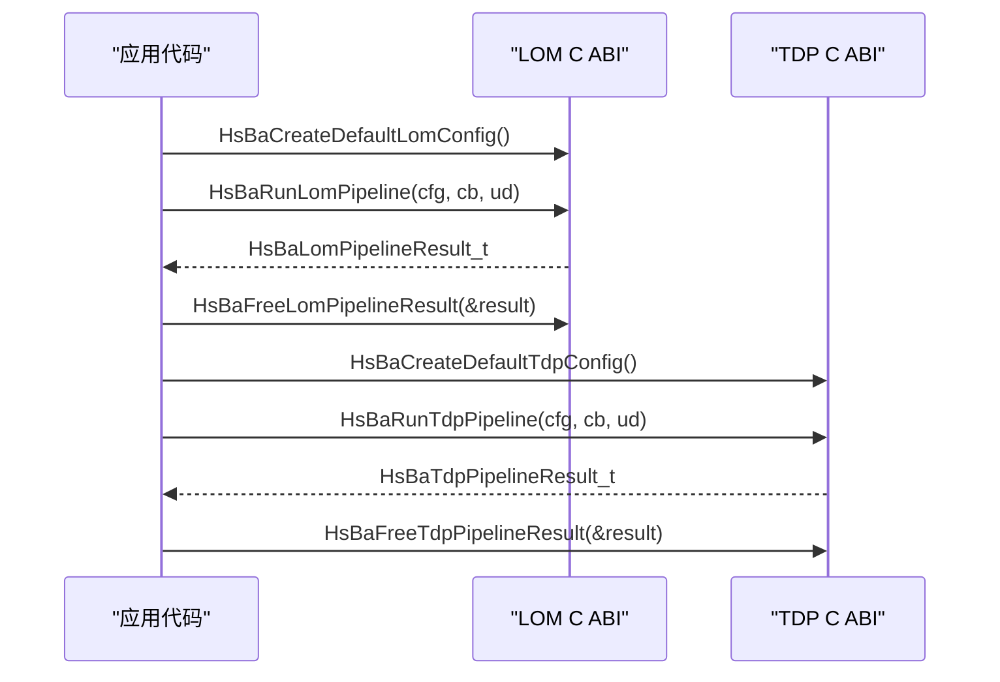

# LOM/TDP 分层制造流水线

<cite>
**本文引用的文件**   
- [lom_pipeline.h](file://DllHsBaSlicer/lom_pipeline.h)
- [lom_pipeline.cpp](file://DllHsBaSlicer/lom_pipeline.cpp)
- [tdp_pipeline.h](file://DllHsBaSlicer/tdp_pipeline.h)
- [tdp_pipeline.cpp](file://DllHsBaSlicer/tdp_pipeline.cpp)
- [pipeline_types.h](file://pipelinetypes/pipeline_types.h)
- [lom_pipeline.proto](file://proto/lom_pipeline.proto)
- [tdp_pipeline.proto](file://proto/tdp_pipeline.proto)
- [samples\LOM\main.cpp](file://samples/LOM/main.cpp)
- [samples\TDP\main.cpp](file://samples/TDP/main.cpp)
</cite>

## 目录
1. [引言](#引言)
2. [项目结构](#项目结构)
3. [核心组件](#核心组件)
4. [架构总览](#架构总览)
5. [详细组件分析](#详细组件分析)
6. [依赖关系分析](#依赖关系分析)
7. [性能与优化](#性能与优化)
8. [故障排除指南](#故障排除指南)
9. [结论](#结论)
10. [附录：API 使用示例与参数设置指南](#附录api-使用示例与参数设置指南)

## 引言
本文件面向 LOM（分层实体制造）与 TDP（热塑性粉末沉积，即粘结剂喷射 3DP）两种分层制造工艺，在 HsBaSlicer 中的实现差异、配置结构与 API 使用进行系统化说明。文档重点包括：
- LOM 与 TDP 的工艺原理与实现差异
- HsBaLomPipelineConfig_t 与 HsBaTdpPipelineConfig_t 字段含义、默认值与用途
- 材料浪费优化、层间粘合强度控制与表面质量提升策略
- 不同材料（纸张、薄膜、热塑性材料）的参数设置建议
- 完整的 C ABI 调用流程与 Lua 导出脚本集成方式

## 项目结构
LOM 与 TDP 流水线由以下关键部分组成：
- C ABI 头文件：定义对外接口与配置结构体
- 流水线实现：预处理、切片、Lua 导出打包
- 类型定义：统一的管道配置与结果结构体
- Proto 定义：跨语言序列化协议
- 示例程序：同步/异步调用与参数定制

**图表来源** 
- [lom_pipeline.h:1-63](file://DllHsBaSlicer/lom_pipeline.h#L1-L63)
- [tdp_pipeline.h:1-63](file://DllHsBaSlicer/tdp_pipeline.h#L1-L63)
- [lom_pipeline.cpp:1-354](file://DllHsBaSlicer/lom_pipeline.cpp#L1-L354)
- [tdp_pipeline.cpp:1-365](file://DllHsBaSlicer/tdp_pipeline.cpp#L1-L365)
- [pipeline_types.h:403-521](file://pipelinetypes/pipeline_types.h#L403-L521)
- [lom_pipeline.proto:1-46](file://proto/lom_pipeline.proto#L1-L46)
- [tdp_pipeline.proto:1-47](file://proto/tdp_pipeline.proto#L1-L47)
- [samples/LOM/main.cpp:1-194](file://samples/LOM/main.cpp#L1-L194)
- [samples/TDP/main.cpp:1-225](file://samples/TDP/main.cpp#L1-L225)

**章节来源**
- [lom_pipeline.h:1-63](file://DllHsBaSlicer/lom_pipeline.h#L1-L63)
- [tdp_pipeline.h:1-63](file://DllHsBaSlicer/tdp_pipeline.h#L1-L63)
- [pipeline_types.h:403-521](file://pipelinetypes/pipeline_types.h#L403-L521)
- [lom_pipeline.proto:1-46](file://proto/lom_pipeline.proto#L1-L46)
- [tdp_pipeline.proto:1-47](file://proto/tdp_pipeline.proto#L1-L47)
- [samples/LOM/main.cpp:1-194](file://samples/LOM/main.cpp#L1-L194)
- [samples/TDP/main.cpp:1-225](file://samples/TDP/main.cpp#L1-L225)

## 核心组件
- LOM 流水线：按“片材厚度”切片，输出每层轮廓，并通过 Lua 导出脚本生成 zip 包与数据库注册信息；支持切割模式（轮廓/半色调）、封边、激光功率与速度、压合温度/压力/时间等参数。
- TDP 流水线：按“层厚”切片，输出每层轮廓，并通过 Lua 导出脚本生成粘结剂喷射路径与固化参数；支持喷头数量、墨滴间距、粘结剂饱和度、固化时间、床温、全彩/单通道/烧结辅助模式，以及螺旋连续路径模式。

关键类型与默认值（节选）：
- LOM 配置结构体包含模型名/路径、层厚、首层层高、切割速度/偏移/功率、压合温度/压力/时间、封边开关、切割模式、Lua 导出脚本与函数、输出路径。
- TDP 配置结构体包含模型名/路径、层厚、首层层高、喷头数、墨滴间距、粘结剂饱和度、固化时间、床温、粘结剂模式、Lua 导出脚本与函数、输出路径、螺旋模式。

**章节来源**
- [pipeline_types.h:403-521](file://pipelinetypes/pipeline_types.h#L403-L521)
- [pipeline_types.h:874-921](file://pipelinetypes/pipeline_types.h#L874-L921)

## 架构总览
LOM 与 TDP 流水线共享统一的处理阶段：
1. 预处理：加载模型并获取包围盒/体积信息
2. 切片：构建拓扑后并行计算各层轮廓与 Z 高度
3. 导出：将轮廓与工艺参数序列化为 JSON，通过 Lua 导出脚本写入 zip 包（可选数据库注册）

**图表来源**
- [lom_pipeline.cpp:193-305](file://DllHsBaSlicer/lom_pipeline.cpp#L193-L305)
- [tdp_pipeline.cpp:203-316](file://DllHsBaSlicer/tdp_pipeline.cpp#L203-L316)

**章节来源**
- [lom_pipeline.cpp:193-305](file://DllHsBaSlicer/lom_pipeline.cpp#L193-L305)
- [tdp_pipeline.cpp:203-316](file://DllHsBaSlicer/tdp_pipeline.cpp#L203-L316)

## 详细组件分析

### LOM 流水线组件
- C ABI 接口：提供创建默认配置、同步运行、异步运行与释放结果的函数。
- 内部实现：
  - 构建 InternalLomConfig，映射 C 配置到内部结构
  - 计算层数与 Z 高度
  - 并行切片，收集每层轮廓
  - 构建 LOM 工艺 JSON（含 slice/cut/bond 段）
  - 通过 SlsPackage + SaveSlsPackageLua 导出 zip 包
- 错误处理：捕获 RuntimeError，封装为错误消息；缺失 Lua 导出脚本时直接报错。

**图表来源**
- [lom_pipeline.cpp:96-153](file://DllHsBaSlicer/lom_pipeline.cpp#L96-L153)
- [lom_pipeline.cpp:193-305](file://DllHsBaSlicer/lom_pipeline.cpp#L193-L305)

**章节来源**
- [lom_pipeline.h:17-56](file://DllHsBaSlicer/lom_pipeline.h#L17-L56)
- [lom_pipeline.cpp:30-58](file://DllHsBaSlicer/lom_pipeline.cpp#L30-L58)
- [lom_pipeline.cpp:96-153](file://DllHsBaSlicer/lom_pipeline.cpp#L96-L153)
- [lom_pipeline.cpp:193-305](file://DllHsBaSlicer/lom_pipeline.cpp#L193-L305)
- [lom_pipeline.cpp:313-354](file://DllHsBaSlicer/lom_pipeline.cpp#L313-L354)

### TDP 流水线组件
- C ABI 接口：提供创建默认配置、同步运行、异步运行与释放结果的函数。
- 内部实现：
  - 构建 InternalTdpConfig，映射 C 配置到内部结构
  - 计算层数与 Z 高度
  - 并行切片，收集每层轮廓
  - 构建 TDP 工艺 JSON（含 slice/binder/bed_temperature/spiral_mode）
  - 通过 SlsPackage + SaveSlsPackageLua 导出 zip 包，支持螺旋模式
- 错误处理：捕获 RuntimeError，封装为错误消息；缺失 Lua 导出脚本时直接报错。

**图表来源**
- [tdp_pipeline.cpp:95-164](file://DllHsBaSlicer/tdp_pipeline.cpp#L95-L164)
- [tdp_pipeline.cpp:203-316](file://DllHsBaSlicer/tdp_pipeline.cpp#L203-L316)

**章节来源**
- [tdp_pipeline.h:17-56](file://DllHsBaSlicer/tdp_pipeline.h#L17-L56)
- [tdp_pipeline.cpp:30-57](file://DllHsBaSlicer/tdp_pipeline.cpp#L30-L57)
- [tdp_pipeline.cpp:95-164](file://DllHsBaSlicer/tdp_pipeline.cpp#L95-L164)
- [tdp_pipeline.cpp:203-316](file://DllHsBaSlicer/tdp_pipeline.cpp#L203-L316)
- [tdp_pipeline.cpp:324-365](file://DllHsBaSlicer/tdp_pipeline.cpp#L324-L365)

### 概念性概览
LOM 与 TDP 的核心差异在于材料与成型机制：
- LOM：以片材为单位，逐层切割轮廓并进行压合；适合纸张、薄膜等材料，强调切割精度与压合强度。
- TDP：以粉床为基础，逐层喷射粘结剂；适合金属/陶瓷粉末或热塑性材料，强调粘结剂分布与固化效果。

[此图为概念示意，不直接映射具体源码文件]

## 依赖关系分析
- LOM/TDP 实现依赖：
  - LibHsBaSlicer 的模型预处理与切片模块
  - Lua 导出系统（SlsPackage + SaveSlsPackageLua）
  - 协程与并行工具（ParallelForLayers）
- 类型与协议：
  - pipeline_types.h 定义 C ABI 结构体与枚举
  - proto 文件用于跨语言序列化（LOM/TDP 配置与结果）

**图表来源**
- [lom_pipeline.cpp:17-23](file://DllHsBaSlicer/lom_pipeline.cpp#L17-L23)
- [tdp_pipeline.cpp:17-23](file://DllHsBaSlicer/tdp_pipeline.cpp#L17-L23)
- [pipeline_types.h:403-521](file://pipelinetypes/pipeline_types.h#L403-L521)
- [lom_pipeline.proto:1-46](file://proto/lom_pipeline.proto#L1-L46)
- [tdp_pipeline.proto:1-47](file://proto/tdp_pipeline.proto#L1-L47)

**章节来源**
- [lom_pipeline.cpp:17-23](file://DllHsBaSlicer/lom_pipeline.cpp#L17-L23)
- [tdp_pipeline.cpp:17-23](file://DllHsBaSlicer/tdp_pipeline.cpp#L17-L23)
- [pipeline_types.h:403-521](file://pipelinetypes/pipeline_types.h#L403-L521)
- [lom_pipeline.proto:1-46](file://proto/lom_pipeline.proto#L1-L46)
- [tdp_pipeline.proto:1-47](file://proto/tdp_pipeline.proto#L1-L47)

## 性能与优化
- 并行切片：LOM/TDP 均使用 ParallelForLayers 对独立层进行并行切片，减少整体切片时间。
- 拓扑复用：BuildSliceTopology 仅构建一次，供所有层读取，避免重复计算。
- 内存管理：OwnedCString 封装 C 字符串分配与释放，确保 C ABI 边界安全。
- 进度回调：分阶段报告进度，便于上层 UI 或日志系统更新。

优化建议：
- 合理设置层厚与首层层高，平衡打印时间与表面质量
- 调整切割/粘结剂参数以减少材料浪费与提高层间结合强度
- 使用螺旋模式（TDP）减少路径切换，提升外壁连续性

**章节来源**
- [lom_pipeline.cpp:235-250](file://DllHsBaSlicer/lom_pipeline.cpp#L235-L250)
- [tdp_pipeline.cpp:245-260](file://DllHsBaSlicer/tdp_pipeline.cpp#L245-L260)
- [lom_pipeline.cpp:60-94](file://DllHsBaSlicer/lom_pipeline.cpp#L60-L94)
- [tdp_pipeline.cpp:59-93](file://DllHsBaSlicer/tdp_pipeline.cpp#L59-L93)

## 故障排除指南
常见问题与处理：
- 模型加载失败：检查 model_path 是否正确，确保模型文件存在且格式受支持
- 层数为零或负数：检查 layer_height 与 first_layer_height 是否合理，模型高度是否为正
- Lua 导出失败：确认 export_lua_script 与 export_lua_func 正确，脚本可执行且无运行时错误
- 输出路径为空：若未指定 output_path，系统将自动生成默认文件名

调试建议：
- 启用进度回调，观察各阶段耗时与状态
- 检查生成的 config_json，确认参数传递正确
- 查看 error_message，定位具体错误原因

**章节来源**
- [lom_pipeline.cpp:200-225](file://DllHsBaSlicer/lom_pipeline.cpp#L200-L225)
- [tdp_pipeline.cpp:210-235](file://DllHsBaSlicer/tdp_pipeline.cpp#L210-L235)
- [lom_pipeline.cpp:256-291](file://DllHsBaSlicer/lom_pipeline.cpp#L256-L291)
- [tdp_pipeline.cpp:266-302](file://DllHsBaSlicer/tdp_pipeline.cpp#L266-L302)

## 结论
LOM 与 TDP 流水线在 HsBaSlicer 中采用统一的架构设计，通过 C ABI 暴露稳定接口，内部实现模块化、并行化，并通过 Lua 导出脚本实现灵活的输出定制。理解配置结构体与工艺参数的作用，有助于针对不同材料与设备优化打印质量与效率。

## 附录：API 使用示例与参数设置指南

### C ABI 调用流程
- 创建默认配置：HsBaCreateDefaultLomConfig / HsBaCreateDefaultTdpConfig
- 同步运行：HsBaRunLomPipeline / HsBaRunTdpPipeline
- 异步运行：HsBaRunLomPipelineAsync / HsBaRunTdpPipelineAsync
- 释放结果：HsBaFreeLomPipelineResult / HsBaFreeTdpPipelineResult

**图表来源**
- [samples/LOM/main.cpp:55-82](file://samples/LOM/main.cpp#L55-L82)
- [samples/TDP/main.cpp:55-82](file://samples/TDP/main.cpp#L55-L82)
- [lom_pipeline.h:21-56](file://DllHsBaSlicer/lom_pipeline.h#L21-L56)
- [tdp_pipeline.h:21-56](file://DllHsBaSlicer/tdp_pipeline.h#L21-L56)

**章节来源**
- [samples/LOM/main.cpp:55-82](file://samples/LOM/main.cpp#L55-L82)
- [samples/TDP/main.cpp:55-82](file://samples/TDP/main.cpp#L55-L82)
- [lom_pipeline.h:21-56](file://DllHsBaSlicer/lom_pipeline.h#L21-L56)
- [tdp_pipeline.h:21-56](file://DllHsBaSlicer/tdp_pipeline.h#L21-L56)

### 配置结构体字段说明

#### LOM 配置结构体（HsBaLomPipelineConfig_t）
- 模型配置：model_name, model_path
- 切片配置：layer_height, first_layer_height
- 切割参数：cut_speed, cut_margin, cut_power, seal_contour, cut_mode
- 压合参数：bond_temperature, bond_pressure, bond_time
- 导出配置：export_lua_script, export_lua_func
- 输出配置：output_path

默认值参考：
- layer_height: 0.2 mm
- first_layer_height: 0.2 mm
- cut_speed: 300.0 mm/s
- cut_margin: 0.5 mm
- cut_power: 0.8
- bond_temperature: 150.0 °C
- bond_pressure: 1.0 MPa
- bond_time: 5.0 s
- seal_contour: 1
- cut_mode: HSBA_LOM_CUT_CONTOUR

**章节来源**
- [pipeline_types.h:419-436](file://pipelinetypes/pipeline_types.h#L419-L436)
- [pipeline_types.h:874-897](file://pipelinetypes/pipeline_types.h#L874-L897)

#### TDP 配置结构体（HsBaTdpPipelineConfig_t）
- 模型配置：model_name, model_path
- 切片配置：layer_height, first_layer_height
- 粘结剂参数：head_count, drop_spacing, binder_saturation, ink_curing_time, bed_temperature, binder_mode
- 导出配置：export_lua_script, export_lua_func
- 输出配置：output_path
- 螺旋模式：spiral_mode

默认值参考：
- layer_height: 0.1 mm
- first_layer_height: 0.12 mm
- head_count: 128
- drop_spacing: 0.05 mm
- binder_saturation: 0.6
- ink_curing_time: 1.0 s
- bed_temperature: 40.0 °C
- binder_mode: HSBA_TDP_SINGLE
- spiral_mode: 0

**章节来源**
- [pipeline_types.h:480-496](file://pipelinetypes/pipeline_types.h#L480-L496)
- [pipeline_types.h:903-921](file://pipelinetypes/pipeline_types.h#L903-L921)

### 材料参数设置指南
- 纸张（LOM）：
  - 切割速度：200-300 mm/s
  - 切割偏移：0.5-1.0 mm
  - 切割功率：0.7-0.9
  - 压合温度：140-160 °C
  - 压合压力：1.0-2.0 MPa
  - 压合时间：4-6 s
- 薄膜（LOM）：
  - 切割速度：150-250 mm/s
  - 切割偏移：0.3-0.8 mm
  - 切割功率：0.6-0.8
  - 压合温度：120-150 °C
  - 压合压力：0.8-1.5 MPa
  - 压合时间：3-5 s
- 热塑性材料（TDP）：
  - 层厚：0.08-0.12 mm
  - 喷头数：128-256
  - 墨滴间距：0.04-0.06 mm
  - 粘结剂饱和度：0.6-0.8
  - 固化时间：1.0-2.0 s
  - 床温：40-60 °C
  - 模式：HSBA_TDP_SINGLE 或 HSBA_TDP_FULL_COLOR

注意：以上参数为经验范围，需根据实际设备与材料特性进行调整。

**章节来源**
- [samples/LOM/main.cpp:87-130](file://samples/LOM/main.cpp#L87-L130)
- [samples/TDP/main.cpp:87-125](file://samples/TDP/main.cpp#L87-L125)

### 实际应用案例
- LOM 基础用例：最小配置运行，输出 zip 包
- LOM 自定义参数：调整切割与压合参数，优化材料利用率与层间强度
- TDP 基础用例：最小配置运行，输出粘结剂喷射路径
- TDP 自定义参数：调整粘结剂参数与床温，提升表面质量
- TDP 螺旋模式：生成连续上升的外壁路径，减少路径切换

**章节来源**
- [samples/LOM/main.cpp:55-130](file://samples/LOM/main.cpp#L55-L130)
- [samples/TDP/main.cpp:55-125](file://samples/TDP/main.cpp#L55-L125)
- [samples/TDP/main.cpp:175-205](file://samples/TDP/main.cpp#L175-L205)