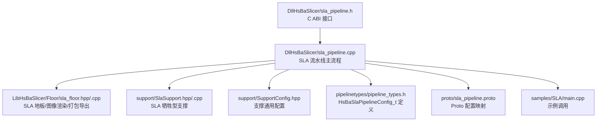
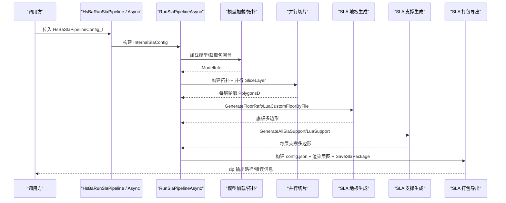
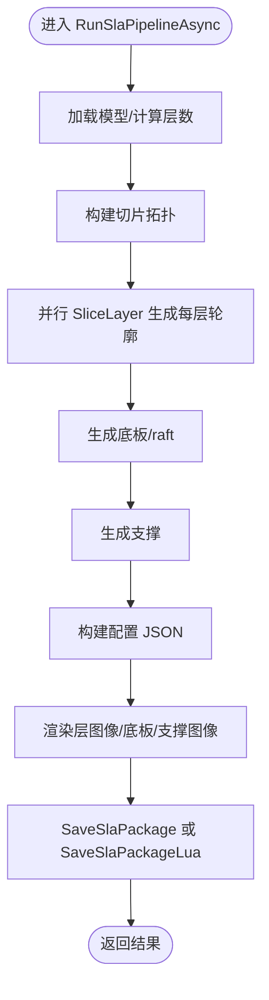
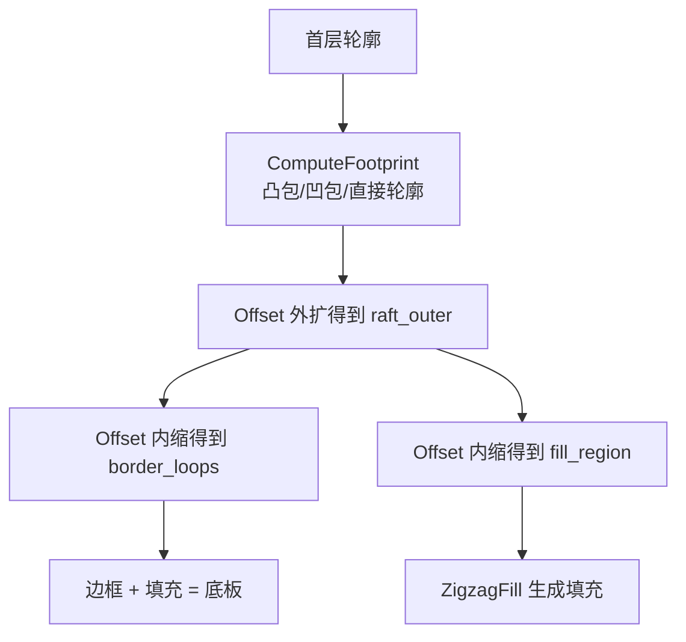
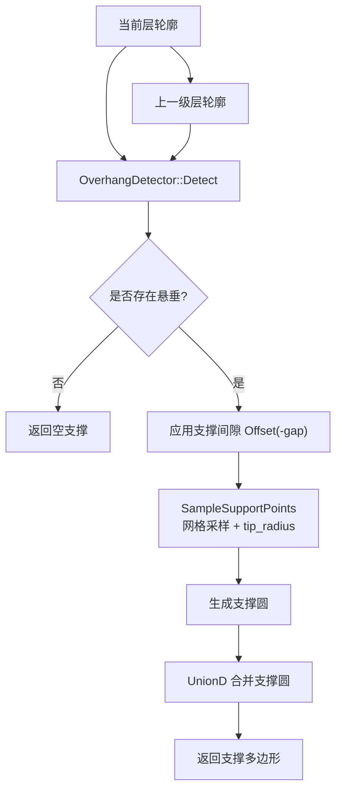
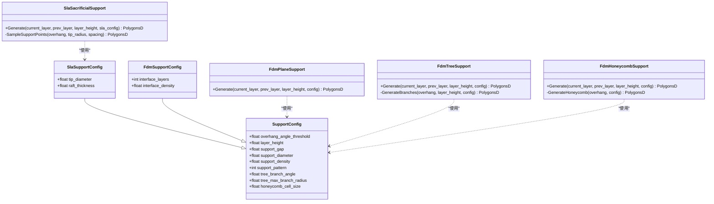
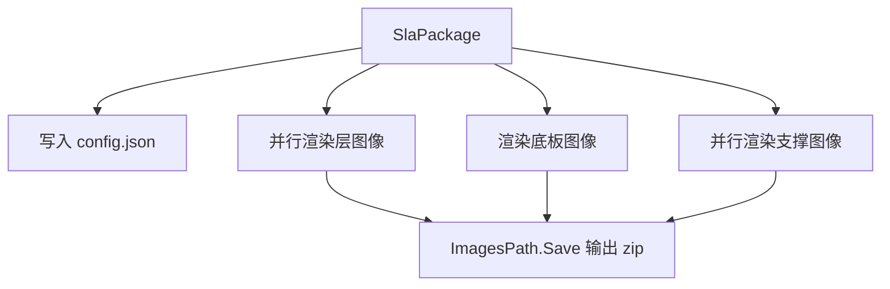
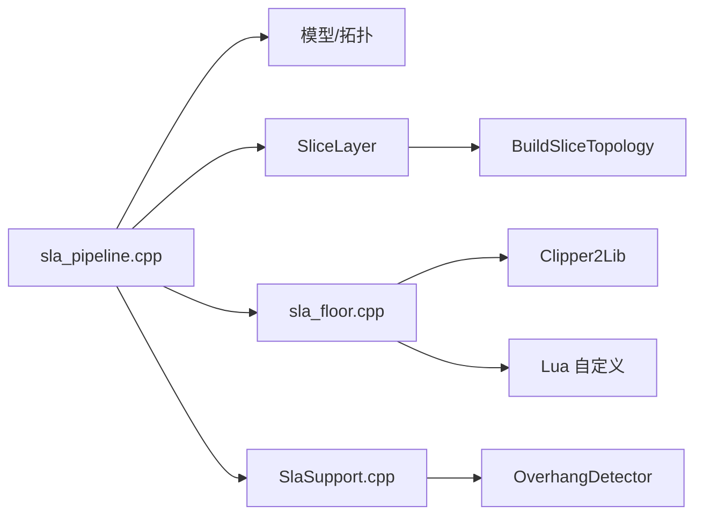
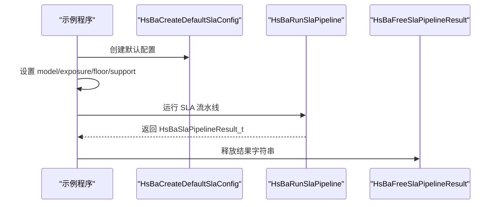

# SLA 立体光刻流水线

<cite>
**本文引用的文件**   
- [sla_pipeline.h](file://DllHsBaSlicer/sla_pipeline.h)
- [sla_pipeline.cpp](file://DllHsBaSlicer/sla_pipeline.cpp)
- [pipeline_types.h](file://pipelinetypes/pipeline_types.h)
- [sla_pipeline.proto](file://proto/sla_pipeline.proto)
- [sla_floor.hpp](file://LibHsBaSlicer/Floor/sla_floor.hpp)
- [sla_floor.cpp](file://LibHsBaSlicer/Floor/sla_floor.cpp)
- [SlaSupport.hpp](file://support/SlaSupport.hpp)
- [SlaSupport.cpp](file://support/SlaSupport.cpp)
- [SupportConfig.hpp](file://support/SupportConfig.hpp)
- [FdmSupport.hpp](file://support/FdmSupport.hpp)
- [FdmSupport.cpp](file://support/FdmSupport.cpp)
- [main.cpp](file://samples/SLA/main.cpp)
</cite>

## 目录
1. [引言](#引言)
2. [项目结构](#项目结构)
3. [核心组件](#核心组件)
4. [架构总览](#架构总览)
5. [详细组件分析](#详细组件分析)
6. [依赖关系分析](#依赖关系分析)
7. [性能与并行化](#性能与并行化)
8. [SLA 参数调优指南](#sla-参数调优指南)
9. [API 使用示例](#api-使用示例)
10. [故障排除](#故障排除)
11. [结论](#结论)

## 引言
本文件面向需要深入理解并调优 HsBaSlicer 中 SLA（立体光刻）切片流水线的工程师和技术文档读者。文档围绕以下目标展开：
- 解释 SLA 流水线的特殊处理流程，包括树脂材料相关的曝光参数、抬升回抽参数、底层层策略、支撑结构与底板生成。
- 完整说明 `HsBaSlaPipelineConfig_t` 配置结构体及其默认值，涵盖层高、首层层高、底层曝光时间、普通层曝光时间、抬升距离、抬升速度、回抽速度、底板偏移、边框宽度、填充间距、填充角度、边框圈数、凸包选项、支撑开关、悬垂角度、支撑间隙、支撑直径、支撑密度、支撑图案、Lua 扩展脚本、输出路径、图像格式与尺寸等。
- 对比 SLA 与 FDM 在支撑生成和层间粘合处理上的算法差异。
- 提供 SLA 专用参数调优建议、最佳实践、API 调用方式以及性能优化方向。

## 项目结构
SLA 流水线由 C ABI 入口、C++ 内部实现、SLA 地板/打包导出、SLA 支撑生成、通用支撑配置、FDM 支撑参考实现、类型定义与 Proto 定义、示例程序共同组成。

**图示来源**
- [sla_pipeline.h:17-56](file://DllHsBaSlicer/sla_pipeline.h#L17-L56)
- [sla_pipeline.cpp:298-483](file://DllHsBaSlicer/sla_pipeline.cpp#L298-L483)
- [sla_floor.hpp:21-195](file://LibHsBaSlicer/Floor/sla_floor.hpp#L21-L195)
- [SlaSupport.hpp:13-42](file://support/SlaSupport.hpp#L13-L42)
- [SupportConfig.hpp:14-43](file://support/SupportConfig.hpp#L14-L43)
- [pipeline_types.h:165-218](file://pipelinetypes/pipeline_types.h#L165-L218)
- [sla_pipeline.proto:18-58](file://proto/sla_pipeline.proto#L18-L58)
- [main.cpp:89-118](file://samples/SLA/main.cpp#L89-L118)

**章节来源**
- [sla_pipeline.h:17-56](file://DllHsBaSlicer/sla_pipeline.h#L17-L56)
- [sla_pipeline.cpp:298-483](file://DllHsBaSlicer/sla_pipeline.cpp#L298-L483)
- [pipeline_types.h:165-218](file://pipelinetypes/pipeline_types.h#L165-L218)

## 核心组件
SLA 流水线核心由以下部分组成：
- C ABI 接口：提供创建默认配置、同步运行、异步运行、释放结果的能力。
- 流水线主流程：加载模型、计算层数、构建拓扑、并行切片、生成底板、生成支撑、构建配置 JSON、渲染层图像、打包导出。
- SLA 地板系统：计算接触面、外扩边界、内缩填充区域、生成边框与填充，支持 Lua 自定义。
- SLA 支撑系统：基于悬垂检测生成牺牲型支撑点，合并为圆形支撑截面。
- 类型定义与 Proto：统一暴露 C 兼容配置结构体及跨语言消息定义。
- 示例程序：演示如何设置 SLA 参数并调用流水线。

**章节来源**
- [sla_pipeline.h:17-56](file://DllHsBaSlicer/sla_pipeline.h#L17-L56)
- [sla_pipeline.cpp:298-483](file://DllHsBaSlicer/sla_pipeline.cpp#L298-L483)
- [sla_floor.hpp:21-195](file://LibHsBaSlicer/Floor/sla_floor.hpp#L21-L195)
- [SlaSupport.hpp:13-42](file://support/SlaSupport.hpp#L13-L42)
- [pipeline_types.h:165-218](file://pipelinetypes/pipeline_types.h#L165-L218)
- [sla_pipeline.proto:18-58](file://proto/sla_pipeline.proto#L18-L58)
- [main.cpp:89-118](file://samples/SLA/main.cpp#L89-L118)

## 架构总览
SLA 流水线采用“预处理 → 切片 → 底板 → 支撑 → 导出”的阶段性流程，并通过协程与线程池实现并行化。

**图示来源**
- [sla_pipeline.cpp:298-483](file://DllHsBaSlicer/sla_pipeline.cpp#L298-L483)
- [sla_floor.cpp:469-600](file://LibHsBaSlicer/Floor/sla_floor.cpp#L469-L600)
- [SlaSupport.cpp:81-133](file://support/SlaSupport.cpp#L81-L133)

## 详细组件分析

### SLA 流水线主流程
SLA 主流程负责将用户配置转换为内部配置，执行各阶段处理，并将结果封装为 C ABI 可返回的结构体。关键步骤包括：
- 加载模型并计算总层数。
- 构建切片拓扑后对每层进行并行切片。
- 根据首层轮廓生成底板。
- 根据悬垂检测结果生成支撑。
- 构建配置 JSON，渲染层图像，打包为 zip。

**图示来源**
- [sla_pipeline.cpp:298-483](file://DllHsBaSlicer/sla_pipeline.cpp#L298-L483)

**章节来源**
- [sla_pipeline.cpp:298-483](file://DllHsBaSlicer/sla_pipeline.cpp#L298-L483)

### SLA 配置结构体 `HsBaSlaPipelineConfig_t`
该结构体是 SLA 流水线的核心输入，包含模型、切片、曝光、抬升、底板、支撑、Lua 扩展、输出与图像等字段。其默认值由 `HsBaSlaConfigDefault` 初始化。

| 分类 | 字段 | 默认值 | 含义 |
|---|---|---:|---|
| 模型 | `model_name` | NULL | 模型名称 |
| 模型 | `model_path` | NULL | 模型文件路径 |
| 切片 | `layer_height` | 0.05 mm | 常规层高 |
| 切片 | `first_layer_height` | 0.1 mm | 首层层高 |
| 曝光 | `bottom_exposure_time` | 60.0 s | 底层曝光时间 |
| 曝光 | `normal_exposure_time` | 2.5 s | 普通层曝光时间 |
| 抬升 | `bottom_lift_distance` | 5.0 mm | 底层抬升距离 |
| 抬升 | `lift_distance` | 3.0 mm | 普通层抬升距离 |
| 抬升 | `lift_speed` | 60.0 mm/s | 抬升速度 |
| 抬升 | `retract_speed` | 150.0 mm/s | 回抽速度 |
| 底板 | `floor_raft_offset` | 2.0 mm | 底板外扩偏移 |
| 底板 | `floor_border_width` | 1.0 mm | 底板边框宽度 |
| 底板 | `floor_fill_spacing` | 0.5 mm | 底板填充间距 |
| 底板 | `floor_fill_angle` | 0.0° | 底板填充角度 |
| 底板 | `floor_border_count` | 2 | 底板边框圈数 |
| 底板 | `floor_use_convex_hull` | 0 | 是否使用凸包 |
| 支撑 | `enable_support` | 1 | 是否启用支撑 |
| 支撑 | `overhang_angle` | 45.0° | 悬垂角度阈值 |
| 支撑 | `support_gap` | 0.5 mm | 支撑与模型间隙 |
| 支撑 | `support_diameter` | 2.0 mm | 支撑柱直径 |
| 支撑 | `support_density` | 0.3 | 支撑填充密度 |
| 支撑 | `support_pattern` | HSBA_SLA_SUPPORT_SACRIFICIAL | 支撑图案 |
| Lua | `support_lua_script` | NULL | 支撑 Lua 脚本路径 |
| Lua | `support_lua_func` | NULL | 支撑 Lua 函数名 |
| Lua | `floor_lua_script` | NULL | 底板 Lua 脚本路径 |
| Lua | `floor_lua_func` | NULL | 底板 Lua 函数名 |
| Lua | `export_lua_script` | NULL | 导出 Lua 脚本路径 |
| Lua | `export_lua_func` | NULL | 导出 Lua 函数名 |
| 输出 | `output_path` | NULL | 输出 zip 路径 |
| 图像 | `image_type` | HSBA_SLA_IMAGE_PNG | 层图像格式 |
| 图像 | `image_width` | 0 | 图像宽度（自动） |
| 图像 | `image_height` | 0 | 图像高度（自动） |

**章节来源**
- [pipeline_types.h:165-218](file://pipelinetypes/pipeline_types.h#L165-L218)
- [pipeline_types.h:789-825](file://pipelinetypes/pipeline_types.h#L789-L825)
- [sla_pipeline.proto:18-58](file://proto/sla_pipeline.proto#L18-L58)

### SLA 底板与 Raft 生成
SLA 底板用于增强模型与构建板的附着力。实现包括：
- 计算接触面：可选凸包或凹包简化。
- 外扩形成 raft 边界。
- 内缩生成边框环。
- 填充内部区域（Zigzag）。
- 支持 Lua 自定义底板生成。

**图示来源**
- [sla_floor.cpp:34-118](file://LibHsBaSlicer/Floor/sla_floor.cpp#L34-L118)

**章节来源**
- [sla_floor.hpp:21-116](file://LibHsBaSlicer/Floor/sla_floor.hpp#L21-L116)
- [sla_floor.cpp:34-118](file://LibHsBaSlicer/Floor/sla_floor.cpp#L34-L118)

### SLA 支撑生成
SLA 牺牲型支撑通过悬垂检测生成支撑点，并以小直径圆表示支撑截面，最终合并为支撑多边形。

**图示来源**
- [SlaSupport.cpp:38-123](file://support/SlaSupport.cpp#L38-L123)

**章节来源**
- [SlaSupport.hpp:13-42](file://support/SlaSupport.hpp#L13-L42)
- [SlaSupport.cpp:38-133](file://support/SlaSupport.cpp#L38-L133)
- [SupportConfig.hpp:36-43](file://support/SupportConfig.hpp#L36-L43)

### SLA 与 FDM 支撑算法差异
SLA 与 FDM 在支撑生成上存在显著差异：
- SLA 牺牲型支撑：以小直径 tip 和较大 base 为目标，逐层生成圆形支撑点并合并；强调易去除性与底部粘附。
- FDM 平面支撑：对悬垂区域膨胀 support_diameter/2 形成柱状支撑截面。
- FDM 树支撑：从构建板向上生长分支，层间半径递增，二维截面表现为分支尖端圆。
- FDM 蜂窝支撑：在悬垂区域内生成六边形蜂窝单元，提供轻量但刚性的支撑。

**图示来源**
- [SupportConfig.hpp:14-43](file://support/SupportConfig.hpp#L14-L43)
- [SlaSupport.hpp:20-42](file://support/SlaSupport.hpp#L20-L42)
- [FdmSupport.hpp:19-63](file://support/FdmSupport.hpp#L19-L63)

**章节来源**
- [SupportConfig.hpp:14-43](file://support/SupportConfig.hpp#L14-L43)
- [SlaSupport.cpp:81-133](file://support/SlaSupport.cpp#L81-L133)
- [FdmSupport.cpp:48-76](file://support/FdmSupport.cpp#L48-L76)
- [FdmSupport.cpp:145-168](file://support/FdmSupport.cpp#L145-L168)
- [FdmSupport.cpp:173-242](file://support/FdmSupport.cpp#L173-L242)

### SLA 图像渲染与打包导出
SLA 导出将每层轮廓、底板、支撑渲染为图像，并打包为 zip，同时写入配置 JSON。支持 Lua 自定义导出逻辑。

**图示来源**
- [sla_floor.cpp:469-600](file://LibHsBaSlicer/Floor/sla_floor.cpp#L469-L600)

**章节来源**
- [sla_floor.hpp:157-195](file://LibHsBaSlicer/Floor/sla_floor.hpp#L157-L195)
- [sla_floor.cpp:469-600](file://LibHsBaSlicer/Floor/sla_floor.cpp#L469-L600)

## 依赖关系分析
SLA 流水线依赖多个模块：
- 模型与拓扑：通过 LibHsBaSlicer 的模型管理与切片拓扑构建。
- 2D 几何：Clipper2Lib 用于多边形偏移、并集、交集等操作。
- 填充算法：ZigzagFill 用于底板填充。
- Lua 扩展：支持自定义底板、支撑与导出逻辑。
- 并行化：协程与线程池用于并行切片与图像渲染。

**图示来源**
- [sla_pipeline.cpp:298-483](file://DllHsBaSlicer/sla_pipeline.cpp#L298-L483)
- [sla_floor.cpp:469-600](file://LibHsBaSlicer/Floor/sla_floor.cpp#L469-L600)
- [SlaSupport.cpp:81-133](file://support/SlaSupport.cpp#L81-L133)

**章节来源**
- [sla_pipeline.cpp:298-483](file://DllHsBaSlicer/sla_pipeline.cpp#L298-L483)
- [sla_floor.cpp:469-600](file://LibHsBaSlicer/Floor/sla_floor.cpp#L469-L600)
- [SlaSupport.cpp:81-133](file://support/SlaSupport.cpp#L81-L133)

## 性能与并行化
SLA 流水线在两个关键路径上使用并行化：
- 切片阶段：构建共享拓扑后，对每层调用 `SliceLayer`，使用 `ParallelForLayers` 并行执行。
- 导出阶段：渲染层图像与支撑图像时，使用 `ForLayersParallel` 基于线程池动态调度，避免固定屏障导致的负载不均。

性能优化建议：
- 合理设置 `HSBA_PIPELINE_THREADS` 环境变量控制导出阶段的线程数。
- 对于超大模型，优先调整层高与图像分辨率以平衡精度与渲染开销。
- 使用 PNG 无损格式保证质量，JPG 减小体积，SVG 矢量缩放但可能增加解析成本。

**章节来源**
- [sla_pipeline.cpp:343-357](file://DllHsBaSlicer/sla_pipeline.cpp#L343-L357)
- [sla_floor.cpp:401-466](file://LibHsBaSlicer/Floor/sla_floor.cpp#L401-L466)

## SLA 参数调优指南
以下为 SLA 专用参数的调优建议，结合代码默认值与实际实现：

- 层高与首层层高
  - 默认层高 0.05 mm，首层 0.1 mm。
  - 更薄层高提升表面质量但增加层数与打印时间。
  - 首层层高影响底层附着力，需与底层曝光时间配合。

- 曝光时间
  - 底层曝光时间默认 60.0 s，普通层 2.5 s。
  - 底层曝光不足会导致底板脱落，过度则导致底板过厚与细节损失。
  - 普通层曝光影响层间粘合与细节锐度。

- 抬升与回抽
  - 底层抬升距离 5.0 mm，普通层 3.0 mm。
  - 抬升速度 60.0 mm/s，回抽速度 150.0 mm/s。
  - 过高抬升速度可能导致树脂撕裂，过低则降低效率。

- 底板参数
  - 底板偏移 2.0 mm，边框宽度 1.0 mm，填充间距 0.5 mm，边框圈数 2。
  - 增大偏移与边框宽度提升附着力，但增加材料消耗。
  - 填充间距越小，底板越密实，但渲染与导出时间增加。

- 支撑参数
  - 悬垂角度阈值 45.0°，支撑间隙 0.5 mm，支撑直径 2.0 mm，密度 0.3。
  - 支撑直径过小易断裂，过大则移除困难。
  - 间隙过小可能导致支撑粘连模型，过大则支撑强度不足。

- 图像格式与尺寸
  - PNG 无损，JPG 体积小，SVG 矢量。
  - 图像宽高为 0 时自动适配模型包围盒。
  - 高分辨率图像提升细节但增加导出时间与存储。

**章节来源**
- [pipeline_types.h:789-825](file://pipelinetypes/pipeline_types.h#L789-L825)
- [sla_pipeline.cpp:181-242](file://DllHsBaSlicer/sla_pipeline.cpp#L181-L242)
- [sla_floor.cpp:34-118](file://LibHsBaSlicer/Floor/sla_floor.cpp#L34-L118)
- [SlaSupport.cpp:81-133](file://support/SlaSupport.cpp#L81-L133)

## API 使用示例
SLA 流水线提供 C ABI 接口，便于跨语言集成。主要接口如下：
- `HsBaCreateDefaultSlaConfig`：创建默认配置。
- `HsBaRunSlaPipeline`：同步运行流水线。
- `HsBaRunSlaPipelineAsync`：异步运行流水线。
- `HsBaFreeSlaPipelineResult`：释放结果内存。

示例程序展示了如何设置模型、切片、曝光、抬升、底板与支撑参数，并调用流水线。

**图示来源**
- [sla_pipeline.h:17-56](file://DllHsBaSlicer/sla_pipeline.h#L17-L56)
- [main.cpp:89-118](file://samples/SLA/main.cpp#L89-L118)

**章节来源**
- [sla_pipeline.h:17-56](file://DllHsBaSlicer/sla_pipeline.h#L17-L56)
- [main.cpp:89-118](file://samples/SLA/main.cpp#L89-L118)

## 故障排除
常见问题与排查方向：
- 模型加载失败：检查 `model_name` 与 `model_path` 是否正确，确保模型文件存在且可读。
- 层数为零：模型高度无效或层高设置异常，需检查 `layer_height` 与 `first_layer_height`。
- 支撑为空：悬垂角度阈值过高或支撑间隙过大，导致无悬垂区域或悬垂被完全收缩。
- 底板为空：底板偏移或边框宽度设置不当，导致外扩或内缩结果为空。
- 导出失败：图像渲染失败或 zip 写入权限问题，检查图像尺寸与输出路径。

错误处理机制：
- 流水线捕获 `RuntimeError` 并返回错误消息。
- 导出阶段捕获异常并返回 false，调用方可检查 `error_message`。

**章节来源**
- [sla_pipeline.cpp:473-483](file://DllHsBaSlicer/sla_pipeline.cpp#L473-L483)
- [sla_floor.cpp:526-530](file://LibHsBaSlicer/Floor/sla_floor.cpp#L526-L530)

## 结论
HsBaSlicer 的 SLA 流水线提供了完整的树脂打印切片能力，涵盖模型加载、并行切片、底板生成、支撑生成与图像打包导出。通过 `HsBaSlaPipelineConfig_t` 可精细控制层高、曝光、抬升、底板与支撑参数，并支持 Lua 扩展以实现定制化流程。与 FDM 相比，SLA 支撑更强调牺牲型小直径支撑与易去除性，而 FDM 支撑则更注重柱状、树状与蜂窝结构的机械强度。在实际应用中，应根据树脂特性、模型几何与设备能力调优参数，并结合并行化与环境变量优化性能。