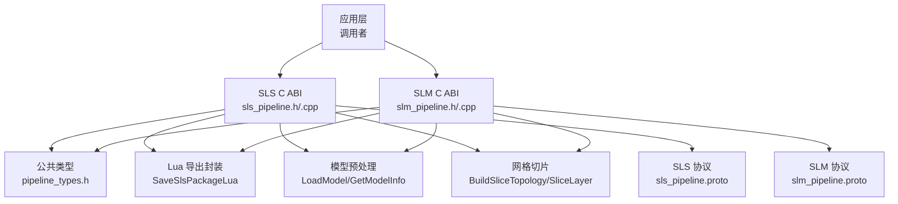
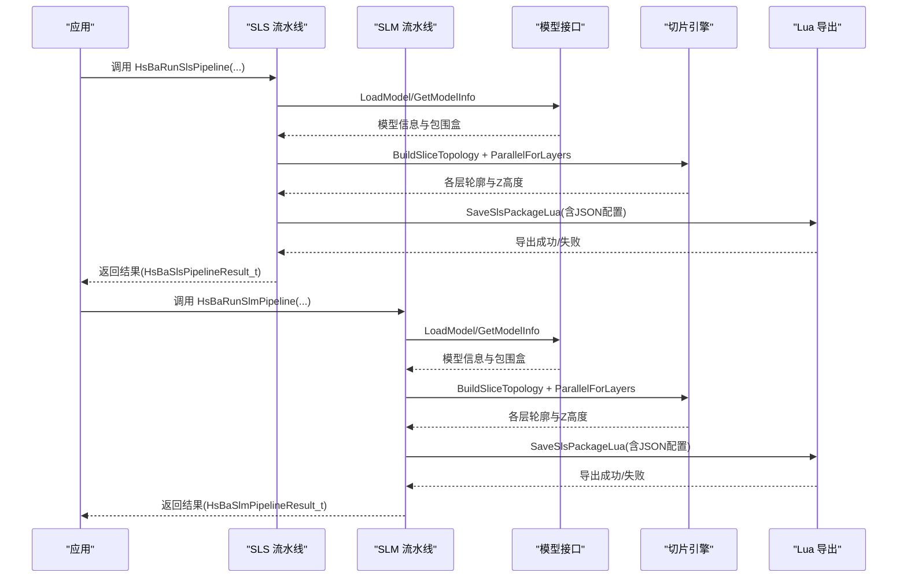
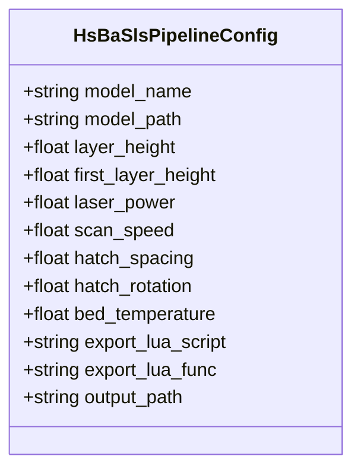
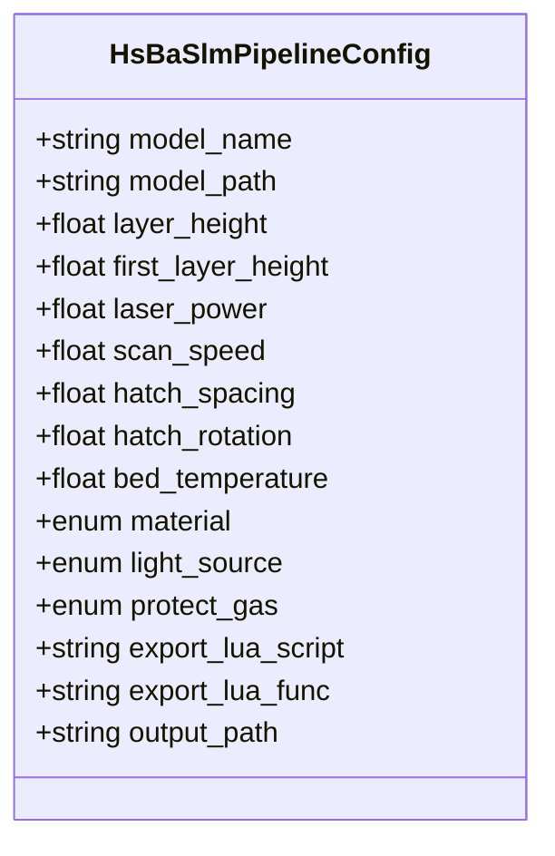
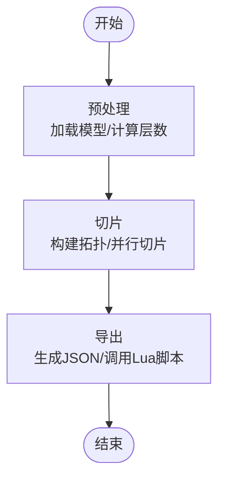
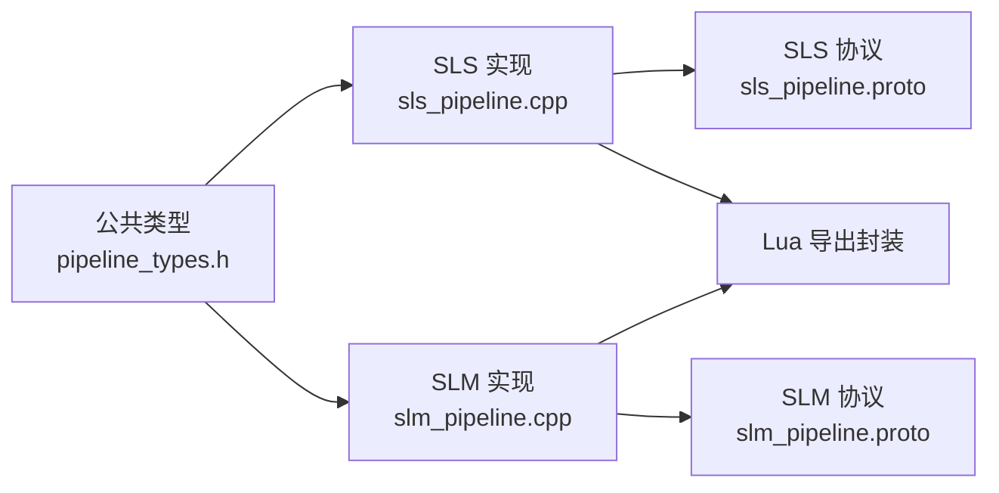

# SLS/SLM 粉末床激光工艺流水线

<cite>
**本文引用的文件**   
- [sls_pipeline.h](file://DllHsBaSlicer/sls_pipeline.h)
- [slm_pipeline.h](file://DllHsBaSlicer/slm_pipeline.h)
- [pipeline_types.h](file://pipelinetypes/pipeline_types.h)
- [sls_pipeline.cpp](file://DllHsBaSlicer/sls_pipeline.cpp)
- [slm_pipeline.cpp](file://DllHsBaSlicer/slm_pipeline.cpp)
- [sls_pipeline.proto](file://proto/sls_pipeline.proto)
- [slm_pipeline.proto](file://proto/slm_pipeline.proto)
</cite>

## 目录
1. [引言](#引言)
2. [项目结构](#项目结构)
3. [核心组件](#核心组件)
4. [架构总览](#架构总览)
5. [详细组件分析](#详细组件分析)
6. [依赖关系分析](#依赖关系分析)
7. [性能与并行特性](#性能与并行特性)
8. [参数调优指南](#参数调优指南)
9. [质量控制建议](#质量控制建议)
10. [API 调用示例](#api-调用示例)
11. [故障排除](#故障排除)
12. [结论](#结论)

## 引言
本技术文档聚焦于选择性激光烧结（SLS）与选择性激光熔化（SLM）的粉末床激光工艺流水线。两者共享“预处理 → 切片 → Lua 导出”的主流程，但在材料、能量源、保护气体等金属相关参数上存在差异。本文系统说明 HsBaSlsPipelineConfig_t 与 HsBaSlmPipelineConfig_t 的配置字段、默认值与行为，解释粉末物理特性对切片算法的影响，并给出热应力分析与变形补偿的工程实践建议，同时提供完整的 API 调用路径与故障排查方案。

## 项目结构
SLS/SLM 流水线由 C ABI 头文件、C++ 实现、协议定义与公共类型组成：
- C ABI 接口：sls_pipeline.h / slm_pipeline.h
- C++ 实现：sls_pipeline.cpp / slm_pipeline.cpp
- 公共类型与默认值：pipelinetypes/pipeline_types.h
- 跨语言协议：proto/sls_pipeline.proto / proto/slm_pipeline.proto

图表来源
- [sls_pipeline.h:1-63](file://DllHsBaSlicer/sls_pipeline.h#L1-L63)
- [slm_pipeline.h:1-63](file://DllHsBaSlicer/slm_pipeline.h#L1-L63)
- [pipeline_types.h:247-376](file://pipelinetypes/pipeline_types.h#L247-L376)
- [sls_pipeline.cpp:182-296](file://DllHsBaSlicer/sls_pipeline.cpp#L182-L296)
- [slm_pipeline.cpp:236-348](file://DllHsBaSlicer/slm_pipeline.cpp#L236-L348)
- [sls_pipeline.proto:5-23](file://proto/sls_pipeline.proto#L5-L23)
- [slm_pipeline.proto:33-55](file://proto/slm_pipeline.proto#L33-L55)

章节来源
- [sls_pipeline.h:1-63](file://DllHsBaSlicer/sls_pipeline.h#L1-L63)
- [slm_pipeline.h:1-63](file://DllHsBaSlicer/slm_pipeline.h#L1-L63)
- [pipeline_types.h:247-376](file://pipelinetypes/pipeline_types.h#L247-L376)

## 核心组件
- SLS 流水线 C ABI：提供创建默认配置、同步/异步执行、结果释放等接口。
- SLM 流水线 C ABI：与 SLS 一致，但包含金属材料、能量源、保护气体等额外参数。
- 公共类型定义：集中声明 SLS/SLM 配置结构体、枚举、回调与默认初始化函数。
- 协议定义：用于跨语言序列化 SLS/SLM 配置与结果。

关键职责划分：
- 配置构建与校验：将外部传入的 C 结构体转换为内部配置对象。
- 模型加载与拓扑构建：统一通过模型接口获取包围盒与体积信息。
- 切片并行化：一次性构建切片拓扑，按层并行切片。
- Lua 导出：将切片轮廓、层高、工艺参数序列化为 JSON，交由 Lua 脚本打包输出。

章节来源
- [sls_pipeline.h:17-56](file://DllHsBaSlicer/sls_pipeline.h#L17-L56)
- [slm_pipeline.h:17-56](file://DllHsBaSlicer/slm_pipeline.h#L17-L56)
- [pipeline_types.h:247-376](file://pipelinetypes/pipeline_types.h#L247-L376)

## 架构总览
SLS/SLM 流水线采用“预处理 → 切片 → Lua 导出”三段式流程，支持同步与异步两种调用方式，并通过进度回调反馈阶段状态。

图表来源
- [sls_pipeline.cpp:182-296](file://DllHsBaSlicer/sls_pipeline.cpp#L182-L296)
- [slm_pipeline.cpp:236-348](file://DllHsBaSlicer/slm_pipeline.cpp#L236-L348)

## 详细组件分析

### SLS 配置结构体 HsBaSlsPipelineConfig_t
- 模型配置：model_name、model_path
- 切片配置：layer_height、first_layer_height
- 激光配置：laser_power、scan_speed、hatch_spacing、hatch_rotation、bed_temperature
- Lua 导出：export_lua_script（必填）、export_lua_func（可选，默认 export_sls）
- 输出：output_path（可选）

默认值（来自默认初始化器）：
- layer_height = 0.1 mm
- first_layer_height = 0.15 mm
- laser_power = 30 W
- scan_speed = 2000 mm/s
- hatch_spacing = 0.15 mm
- hatch_rotation = 90°
- bed_temperature = 180°C

图表来源
- [pipeline_types.h:247-283](file://pipelinetypes/pipeline_types.h#L247-L283)
- [pipeline_types.h:827-847](file://pipelinetypes/pipeline_types.h#L827-L847)

章节来源
- [pipeline_types.h:247-283](file://pipelinetypes/pipeline_types.h#L247-L283)
- [pipeline_types.h:827-847](file://pipelinetypes/pipeline_types.h#L827-L847)

### SLM 配置结构体 HsBaSlmPipelineConfig_t
- 模型配置：model_name、model_path
- 切片配置：layer_height、first_layer_height
- 激光/能量配置：laser_power、scan_speed、hatch_spacing、hatch_rotation、bed_temperature
- 金属参数：material（铁/铝/钛/未知）、light_source（激光/电子束/未知）、protect_gas（氩/氦/氮/二氧化碳/未知）
- Lua 导出：export_lua_script（必填）、export_lua_func（可选，默认 export_slm）
- 输出：output_path（可选）

默认值（来自默认初始化器）：
- layer_height = 0.06 mm
- first_layer_height = 0.08 mm
- laser_power = 200 W
- scan_speed = 1000 mm/s
- hatch_spacing = 0.1 mm
- hatch_rotation = 67°
- bed_temperature = 100°C
- material = 钛
- light_source = 激光
- protect_gas = 氩气

图表来源
- [pipeline_types.h:312-376](file://pipelinetypes/pipeline_types.h#L312-L376)
- [pipeline_types.h:849-872](file://pipelinetypes/pipeline_types.h#L849-L872)

章节来源
- [pipeline_types.h:312-376](file://pipelinetypes/pipeline_types.h#L312-L376)
- [pipeline_types.h:849-872](file://pipelinetypes/pipeline_types.h#L849-L872)

### 流水线执行流程
SLS/SLM 均遵循相同主流程：
1. 预处理：加载模型，获取包围盒与体积信息，计算总层数。
2. 切片：构建切片拓扑，按层并行切片，得到每层轮廓与 Z 高度。
3. 导出：生成 JSON 配置（包含切片与激光/工艺参数），调用 Lua 导出脚本进行打包与数据库注册。

图表来源
- [sls_pipeline.cpp:182-296](file://DllHsBaSlicer/sls_pipeline.cpp#L182-L296)
- [slm_pipeline.cpp:236-348](file://DllHsBaSlicer/slm_pipeline.cpp#L236-L348)

章节来源
- [sls_pipeline.cpp:182-296](file://DllHsBaSlicer/sls_pipeline.cpp#L182-L296)
- [slm_pipeline.cpp:236-348](file://DllHsBaSlicer/slm_pipeline.cpp#L236-L348)

## 依赖关系分析
- C ABI 头文件仅依赖公共类型与导出宏，保持 ABI 稳定。
- C++ 实现依赖模型预处理、切片引擎、协程与错误处理模块。
- Lua 导出通过统一封装 SaveSlsPackageLua 完成，SLS/SLM 复用同一导出机制，区别在于 JSON 内容。
- 协议定义与 C 结构体一一对应，便于跨语言传递配置与结果。

图表来源
- [pipeline_types.h:247-376](file://pipelinetypes/pipeline_types.h#L247-L376)
- [sls_pipeline.cpp:182-296](file://DllHsBaSlicer/sls_pipeline.cpp#L182-L296)
- [slm_pipeline.cpp:236-348](file://DllHsBaSlicer/slm_pipeline.cpp#L236-L348)
- [sls_pipeline.proto:5-23](file://proto/sls_pipeline.proto#L5-L23)
- [slm_pipeline.proto:33-55](file://proto/slm_pipeline.proto#L33-L55)

章节来源
- [sls_pipeline.cpp:182-296](file://DllHsBaSlicer/sls_pipeline.cpp#L182-L296)
- [slm_pipeline.cpp:236-348](file://DllHsBaSlicer/slm_pipeline.cpp#L236-L348)

## 性能与并行特性
- 切片阶段使用并行策略：先构建一次切片拓扑，再对每层独立切片，提升吞吐。
- 进度回调在预处理、切片、导出阶段分别上报，便于 UI 或监控系统展示。
- 结果内存管理通过专用释放函数避免泄漏。

章节来源
- [sls_pipeline.cpp:220-242](file://DllHsBaSlicer/sls_pipeline.cpp#L220-L242)
- [slm_pipeline.cpp:272-294](file://DllHsBaSlicer/slm_pipeline.cpp#L272-L294)

## 参数调优指南
以下为面向 SLS/SLM 的工艺参数调优建议，结合代码默认值与实际工程经验：

- 层厚与首层层高
  - SLS：默认层厚 0.1 mm，首层 0.15 mm；SLM：默认层厚 0.06 mm，首层 0.08 mm。
  - 建议：薄层提高尺寸精度，但增加打印时间与热累积；首层略厚有助于铺粉/附着稳定性。

- 激光功率与扫描速度
  - SLS：默认功率 30 W，速度 2000 mm/s；SLM：默认功率 200 W，速度 1000 mm/s。
  - 建议：功率过低导致未熔合/孔隙率升高；速度过快降低线能量，需配合光斑与间距调整。

- 扫描间距与旋转角度
  - SLS：默认间距 0.15 mm，旋转 90°；SLM：默认间距 0.1 mm，旋转 67°。
  - 建议：间距过小增加热输入与翘曲风险；旋转角度可打乱热积累方向，减少各向异性。

- 基板温度
  - SLS：默认 180°C；SLM：默认 100°C。
  - 建议：预热可降低冷却速率，缓解热应力；过高可能引起粉末结块或氧化。

- 金属材料与保护气体（SLM）
  - 材料：铁/铝/钛；光源：激光/电子束；气体：氩/氦/氮/二氧化碳。
  - 建议：钛合金常用氩气保护；铝合金需注意高反射率与热导率带来的能量耦合变化。

- 层间热管理与变形控制
  - 通过合理设置 hatch_rotation 与 bed_temperature 控制热积累方向与冷却速率。
  - 对于大悬垂区域，建议在 Lua 导出中引入支撑或局部重排扫描策略（若扩展）。

章节来源
- [pipeline_types.h:827-872](file://pipelinetypes/pipeline_types.h#L827-L872)
- [sls_pipeline.cpp:125-145](file://DllHsBaSlicer/sls_pipeline.cpp#L125-L145)
- [slm_pipeline.cpp:173-196](file://DllHsBaSlicer/slm_pipeline.cpp#L173-L196)

## 质量控制建议
- 切片质量
  - 确保模型封闭且法线正确；检查包围盒与体积是否有效。
  - 层厚与首层层高需匹配设备能力与材料特性。

- 激光能量密度
  - 根据材料与光斑直径估算线能量，避免欠熔或过熔。
  - 监控孔隙率与致密度，必要时调整功率/速度/间距组合。

- 热应力与变形
  - 预热基板、优化扫描顺序与旋转角度，降低残余应力。
  - 对大型薄壁件，考虑分段打印或引入临时支撑（通过 Lua 扩展）。

- 过程监控与追溯
  - 利用 Lua 导出脚本记录工艺参数、层数、时间戳与结果路径，便于追溯与分析。

[本节为通用指导，不直接分析具体文件]

## API 调用示例
以下示例描述如何调用 SLS/SLM 流水线接口（以步骤形式呈现，不展示具体代码内容）：

- 创建默认配置
  - 调用 HsBaCreateDefaultSlsConfig() 或 HsBaCreateDefaultSlmConfig() 获取默认配置结构体。
  - 根据需要修改层厚、激光功率、扫描速度、基板温度、材料/气体等参数。

- 同步执行
  - 调用 HsBaRunSlsPipeline(config, callback, user_data) 或 HsBaRunSlmPipeline(...)。
  - 在回调中更新进度条或日志。
  - 使用返回的 HsBaSlsPipelineResult_t/HsBaSlmPipelineResult_t 检查 success、total_layers、export_path、error_message。

- 异步执行
  - 调用 HsBaRunSlsPipelineAsync(...) 或 HsBaRunSlmPipelineAsync(...)。
  - 在 result_callback 中处理最终结果。

- 释放资源
  - 调用 HsBaFreeSlsPipelineResult(result) 或 HsBaFreeSlmPipelineResult(result) 释放字符串字段。

章节来源
- [sls_pipeline.h:17-56](file://DllHsBaSlicer/sls_pipeline.h#L17-L56)
- [slm_pipeline.h:17-56](file://DllHsBaSlicer/slm_pipeline.h#L17-L56)
- [sls_pipeline.cpp:304-344](file://DllHsBaSlicer/sls_pipeline.cpp#L304-L344)
- [slm_pipeline.cpp:356-396](file://DllHsBaSlicer/slm_pipeline.cpp#L356-L396)

## 故障排除
常见问题与定位方法：

- 模型加载失败
  - 现象：返回错误消息包含“Failed to load model”。
  - 原因：模型路径无效或格式不支持。
  - 处理：检查 model_path 是否存在且格式受支持；确认 GetModel/LoadModel 返回非空。

- 模型高度无效
  - 现象：返回错误消息包含“Invalid model height”。
  - 原因：包围盒高度为零或负值。
  - 处理：检查模型几何完整性；确保 bbox_max.z > bbox_min.z。

- 缺少 Lua 导出脚本
  - 现象：返回错误消息包含“requires a Lua export script”。
  - 原因：export_lua_script 为空或未指定。
  - 处理：设置有效的 Lua 脚本路径；确认脚本中存在对应导出函数（export_sls/export_slm）。

- Lua 导出失败
  - 现象：返回错误消息包含“Failed to export ... via Lua script”。
  - 原因：Lua 脚本错误或导出路径不可写。
  - 处理：检查 Lua 脚本语法与逻辑；确认输出目录权限与磁盘空间。

- 结果内存泄漏
  - 现象：程序运行后内存持续增长。
  - 原因：未调用 HsBaFreeSlsPipelineResult/HsBaFreeSlmPipelineResult。
  - 处理：在每次使用后调用对应释放函数。

章节来源
- [sls_pipeline.cpp:193-216](file://DllHsBaSlicer/sls_pipeline.cpp#L193-L216)
- [sls_pipeline.cpp:247-282](file://DllHsBaSlicer/sls_pipeline.cpp#L247-L282)
- [slm_pipeline.cpp:245-268](file://DllHsBaSlicer/slm_pipeline.cpp#L245-L268)
- [slm_pipeline.cpp:299-334](file://DllHsBaSlicer/slm_pipeline.cpp#L299-L334)
- [sls_pipeline.cpp:336-344](file://DllHsBaSlicer/sls_pipeline.cpp#L336-L344)
- [slm_pipeline.cpp:388-396](file://DllHsBaSlicer/slm_pipeline.cpp#L388-L396)

## 结论
SLS 与 SLM 流水线在架构上高度一致，均采用“预处理 → 切片 → Lua 导出”的流程，并通过公共类型与协议定义保证 ABI 与跨语言兼容性。两者的主要差异体现在材料、能量源与保护气体等金属相关参数上。通过合理设置层厚、激光功率、扫描速度、扫描间距与基板温度，并结合 Lua 导出脚本的记录与扩展能力，可实现稳定的粉末床激光工艺输出。在实际工程中，应重点关注模型质量、能量密度控制、热应力管理与过程追溯，以获得高质量、可追溯的制造结果。