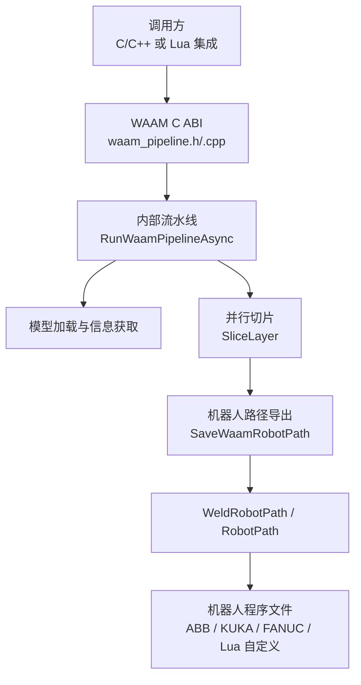
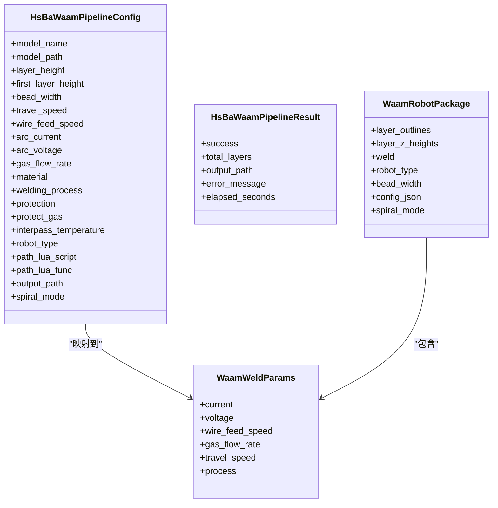
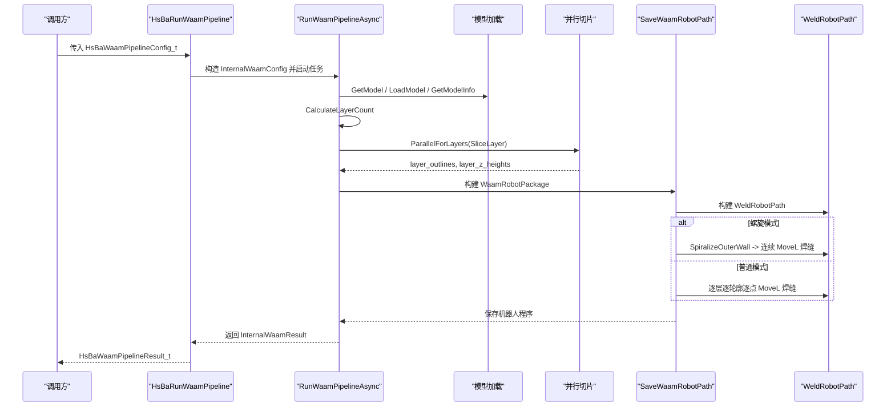
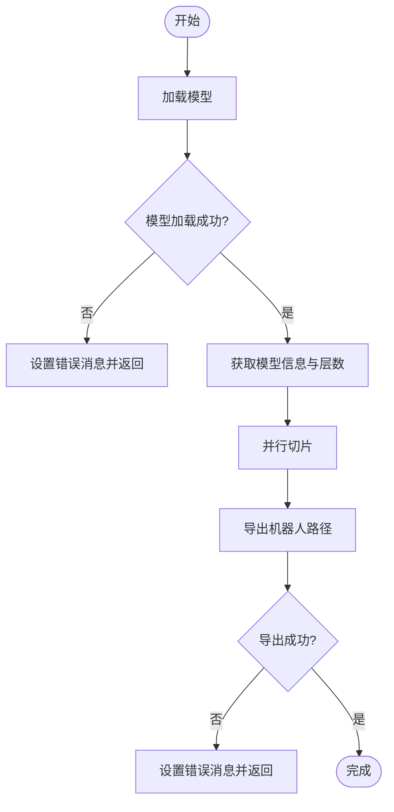
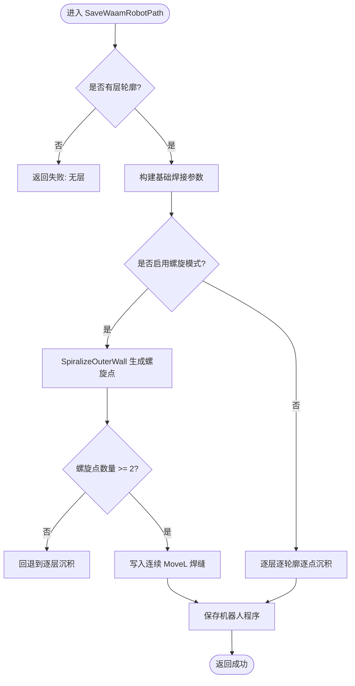
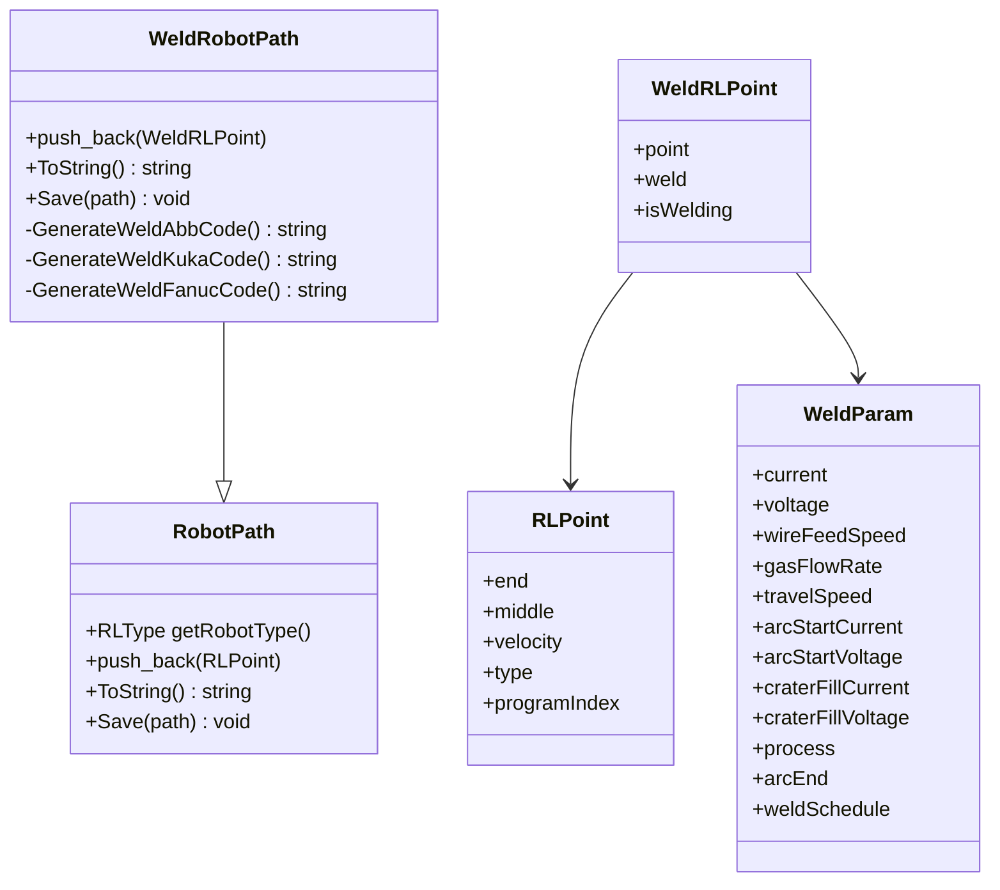
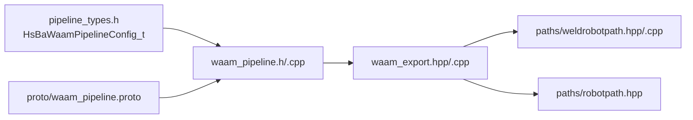

# WAAM 电弧增材制造流水线

<cite>
**本文引用的文件**   
- [waam_pipeline.h](file://DllHsBaSlicer/waam_pipeline.h)
- [waam_pipeline.cpp](file://DllHsBaSlicer/waam_pipeline.cpp)
- [pipeline_types.h](file://pipelinetypes/pipeline_types.h)
- [waam_export.hpp](file://LibHsBaSlicer/Path/waam_export.hpp)
- [waam_export.cpp](file://LibHsBaSlicer/Path/waam_export.cpp)
- [robotpath.hpp](file://paths/robotpath.hpp)
- [weldrobotpath.hpp](file://paths/weldrobotpath.hpp)
- [weldrobotpath.cpp](file://paths/weldrobotpath.cpp)
- [waam_pipeline.proto](file://proto/waam_pipeline.proto)
- [my_waam_path.lua](file://samples/WAAM/scripts/my_waam_path.lua)
- [main.cpp](file://samples/WAAM/main.cpp)
</cite>

## 目录
1. [引言](#引言)
2. [项目结构](#项目结构)
3. [核心组件](#核心组件)
4. [架构总览](#架构总览)
5. [详细组件分析](#详细组件分析)
6. [依赖关系分析](#依赖关系分析)
7. [性能与可扩展性](#性能与可扩展性)
8. [故障排除指南](#故障排除指南)
9. [结论](#结论)
10. [附录：API 调用示例与工业应用要点](#附录api-调用示例与工业应用要点)

## 引言
本技术文档围绕 HsBaSlicer 中的 WAAM（Wire Arc Additive Manufacturing，电弧增材制造）流水线展开。WAAM 与传统桌面级或粉末床增材制造不同：它不是逐层打印“切片图像”，而是以机器人带动焊枪沿每层轮廓逐道沉积金属丝，最终输出 ABB、KUKA 或 FANUC 等机器人语言程序文本；同时支持通过 Lua 脚本自定义机器人代码生成逻辑。

对于大型构件，WAAM 的特殊处理需求包括：
- 大尺度几何建模与分层：模型高度决定层数，首层厚度与普通层高共同影响 Z 向分层。
- 热输入控制：焊接电流、电压、送丝速度、行走速度和保护气体流量直接影响熔池尺寸和热积累。
- 变形预测与补偿：当前实现未内置热-力耦合仿真，但可通过螺旋模式减少层间起弧/收弧次数，并通过工艺参数调优降低角变形和收缩。
- 路径规划差异：WAAM 必须考虑机器人运动学约束、连续焊缝轨迹、起弧/收弧位置、层间过渡策略，以及可选的“花瓶模式”螺旋外壁连续走丝。

## 项目结构
WAAM 相关代码分布在以下模块：
- DllHsBaSlicer：对外 C ABI 入口，提供默认配置创建、同步/异步运行流水线、结果释放接口。
- LibHsBaSlicer/Path：WAAM 机器人路径导出核心，负责将分层轮廓转换为 WeldRobotPath 并写出机器人程序。
- paths：通用机器人路径抽象与焊接路径扩展，支持 ABB/KUKA/FANUC 品牌代码生成。
- pipelinetypes：C 兼容的配置结构体定义，包含 HsBaWaamPipelineConfig_t 及默认初始化函数。
- proto：Protocol Buffers 定义，用于跨语言序列化 WAAM 配置与结果。
- samples/WAAM：完整示例工程，演示基本用法、自定义焊接参数、异步执行、Lua 自定义路径脚本和螺旋模式。

**图表来源**
- [waam_pipeline.cpp:174-284](file://DllHsBaSlicer/waam_pipeline.cpp#L174-L284)
- [waam_export.cpp:62-190](file://LibHsBaSlicer/Path/waam_export.cpp#L62-L190)
- [weldrobotpath.cpp:72-100](file://paths/weldrobotpath.cpp#L72-L100)

**章节来源**
- [waam_pipeline.h:1-64](file://DllHsBaSlicer/waam_pipeline.h#L1-L64)
- [waam_pipeline.cpp:1-333](file://DllHsBaSlicer/waam_pipeline.cpp#L1-L333)
- [waam_export.hpp:1-77](file://LibHsBaSlicer/Path/waam_export.hpp#L1-L77)
- [waam_export.cpp:1-193](file://LibHsBaSlicer/Path/waam_export.cpp#L1-L193)

## 核心组件
本节聚焦 WAAM 流水线的核心数据结构与 API：
- HsBaWaamPipelineConfig_t：WAAM 流水线配置结构体，包含模型、几何、焊接工艺、保护方式、机器人类型、Lua 路径脚本和输出路径等字段。
- HsBaWaamPipelineResult_t：流水线结果，包含成功标志、总层数、输出路径、错误信息和耗时。
- WaamRobotPackage 与 WaamWeldParams：内部导出包，承载分层轮廓、Z 高度、焊接参数、机器人类型、焊道宽度、可选 JSON 配置和螺旋模式开关。
- C ABI 接口：HsBaCreateDefaultWaamConfig、HsBaRunWaamPipeline、HsBaRunWaamPipelineAsync、HsBaFreeWaamPipelineResult。

**图表来源**
- [pipeline_types.h:573-600](file://pipelinetypes/pipeline_types.h#L573-L600)
- [pipeline_types.h:927-951](file://pipelinetypes/pipeline_types.h#L927-L951)
- [waam_export.hpp:23-52](file://LibHsBaSlicer/Path/waam_export.hpp#L23-L52)

**章节来源**
- [pipeline_types.h:523-625](file://pipelinetypes/pipeline_types.h#L523-L625)
- [pipeline_types.h:927-951](file://pipelinetypes/pipeline_types.h#L927-L951)
- [waam_export.hpp:17-72](file://LibHsBaSlicer/Path/waam_export.hpp#L17-L72)

## 架构总览
WAAM 流水线采用“预处理 → 切片 → 机器人路径导出”三段式流程，并使用协程与并行循环提升效率：
1. 预处理阶段：加载模型并计算包围盒，得到总层数。
2. 切片阶段：构建切片拓扑后对每层轮廓进行并行切片，得到每层的 PolygonsD 轮廓集合。
3. 导出阶段：根据是否启用螺旋模式，选择“连续上升螺旋外壁”或“逐层逐轮廓逐点沉积”两种路径生成策略，最终写入机器人程序。

**图表来源**
- [waam_pipeline.cpp:174-284](file://DllHsBaSlicer/waam_pipeline.cpp#L174-L284)
- [waam_export.cpp:62-190](file://LibHsBaSlicer/Path/waam_export.cpp#L62-L190)

**章节来源**
- [waam_pipeline.cpp:174-284](file://DllHsBaSlicer/waam_pipeline.cpp#L174-L284)
- [waam_export.cpp:62-190](file://LibHsBaSlicer/Path/waam_export.cpp#L62-L190)

## 详细组件分析

### HsBaWaamPipelineConfig_t 配置结构体详解
该结构体是 WAAM 流水线的用户输入契约，涵盖几何、工艺、保护和机器人目标平台：
- 几何与分层：layer_height、first_layer_height、bead_width。
- 焊接工艺：travel_speed、wire_feed_speed、arc_current、arc_voltage、gas_flow_rate。
- 材料与保护：material、welding_process、protection、protect_gas、interpass_temperature。
- 机器人与脚本：robot_type、path_lua_script、path_lua_func、spiral_mode、output_path。

默认值由 HsBaWaamConfigDefault 提供，便于快速初始化。

| 字段 | 默认值 | 含义与单位 |
| --- | --- | --- |
| layer_height | 0.8 | 焊道/层高（mm） |
| first_layer_height | 1.0 | 首层高度（mm） |
| bead_width | 1.2 | 沉积焊道宽度（mm） |
| travel_speed | 8.0 | 焊枪行走速度（mm/s） |
| wire_feed_speed | 5.0 | 送丝速度（m/min） |
| arc_current | 180.0 | 焊接电流（A） |
| arc_voltage | 22.0 | 电弧电压（V） |
| gas_flow_rate | 15.0 | 保护气体流量（L/min） |
| material | HSBA_WAAM_MATERIAL_STEEL | 丝材材料 |
| welding_process | HSBA_WAAM_WELD_ARC | 焊接工艺类型 |
| protection | HSBA_WAAM_PROTECTION_SHIELD_GAS | 保护方式 |
| protect_gas | HSBA_METAL_GAS_ARGON | 保护气体种类 |
| interpass_temperature | 100.0 | 层间温度（°C） |
| robot_type | HSBA_WAAM_ROBOT_ABB | 目标机器人控制器 |
| path_lua_script | NULL | 可选自定义机器人代码生成脚本 |
| path_lua_func | NULL | 可选自定义脚本函数名 |
| spiral_mode | 0 | 外壁螺旋连续沉积模式 |
| output_path | NULL | 输出机器人程序路径 |

**章节来源**
- [pipeline_types.h:573-600](file://pipelinetypes/pipeline_types.h#L573-L600)
- [pipeline_types.h:927-951](file://pipelinetypes/pipeline_types.h#L927-L951)

### 流水线执行流程与错误处理
内部执行流程使用协程封装，关键步骤如下：
- 模型加载失败：返回错误消息，提示模型路径无效。
- 模型高度无效：层数为非正数时直接失败。
- 切片阶段：使用 ParallelForLayers 并行切片，进度回调更新“Slicing bead layer”。
- 导出阶段：若 SaveWaamRobotPath 失败，返回 Lua 脚本错误或导出失败信息。
- 异常捕获：RuntimeError 被统一捕获并包装为错误消息。

**图表来源**
- [waam_pipeline.cpp:174-284](file://DllHsBaSlicer/waam_pipeline.cpp#L174-L284)

**章节来源**
- [waam_pipeline.cpp:174-284](file://DllHsBaSlicer/waam_pipeline.cpp#L174-L284)

### 机器人路径导出与螺旋模式
导出器根据 pkg.spiral_mode 选择两条路径：
- 螺旋模式：将所有层的外轮廓合并为一条连续上升的螺旋焊缝，焊枪不抬枪、不断弧，仅一次 MoveL 连续沉积。
- 普通模式：对每层每个轮廓，先 MoveJ 快速移动到起点，再逐点 MoveL 沉积。

**图表来源**
- [waam_export.cpp:62-190](file://LibHsBaSlicer/Path/waam_export.cpp#L62-L190)

**章节来源**
- [waam_export.cpp:62-190](file://LibHsBaSlicer/Path/waam_export.cpp#L62-L190)

### 机器人路径抽象与品牌代码生成
WeldRobotPath 继承自 RobotPath，并在其基础上增加焊接参数：
- RLType：ABB、KUKA、FANUC、Unknown。
- RLPoint：包含终点、中点、速度和命令类型。
- WeldParam：电流、电压、送丝速度、气体流量、行走速度、起弧/收弧参数、工艺类型、坑填策略等。
- ToString/Save：根据机器人品牌生成对应语言程序，未知品牌会抛出 NotSupportedError。

**图表来源**
- [robotpath.hpp:38-69](file://paths/robotpath.hpp#L38-L69)
- [weldrobotpath.hpp:16-74](file://paths/weldrobotpath.hpp#L16-L74)
- [weldrobotpath.cpp:72-100](file://paths/weldrobotpath.cpp#L72-L100)

**章节来源**
- [robotpath.hpp:38-69](file://paths/robotpath.hpp#L38-L69)
- [weldrobotpath.hpp:16-74](file://paths/weldrobotpath.hpp#L16-L74)
- [weldrobotpath.cpp:72-100](file://paths/weldrobotpath.cpp#L72-L100)

### Lua 自定义路径脚本
当配置中设置 path_lua_script 时，内置的 ABB/KUKA/FANUC 代码生成器会被替换为用户自定义脚本。脚本环境提供 header、startProgramFunc、endProgramFunc、points 等全局变量，并要求返回完整的机器人程序字符串。

示例脚本 my_waam_path.lua 展示了如何遍历 points 数组并根据 pt.type 生成 MoveJ 或带焊接指令的 MOVEL。

**章节来源**
- [my_waam_path.lua:1-46](file://samples/WAAM/scripts/my_waam_path.lua#L1-L46)
- [waam_pipeline.cpp:256-269](file://DllHsBaSlicer/waam_pipeline.cpp#L256-L269)

## 依赖关系分析
WAAM 流水线依赖以下模块：
- 模型预处理与切片：GetModel、LoadModel、GetModelInfo、BuildSliceTopology、SliceLayer。
- 并行工具：ParallelForLayers。
- 机器人路径：WeldRobotPath、RobotPath、SpiralizeOuterWall。
- 编码与错误：utf8_to_path、RuntimeError。
- 协议定义：waam_pipeline.proto 用于跨语言序列化。

**图表来源**
- [pipeline_types.h:573-600](file://pipelinetypes/pipeline_types.h#L573-L600)
- [waam_pipeline.cpp:16-21](file://DllHsBaSlicer/waam_pipeline.cpp#L16-L21)
- [waam_export.cpp:11-14](file://LibHsBaSlicer/Path/waam_export.cpp#L11-L14)
- [waam_pipeline.proto:49-79](file://proto/waam_pipeline.proto#L49-L79)

**章节来源**
- [waam_pipeline.cpp:16-21](file://DllHsBaSlicer/waam_pipeline.cpp#L16-L21)
- [waam_export.cpp:11-14](file://LibHsBaSlicer/Path/waam_export.cpp#L11-L14)
- [waam_pipeline.proto:49-79](file://proto/waam_pipeline.proto#L49-L79)

## 性能与可扩展性
- 并行切片：使用 ParallelForLayers 对每层独立切片，提高大型构件的分片效率。
- 螺旋模式：减少层间起弧/收弧和抬枪次数，适合薄壁容器类构件，可显著降低热循环次数。
- 可扩展性：通过 path_lua_script 和 path_lua_func 完全替换机器人代码生成逻辑，适配新品牌或特殊工艺。

建议：
- 对大型构件优先评估螺旋模式可行性，确保每层至少有一个闭合外轮廓。
- 合理设置层间温度与保护气体流量，避免热积累导致变形。
- 在未知机器人品牌场景下，务必提供 Lua 路径脚本以避免 NotSupportedError。

[本节为通用指导，不直接分析具体文件]

## 故障排除指南
常见问题与定位方法：
- 模型加载失败：检查 model_path 是否正确，确认模型格式可被系统加载。
- 层数为零或负数：检查 layer_height 与 first_layer_height 是否合理，确保模型高度为正。
- 导出失败：检查 robot_type 是否为已知品牌，或是否提供了有效的 path_lua_script。
- 螺旋模式退化：若无闭合外轮廓，螺旋模式会回退到逐层沉积；需检查模型截面是否闭合。
- 未知机器人品牌：WeldRobotPath.ToString 会抛出 NotSupportedError，应改用 Lua 自定义脚本。

**章节来源**
- [waam_pipeline.cpp:181-204](file://DllHsBaSlicer/waam_pipeline.cpp#L181-L204)
- [waam_export.cpp:68-76](file://LibHsBaSlicer/Path/waam_export.cpp#L68-L76)
- [weldrobotpath.cpp:97-99](file://paths/weldrobotpath.cpp#L97-L99)

## 结论
HsBaSlicer 的 WAAM 流水线以清晰的三段式架构实现了从模型到机器人程序的完整转换。其核心优势在于：
- 明确的 C ABI 配置结构体 HsBaWaamPipelineConfig_t，覆盖几何、工艺、保护和机器人目标。
- 并行切片与螺旋模式优化，兼顾效率与连续性。
- 可扩展的 Lua 路径脚本机制，适配多品牌机器人与特殊工艺。
- 完善的错误处理与进度回调，便于集成到工业软件或自动化系统中。

对于大型构件制造，建议结合工艺试验确定最佳电流、电压、送丝速度与行走速度组合，并通过层间温度控制和保护气体优化来抑制变形与缺陷。

[本节为总结性内容，不直接分析具体文件]

## 附录：API 调用示例与工业应用要点

### C ABI 接口概览
- HsBaCreateDefaultWaamConfig：创建默认配置。
- HsBaRunWaamPipeline：同步执行流水线。
- HsBaRunWaamPipelineAsync：异步执行流水线，通过回调返回结果。
- HsBaFreeWaamPipelineResult：释放结果内存。

**章节来源**
- [waam_pipeline.h:17-57](file://DllHsBaSlicer/waam_pipeline.h#L17-L57)

### 完整示例说明
samples/WAAM/main.cpp 提供四个示例：
1. 基本用法：使用内置 ABB 代码生成器。
2. 自定义焊接参数：铝丝、更高电流与电压、KUKA 机器人。
3. 异步执行：配合自定义 Lua 路径脚本。
4. 螺旋模式：所有层外壁合并为连续上升焊缝。

这些示例展示了如何设置模型路径、工艺参数、机器人类型、输出路径和螺旋模式开关。

**章节来源**
- [main.cpp:54-81](file://samples/WAAM/main.cpp#L54-L81)
- [main.cpp:86-131](file://samples/WAAM/main.cpp#L86-L131)
- [main.cpp:155-178](file://samples/WAAM/main.cpp#L155-L178)
- [main.cpp:183-217](file://samples/WAAM/main.cpp#L183-L217)

### 工业应用案例建议
- 大型薄壁容器：优先启用螺旋模式，减少层间中断，降低热循环。
- 厚板堆焊：适当提高层间温度，控制冷却速率，减少裂纹风险。
- 多材料接头：通过调整 arc_current、arc_voltage 和 wire_feed_speed 匹配不同材料的热物理特性。
- 机器人集成：若使用非 ABB/KUKA/FANUC 品牌，必须提供 Lua 路径脚本以生成兼容代码。

[本节为通用指导，不直接分析具体文件]