# 多技术流水线

<cite>
**本文引用的文件**   
- [pipeline_types.h](file://pipelinetypes/pipeline_types.h)
- [fdm_pipeline.h](file://DllHsBaSlicer/fdm_pipeline.h)
- [sla_pipeline.h](file://DllHsBaSlicer/sla_pipeline.h)
- [sls_pipeline.h](file://DllHsBaSlicer/sls_pipeline.h)
- [slm_pipeline.h](file://DllHsBaSlicer/slm_pipeline.h)
- [lom_pipeline.h](file://DllHsBaSlicer/lom_pipeline.h)
- [tdp_pipeline.h](file://DllHsBaSlicer/tdp_pipeline.h)
- [waam_pipeline.h](file://DllHsBaSlicer/waam_pipeline.h)
- [hsba_slicer.cppm](file://ModuleHsBaSlicer/hsba_slicer.cppm)
- [PipelineConfig2Msg.cpp](file://convert/PipelineConfig2Msg.cpp)
</cite>

## 目录
1. [项目概述与快速开始](#项目概述与快速开始)
2. [架构总览](#架构总览)
3. [核心概念](#核心概念)
4. [核心模块详解](#核心模块详解)
5. [高级主题](#高级主题)
6. [Lua 脚本系统](#lua-脚本系统)
7. [API 参考文档](#api-参考文档)
8. [集成指南](#集成指南)
9. [开发测试与贡献](#开发测试与贡献)
10. [扩展开发指南](#扩展开发指南)
11. [示例与教程](#示例与教程)
12. [部署故障排除与FAQ](#部署故障排除与faq)
13. [附录](#附录)

## 项目概述与快速开始
本仓库实现了一个面向多种增材制造技术的统一切片与后处理流水线，覆盖 FDM、SLA、SLS、SLM、LOM、TDP（热塑性粉末沉积/粘结剂喷射）和 WAAM（电弧增材制造）。每种技术通过独立的 C ABI 头文件暴露同步与异步接口，并通过统一的配置结构体描述工艺参数；Lua 脚本用于支撑自定义填充、支撑、底板生成以及 SLS/SLM/LOM/TDP/WAAM 的导出逻辑。

典型调用流程：
- 选择目标技术并构造对应配置结构体。
- 调用同步或异步运行函数执行流水线。
- 根据输出类型获取 G 代码、层图像压缩包、机器人程序或 Lua 导出的任意结果路径。
- 释放结果结构体中由库分配的字符串内存。

该文档聚焦于各技术的流水线实现、配置参数、处理流程、输出格式、最佳实践与参数调优建议，并提供技术选型指南帮助开发者按应用场景选择合适的技术栈。

**章节来源**
- [pipeline_types.h:53-113](file://pipelinetypes/pipeline_types.h#L53-L113)
- [pipeline_types.h:165-218](file://pipelinetypes/pipeline_types.h#L165-L218)
- [pipeline_types.h:259-283](file://pipelinetypes/pipeline_types.h#L259-L283)
- [pipeline_types.h:359-376](file://pipelinetypes/pipeline_types.h#L359-L376)
- [pipeline_types.h:419-436](file://pipelinetypes/pipeline_types.h#L419-L436)
- [pipeline_types.h:480-496](file://pipelinetypes/pipeline_types.h#L480-L496)
- [pipeline_types.h:578-600](file://pipelinetypes/pipeline_types.h#L578-L600)

## 架构总览
系统采用“C ABI + C++ 模块封装”的分层设计：
- DllHsBaSlicer 提供每种技术的 C ABI 入口，负责参数校验、阶段编排、Lua 脚本加载与结果封装。
- ModuleHsBaSlicer 提供 C++20 module 风格的类式 API，将底层自由函数包装为 FdmPipeline、SlaPipeline、SlsPipeline、SlmPipeline、LomPipeline、TdpPipeline、WaamPipeline 等类。
- pipelinetypes 定义跨模块共享的配置与结果结构体，确保 convert 等下游组件无需依赖 DLL。
- LibHsBaSlicer 提供切片、填充、支撑、路径生成、文件传输、参数存储等基础能力。
- proto 与 convert 提供 Protobuf 序列化与双向转换。

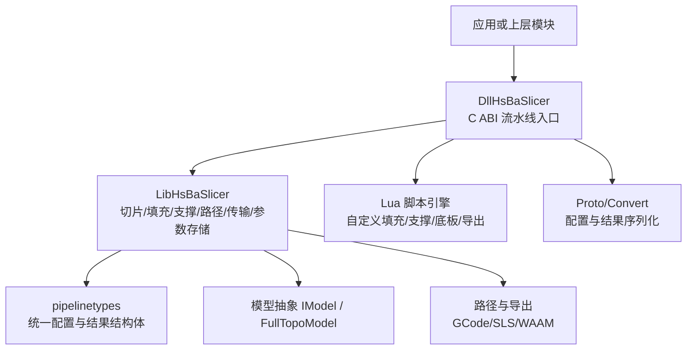

**图示来源**
- [hsba_slicer.cppm:129-146](file://ModuleHsBaSlicer/hsba_slicer.cppm#L129-L146)
- [hsba_slicer.cppm:204-225](file://ModuleHsBaSlicer/hsba_slicer.cppm#L204-L225)
- [hsba_slicer.cppm:238-258](file://ModuleHsBaSlicer/hsba_slicer.cppm#L238-L258)
- [hsba_slicer.cppm:264-348](file://ModuleHsBaSlicer/hsba_slicer.cppm#L264-L348)
- [pipeline_types.h:53-113](file://pipelinetypes/pipeline_types.h#L53-L113)

**章节来源**
- [hsba_slicer.cppm:1-63](file://ModuleHsBaSlicer/hsba_slicer.cppm#L1-L63)
- [pipeline_types.h:1-12](file://pipelinetypes/pipeline_types.h#L1-L12)

## 核心概念
- 流水线阶段：预处理 -> 切片 -> 支撑/底板 -> 填充/路径生成 -> 导出。不同技术对阶段组合有所差异。
- 配置结构体：每种技术有独立配置结构体，包含模型信息、切片参数、工艺参数、Lua 脚本路径与输出路径。
- 结果结构体：包含成功标志、总层数、输出路径或内容、错误消息与耗时。
- 回调机制：进度回调与异步结果回调，便于 UI 更新与非阻塞执行。
- Lua 扩展点：支撑、填充、底板、导出、路径生成均可通过 Lua 脚本定制。

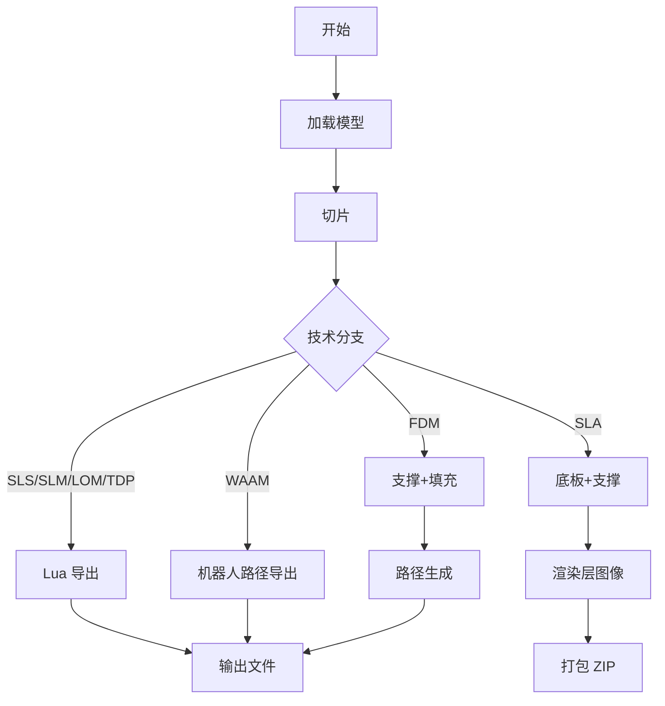

**图示来源**
- [fdm_pipeline.h:23-35](file://DllHsBaSlicer/fdm_pipeline.h#L23-L35)
- [sla_pipeline.h:23-34](file://DllHsBaSlicer/sla_pipeline.h#L23-L34)
- [sls_pipeline.h:23-34](file://DllHsBaSlicer/sls_pipeline.h#L23-L34)
- [slm_pipeline.h:23-37](file://DllHsBaSlicer/slm_pipeline.h#L23-L37)
- [lom_pipeline.h:23-37](file://DllHsBaSlicer/lom_pipeline.h#L23-L37)
- [tdp_pipeline.h:23-37](file://DllHsBaSlicer/tdp_pipeline.h#L23-L37)
- [waam_pipeline.h:23-38](file://DllHsBaSlicer/waam_pipeline.h#L23-L38)

**章节来源**
- [pipeline_types.h:115-140](file://pipelinetypes/pipeline_types.h#L115-L140)
- [pipeline_types.h:220-245](file://pipelinetypes/pipeline_types.h#L220-L245)
- [pipeline_types.h:285-310](file://pipelinetypes/pipeline_types.h#L285-L310)
- [pipeline_types.h:378-401](file://pipelinetypes/pipeline_types.h#L378-L401)
- [pipeline_types.h:438-461](file://pipelinetypes/pipeline_types.h#L438-L461)
- [pipeline_types.h:498-521](file://pipelinetypes/pipeline_types.h#L498-L521)
- [pipeline_types.h:602-625](file://pipelinetypes/pipeline_types.h#L602-L625)

## 核心模块详解

### FDM（熔融沉积成型）流水线
- 流水线阶段：预处理 -> 切片 -> 支撑 -> 填充 -> 路径生成 -> G 代码输出。
- 关键配置字段：
  - 切片：layer_height、first_layer_height。
  - 填充：fill_spacing、fill_mode、fill_angle、wall_count、top_layer_count、bottom_layer_count、infill_density。
  - 支撑：enable_support、overhang_angle、support_gap、support_diameter、support_density、support_pattern、interface_layers、interface_density。
  - 路径：line_width、print_speed、travel_speed、extrusion_multiplier、spiral_mode。
  - G 代码固件：gcode_firmware、nozzle_diameter、filament_diameter、nozzle_temp、bed_temp、retract_length、retract_speed、first_layer_speed。
  - Lua 扩展：support_lua_script/support_lua_func、infill_lua_script/infill_lua_func。
  - 输出：output_path。
- 输出格式：UTF-8 编码的 G 代码字符串，可选保存到文件。
- 默认值：见 HsBaFdmConfigDefault。

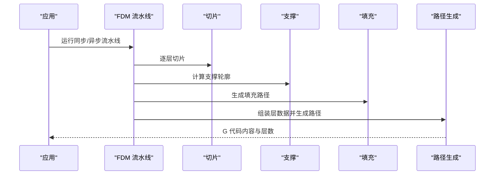

**图示来源**
- [hsba_slicer.cppm:624-752](file://ModuleHsBaSlicer/hsba_slicer.cppm#L624-L752)
- [fdm_pipeline.h:23-35](file://DllHsBaSlicer/fdm_pipeline.h#L23-L35)

**章节来源**
- [pipeline_types.h:53-113](file://pipelinetypes/pipeline_types.h#L53-L113)
- [pipeline_types.h:742-783](file://pipelinetypes/pipeline_types.h#L742-L783)
- [fdm_pipeline.h:17-61](file://DllHsBaSlicer/fdm_pipeline.h#L17-L61)
- [hsba_slicer.cppm:624-752](file://ModuleHsBaSlicer/hsba_slicer.cppm#L624-L752)

### SLA（立体光刻）流水线
- 流水线阶段：预处理 -> 切片 -> 底板 -> 支撑 -> 渲染 -> 打包 ZIP。
- 关键配置字段：
  - 切片：layer_height、first_layer_height。
  - 曝光：bottom_exposure_time、normal_exposure_time、bottom_lift_distance、lift_distance、lift_speed、retract_speed。
  - 底板：floor_raft_offset、floor_border_width、floor_fill_spacing、floor_fill_angle、floor_border_count、floor_use_convex_hull。
  - 支撑：enable_support、overhang_angle、support_gap、support_diameter、support_density、support_pattern。
  - Lua 扩展：support_lua_script/support_lua_func、floor_lua_script/floor_lua_func、export_lua_script/export_lua_func。
  - 输出：output_path、image_type、image_width、image_height。
- 输出格式：ZIP 压缩包，内含层图像（PNG/JPEG/SVG）及元数据。

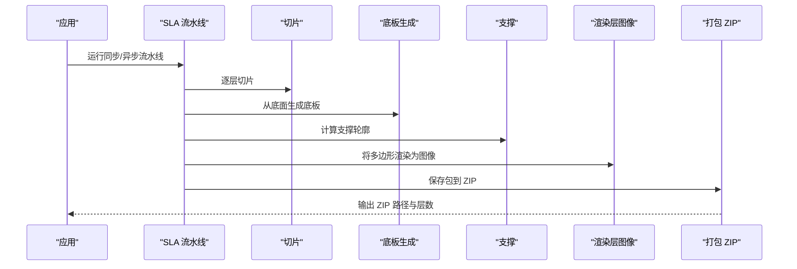

**图示来源**
- [hsba_slicer.cppm:758-792](file://ModuleHsBaSlicer/hsba_slicer.cppm#L758-L792)
- [sla_pipeline.h:23-34](file://DllHsBaSlicer/sla_pipeline.h#L23-L34)

**章节来源**
- [pipeline_types.h:165-218](file://pipelinetypes/pipeline_types.h#L165-L218)
- [pipeline_types.h:789-825](file://pipelinetypes/pipeline_types.h#L789-L825)
- [sla_pipeline.h:17-56](file://DllHsBaSlicer/sla_pipeline.h#L17-L56)
- [hsba_slicer.cppm:758-792](file://ModuleHsBaSlicer/hsba_slicer.cppm#L758-L792)

### SLS（选择性激光烧结）流水线
- 流水线阶段：预处理 -> 切片 -> Lua 导出（ZIP + 数据库）。
- 关键配置字段：
  - 切片：layer_height、first_layer_height。
  - 激光：laser_power、scan_speed、hatch_spacing、hatch_rotation、bed_temperature。
  - Lua 导出：export_lua_script（必填）、export_lua_func。
  - 输出：output_path。
- 输出格式：由 Lua 导出脚本决定，通常为 ZIP 与数据库的组合。

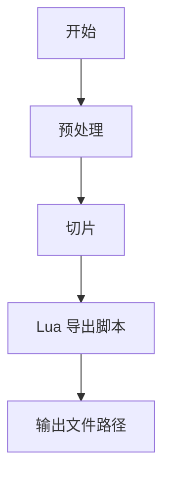

**图示来源**
- [sls_pipeline.h:23-34](file://DllHsBaSlicer/sls_pipeline.h#L23-L34)
- [pipeline_types.h:259-283](file://pipelinetypes/pipeline_types.h#L259-L283)

**章节来源**
- [pipeline_types.h:259-283](file://pipelinetypes/pipeline_types.h#L259-L283)
- [pipeline_types.h:831-847](file://pipelinetypes/pipeline_types.h#L831-L847)
- [sls_pipeline.h:17-56](file://DllHsBaSlicer/sls_pipeline.h#L17-L56)

### SLM（选择性激光熔化）流水线
- 流水线阶段：预处理 -> 切片 -> Lua 导出（ZIP + 数据库），与 SLS 流程镜像。
- 关键配置字段：
  - 切片：layer_height、first_layer_height。
  - 能量源：laser_power、scan_speed、hatch_spacing、hatch_rotation、bed_temperature。
  - 材料：material（铁/铝/钛/未知）。
  - 光源：light_source（激光/电子束/未知）。
  - 保护气体：protect_gas（氩/氦/N2/CO2/未知）。
  - Lua 导出：export_lua_script（必填）、export_lua_func。
  - 输出：output_path。
- 输出格式：由 Lua 导出脚本决定，通常包含金属打印所需的层数据与工艺参数。

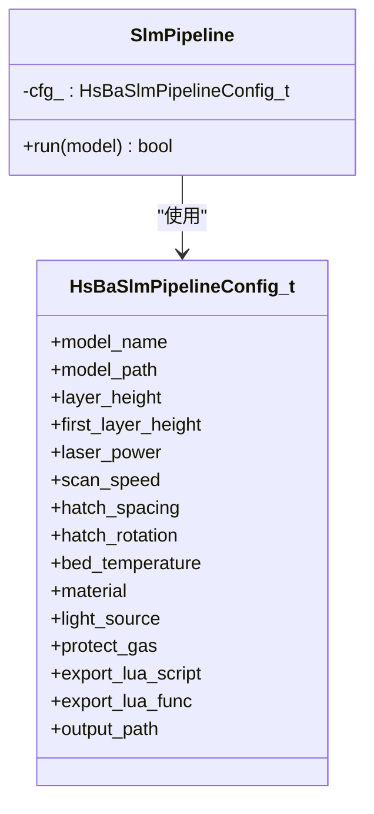

**图示来源**
- [pipeline_types.h:359-376](file://pipelinetypes/pipeline_types.h#L359-L376)
- [slm_pipeline.h:23-37](file://DllHsBaSlicer/slm_pipeline.h#L23-L37)

**章节来源**
- [pipeline_types.h:359-376](file://pipelinetypes/pipeline_types.h#L359-L376)
- [pipeline_types.h:853-872](file://pipelinetypes/pipeline_types.h#L853-L872)
- [slm_pipeline.h:17-56](file://DllHsBaSlicer/slm_pipeline.h#L17-L56)

### LOM（分层实体制造）流水线
- 流水线阶段：预处理 -> 切片 -> Lua 导出（ZIP + 数据库）。
- 关键配置字段：
  - 切片：layer_height、first_layer_height。
  - 切割：cut_speed、cut_margin、cut_power、cut_mode（轮廓/半色调）。
  - 粘合：bond_temperature、bond_pressure、bond_time、seal_contour。
  - Lua 导出：export_lua_script（必填）、export_lua_func。
  - 输出：output_path。
- 输出格式：由 Lua 导出脚本决定，通常包含每层轮廓与切割/粘合参数。

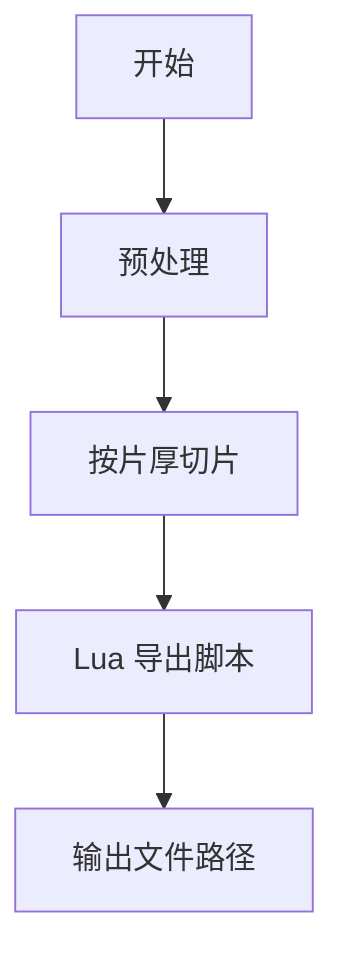

**图示来源**
- [lom_pipeline.h:23-37](file://DllHsBaSlicer/lom_pipeline.h#L23-L37)
- [pipeline_types.h:419-436](file://pipelinetypes/pipeline_types.h#L419-L436)

**章节来源**
- [pipeline_types.h:419-436](file://pipelinetypes/pipeline_types.h#L419-L436)
- [pipeline_types.h:878-897](file://pipelinetypes/pipeline_types.h#L878-L897)
- [lom_pipeline.h:17-56](file://DllHsBaSlicer/lom_pipeline.h#L17-L56)

### TDP（热塑性粉末沉积/粘结剂喷射）流水线
- 流水线阶段：预处理 -> 切片 -> Lua 导出（ZIP + 数据库）。
- 关键配置字段：
  - 切片：layer_height、first_layer_height。
  - 喷头：head_count、drop_spacing。
  - 粘结剂：binder_saturation、ink_curing_time、bed_temperature、binder_mode（全彩/单通道/烧结）。
  - Lua 导出：export_lua_script（必填）、export_lua_func。
  - 螺旋模式：spiral_mode（外轮廓连续上升路径）。
  - 输出：output_path。
- 输出格式：由 Lua 导出脚本决定，通常包含粘结剂喷射轮廓与固化参数。

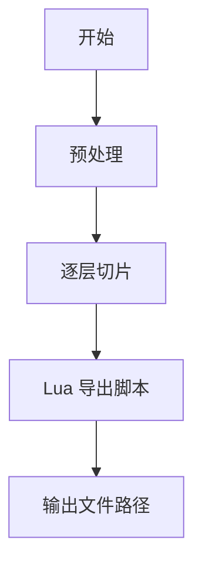

**图示来源**
- [tdp_pipeline.h:23-37](file://DllHsBaSlicer/tdp_pipeline.h#L23-L37)
- [pipeline_types.h:480-496](file://pipelinetypes/pipeline_types.h#L480-L496)

**章节来源**
- [pipeline_types.h:480-496](file://pipelinetypes/pipeline_types.h#L480-L496)
- [pipeline_types.h:903-921](file://pipelinetypes/pipeline_types.h#L903-L921)
- [tdp_pipeline.h:17-56](file://DllHsBaSlicer/tdp_pipeline.h#L17-L56)

### WAAM（电弧增材制造）流水线
- 流水线阶段：预处理 -> 切片 -> 机器人路径导出。
- 关键配置字段：
  - 切片：layer_height、first_layer_height。
  - 沉积：bead_width、travel_speed、wire_feed_speed。
  - 焊接：arc_current、arc_voltage、gas_flow_rate、welding_process（电弧/激光/未知）。
  - 材料：material（钢/铝/钛/铜/未知）。
  - 保护：protection（保护气/真空/未知）、protect_gas。
  - 工艺：interpass_temperature。
  - 机器人：robot_type（ABB/KUKA/FANUC/未知）。
  - Lua 路径脚本：path_lua_script/path_lua_func（可选）。
  - 螺旋模式：spiral_mode（外壁作为连续上升焊道）。
  - 输出：output_path（机器人程序路径）。
- 输出格式：机器人语言程序（非层图像 ZIP）。

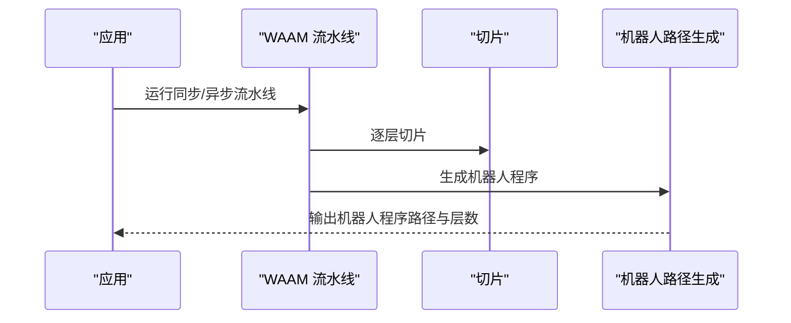

**图示来源**
- [waam_pipeline.h:23-38](file://DllHsBaSlicer/waam_pipeline.h#L23-L38)
- [pipeline_types.h:578-600](file://pipelinetypes/pipeline_types.h#L578-L600)

**章节来源**
- [pipeline_types.h:578-600](file://pipelinetypes/pipeline_types.h#L578-L600)
- [pipeline_types.h:927-951](file://pipelinetypes/pipeline_types.h#L927-L951)
- [waam_pipeline.h:17-57](file://DllHsBaSlicer/waam_pipeline.h#L17-L57)

## 高级主题
- 参数持久化：ParamStorePipeline 支持将各技术配置保存到 SQLite/MySQL/PostgreSQL，并在需要时加载复用。
- 文件传输：FileTransferPipeline 通过 RemoteExecutorConnectionPool 将文件发送到远程服务，适用于批量上传切片结果或中间数据。
- 自定义流水线：CustomLuaPipeline 允许完全由 Lua 脚本定义流水线阶段顺序与内容，C++ 侧仅暴露构建块（模型加载、切片、支撑、填充、底板、G 代码路径输出、SLS/SLA 打包等）。

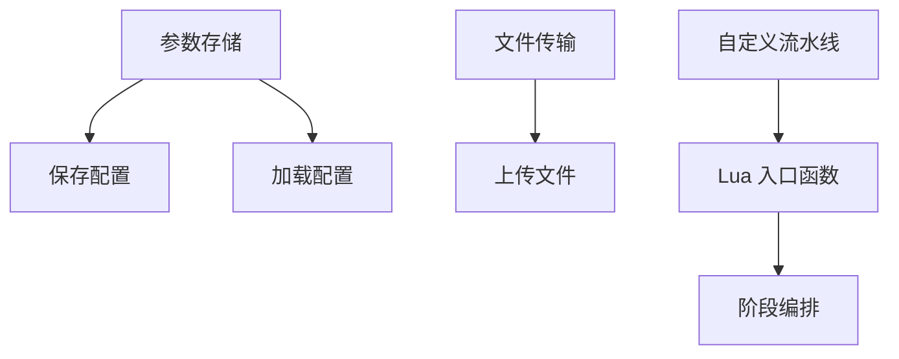

**图示来源**
- [hsba_slicer.cppm:380-446](file://ModuleHsBaSlicer/hsba_slicer.cppm#L380-L446)
- [hsba_slicer.cppm:448-480](file://ModuleHsBaSlicer/hsba_slicer.cppm#L448-L480)

**章节来源**
- [pipeline_types.h:989-1043](file://pipelinetypes/pipeline_types.h#L989-L1043)
- [hsba_slicer.cppm:380-446](file://ModuleHsBaSlicer/hsba_slicer.cppm#L380-L446)
- [hsba_slicer.cppm:448-480](file://ModuleHsBaSlicer/hsba_slicer.cppm#L448-L480)

## Lua 脚本系统
- 支撑与填充：FDM 可通过 support_lua_script/support_lua_func 与 infill_lua_script/infill_lua_func 替换内置算法。
- 底板生成：SLA 可通过 floor_lua_script/floor_lua_func 自定义底板生成逻辑。
- 导出脚本：SLS/SLM/LOM/TDP/WAAM 通过 export_lua_script/export_lua_func 或 path_lua_script/path_lua_func 控制最终输出格式。
- 自定义流水线：CustomLuaPipeline 通过 pipeline_lua_script/pipeline_lua_source 与 entry_func 完全接管流水线编排。

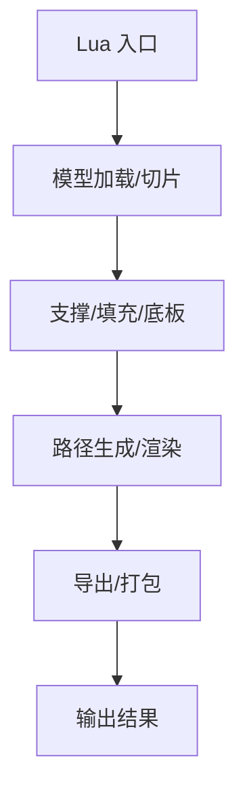

**图示来源**
- [pipeline_types.h:689-704](file://pipelinetypes/pipeline_types.h#L689-L704)
- [hsba_slicer.cppm:448-480](file://ModuleHsBaSlicer/hsba_slicer.cppm#L448-L480)

**章节来源**
- [pipeline_types.h:689-704](file://pipelinetypes/pipeline_types.h#L689-L704)
- [hsba_slicer.cppm:448-480](file://ModuleHsBaSlicer/hsba_slicer.cppm#L448-L480)

## API 参考文档
- FDM：HsBaCreateDefaultConfig、HsBaRunFdmPipeline、HsBaRunFdmPipelineAsync、HsBaFreePipelineResult。
- SLA：HsBaCreateDefaultSlaConfig、HsBaRunSlaPipeline、HsBaRunSlaPipelineAsync、HsBaFreeSlaPipelineResult。
- SLS：HsBaCreateDefaultSlsConfig、HsBaRunSlsPipeline、HsBaRunSlsPipelineAsync、HsBaFreeSlsPipelineResult。
- SLM：HsBaCreateDefaultSlmConfig、HsBaRunSlmPipeline、HsBaRunSlmPipelineAsync、HsBaFreeSlmPipelineResult。
- LOM：HsBaCreateDefaultLomConfig、HsBaRunLomPipeline、HsBaRunLomPipelineAsync、HsBaFreeLomPipelineResult。
- TDP：HsBaCreateDefaultTdpConfig、HsBaRunTdpPipeline、HsBaRunTdpPipelineAsync、HsBaFreeTdpPipelineResult。
- WAAM：HsBaCreateDefaultWaamConfig、HsBaRunWaamPipeline、HsBaRunWaamPipelineAsync、HsBaFreeWaamPipelineResult。

**图示来源**
- [fdm_pipeline.h:17-61](file://DllHsBaSlicer/fdm_pipeline.h#L17-L61)
- [sla_pipeline.h:17-56](file://DllHsBaSlicer/sla_pipeline.h#L17-L56)
- [sls_pipeline.h:17-56](file://DllHsBaSlicer/sls_pipeline.h#L17-L56)
- [slm_pipeline.h:17-56](file://DllHsBaSlicer/slm_pipeline.h#L17-L56)
- [lom_pipeline.h:17-56](file://DllHsBaSlicer/lom_pipeline.h#L17-L56)
- [tdp_pipeline.h:17-56](file://DllHsBaSlicer/tdp_pipeline.h#L17-L56)
- [waam_pipeline.h:17-57](file://DllHsBaSlicer/waam_pipeline.h#L17-L57)

**章节来源**
- [fdm_pipeline.h:17-61](file://DllHsBaSlicer/fdm_pipeline.h#L17-L61)
- [sla_pipeline.h:17-56](file://DllHsBaSlicer/sla_pipeline.h#L17-L56)
- [sls_pipeline.h:17-56](file://DllHsBaSlicer/sls_pipeline.h#L17-L56)
- [slm_pipeline.h:17-56](file://DllHsBaSlicer/slm_pipeline.h#L17-L56)
- [lom_pipeline.h:17-56](file://DllHsBaSlicer/lom_pipeline.h#L17-L56)
- [tdp_pipeline.h:17-56](file://DllHsBaSlicer/tdp_pipeline.h#L17-L56)
- [waam_pipeline.h:17-57](file://DllHsBaSlicer/waam_pipeline.h#L17-L57)

## 集成指南
- 在 C/C++ 应用中引入 DllHsBaSlicer 的 C ABI 头文件，构造对应配置结构体并调用运行函数。
- 在 C++20 module 消费者中使用 hsba.slicer 模块提供的类式 API，简化对象生命周期管理。
- 使用 convert 模块进行配置与结果的 Protobuf 序列化，便于跨进程或网络传输。

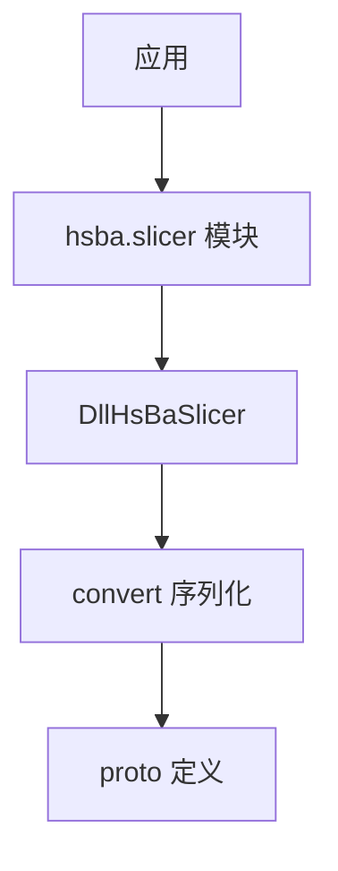

**图示来源**
- [hsba_slicer.cppm:1-63](file://ModuleHsBaSlicer/hsba_slicer.cppm#L1-L63)
- [PipelineConfig2Msg.cpp:52-92](file://convert/PipelineConfig2Msg.cpp#L52-L92)
- [PipelineConfig2Msg.cpp:338-369](file://convert/PipelineConfig2Msg.cpp#L338-L369)

**章节来源**
- [hsba_slicer.cppm:1-63](file://ModuleHsBaSlicer/hsba_slicer.cppm#L1-L63)
- [PipelineConfig2Msg.cpp:52-92](file://convert/PipelineConfig2Msg.cpp#L52-L92)
- [PipelineConfig2Msg.cpp:338-369](file://convert/PipelineConfig2Msg.cpp#L338-L369)

## 开发测试与贡献
- 单元测试覆盖模型加载、路径生成、填充算法、支撑生成、参数存储等核心功能。
- 静态检查与格式化规则通过 .clang-format/.clang-tidy 与 static_check 工具链保障代码质量。
- 示例工程位于 samples 目录，涵盖各技术流水线的完整调用与 Lua 脚本示例。

**章节来源**
- [tests/CMakeLists.txt](file://tests/CMakeLists.txt)
- [samples/FDM/main.cpp](file://samples/FDM/main.cpp)
- [samples/SLA/main.cpp](file://samples/SLA/main.cpp)
- [samples/SLS/main.cpp](file://samples/SLS/main.cpp)
- [samples/SLM/main.cpp](file://samples/SLM/main.cpp)
- [samples/LOM/main.cpp](file://samples/LOM/main.cpp)
- [samples/TDP/main.cpp](file://samples/TDP/main.cpp)
- [samples/WAAM/main.cpp](file://samples/WAAM/main.cpp)

## 扩展开发指南
- 自定义填充/支撑/底板：在对应配置的 Lua 脚本字段中指定脚本路径与函数名。
- 自定义导出：为 SLS/SLM/LOM/TDP/WAAM 编写 export_lua_script 或 path_lua_script，返回期望的输出格式。
- 自定义流水线：使用 CustomLuaPipeline 完全控制阶段顺序与数据流，利用全局 HsBa 表提供的构建块。

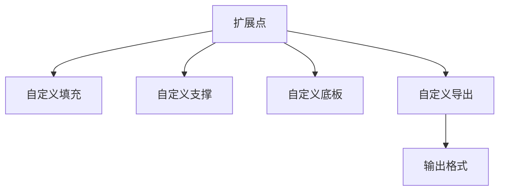

**图示来源**
- [hsba_slicer.cppm:486-512](file://ModuleHsBaSlicer/hsba_slicer.cppm#L486-L512)
- [pipeline_types.h:689-704](file://pipelinetypes/pipeline_types.h#L689-L704)

**章节来源**
- [hsba_slicer.cppm:486-512](file://ModuleHsBaSlicer/hsba_slicer.cppm#L486-L512)
- [pipeline_types.h:689-704](file://pipelinetypes/pipeline_types.h#L689-L704)

## 示例与教程
- FDM：同步/异步调用、Lua 自定义支撑与填充。
- SLA：Lua 自定义底板、支撑与导出。
- SLS/SLM/LOM/TDP：Lua 导出脚本示例。
- WAAM：机器人路径生成与导出。
- Custom：完全由 Lua 定义的流水线示例。

**章节来源**
- [samples/FDM/main.cpp](file://samples/FDM/main.cpp)
- [samples/SLA/main.cpp](file://samples/SLA/main.cpp)
- [samples/SLS/main.cpp](file://samples/SLS/main.cpp)
- [samples/SLM/main.cpp](file://samples/SLM/main.cpp)
- [samples/LOM/main.cpp](file://samples/LOM/main.cpp)
- [samples/TDP/main.cpp](file://samples/TDP/main.cpp)
- [samples/WAAM/main.cpp](file://samples/WAAM/main.cpp)
- [samples/Custom/main.cpp](file://samples/Custom/main.cpp)

## 部署故障排除与FAQ
- 常见问题：
  - 未释放结果结构体中的字符串导致内存泄漏：务必调用对应的 HsBaFree*PipelineResult。
  - Lua 脚本路径或函数名错误：检查 export_lua_script/export_lua_func 或 path_lua_script/path_lua_func。
  - 输出路径为空或未写入：确认 output_path 已设置且可写。
  - 异步回调未触发：确保 result_callback 不为 NULL。
- 调试建议：
  - 启用日志与进度回调，观察各阶段耗时与状态。
  - 使用 Protobuf 序列化配置与结果，便于跨进程定位问题。

**章节来源**
- [fdm_pipeline.h:53-61](file://DllHsBaSlicer/fdm_pipeline.h#L53-L61)
- [sla_pipeline.h:49-56](file://DllHsBaSlicer/sla_pipeline.h#L49-L56)
- [sls_pipeline.h:49-56](file://DllHsBaSlicer/sls_pipeline.h#L49-L56)
- [slm_pipeline.h:52-56](file://DllHsBaSlicer/slm_pipeline.h#L52-L56)
- [lom_pipeline.h:52-56](file://DllHsBaSlicer/lom_pipeline.h#L52-L56)
- [tdp_pipeline.h:52-56](file://DllHsBaSlicer/tdp_pipeline.h#L52-L56)
- [waam_pipeline.h:53-57](file://DllHsBaSlicer/waam_pipeline.h#L53-L57)

## 附录
- 技术选择指南：
  - FDM：适合塑料原型与小批量生产，成本低，参数可调空间大。
  - SLA：适合高精度树脂件，表面质量好，适合外观验证与小型功能件。
  - SLS：适合尼龙等粉末材料，无需支撑，适合复杂几何与中等强度零件。
  - SLM：适合金属零件，高强度与高复杂度几何，需关注材料、光源与保护气体。
  - LOM：适合纸/复合材料层压，成本低，适合大型薄壁结构与模具。
  - TDP：适合粘结剂喷射，支持彩色或多材料，适合砂型铸造与快速原型。
  - WAAM：适合大型金属构件，沉积效率高，需考虑机器人编程与热输入控制。
- 参数调优建议：
  - 层厚与首层层高：影响精度与打印时间，需结合材料与设备能力。
  - 填充密度与间距：平衡强度与耗材用量。
  - 支撑密度与间隙：避免过度支撑与粘连，提高后处理效率。
  - 曝光时间与提升速度：优化 SLA 层间粘附与脱模成功率。
  - 激光功率与扫描速度：匹配材料吸收特性，避免过熔或未熔。
  - 保护气体与温度：控制氧化与热应力，提升成形质量。
  - 机器人速度与送丝速度：保证焊缝成形与热输入稳定。

**章节来源**
- [pipeline_types.h:53-113](file://pipelinetypes/pipeline_types.h#L53-L113)
- [pipeline_types.h:165-218](file://pipelinetypes/pipeline_types.h#L165-L218)
- [pipeline_types.h:259-283](file://pipelinetypes/pipeline_types.h#L259-L283)
- [pipeline_types.h:359-376](file://pipelinetypes/pipeline_types.h#L359-L376)
- [pipeline_types.h:419-436](file://pipelinetypes/pipeline_types.h#L419-L436)
- [pipeline_types.h:480-496](file://pipelinetypes/pipeline_types.h#L480-L496)
- [pipeline_types.h:578-600](file://pipelinetypes/pipeline_types.h#L578-L600)