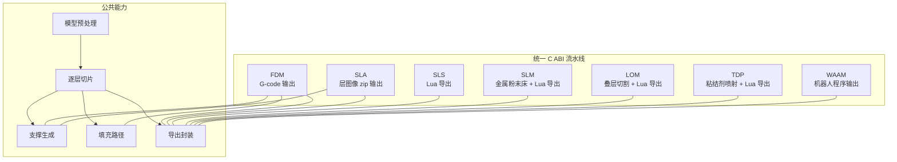
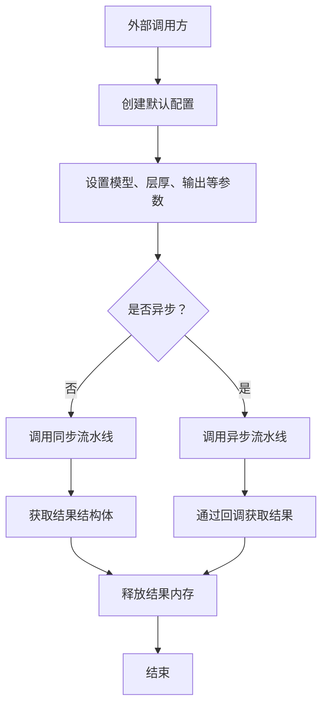
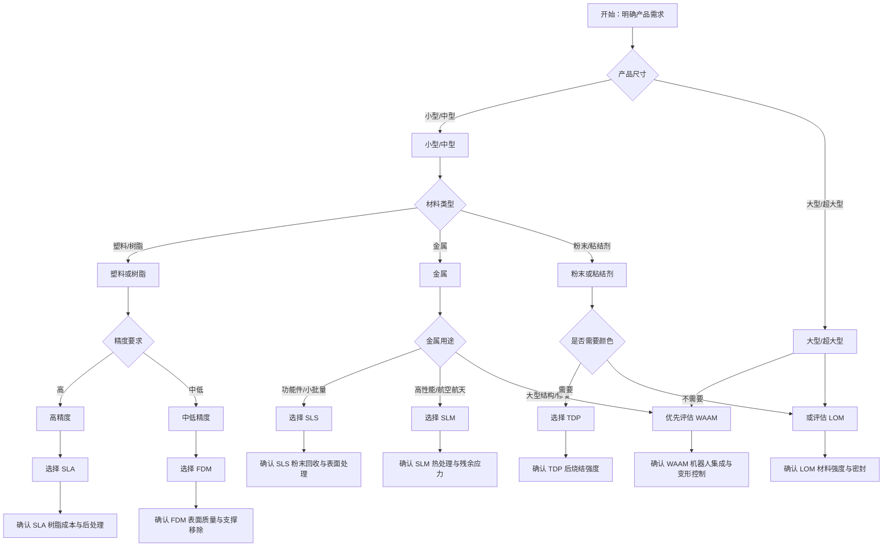
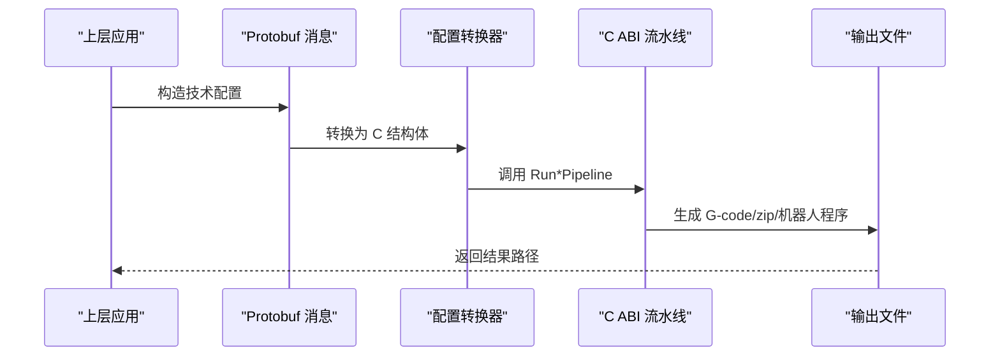

# 流水线技术对比与选择指南

<cite>
**本文引用的文件**   
- [README.md](file://README.md)
- [pipeline_types.h](file://pipelinetypes/pipeline_types.h)
- [fdm_pipeline.h](file://DllHsBaSlicer/fdm_pipeline.h)
- [sla_pipeline.h](file://DllHsBaSlicer/sla_pipeline.h)
- [sls_pipeline.h](file://DllHsBaSlicer/sls_pipeline.h)
- [slm_pipeline.h](file://DllHsBaSlicer/slm_pipeline.h)
- [lom_pipeline.h](file://DllHsBaSlicer/lom_pipeline.h)
- [tdp_pipeline.h](file://DllHsBaSlicer/tdp_pipeline.h)
- [waam_pipeline.h](file://DllHsBaSlicer/waam_pipeline.h)
- [base_config.proto](file://proto/base_config.proto)
- [slm_pipeline.proto](file://proto/slm_pipeline.proto)
- [PipelineConfig2Msg.cpp](file://convert/PipelineConfig2Msg.cpp)
- [Msg2PipelineConfig.cpp](file://convert/Msg2PipelineConfig.cpp)
- [hsba_slicer.cppm](file://ModuleHsBaSlicer/hsba_slicer.cppm)
- [my_slm_pipeline.lua](file://samples/Custom/scripts/my_slm_pipeline.lua)
</cite>

## 目录
1. [引言](#引言)
2. [项目结构中的七种技术定位](#项目结构中的七种技术定位)
3. [统一流水线接口与数据转换模式](#统一流水线接口与数据转换模式)
4. [七种技术综合对比矩阵](#七种技术综合对比矩阵)
5. [技术选择决策树](#技术选择决策树)
6. [各技术优缺点、典型场景与限制条件](#各技术优缺点典型场景与限制条件)
7. [跨技术数据转换与统一调用模式](#跨技术数据转换与统一调用模式)
8. [实际选型案例与经验总结](#实际选型案例与经验总结)
9. [性能与工程实践建议](#性能与工程实践建议)
10. [故障排除与常见问题](#故障排除与常见问题)
11. [结论](#结论)

## 引言
本指南面向需要在 FDM、SLA、SLS、SLM、LOM、TDP、WAAM 七种增材制造技术之间做系统对比与技术选型的开发者。文档以 HsBaSlicer 源码为依据，从统一 C ABI 流水线接口、配置结构体、Protobuf 消息定义、Lua 导出脚本和示例工程出发，给出精度、速度、材料成本、设备成本、适用场景等维度的结构化比较，并提供决策树、评估矩阵、跨技术数据转换方法和统一接口使用模式。

需要特别说明的是：HsBaSlicer 提供的是切片与路径生成框架，并不直接测量真实设备的物理精度或打印速度；因此“精度”“速度”“成本”等维度在本文件中分为两类：
- **框架内可量化指标**：层厚默认值、图像格式、输出类型（G-code / zip / 机器人程序）、是否支持支撑、是否依赖 Lua 导出脚本等。
- **工艺经验性判断**：基于每种技术在代码注释、参数语义和输出形态中体现的工艺特征，结合行业常识进行定性说明，用于辅助选型而非精确数值。

## 项目结构中的七种技术定位
HsBaSlicer 将七种技术抽象为统一的流水线入口：每个技术都有对应的 C ABI 头文件、C 兼容配置结构体、结果结构体、进度回调和异步回调。核心共性是：
- 所有流水线都暴露 `CreateDefault*Config`、`Run*Pipeline`、`Run*PipelineAsync`、`Free*PipelineResult` 风格接口。
- 配置结构体包含模型名称、模型路径、层厚、首层层厚、输出路径等通用字段。
- SLS、SLM、LOM、TDP 的导出阶段由 Lua 脚本决定具体文件格式；FDM 输出 G-code，SLA 输出层图像 zip，WAAM 输出机器人语言程序。

**图表来源**
- [fdm_pipeline.h:23-35](file://DllHsBaSlicer/fdm_pipeline.h#L23-L35)
- [sla_pipeline.h:23-34](file://DllHsBaSlicer/sla_pipeline.h#L23-L34)
- [sls_pipeline.h:23-34](file://DllHsBaSlicer/sls_pipeline.h#L23-L34)
- [slm_pipeline.h:23-37](file://DllHsBaSlicer/slm_pipeline.h#L23-L37)
- [lom_pipeline.h:23-37](file://DllHsBaSlicer/lom_pipeline.h#L23-L37)
- [tdp_pipeline.h:23-37](file://DllHsBaSlicer/tdp_pipeline.h#L23-L37)
- [waam_pipeline.h:23-38](file://DllHsBaSlicer/waam_pipeline.h#L23-L38)

**章节来源**
- [README.md:21-39](file://README.md#L21-L39)
- [fdm_pipeline.h:1-68](file://DllHsBaSlicer/fdm_pipeline.h#L1-L68)
- [sla_pipeline.h:1-63](file://DllHsBaSlicer/sla_pipeline.h#L1-L63)
- [sls_pipeline.h:1-63](file://DllHsBaSlicer/sls_pipeline.h#L1-L63)
- [slm_pipeline.h:1-63](file://DllHsBaSlicer/slm_pipeline.h#L1-L63)
- [lom_pipeline.h:1-63](file://DllHsBaSlicer/lom_pipeline.h#L1-L63)
- [tdp_pipeline.h:1-63](file://DllHsBaSlicer/tdp_pipeline.h#L1-L63)
- [waam_pipeline.h:1-64](file://DllHsBaSlicer/waam_pipeline.h#L1-L64)

## 统一流水线接口与数据转换模式
### 统一 C ABI 接口模式
每种技术的 C ABI 都遵循相同模式：
1. 通过 `HsBaCreateDefault*Config` 创建默认配置。
2. 设置模型路径、层厚、输出路径等字段。
3. 调用同步 `Run*Pipeline` 或异步 `Run*PipelineAsync`。
4. 通过结果结构体的 `success`、`total_layers`、`elapsed_seconds` 判断执行状态。
5. 调用对应 `Free*PipelineResult` 释放内存。

| 技术 | 同步接口 | 异步接口 | 主要输出 |
|------|----------|----------|----------|
| FDM | `HsBaRunFdmPipeline` | `HsBaRunFdmPipelineAsync` | G-code 文本 |
| SLA | `HsBaRunSlaPipeline` | `HsBaRunSlaPipelineAsync` | 层图像 zip |
| SLS | `HsBaRunSlsPipeline` | `HsBaRunSlsPipelineAsync` | Lua 导出文件 |
| SLM | `HsBaRunSlmPipeline` | `HsBaRunSlmPipelineAsync` | Lua 导出文件 |
| LOM | `HsBaRunLomPipeline` | `HsBaRunLomPipelineAsync` | Lua 导出文件 |
| TDP | `HsBaRunTdpPipeline` | `HsBaRunTdpPipelineAsync` | Lua 导出文件 |
| WAAM | `HsBaRunWaamPipeline` | `HsBaRunWaamPipelineAsync` | 机器人语言程序 |

### Protobuf 统一技术类型
在 `base_config.proto` 中，七种技术被统一映射到 `msg_technology_type`：
- `techt_Fff`：FDM/FFF
- `techt_Sla`：SLA
- `techt_Slm`：SLM
- `techt_Sls`：SLS
- `techt_Lom`：LOM
- `techt_3dp`：TDP/3DP
- `techt_Waam`：WAAM

这为跨语言、跨模块的技术路由提供了统一枚举基础。

**图表来源**
- [fdm_pipeline.h:23-61](file://DllHsBaSlicer/fdm_pipeline.h#L23-L61)
- [sla_pipeline.h:17-56](file://DllHsBaSlicer/sla_pipeline.h#L17-L56)
- [sls_pipeline.h:17-56](file://DllHsBaSlicer/sls_pipeline.h#L17-L56)
- [slm_pipeline.h:17-56](file://DllHsBaSlicer/slm_pipeline.h#L17-L56)
- [lom_pipeline.h:17-56](file://DllHsBaSlicer/lom_pipeline.h#L17-L56)
- [tdp_pipeline.h:17-56](file://DllHsBaSlicer/tdp_pipeline.h#L17-L56)
- [waam_pipeline.h:17-57](file://DllHsBaSlicer/waam_pipeline.h#L17-L57)

**章节来源**
- [base_config.proto:5-15](file://proto/base_config.proto#L5-L15)
- [fdm_pipeline.h:17-61](file://DllHsBaSlicer/fdm_pipeline.h#L17-L61)
- [sla_pipeline.h:17-56](file://DllHsBaSlicer/sla_pipeline.h#L17-L56)
- [sls_pipeline.h:17-56](file://DllHsBaSlicer/sls_pipeline.h#L17-L56)
- [slm_pipeline.h:17-56](file://DllHsBaSlicer/slm_pipeline.h#L17-L56)
- [lom_pipeline.h:17-56](file://DllHsBaSlicer/lom_pipeline.h#L17-L56)
- [tdp_pipeline.h:17-56](file://DllHsBaSlicer/tdp_pipeline.h#L17-L56)
- [waam_pipeline.h:17-57](file://DllHsBaSlicer/waam_pipeline.h#L17-L57)

## 七种技术综合对比矩阵
以下矩阵基于 HsBaSlicer 的配置结构体、注释、输出类型和示例脚本进行分析。其中“框架内默认精度”指层厚默认值，“输出形态”指流水线最终产物，“Lua 依赖”表示是否需要自定义导出脚本。

| 技术 | 框架内默认精度 （层厚） | 输出形态 | 是否内置支撑 | 是否需 Lua 导出 | 主要工艺特征 | 典型适用场景 | 主要限制 |
|------|---------------------------|----------|--------------|------------------|--------------|--------------|----------|
| FDM | 0.2 mm | G-code | 是 | 否 | 熔融沉积，支持 Marlin/RepRap/Klipper | 原型验证、功能件、教育、低成本制造 | 表面阶梯效应明显，精度受喷嘴直径影响 |
| SLA | 0.05 mm | 层图像 zip | 是 | 可选 | 光固化，支持 PNG/JPEG/SVG | 高精度外观件、牙科、珠宝、微结构 | 树脂成本高，后处理复杂 |
| SLS | 0.1 mm | Lua 导出 | 否 | 必须 | 粉末床激光烧结，无需支撑 | 功能件、小批量生产、复杂几何 | 设备昂贵，表面较粗糙 |
| SLM | 未固定默认值 | Lua 导出 | 否 | 必须 | 金属粉末床激光/电子束熔化 | 航空航天、医疗植入、模具镶件 | 材料昂贵，热应力大，需热处理 |
| LOM | 未固定默认值 | Lua 导出 | 否 | 必须 | 片材粘接+切割 | 大型快速原型、木工/纸模展示 | 材料利用率低，强度有限 |
| TDP | 未固定默认值 | Lua 导出 | 否 | 必须 | 粘结剂喷射，支持全彩/单通道/烧结 | 建筑模型、彩色原型、砂型铸造 | 强度较低，后处理耗时 |
| WAAM | 未固定默认值 | 机器人程序 | 否 | 可选 | 电弧/激光丝材沉积，机器人路径 | 大型金属构件、修复、重型装备 | 精度低，热输入大，变形控制难 |

### 关键差异点说明
- **精度维度**：SLA 默认层厚最小，适合高细节外观件；FDM 默认层厚较大，适合快速原型；SLS/SLM/TDP/LOM/WAAM 更关注工艺能力而非单纯层厚。
- **速度维度**：SLA 单层曝光速度快但总时间受层数影响；FDM 速度慢但设备普及度高；SLS/SLM 适合批量但设备成本高；WAAM 适合大体积但路径规划复杂。
- **材料成本**：FDM 最低，SLA 中等，SLS/SLM/TDP 较高，WAAM 金属材料成本高且能耗大。
- **设备成本**：FDM 最低，SLA 中等，SLS/SLM/LOM/TDP 高，WAAM 通常与工业机器人绑定，整体投入高。
- **Lua 依赖**：SLS、SLM、LOM、TDP 明确需要 Lua 导出脚本；FDM、SLA、WAAM 有内置输出逻辑，但也可扩展。

**章节来源**
- [pipeline_types.h:56-113](file://pipelinetypes/pipeline_types.h#L56-L113)
- [pipeline_types.h:170-218](file://pipelinetypes/pipeline_types.h#L170-L218)
- [pipeline_types.h:259-283](file://pipelinetypes/pipeline_types.h#L259-L283)
- [pipeline_types.h:359-376](file://pipelinetypes/pipeline_types.h#L359-L376)
- [pipeline_types.h:419-436](file://pipelinetypes/pipeline_types.h#L419-L436)
- [pipeline_types.h:480-496](file://pipelinetypes/pipeline_types.h#L480-L496)
- [pipeline_types.h:578-600](file://pipelinetypes/pipeline_types.h#L578-L600)
- [slm_pipeline.h:23-37](file://DllHsBaSlicer/slm_pipeline.h#L23-L37)
- [lom_pipeline.h:23-37](file://DllHsBaSlicer/lom_pipeline.h#L23-L37)
- [tdp_pipeline.h:23-37](file://DllHsBaSlicer/tdp_pipeline.h#L23-L37)
- [waam_pipeline.h:23-38](file://DllHsBaSlicer/waam_pipeline.h#L23-L38)

## 技术选择决策树
下面的决策树帮助开发者根据产品需求快速缩小技术范围。

**图表来源**
- [pipeline_types.h:56-113](file://pipelinetypes/pipeline_types.h#L56-L113)
- [pipeline_types.h:170-218](file://pipelinetypes/pipeline_types.h#L170-L218)
- [pipeline_types.h:259-283](file://pipelinetypes/pipeline_types.h#L259-L283)
- [pipeline_types.h:359-376](file://pipelinetypes/pipeline_types.h#L359-L376)
- [pipeline_types.h:419-436](file://pipelinetypes/pipeline_types.h#L419-L436)
- [pipeline_types.h:480-496](file://pipelinetypes/pipeline_types.h#L480-L496)
- [pipeline_types.h:578-600](file://pipelinetypes/pipeline_types.h#L578-L600)

## 各技术优缺点、典型场景与限制条件

### FDM（熔融沉积制造）
- **优点**：设备成本低、材料丰富、支持多固件目标、内置支撑与填充算法、Lua 可扩展支撑与填充。
- **缺点**：表面阶梯效应明显、悬垂面需支撑、精度受喷嘴直径和挤出稳定性影响。
- **典型场景**：原型验证、教学演示、低成本功能件、快速迭代。
- **限制条件**：不适合极高表面质量要求；支撑移除可能损伤模型。

**章节来源**
- [pipeline_types.h:23-113](file://pipelinetypes/pipeline_types.h#L23-L113)
- [fdm_pipeline.h:23-61](file://DllHsBaSlicer/fdm_pipeline.h#L23-L61)

### SLA（立体光刻）
- **优点**：默认层厚小、表面质量好、支持多种图像格式、可自定义地板/支撑/导出。
- **缺点**：树脂成本高、支撑去除困难、模型易脆、后处理复杂。
- **典型场景**：高精度外观件、牙科模型、珠宝蜡模、微流控芯片。
- **限制条件**：不适合大批量生产；长时间曝光可能引起翘曲。

**章节来源**
- [pipeline_types.h:146-232](file://pipelinetypes/pipeline_types.h#L146-L232)
- [sla_pipeline.h:23-56](file://DllHsBaSlicer/sla_pipeline.h#L23-L56)

### SLS（选择性激光烧结）
- **优点**：无需支撑、粉末床提供热稳定性、适合复杂几何和小批量生产。
- **缺点**：设备昂贵、表面粗糙、粉末回收管理复杂。
- **典型场景**：功能件、夹具、小批量工业零件。
- **限制条件**：需要自定义 Lua 导出脚本；不同设备厂商格式差异大。

**章节来源**
- [pipeline_types.h:247-310](file://pipelinetypes/pipeline_types.h#L247-L310)
- [sls_pipeline.h:23-56](file://DllHsBaSlicer/sls_pipeline.h#L23-L56)

### SLM（选择性激光熔化）
- **优点**：金属致密度高、机械性能好、适合高性能部件。
- **缺点**：材料昂贵、热应力大、需保护气体和后处理。
- **典型场景**：航空航天、医疗植入、模具镶件、高性能结构件。
- **限制条件**：必须提供金属相关参数；Lua 导出需适配设备厂商。

**章节来源**
- [pipeline_types.h:312-401](file://pipelinetypes/pipeline_types.h#L312-L401)
- [slm_pipeline.h:23-56](file://DllHsBaSlicer/slm_pipeline.h#L23-L56)
- [slm_pipeline.proto:5-44](file://proto/slm_pipeline.proto#L5-L44)

### LOM（叠层实体制造）
- **优点**：适合大型快速原型、材料成本低、切割速度快。
- **缺点**：层间强度弱、材料利用率低、不适合受力件。
- **典型场景**：展示模型、木工/纸模、大型概念验证。
- **限制条件**：需要自定义 Lua 导出；切割参数对材料敏感。

**章节来源**
- [pipeline_types.h:403-461](file://pipelinetypes/pipeline_types.h#L403-L461)
- [lom_pipeline.h:23-56](file://DllHsBaSlicer/lom_pipeline.h#L23-L56)

### TDP（三维打印/粘结剂喷射）
- **优点**：支持全彩打印、适合建筑模型和砂型铸造。
- **缺点**：强度较低、后处理耗时、烧结收缩控制难。
- **典型场景**：彩色原型、建筑沙盘、铸造砂型。
- **限制条件**：需要粘结剂饱和度和固化时间参数；Lua 导出需适配喷头行为。

**章节来源**
- [pipeline_types.h:463-521](file://pipelinetypes/pipeline_types.h#L463-L521)
- [tdp_pipeline.h:23-56](file://DllHsBaSlicer/tdp_pipeline.h#L23-L56)

### WAAM（电弧增材制造）
- **优点**：适合大体积金属构件、材料利用率高、可与机器人集成。
- **缺点**：精度低、热输入大、变形控制复杂、路径规划难度高。
- **典型场景**：大型结构件、修复、重型装备、海洋工程。
- **限制条件**：输出为机器人程序；需要 ABB/KUKA/FANUC 等控制器适配。

**章节来源**
- [pipeline_types.h:523-625](file://pipelinetypes/pipeline_types.h#L523-L625)
- [waam_pipeline.h:23-57](file://DllHsBaSlicer/waam_pipeline.h#L23-L57)

## 跨技术数据转换与统一调用模式
### Protobuf 与 C 结构体双向转换
HsBaSlicer 通过 `convert` 模块实现 Protobuf 消息与 C 兼容结构体之间的转换。例如：
- `PipelineConfig2Msg.cpp` 负责将 C 配置转换为 Protobuf 消息。
- `Msg2PipelineConfig.cpp` 负责将 Protobuf 消息转换为 C 配置。

这种设计使得上层应用可以通过统一的 Protobuf 接口调度不同技术，而底层 C ABI 保持稳定。

**图表来源**
- [PipelineConfig2Msg.cpp:52-95](file://convert/PipelineConfig2Msg.cpp#L52-L95)
- [Msg2PipelineConfig.cpp:247-269](file://convert/Msg2PipelineConfig.cpp#L247-L269)

### 统一调用模式
无论哪种技术，调用流程都遵循：
1. 构造 Protobuf 配置或 C 结构体配置。
2. 设置模型路径、层厚、输出路径。
3. 调用对应流水线接口。
4. 检查结果结构体的 `success` 和 `error_message`。
5. 释放内存。

对于 SLM 等金属工艺，还可以参考 `samples/Custom/scripts/my_slm_pipeline.lua`，该脚本展示了完全由 Lua 驱动的 SLM 打包流程，包括模型加载、切片、参数读取和输出路径设置。

**章节来源**
- [PipelineConfig2Msg.cpp:52-95](file://convert/PipelineConfig2Msg.cpp#L52-L95)
- [Msg2PipelineConfig.cpp:247-269](file://convert/Msg2PipelineConfig.cpp#L247-L269)
- [my_slm_pipeline.lua:1-34](file://samples/Custom/scripts/my_slm_pipeline.lua#L1-L34)

## 实际选型案例与经验总结

### 案例一：高精度外观件
- **需求**：表面光滑、细节丰富、小批量。
- **选择**：SLA。
- **理由**：默认层厚 0.05 mm，支持 PNG/JPEG/SVG 图像格式，内置支撑和地板生成。
- **注意事项**：树脂成本高，需考虑后处理和支撑去除。

**章节来源**
- [pipeline_types.h:170-218](file://pipelinetypes/pipeline_types.h#L170-L218)
- [sla_pipeline.h:23-56](file://DllHsBaSlicer/sla_pipeline.h#L23-L56)

### 案例二：低成本功能原型
- **需求**：快速验证、成本低、可装配。
- **选择**：FDM。
- **理由**：设备便宜、材料多样、支持 Marlin/RepRap/Klipper 固件。
- **注意事项**：表面质量一般，悬垂面需支撑。

**章节来源**
- [pipeline_types.h:56-113](file://pipelinetypes/pipeline_types.h#L56-L113)
- [fdm_pipeline.h:23-61](file://DllHsBaSlicer/fdm_pipeline.h#L23-L61)

### 案例三：高性能金属部件
- **需求**：高强度、耐高温、航空航天。
- **选择**：SLM。
- **理由**：金属粉末床激光/电子束熔化，支持钛合金、铝合金、铁基材料。
- **注意事项**：需保护气体、热处理、残余应力控制。

**章节来源**
- [pipeline_types.h:312-401](file://pipelinetypes/pipeline_types.h#L312-L401)
- [slm_pipeline.h:23-56](file://DllHsBaSlicer/slm_pipeline.h#L23-L56)

### 案例四：大型金属结构修复
- **需求**：大体积、现场修复、重型装备。
- **选择**：WAAM。
- **理由**：机器人路径输出，适合 ABB/KUKA/FANUC 控制器。
- **注意事项**：精度低，热变形大，需路径优化和温度控制。

**章节来源**
- [pipeline_types.h:523-625](file://pipelinetypes/pipeline_types.h#L523-L625)
- [waam_pipeline.h:23-57](file://DllHsBaSlicer/waam_pipeline.h#L23-L57)

### 案例五：彩色建筑模型
- **需求**：全彩、低成本、展示用。
- **选择**：TDP。
- **理由**：粘结剂喷射支持全彩模式，适合建筑沙盘。
- **注意事项**：强度低，需后处理增强。

**章节来源**
- [pipeline_types.h:463-521](file://pipelinetypes/pipeline_types.h#L463-L521)
- [tdp_pipeline.h:23-56](file://DllHsBaSlicer/tdp_pipeline.h#L23-L56)

### 案例六：大型展示原型
- **需求**：大尺寸、快速、低成本。
- **选择**：LOM。
- **理由**：片材切割速度快，适合大型展示模型。
- **注意事项**：层间强度弱，不适合受力件。

**章节来源**
- [pipeline_types.h:403-461](file://pipelinetypes/pipeline_types.h#L403-L461)
- [lom_pipeline.h:23-56](file://DllHsBaSlicer/lom_pipeline.h#L23-L56)

## 性能与工程实践建议
- **并行处理**：HsBaSlicer 内部使用协程和线程池，异步接口适合 UI 或后台任务。
- **Lua 扩展**：SLS/SLM/LOM/TDP 的导出逻辑由 Lua 脚本决定，建议先复用官方示例再定制。
- **错误处理**：始终检查结果结构体的 `success` 和 `error_message`，避免空指针访问。
- **内存管理**：务必调用 `Free*PipelineResult` 释放 C ABI 分配的字符串内存。
- **路径优化**：FDM 和 WAAM 的路径生成对打印质量和效率影响显著，建议启用螺旋模式和路径优化。

[本节为通用工程建议，不直接分析具体文件]

## 故障排除与常见问题
- **问题**：SLA 导出失败。
  - **排查**：检查 `output_path` 是否有效，确认图像格式和尺寸参数。
  - **依据**：SLA 配置包含 `image_type`、`image_width`、`image_height`。
- **问题**：SLS/SLM/LOM/TDP 导出无输出。
  - **排查**：确认 `export_lua_script` 不为 NULL，并检查 Lua 脚本路径和函数名。
  - **依据**：这些技术的配置明确要求 Lua 导出脚本。
- **问题**：WAAM 机器人程序无法运行。
  - **排查**：确认 `robot_type` 与目标控制器匹配，检查路径 Lua 脚本生成的机器人代码语法。
  - **依据**：WAAM 配置包含 `robot_type` 和 `path_lua_script`。
- **问题**：FDM G-code 无法被固件识别。
  - **排查**：检查 `gcode_firmware` 是否与目标固件匹配，确认喷嘴直径和线材直径参数。
  - **依据**：FDM 配置包含 `gcode_firmware`、`nozzle_diameter`、`filament_diameter`。

**章节来源**
- [pipeline_types.h:170-218](file://pipelinetypes/pipeline_types.h#L170-L218)
- [pipeline_types.h:259-283](file://pipelinetypes/pipeline_types.h#L259-L283)
- [pipeline_types.h:359-376](file://pipelinetypes/pipeline_types.h#L359-L376)
- [pipeline_types.h:419-436](file://pipelinetypes/pipeline_types.h#L419-L436)
- [pipeline_types.h:480-496](file://pipelinetypes/pipeline_types.h#L480-L496)
- [pipeline_types.h:578-600](file://pipelinetypes/pipeline_types.h#L578-L600)

## 结论
HsBaSlicer 为七种增材制造技术提供了统一的流水线接口和数据转换机制。开发者应根据产品尺寸、材料、精度、成本和工艺约束选择合适的技术：
- **高精度外观件**：优先 SLA。
- **低成本原型**：优先 FDM。
- **功能件与小批量**：考虑 SLS。
- **高性能金属件**：选择 SLM。
- **大型展示模型**：考虑 LOM。
- **彩色原型与铸造**：选择 TDP。
- **大型金属结构与修复**：选择 WAAM。

在实际工程中，建议结合 HsBaSlicer 的异步接口、Lua 扩展能力和 Protobuf 统一消息体系，构建可维护、可扩展的多技术流水线平台。

[本节为总结性内容，不直接分析具体文件]