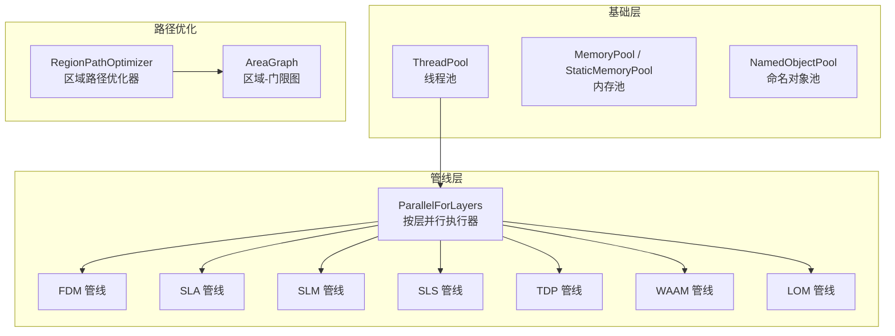
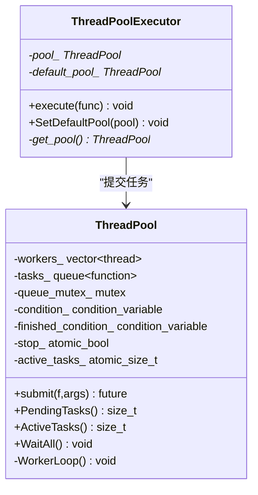
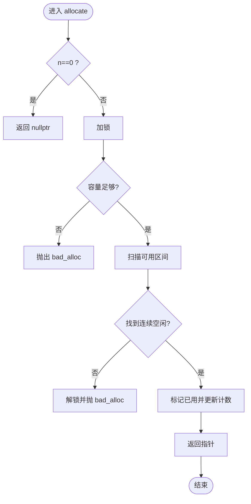
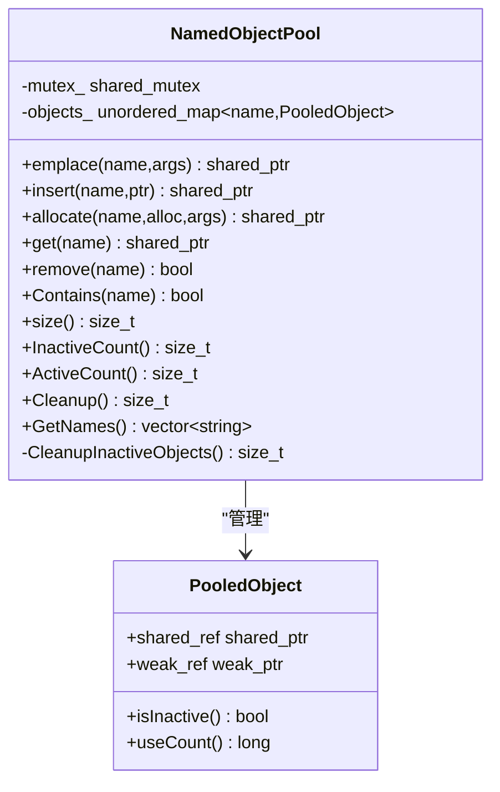
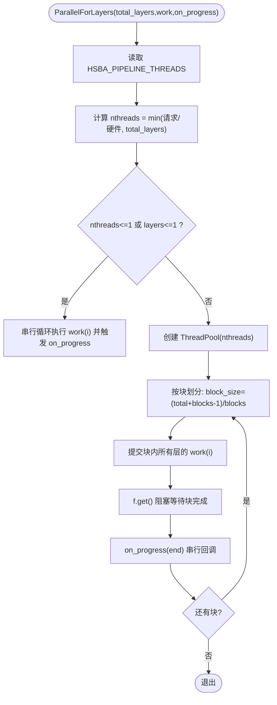
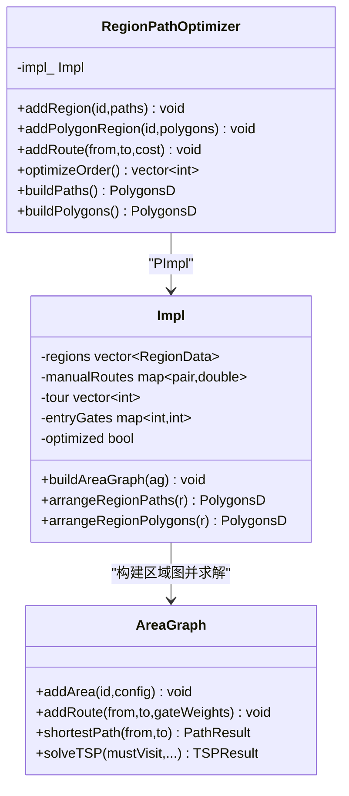
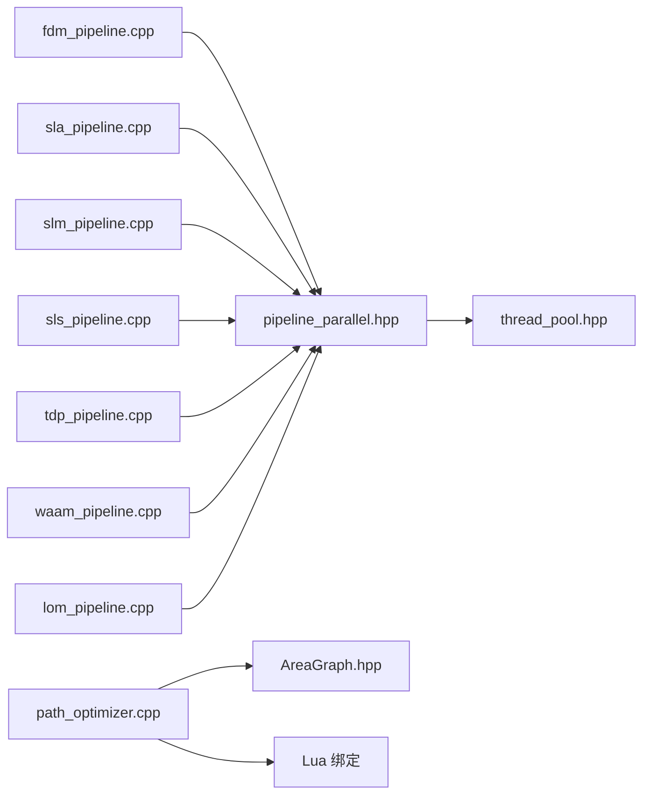

# 并行计算优化

<cite>
**本文引用的文件**   
- [base/thread_pool.hpp](file://base/thread_pool.hpp)
- [base/memory_pool.hpp](file://base/memory_pool.hpp)
- [base/object_pool.hpp](file://base/object_pool.hpp)
- [DllHsBaSlicer/pipeline_parallel.hpp](file://DllHsBaSlicer/pipeline_parallel.hpp)
- [LibHsBaSlicer/Path/path_optimizer.hpp](file://LibHsBaSlicer/Path/path_optimizer.hpp)
- [LibHsBaSlicer/Path/path_optimizer.cpp](file://LibHsBaSlicer/Path/path_optimizer.cpp)
- [utils/AreaGraph.hpp](file://utils/AreaGraph.hpp)
- [tests/Pool/thread_pool_test.cpp](file://tests/Pool/thread_pool_test.cpp)
- [tests/PolygonFill/polygon_fill_test.cpp](file://tests/PolygonFill/polygon_fill_test.cpp)
- [tests/PolygonFill/optimize_paths.lua](file://tests/PolygonFill/optimize_paths.lua)
- [DllHsBaSlicer/fdm_pipeline.cpp](file://DllHsBaSlicer/fdm_pipeline.cpp)
- [DllHsBaSlicer/sla_pipeline.cpp](file://DllHsBaSlicer/sla_pipeline.cpp)
- [DllHsBaSlicer/slm_pipeline.cpp](file://DllHsBaSlicer/slm_pipeline.cpp)
- [DllHsBaSlicer/sls_pipeline.cpp](file://DllHsBaSlicer/sls_pipeline.cpp)
- [DllHsBaSlicer/tdp_pipeline.cpp](file://DllHsBaSlicer/tdp_pipeline.cpp)
- [DllHsBaSlicer/waam_pipeline.cpp](file://DllHsBaSlicer/waam_pipeline.cpp)
- [DllHsBaSlicer/lom_pipeline.cpp](file://DllHsBaSlicer/lom_pipeline.cpp)
- [LibHsBaSlicer/Floor/sla_floor.cpp](file://LibHsBaSlicer/Floor/sla_floor.cpp)
</cite>

## 目录
1. [引言](#引言)
2. [项目结构](#项目结构)
3. [核心组件](#核心组件)
4. [架构总览](#架构总览)
5. [详细组件分析](#详细组件分析)
6. [依赖关系分析](#依赖关系分析)
7. [性能与并行度调优](#性能与并行度调优)
8. [大数据集处理策略](#大数据集处理策略)
9. [故障排除指南](#故障排除指南)
10. [结论](#结论)
11. [附录：API 与配置速查](#附录api-与配置速查)

## 引言
本文面向有经验的 C++ 开发者，系统性梳理 HsBaSlicer 的并行计算优化方案。内容覆盖线程池实现、任务分配与负载均衡、内存与对象池生命周期管理、路径优化的并行算法、几何计算的加速技术、大数据集处理策略，以及并行度调优方法、基准测试思路和优化案例。文档中的关键实现均直接对应源码文件，便于读者进一步定位代码细节。

## 项目结构
HsBaSlicer 的并行能力由基础库与管线层共同构成：
- 基础层提供线程池、内存池、对象池等通用并发与内存工具。
- 管线层在切片、填充、支撑、路径生成等阶段使用并行执行器对“层”进行并行化。
- 路径优化模块通过区域图与遗传 TSP 算法减少空走距离，配合并行填充提升整体吞吐。



**图表来源**
- [base/thread_pool.hpp:29-162](file://base/thread_pool.hpp#L29-L162)
- [base/memory_pool.hpp:43-208](file://base/memory_pool.hpp#L43-L208)
- [base/object_pool.hpp:22-283](file://base/object_pool.hpp#L22-L283)
- [DllHsBaSlicer/pipeline_parallel.hpp:41-117](file://DllHsBaSlicer/pipeline_parallel.hpp#L41-L117)
- [LibHsBaSlicer/Path/path_optimizer.hpp:44-100](file://LibHsBaSlicer/Path/path_optimizer.hpp#L44-L100)
- [utils/AreaGraph.hpp:105-345](file://utils/AreaGraph.hpp#L105-L345)

**章节来源**
- [base/thread_pool.hpp:29-162](file://base/thread_pool.hpp#L29-L162)
- [base/memory_pool.hpp:43-208](file://base/memory_pool.hpp#L43-L208)
- [base/object_pool.hpp:22-283](file://base/object_pool.hpp#L22-L283)
- [DllHsBaSlicer/pipeline_parallel.hpp:41-117](file://DllHsBaSlicer/pipeline_parallel.hpp#L41-L117)
- [LibHsBaSlicer/Path/path_optimizer.hpp:44-100](file://LibHsBaSlicer/Path/path_optimizer.hpp#L44-L100)
- [utils/AreaGraph.hpp:105-345](file://utils/AreaGraph.hpp#L105-L345)

## 核心组件
本节聚焦三大基础组件与一个管线并行执行器：
- ThreadPool：带 future 的任务提交、活跃任务计数、等待全部完成；可选协程执行器。
- MemoryPool / StaticMemoryPool：固定大小内存池，支持线程安全分配/释放，适合高频小对象。
- NamedObjectPool：命名共享对象池，基于 shared_ptr/weak_ptr 自动回收非活跃对象。
- ParallelForLayers：按层并行执行器，块状调度、进度回调串行化、环境变量控制并行度。

**章节来源**
- [base/thread_pool.hpp:29-162](file://base/thread_pool.hpp#L29-L162)
- [base/memory_pool.hpp:43-208](file://base/memory_pool.hpp#L43-L208)
- [base/object_pool.hpp:22-283](file://base/object_pool.hpp#L22-L283)
- [DllHsBaSlicer/pipeline_parallel.hpp:41-117](file://DllHsBaSlicer/pipeline_parallel.hpp#L41-L117)

## 架构总览
下图展示从管线入口到具体阶段的并行调用链，以及路径优化在数据流中的位置。

```mermaid
sequenceDiagram
participant Caller as "调用方"
participant Pipeline as "各管线(如 FDM/SLA)"
participant Par as "ParallelForLayers"
participant Pool as "ThreadPool"
participant Worker as "工作线程"
participant Opt as "RegionPathOptimizer"
participant Graph as "AreaGraph"
Caller->>Pipeline : 运行完整管线
Pipeline->>Par : 按层并行(work, on_progress)
Par->>Pool : submit(每层 work(i))
Pool->>Worker : 执行 work(i)
Worker-->>Par : 完成一层
Par->>Caller : on_progress(累计完成层数)
Note over Opt,Graph : 路径优化在填充前后均可介入
Opt->>Graph : 构建 AreaGraph(区域=顶点, 门=出入口)
Graph-->>Opt : 最短路径/TSP 结果
Opt-->>Caller : 输出优化后的路径或多边形顺序
```

**图表来源**
- [DllHsBaSlicer/pipeline_parallel.hpp:41-117](file://DllHsBaSlicer/pipeline_parallel.hpp#L41-L117)
- [base/thread_pool.hpp:67-111](file://base/thread_pool.hpp#L67-L111)
- [LibHsBaSlicer/Path/path_optimizer.cpp:129-185](file://LibHsBaSlicer/Path/path_optimizer.cpp#L129-L185)
- [utils/AreaGraph.hpp:197-345](file://utils/AreaGraph.hpp#L197-L345)

## 详细组件分析

### 线程池 ThreadPool
- 设计要点
  - 构造时创建固定数量的 worker 线程，析构时设置停止标志并 join。
  - submit 将函数包装为 packaged_task，放入队列，返回 future。
  - ActiveTasks 原子计数，WaitAll 通过条件变量等待队列为空且无活跃任务。
  - 可选协程执行器 ThreadPoolExecutor 实现 IExecutor，支持默认池或指定池。
- 任务分配与异常
  - 任务按提交顺序入队，异常在工作线程捕获但不影响其他任务；future.get() 可重新抛出异常。
- 资源管理
  - 禁止拷贝移动，避免多实例竞争同一队列。
  - 可通过 PendingTasks/ActiveTasks 监控负载。



**图表来源**
- [base/thread_pool.hpp:29-162](file://base/thread_pool.hpp#L29-L162)
- [base/thread_pool.hpp:170-207](file://base/thread_pool.hpp#L170-L207)

**章节来源**
- [base/thread_pool.hpp:29-162](file://base/thread_pool.hpp#L29-L162)
- [tests/Pool/thread_pool_test.cpp:14-37](file://tests/Pool/thread_pool_test.cpp#L14-L37)
- [tests/Pool/thread_pool_test.cpp:39-84](file://tests/Pool/thread_pool_test.cpp#L39-L84)

### 内存池 MemoryPool / StaticMemoryPool
- 设计要点
  - MemoryPool：实例级共享状态（shared_ptr），线程安全分配/释放，按字节位标记 used。
  - StaticMemoryPool：静态全局缓冲，所有实例共享，is_always_equal=true，适合跨实例复用。
  - 两者均提供 allocate/deallocate/construct/destroy，符合 Allocator 语义。
- 复杂度与风险
  - 分配/释放为 O(PoolSize) 线性扫描，存在锁竞争；适用于小块频繁分配场景。
  - 越界释放会抛 invalid_argument；超容量抛 bad_alloc。



**图表来源**
- [base/memory_pool.hpp:111-142](file://base/memory_pool.hpp#L111-L142)
- [base/memory_pool.hpp:266-296](file://base/memory_pool.hpp#L266-L296)

**章节来源**
- [base/memory_pool.hpp:43-208](file://base/memory_pool.hpp#L43-L208)
- [base/memory_pool.hpp:215-372](file://base/memory_pool.hpp#L215-L372)

### 命名对象池 NamedObjectPool
- 设计要点
  - 以名称索引存储 shared_ptr，同时维护 weak_ref 用于检测非活跃对象。
  - emplace/insert/allocate 在满池时清理 inactive 对象；读取使用 shared_lock，写入使用 unique_lock。
  - CleanupInactiveObjects 遍历删除 use_count==1 的对象，避免常驻内存泄漏。
- 适用场景
  - 需要跨线程共享对象、按名查找、自动回收的场景，例如缓存模型、中间结果。



**图表来源**
- [base/object_pool.hpp:22-283](file://base/object_pool.hpp#L22-L283)

**章节来源**
- [base/object_pool.hpp:22-283](file://base/object_pool.hpp#L22-L283)

### 管线并行执行器 ParallelForLayers
- 设计要点
  - 根据 HSBA_PIPELINE_THREADS 环境变量决定线程数；未设置则取硬件并发。
  - 当 nthreads<=1 或 total_layers<=1 时退化为串行，保证行为一致。
  - 分块调度：blocks=min(nthreads*4,total_layers)，每个块内并行提交，完成后统一 on_progress。
  - 工作函数 work(layer_index) 必须只写自身层对应的输出槽，保证线程安全。
- 与其他管线集成
  - FDM、SLA、SLM、SLS、TDP、WAAM、LOM 管线均通过 ParallelForLayers 并行处理层。



**图表来源**
- [DllHsBaSlicer/pipeline_parallel.hpp:41-117](file://DllHsBaSlicer/pipeline_parallel.hpp#L41-L117)

**章节来源**
- [DllHsBaSlicer/pipeline_parallel.hpp:41-117](file://DllHsBaSlicer/pipeline_parallel.hpp#L41-L117)
- [DllHsBaSlicer/fdm_pipeline.cpp:267-275](file://DllHsBaSlicer/fdm_pipeline.cpp#L267-L275)
- [DllHsBaSlicer/fdm_pipeline.cpp:376-384](file://DllHsBaSlicer/fdm_pipeline.cpp#L376-L384)
- [DllHsBaSlicer/sla_pipeline.cpp:346-354](file://DllHsBaSlicer/sla_pipeline.cpp#L346-L354)
- [DllHsBaSlicer/slm_pipeline.cpp:281-289](file://DllHsBaSlicer/slm_pipeline.cpp#L281-L289)
- [DllHsBaSlicer/sls_pipeline.cpp:229-237](file://DllHsBaSlicer/sls_pipeline.cpp#L229-L237)
- [DllHsBaSlicer/tdp_pipeline.cpp:248-256](file://DllHsBaSlicer/tdp_pipeline.cpp#L248-L256)
- [DllHsBaSlicer/waam_pipeline.cpp:217-225](file://DllHsBaSlicer/waam_pipeline.cpp#L217-L225)
- [DllHsBaSlicer/lom_pipeline.cpp:238-246](file://DllHsBaSlicer/lom_pipeline.cpp#L238-L246)

### 路径优化 RegionPathOptimizer 与 AreaGraph
- 模式
  - 多边形模式（填充前）：输入为多边形轮廓，所有顶点作为门；输出为优化顺序的多边形集合。
  - 填充结果模式（填充后）：输入为填充路径（多点折线），每条路径的首尾端点作为门；输出为完整填充路径。
- 建模
  - 每个区域为一个 AreaGraph 顶点；区域内门到门的内部成本为直线距离；区域间路由成本为门对之间的直线距离，可手动覆盖。
- 求解
  - 两区域时直接比较两个方向的最短路径。
  - 三区域及以上使用遗传 TSP 求解访问顺序，并记录每个区域的入口门。
  - 区域内路径/多边形顺序采用最近邻贪心安排，减少跳跃和空走。
- Lua 接口
  - PathOptimize.new()/optimizeRegions()/optimizePolygons() 暴露给脚本环境，支持嵌入脚本或内联脚本。



**图表来源**
- [LibHsBaSlicer/Path/path_optimizer.hpp:44-100](file://LibHsBaSlicer/Path/path_optimizer.hpp#L44-L100)
- [LibHsBaSlicer/Path/path_optimizer.cpp:45-127](file://LibHsBaSlicer/Path/path_optimizer.cpp#L45-L127)
- [utils/AreaGraph.hpp:105-345](file://utils/AreaGraph.hpp#L105-L345)

**章节来源**
- [LibHsBaSlicer/Path/path_optimizer.hpp:44-100](file://LibHsBaSlicer/Path/path_optimizer.hpp#L44-L100)
- [LibHsBaSlicer/Path/path_optimizer.cpp:68-127](file://LibHsBaSlicer/Path/path_optimizer.cpp#L68-L127)
- [LibHsBaSlicer/Path/path_optimizer.cpp:129-185](file://LibHsBaSlicer/Path/path_optimizer.cpp#L129-L185)
- [LibHsBaSlicer/Path/path_optimizer.cpp:314-438](file://LibHsBaSlicer/Path/path_optimizer.cpp#L314-L438)
- [utils/AreaGraph.hpp:197-345](file://utils/AreaGraph.hpp#L197-L345)
- [tests/PolygonFill/polygon_fill_test.cpp:328-352](file://tests/PolygonFill/polygon_fill_test.cpp#L328-L352)
- [tests/PolygonFill/optimize_paths.lua:1-33](file://tests/PolygonFill/optimize_paths.lua#L1-L33)

## 依赖关系分析
- 组件耦合
  - 管线层强依赖 ParallelForLayers 与 ThreadPool；路径优化独立于并行执行器，但可与填充阶段组合。
  - AreaGraph 依赖 Boost Graph 与自定义 DirectedGraph，提供最短路径与 TSP 能力。
- 外部依赖
  - Boost：adjacency_list、hash 等。
  - Lua：路径优化脚本环境与数据绑定。
- 潜在环依赖
  - 当前结构未见明显环依赖；路径优化与底层几何/填充解耦，通过 PolygonsD 传递数据。



**图表来源**
- [DllHsBaSlicer/fdm_pipeline.cpp:267-275](file://DllHsBaSlicer/fdm_pipeline.cpp#L267-L275)
- [DllHsBaSlicer/sla_pipeline.cpp:346-354](file://DllHsBaSlicer/sla_pipeline.cpp#L346-L354)
- [DllHsBaSlicer/slm_pipeline.cpp:281-289](file://DllHsBaSlicer/slm_pipeline.cpp#L281-L289)
- [DllHsBaSlicer/sls_pipeline.cpp:229-237](file://DllHsBaSlicer/sls_pipeline.cpp#L229-L237)
- [DllHsBaSlicer/tdp_pipeline.cpp:248-256](file://DllHsBaSlicer/tdp_pipeline.cpp#L248-L256)
- [DllHsBaSlicer/waam_pipeline.cpp:217-225](file://DllHsBaSlicer/waam_pipeline.cpp#L217-L225)
- [DllHsBaSlicer/lom_pipeline.cpp:238-246](file://DllHsBaSlicer/lom_pipeline.cpp#L238-L246)
- [DllHsBaSlicer/pipeline_parallel.hpp:41-117](file://DllHsBaSlicer/pipeline_parallel.hpp#L41-L117)
- [base/thread_pool.hpp:29-162](file://base/thread_pool.hpp#L29-L162)
- [LibHsBaSlicer/Path/path_optimizer.cpp:129-185](file://LibHsBaSlicer/Path/path_optimizer.cpp#L129-L185)
- [utils/AreaGraph.hpp:197-345](file://utils/AreaGraph.hpp#L197-L345)

**章节来源**
- [DllHsBaSlicer/fdm_pipeline.cpp:267-275](file://DllHsBaSlicer/fdm_pipeline.cpp#L267-L275)
- [DllHsBaSlicer/sla_pipeline.cpp:346-354](file://DllHsBaSlicer/sla_pipeline.cpp#L346-L354)
- [DllHsBaSlicer/slm_pipeline.cpp:281-289](file://DllHsBaSlicer/slm_pipeline.cpp#L281-L289)
- [DllHsBaSlicer/sls_pipeline.cpp:229-237](file://DllHsBaSlicer/sls_pipeline.cpp#L229-L237)
- [DllHsBaSlicer/tdp_pipeline.cpp:248-256](file://DllHsBaSlicer/tdp_pipeline.cpp#L248-L256)
- [DllHsBaSlicer/waam_pipeline.cpp:217-225](file://DllHsBaSlicer/waam_pipeline.cpp#L217-L225)
- [DllHsBaSlicer/lom_pipeline.cpp:238-246](file://DllHsBaSlicer/lom_pipeline.cpp#L238-L246)
- [DllHsBaSlicer/pipeline_parallel.hpp:41-117](file://DllHsBaSlicer/pipeline_parallel.hpp#L41-L117)
- [base/thread_pool.hpp:29-162](file://base/thread_pool.hpp#L29-L162)
- [LibHsBaSlicer/Path/path_optimizer.cpp:129-185](file://LibHsBaSlicer/Path/path_optimizer.cpp#L129-L185)
- [utils/AreaGraph.hpp:197-345](file://utils/AreaGraph.hpp#L197-L345)

## 性能与并行度调优
- 并行度选择
  - 默认线程数取自 std::thread::hardware_concurrency()，可通过 HSBA_PIPELINE_THREADS 环境变量强制指定。
  - 当 nthreads<=1 或 total_layers<=1 时自动回退串行，确保行为一致。
- 任务粒度
  - ParallelForLayers 使用块状调度 blocks=min(nthreads*4,total_layers)，降低进度回调频率，提高吞吐。
  - 建议 work 函数尽量包含足够的计算量，避免过多极短任务导致队列开销放大。
- 内存与对象池
  - 高频小对象分配建议使用 MemoryPool/StaticMemoryPool，减少堆分配与碎片。
  - 跨线程共享对象使用 NamedObjectPool，利用 weak_ptr 自动回收非活跃对象，避免内存泄漏。
- 路径优化
  - 多边形模式在填充前优化多边形顺序，可减少后续填充的空走。
  - 填充结果模式在填充后优化路径顺序，结合最近邻贪心减少跳跃。
- 基准测试建议
  - 使用 HSBA_PIPELINE_THREADS=1 与默认值对比，验证并行收益。
  - 统计 total_layers、elapsed_seconds、progress 回调次数，评估并行效率。
  - 针对典型数据集（复杂网格、多层薄壁、分散区域）分别测试，观察不同并行度下的稳定性。

**章节来源**
- [DllHsBaSlicer/pipeline_parallel.hpp:41-117](file://DllHsBaSlicer/pipeline_parallel.hpp#L41-L117)
- [LibHsBaSlicer/Floor/sla_floor.cpp:402-456](file://LibHsBaSlicer/Floor/sla_floor.cpp#L402-L456)
- [tests/Pool/thread_pool_test.cpp:14-37](file://tests/Pool/thread_pool_test.cpp#L14-L37)
- [tests/PolygonFill/polygon_fill_test.cpp:328-352](file://tests/PolygonFill/polygon_fill_test.cpp#L328-L352)

## 大数据集处理策略
- 分层并行
  - 将模型切分为多个层，每层独立处理，通过 ParallelForLayers 并行执行，充分利用多核。
- 内存优化
  - 使用 MemoryPool/StaticMemoryPool 管理临时几何对象，减少分配开销。
  - 使用 NamedObjectPool 缓存常用对象（如模板、参数表），避免重复构造。
- 路径优化
  - 对分散区域进行 TSP 排序，减少空走；对密集区域使用最近邻贪心，减少跳跃。
- I/O 与日志
  - 将进度回调限制在调用线程，避免多线程日志竞争；批量写入文件，减少系统调用。

**章节来源**
- [base/memory_pool.hpp:43-208](file://base/memory_pool.hpp#L43-L208)
- [base/object_pool.hpp:22-283](file://base/object_pool.hpp#L22-L283)
- [LibHsBaSlicer/Path/path_optimizer.cpp:314-438](file://LibHsBaSlicer/Path/path_optimizer.cpp#L314-L438)
- [DllHsBaSlicer/pipeline_parallel.hpp:41-117](file://DllHsBaSlicer/pipeline_parallel.hpp#L41-L117)

## 故障排除指南
- 线程池相关
  - 向已停止的线程池提交任务会抛出 RuntimeError；确保在池销毁前不再提交。
  - 任务中抛出的异常会被 future.get() 重新抛出，建议在 work 函数内捕获并记录错误上下文。
- 内存池相关
  - 越界释放会抛 invalid_argument；请确保指针属于同一池且长度正确。
  - 容量不足抛 bad_alloc；适当增大 PoolSize 或改用动态容器。
- 对象池相关
  - 同名对象插入会抛 InvalidArgumentError；确保名称唯一。
  - 池满且无 inactive 对象会抛 RuntimeError；调整 MaxSize 或主动调用 Cleanup。
- 路径优化相关
  - 混合路径区域与多边形区域会抛 RuntimeError；请在同一优化器中仅使用一种模式。
  - TSP 失败时保持插入顺序；检查区域连通性与门配置。

**章节来源**
- [base/thread_pool.hpp:77-89](file://base/thread_pool.hpp#L77-L89)
- [base/memory_pool.hpp:156-175](file://base/memory_pool.hpp#L156-L175)
- [base/object_pool.hpp:66-92](file://base/object_pool.hpp#L66-L92)
- [LibHsBaSlicer/Path/path_optimizer.cpp:68-103](file://LibHsBaSlicer/Path/path_optimizer.cpp#L68-L103)

## 结论
HsBaSlicer 的并行计算优化围绕“层并行 + 路径优化 + 内存/对象池”展开：
- 线程池提供稳定可靠的并发执行能力，配合 ParallelForLayers 实现按层并行。
- 内存池与对象池显著降低分配开销，提升热点路径性能。
- 路径优化通过 AreaGraph 与遗传 TSP 减少空走，结合贪心策略优化区域内顺序。
- 通过 HSBA_PIPELINE_THREADS 与环境探测，可在不同平台上获得稳定且高效的并行效果。

## 附录：API 与配置速查
- 线程池 API
  - ThreadPool::submit、PendingTasks、ActiveTasks、WaitAll
  - ThreadPoolExecutor::execute、SetDefaultPool
- 内存池 API
  - MemoryPool::allocate/deallocate/construct/destroy
  - StaticMemoryPool::UsedCount
- 对象池 API
  - NamedObjectPool::emplace/insert/allocate/get/remove/Cleanup
- 路径优化 API
  - RegionPathOptimizer::addRegion/addPolygonRegion/addRoute/optimizeOrder/buildPaths/buildPolygons
  - Lua: PathOptimize.new()/optimizeRegions()/optimizePolygons()
- 并行度配置
  - HSBA_PIPELINE_THREADS：环境变量，控制并行线程数；设为 1 强制串行路径用于基准对比。

**章节来源**
- [base/thread_pool.hpp:29-162](file://base/thread_pool.hpp#L29-L162)
- [base/memory_pool.hpp:43-208](file://base/memory_pool.hpp#L43-L208)
- [base/object_pool.hpp:22-283](file://base/object_pool.hpp#L22-L283)
- [LibHsBaSlicer/Path/path_optimizer.hpp:44-100](file://LibHsBaSlicer/Path/path_optimizer.hpp#L44-L100)
- [LibHsBaSlicer/Path/path_optimizer.cpp:565-623](file://LibHsBaSlicer/Path/path_optimizer.cpp#L565-L623)
- [DllHsBaSlicer/pipeline_parallel.hpp:41-117](file://DllHsBaSlicer/pipeline_parallel.hpp#L41-L117)