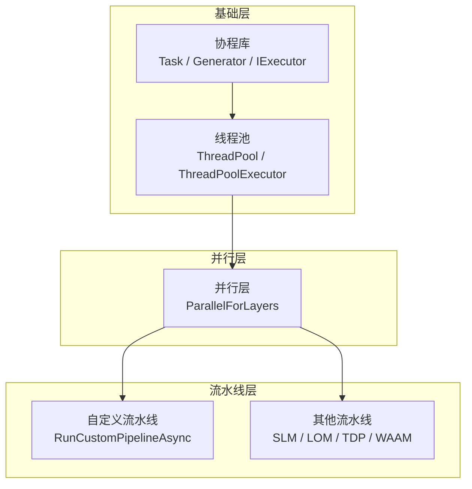
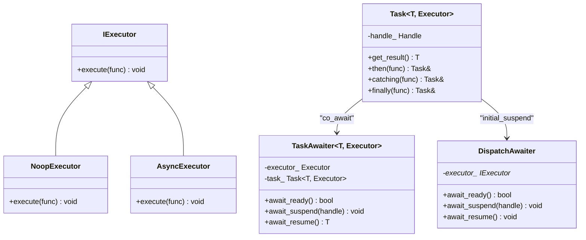
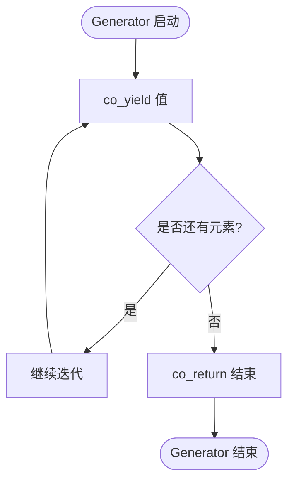
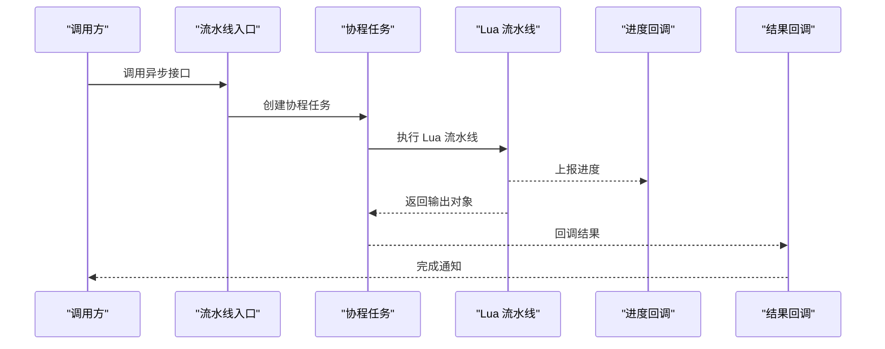
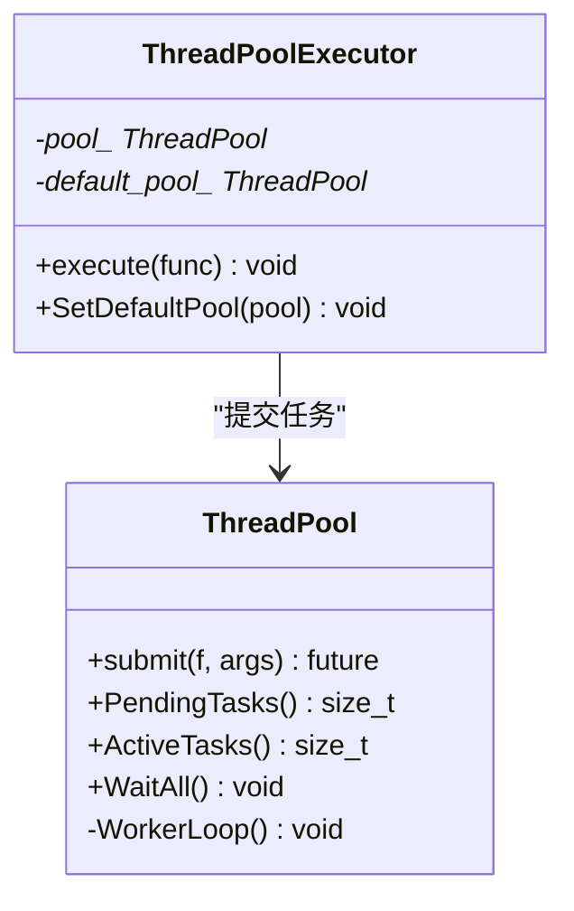
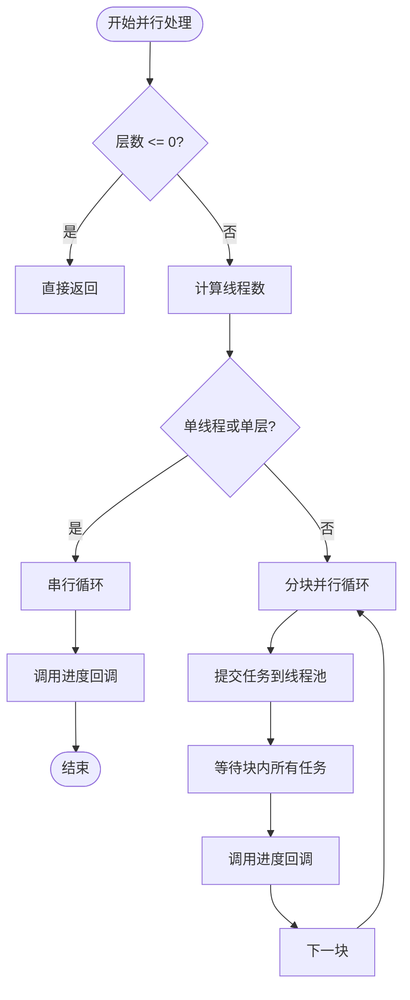
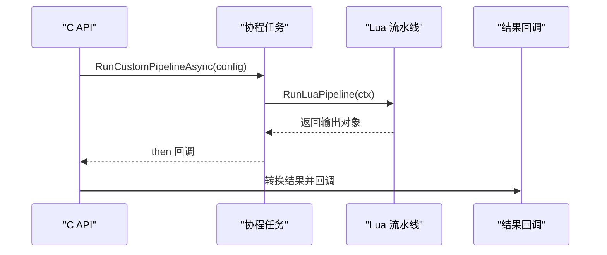
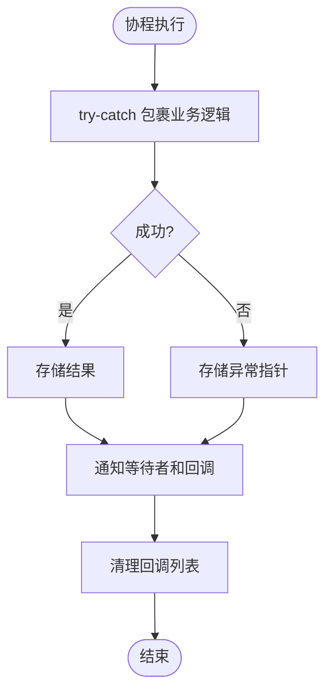
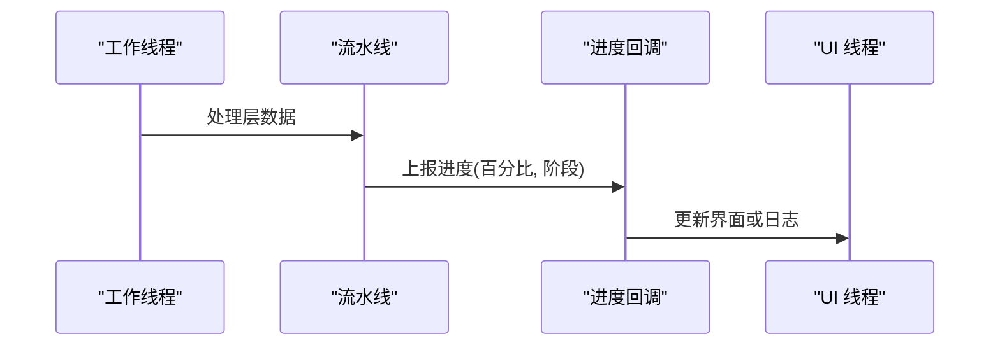

# 异步处理机制

<cite>
**本文引用的文件**   
- [coroutine.hpp](file://base/coroutine.hpp)
- [thread_pool.hpp](file://base/thread_pool.hpp)
- [pipeline_parallel.hpp](file://DllHsBaSlicer/pipeline_parallel.hpp)
- [custom_pipeline.cpp](file://DllHsBaSlicer/custom_pipeline.cpp)
- [custom_pipeline.h](file://DllHsBaSlicer/custom_pipeline.h)
- [EventSourceFunction.hpp](file://LibHsBaSlicer/Extends/EventSourceFunction.hpp)
- [EventSourceFunction.cpp](file://LibHsBaSlicer/Extends/EventSourceFunction.cpp)
- [slm_pipeline.h](file://DllHsBaSlicer/slm_pipeline.h)
- [lom_pipeline.h](file://DllHsBaSlicer/lom_pipeline.h)
- [tdp_pipeline.h](file://DllHsBaSlicer/tdp_pipeline.h)
- [waam_pipeline.h](file://DllHsBaSlicer/waam_pipeline.h)
- [coroutines_test.cpp](file://tests/Coroutines/coroutines_test.cpp)
</cite>

## 目录
1. [引言](#引言)
2. [项目结构中的异步基础设施](#项目结构中的异步基础设施)
3. [核心概念：协程、任务与执行器](#核心概念协程任务与执行器)
4. [架构总览：异步切片流水线](#架构总览异步切片流水线)
5. [详细组件分析](#详细组件分析)
6. [依赖关系分析](#依赖关系分析)
7. [性能与调度策略](#性能与调度策略)
8. [错误处理与资源管理](#错误处理与资源管理)
9. [事件源与进度监控](#事件源与进度监控)
10. [配置方法、调试与最佳实践](#配置方法调试与最佳实践)
11. [结论](#结论)

## 引言
本文聚焦 HsBaSlicer 的异步处理机制，重点说明 C++20 协程在切片流水线中的应用方式。文档覆盖同步与异步执行模式、异步回调机制、任务调度策略、错误传播、资源管理、事件源函数、进度监控、多线程安全保证，以及异步流水线的配置、性能优化和调试策略。面向有经验的开发者，目标是帮助你在现有架构基础上设计更稳健、可观测、可扩展的异步切片流程。

## 项目结构中的异步基础设施
HsBaSlicer 的异步能力由三层组成：
- 基础协程库：提供 `Task`、`Generator`、执行器抽象和自定义分配器支持。
- 线程池与并行层：提供工作线程池、协程执行器适配，以及按层并行的热路径工具。
- 流水线接口层：对外暴露同步与异步 API，内部通过协程封装 Lua 或 C++ 流水线逻辑，并通过回调上报进度和结果。

**图表来源**
- [coroutine.hpp:47-73](file://base/coroutine.hpp#L47-L73)
- [thread_pool.hpp:29-90](file://base/thread_pool.hpp#L29-L90)
- [pipeline_parallel.hpp:41-117](file://DllHsBaSlicer/pipeline_parallel.hpp#L41-L117)
- [custom_pipeline.cpp:118-163](file://DllHsBaSlicer/custom_pipeline.cpp#L118-L163)

**章节来源**
- [coroutine.hpp:41-1091](file://base/coroutine.hpp#L41-L1091)
- [thread_pool.hpp:25-214](file://base/thread_pool.hpp#L25-L214)
- [pipeline_parallel.hpp:19-122](file://DllHsBaSlicer/pipeline_parallel.hpp#L19-L122)
- [custom_pipeline.cpp:18-213](file://DllHsBaSlicer/custom_pipeline.cpp#L18-L213)

## 核心概念：协程、任务与执行器
### Task 与协程执行模型
- `Task<T, Executor>` 是协程任务的包装类型，内部使用 `promise_type` 管理结果、异常、回调队列和条件变量。
- `initial_suspend` 返回 `DispatchAwaiter`，使协程首次挂起时通过执行器恢复，从而控制协程运行上下文。
- `final_suspend` 返回 `std::suspend_always`，确保协程完成时不自动销毁句柄，直到显式释放。
- `await_transform` 允许在协程中直接 `co_await` 其他 `Task`，实现链式异步调用。
- `then`、`catching`、`finally` 提供链式回调注册，分别用于成功回调、异常捕获和清理回调。

**图表来源**
- [coroutine.hpp:47-73](file://base/coroutine.hpp#L47-L73)
- [coroutine.hpp:81-122](file://base/coroutine.hpp#L81-L122)
- [coroutine.hpp:184-198](file://base/coroutine.hpp#L184-L198)
- [coroutine.hpp:205-382](file://base/coroutine.hpp#L205-L382)

**章节来源**
- [coroutine.hpp:47-122](file://base/coroutine.hpp#L47-L122)
- [coroutine.hpp:184-198](file://base/coroutine.hpp#L184-L198)
- [coroutine.hpp:205-382](file://base/coroutine.hpp#L205-L382)

### Generator 与惰性迭代
- `Generator<T>` 提供基于协程的惰性迭代器，支持 `co_yield` 和 `co_return`。
- `SetOnCancel` 允许设置取消钩子，当未处理异常发生时触发。
- `GeneratorInvoke` 对容器元素进行惰性映射，返回 `Generator<std::invoke_result_t<Callback, Arg>>`。

**图表来源**
- [coroutine.hpp:784-893](file://base/coroutine.hpp#L784-L893)
- [coroutine.hpp:1052-1061](file://base/coroutine.hpp#L1052-L1061)

**章节来源**
- [coroutine.hpp:784-893](file://base/coroutine.hpp#L784-L893)
- [coroutine.hpp:1052-1061](file://base/coroutine.hpp#L1052-L1061)

## 架构总览：异步切片流水线
HsBaSlicer 的流水线通常包含以下阶段：
- 配置解析与模型加载。
- 切片与填充（可并行）。
- 导出或输出。
- 进度上报与结果回调。

**图表来源**
- [custom_pipeline.cpp:118-163](file://DllHsBaSlicer/custom_pipeline.cpp#L118-L163)
- [custom_pipeline.cpp:185-201](file://DllHsBaSlicer/custom_pipeline.cpp#L185-L201)

**章节来源**
- [custom_pipeline.cpp:118-201](file://DllHsBaSlicer/custom_pipeline.cpp#L118-L201)

## 详细组件分析

### 协程库与执行器
- `IExecutor` 定义统一执行接口，`NoopExecutor` 在当前线程执行，`AsyncExecutor` 使用 `std::async` 异步执行。
- `Task` 的 `promise_type` 使用互斥锁和条件变量保护结果状态，确保多线程安全。
- `TaskAwaiter` 在 `await_suspend` 中通过执行器恢复协程，避免阻塞等待。

**图表来源**
- [thread_pool.hpp:29-90](file://base/thread_pool.hpp#L29-L90)
- [thread_pool.hpp:170-207](file://base/thread_pool.hpp#L170-L207)

**章节来源**
- [thread_pool.hpp:29-90](file://base/thread_pool.hpp#L29-L90)
- [thread_pool.hpp:170-207](file://base/thread_pool.hpp#L170-L207)

### 并行层：按层并行处理
`ParallelForLayers` 将切片或填充阶段的层索引分配到线程池，保证：
- 每个层的写入操作只访问自己的输出槽，避免竞争。
- 进度回调在调用线程串行执行，避免 UI 或日志线程竞争。
- 通过环境变量 `HSBA_PIPELINE_THREADS` 控制线程数，便于性能对比。

**图表来源**
- [pipeline_parallel.hpp:41-117](file://DllHsBaSlicer/pipeline_parallel.hpp#L41-L117)

**章节来源**
- [pipeline_parallel.hpp:41-117](file://DllHsBaSlicer/pipeline_parallel.hpp#L41-L117)

### 自定义流水线异步接口
`RunCustomPipelineAsync` 是典型的协程封装示例：
- 构建内部配置，绑定进度回调。
- 调用 `RunLuaPipeline` 执行 Lua 流水线。
- 统计耗时，返回结构化结果。
- C API 层通过 `Task.then` 将结果转换为 C 结构体并回调给调用方。

**图表来源**
- [custom_pipeline.cpp:118-163](file://DllHsBaSlicer/custom_pipeline.cpp#L118-L163)
- [custom_pipeline.cpp:185-201](file://DllHsBaSlicer/custom_pipeline.cpp#L185-L201)

**章节来源**
- [custom_pipeline.cpp:118-201](file://DllHsBaSlicer/custom_pipeline.cpp#L118-L201)

### 其他流水线异步接口
SLM、LOM、TDP、WAAM 等流水线均提供类似的异步接口：
- 同步接口返回结果对象。
- 异步接口接受进度回调和结果回调，非阻塞执行。
- 结果对象需调用对应的释放函数。

**章节来源**
- [slm_pipeline.h:37-62](file://DllHsBaSlicer/slm_pipeline.h#L37-L62)
- [lom_pipeline.h:37-62](file://DllHsBaSlicer/lom_pipeline.h#L37-L62)
- [tdp_pipeline.h:37-62](file://DllHsBaSlicer/tdp_pipeline.h#L37-L62)
- [waam_pipeline.h:38-63](file://DllHsBaSlicer/waam_pipeline.h#L38-L63)

## 依赖关系分析
协程库依赖标准库的协程、线程、互斥量、条件变量等；线程池依赖协程库以提供执行器；并行层依赖线程池；流水线层依赖并行层和协程库。

**图表来源**
- [coroutine.hpp:41-1091](file://base/coroutine.hpp#L41-L1091)
- [thread_pool.hpp:25-214](file://base/thread_pool.hpp#L25-L214)
- [pipeline_parallel.hpp:19-122](file://DllHsBaSlicer/pipeline_parallel.hpp#L19-L122)
- [EventSourceFunction.hpp:16-42](file://LibHsBaSlicer/Extends/EventSourceFunction.hpp#L16-L42)

**章节来源**
- [coroutine.hpp:41-1091](file://base/coroutine.hpp#L41-L1091)
- [thread_pool.hpp:25-214](file://base/thread_pool.hpp#L25-L214)
- [pipeline_parallel.hpp:19-122](file://DllHsBaSlicer/pipeline_parallel.hpp#L19-L122)
- [EventSourceFunction.hpp:16-42](file://LibHsBaSlicer/Extends/EventSourceFunction.hpp#L16-L42)

## 性能与调度策略
- **执行器选择**：`NoopExecutor` 适合测试或单线程场景；`AsyncExecutor` 适合通用异步；`ThreadPoolExecutor` 适合高并发任务。
- **并行粒度**：`ParallelForLayers` 按层并行，避免细粒度任务开销，同时通过块大小控制进度回调频率。
- **线程数控制**：通过 `HSBA_PIPELINE_THREADS` 环境变量强制线程数，便于性能验证和回归测试。
- **内存分配**：`CustomAllocatorTask` 和 `CustomAllocatorGenerator` 支持自定义分配器，减少碎片化分配。

**章节来源**
- [coroutine.hpp:563-772](file://base/coroutine.hpp#L563-L772)
- [pipeline_parallel.hpp:49-72](file://DllHsBaSlicer/pipeline_parallel.hpp#L49-L72)

## 错误处理与资源管理
- **异常传播**：`Task` 的 `promise_type` 捕获异常并存储为 `exception_ptr`，`get_or_throw` 重新抛出。
- **回调安全**：`then`、`catching`、`finally` 在回调中捕获异常，避免破坏回调链。
- **资源释放**：`Task` 析构时销毁协程句柄；`Generator` 析构时销毁协程句柄；C API 结果对象需调用对应释放函数。
- **取消钩子**：`Generator` 支持 `SetOnCancel`，在异常路径触发取消逻辑。

**图表来源**
- [coroutine.hpp:242-315](file://base/coroutine.hpp#L242-L315)
- [coroutine.hpp:422-487](file://base/coroutine.hpp#L422-L487)

**章节来源**
- [coroutine.hpp:242-315](file://base/coroutine.hpp#L242-L315)
- [coroutine.hpp:422-487](file://base/coroutine.hpp#L422-L487)
- [custom_pipeline.cpp:203-212](file://DllHsBaSlicer/custom_pipeline.cpp#L203-L212)

## 事件源与进度监控
- **事件源回调**：通过 `AddZipperEventCallback` 和 `AddDBEventCallback` 注册全局回调，用于压缩器和数据库事件。
- **进度回调**：流水线内部通过 `progress_cb` 上报百分比和阶段名称，C API 层将其转发给调用方。
- **线程安全**：进度回调在调用线程串行执行，避免多线程竞争。

**图表来源**
- [EventSourceFunction.hpp:18-41](file://LibHsBaSlicer/Extends/EventSourceFunction.hpp#L18-L41)
- [custom_pipeline.cpp:143-149](file://DllHsBaSlicer/custom_pipeline.cpp#L143-L149)

**章节来源**
- [EventSourceFunction.hpp:18-41](file://LibHsBaSlicer/Extends/EventSourceFunction.hpp#L18-L41)
- [EventSourceFunction.cpp:17-32](file://LibHsBaSlicer/Extends/EventSourceFunction.cpp#L17-L32)
- [custom_pipeline.cpp:143-149](file://DllHsBaSlicer/custom_pipeline.cpp#L143-L149)

## 配置方法、调试与最佳实践

### 异步调用示例
- **自定义流水线异步调用**：
  - 调用 `HsBaRunCustomPipelineAsync`，传入配置、进度回调和结果回调。
  - 在结果回调中释放结果对象。
- **其他流水线异步调用**：
  - 类似地调用 `HsBaRunSlmPipelineAsync`、`HsBaRunLomPipelineAsync` 等。

**章节来源**
- [custom_pipeline.h:42-55](file://DllHsBaSlicer/custom_pipeline.h#L42-L55)
- [slm_pipeline.h:37-62](file://DllHsBaSlicer/slm_pipeline.h#L37-L62)
- [lom_pipeline.h:37-62](file://DllHsBaSlicer/lom_pipeline.h#L37-L62)
- [tdp_pipeline.h:37-62](file://DllHsBaSlicer/tdp_pipeline.h#L37-L62)
- [waam_pipeline.h:38-63](file://DllHsBaSlicer/waam_pipeline.h#L38-L63)

### 性能优化技巧
- **调整线程数**：通过 `HSBA_PIPELINE_THREADS` 环境变量控制并行度。
- **选择合适的执行器**：测试用 `NoopExecutor`，生产用 `AsyncExecutor` 或 `ThreadPoolExecutor`。
- **减少回调开销**：批量处理层数据，减少进度回调频率。
- **自定义分配器**：高频分配场景使用 `CustomAllocatorTask` 和 `CustomAllocatorGenerator`。

**章节来源**
- [pipeline_parallel.hpp:49-72](file://DllHsBaSlicer/pipeline_parallel.hpp#L49-L72)
- [coroutine.hpp:563-772](file://base/coroutine.hpp#L563-L772)

### 调试策略
- **单元测试**：参考 `coroutines_test.cpp`，验证协程行为、异常传播和回调顺序。
- **日志注入**：在进度回调中记录阶段和百分比，辅助定位瓶颈。
- **环境变量**：使用 `HSBA_PIPELINE_THREADS=1` 强制串行路径，便于复现问题。

**章节来源**
- [coroutines_test.cpp:1-244](file://tests/Coroutines/coroutines_test.cpp#L1-L244)

### 最佳实践建议
- **避免在回调中执行长时间任务**：回调应快速返回，避免阻塞 UI 或主线程。
- **确保结果对象生命周期**：C API 结果对象需显式释放，防止内存泄漏。
- **异常处理**：在 `catching` 回调中记录异常信息，但不吞掉异常，必要时重新抛出。
- **线程安全**：共享状态必须加锁或使用原子操作，避免数据竞争。

[无章节来源，因为本节为总结性建议]

## 结论
HsBaSlicer 的异步处理机制以 C++20 协程为核心，结合线程池和并行层，提供了灵活、高效、可观测的异步流水线框架。开发者可以通过协程简化异步代码编写，通过执行器控制任务调度，通过进度回调和事件源实现实时监控。在实际应用中，应根据场景选择合适的执行器、并行粒度和回调策略，并结合单元测试和环境变量进行性能调优和问题排查。

[无章节来源，因为本节为总结性内容]