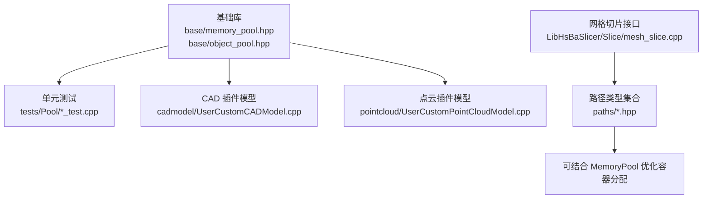
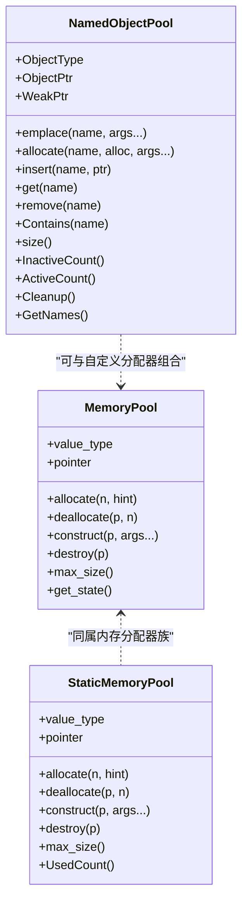
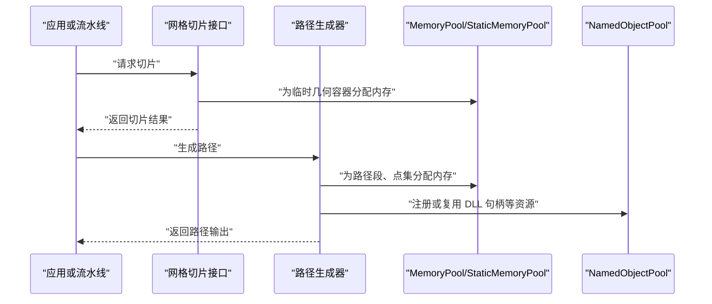
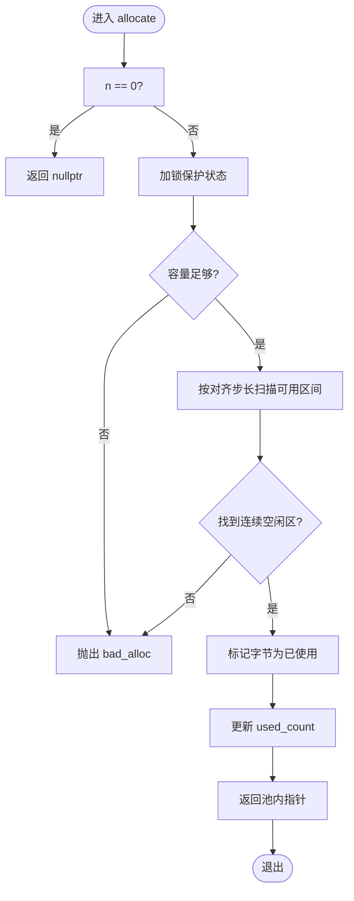
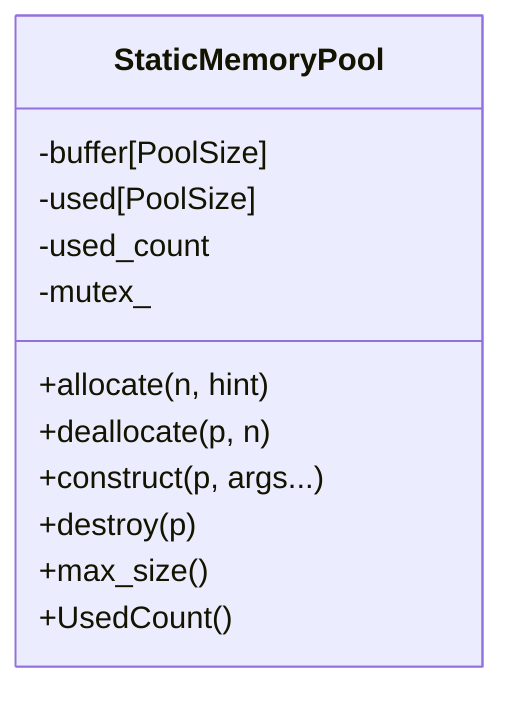
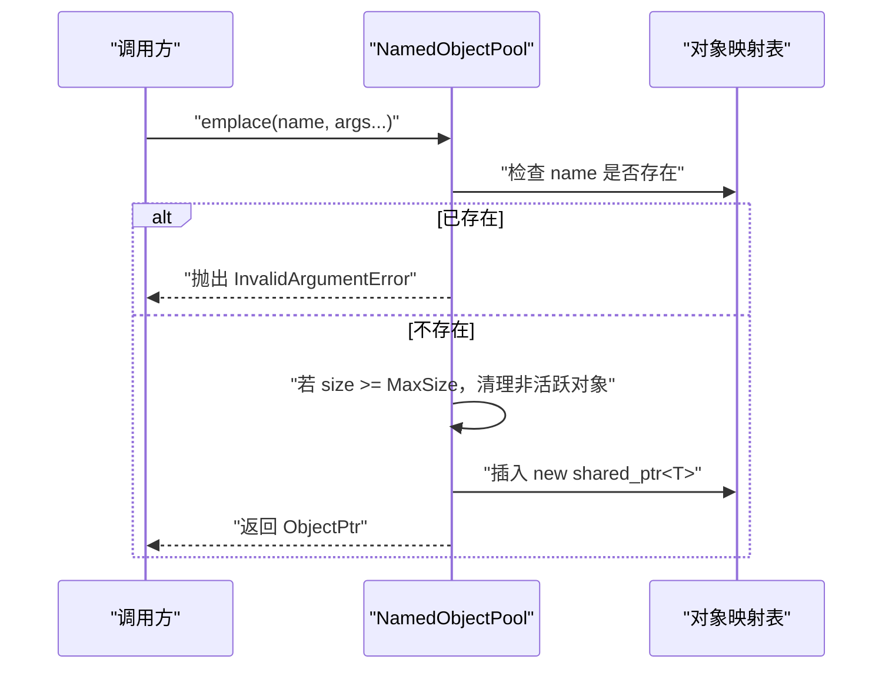
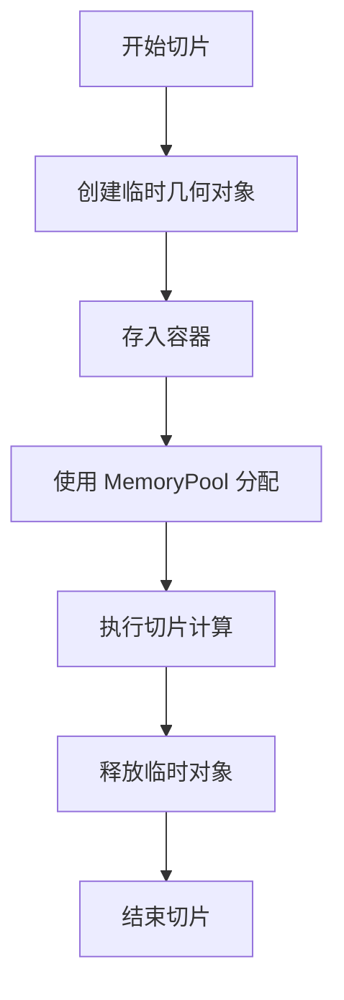
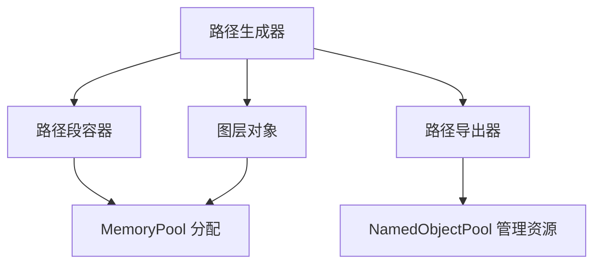

# 内存管理优化

<cite>
**本文引用的文件**   
- [memory_pool.hpp](file://base/memory_pool.hpp)
- [object_pool.hpp](file://base/object_pool.hpp)
- [memory_pool_test.cpp](file://tests/Pool/memory_pool_test.cpp)
- [object_pool_test.cpp](file://tests/Pool/object_pool_test.cpp)
- [UserCustomCADModel.cpp](file://cadmodel/UserCustomCADModel.cpp)
- [UserCustomPointCloudModel.cpp](file://pointcloud/UserCustomPointCloudModel.cpp)
- [mesh_slice.cpp](file://LibHsBaSlicer/Slice/mesh_slice.cpp)
- [path_generator.hpp](file://LibHsBaSlicer/Path/path_generator.hpp)
- [path_optimizer.hpp](file://LibHsBaSlicer/Path/path_optimizer.hpp)
- [layerspath.hpp](file://paths/layerspath.hpp)
- [gcodepath.hpp](file://paths/gcodepath.hpp)
- [pointspath.hpp](file://paths/pointspath.hpp)
- [error.hpp](file://base/error.hpp)
</cite>

## 目录
1. [引言](#引言)
2. [项目结构中的内存池位置](#项目结构中的内存池位置)
3. [核心组件总览](#核心组件总览)
4. [架构与数据流](#架构与数据流)
5. [MemoryPool 实现原理与分块复用策略](#memorypool-实现原理与分块复用策略)
6. [StaticMemoryPool 全局共享内存池](#staticmemorypool-全局共享内存池)
7. [NamedObjectPool 对象池机制](#namedobjectpool-对象池机制)
8. [在网格切片中的内存优化实践](#在网格切片中的内存优化实践)
9. [在路径生成中的内存优化实践](#在路径生成中的内存优化实践)
10. [池化策略选择原则](#池化策略选择原则)
11. [配置参数调优指南](#配置参数调优指南)
12. [内存泄漏检测与性能监控](#内存泄漏检测与性能监控)
13. [故障排除与常见问题](#故障排除与常见问题)
14. [结论](#结论)

## 引言
本指南面向 HsBaSlicer 的内存管理优化，重点解析 `MemoryPool`、`StaticMemoryPool` 和 `NamedObjectPool` 的实现原理、使用场景、分块管理机制、内存复用策略，以及如何在网格处理和路径生成中降低频繁对象创建带来的分配开销。文档同时提供内存泄漏检测、性能监控方法，并给出池化策略选择和配置参数调优建议。

## 项目结构中的内存池位置
HsBaSlicer 将底层内存池能力集中在基础库中：
- 内存分配器：`base/memory_pool.hpp`
- 命名对象池：`base/object_pool.hpp`
- 单元测试：`tests/Pool/memory_pool_test.cpp`、`tests/Pool/object_pool_test.cpp`
- 实际使用示例：插件式 CAD 模型与点云模型通过 `NamedObjectPool` 复用动态库句柄；网格切片子系统对外暴露安全封装；路径层由大量轻量几何对象组成，适合配合内存池优化容器分配。

**图表来源** 
- [memory_pool.hpp:1-375](file://base/memory_pool.hpp#L1-L375)
- [object_pool.hpp:1-286](file://base/object_pool.hpp#L1-L286)
- [memory_pool_test.cpp:1-100](file://tests/Pool/memory_pool_test.cpp#L1-L100)
- [object_pool_test.cpp:1-162](file://tests/Pool/object_pool_test.cpp#L1-L162)
- [UserCustomCADModel.cpp:1-200](file://cadmodel/UserCustomCADModel.cpp#L1-L200)
- [UserCustomPointCloudModel.cpp:1-200](file://pointcloud/UserCustomPointCloudModel.cpp#L1-L200)
- [mesh_slice.cpp:1-45](file://LibHsBaSlicer/Slice/mesh_slice.cpp#L1-L45)

**章节来源**
- [memory_pool.hpp:1-375](file://base/memory_pool.hpp#L1-L375)
- [object_pool.hpp:1-286](file://base/object_pool.hpp#L1-L286)
- [memory_pool_test.cpp:1-100](file://tests/Pool/memory_pool_test.cpp#L1-L100)
- [object_pool_test.cpp:1-162](file://tests/Pool/object_pool_test.cpp#L1-L162)
- [UserCustomCADModel.cpp:1-200](file://cadmodel/UserCustomCADModel.cpp#L1-L200)
- [UserCustomPointCloudModel.cpp:1-200](file://pointcloud/UserCustomPointCloudModel.cpp#L1-L200)
- [mesh_slice.cpp:1-45](file://LibHsBaSlicer/Slice/mesh_slice.cpp#L1-L45)

## 核心组件总览
- `MemoryPool<T, PoolSize>`：按字节池分配的 STL Allocator 兼容分配器，支持多实例共享同一内存区域，线程安全。
- `StaticMemoryPool<T, PoolSize>`：全局静态内存池，所有实例等价，零实例开销，同样符合 STL Allocator 规范。
- `NamedObjectPool<T, MaxSize>`：基于名称的对象池，管理 `std::shared_ptr<T>`，支持自动清理非活跃对象、容量限制、读写分离锁。

**图表来源** 
- [memory_pool.hpp:43-208](file://base/memory_pool.hpp#L43-L208)
- [memory_pool.hpp:215-372](file://base/memory_pool.hpp#L215-L372)
- [object_pool.hpp:22-283](file://base/object_pool.hpp#L22-L283)

**章节来源**
- [memory_pool.hpp:43-208](file://base/memory_pool.hpp#L43-L208)
- [memory_pool.hpp:215-372](file://base/memory_pool.hpp#L215-L372)
- [object_pool.hpp:22-283](file://base/object_pool.hpp#L22-L283)

## 架构与数据流
HsBaSlicer 的内存优化通常遵循以下模式：
- 高频小对象或固定大小对象：使用 `MemoryPool` 或 `StaticMemoryPool` 作为容器的分配器，减少堆分配次数。
- 需要生命周期管理和去重的对象：使用 `NamedObjectPool`，通过名称唯一标识，避免重复创建，并在不再使用时自动清理。
- 网格切片与路径生成：中间结果（如顶点、边、线段、路径段）数量巨大且生命周期短，适合用内存池优化容器分配；插件式 DLL 句柄等昂贵资源适合用对象池复用。

**图表来源** 
- [mesh_slice.cpp:1-45](file://LibHsBaSlicer/Slice/mesh_slice.cpp#L1-L45)
- [path_generator.hpp:1-200](file://LibHsBaSlicer/Path/path_generator.hpp#L1-L200)
- [memory_pool.hpp:100-175](file://base/memory_pool.hpp#L100-L175)
- [object_pool.hpp:66-156](file://base/object_pool.hpp#L66-L156)

**章节来源**
- [mesh_slice.cpp:1-45](file://LibHsBaSlicer/Slice/mesh_slice.cpp#L1-L45)
- [path_generator.hpp:1-200](file://LibHsBaSlicer/Path/path_generator.hpp#L1-L200)

## MemoryPool 实现原理与分块复用策略
`MemoryPool` 是一个模板化的内存池分配器，内部维护一个对齐的字符数组作为池，并使用布尔数组标记每个字节是否已分配，同时记录已使用字节数。其关键特性如下：
- 线程安全：分配与释放操作使用互斥锁保护。
- 对齐保证：池内存按最大对齐要求对齐，确保任意类型均可正确放置。
- 分配策略：采用简单首次适配（first-fit），按类型大小连续扫描可用区间。
- 异常处理：空间不足时抛出 `std::bad_alloc`；非法指针释放抛出 `std::invalid_argument`。
- STL 兼容：实现标准分配器接口，可直接用于 `std::vector`、`std::list`、`std::shared_ptr` 等。

**图表来源** 
- [memory_pool.hpp:111-141](file://base/memory_pool.hpp#L111-L141)

**章节来源**
- [memory_pool.hpp:28-34](file://base/memory_pool.hpp#L28-L34)
- [memory_pool.hpp:111-175](file://base/memory_pool.hpp#L111-L175)

## StaticMemoryPool 全局共享内存池
`StaticMemoryPool` 与 `MemoryPool` 类似，但使用静态缓冲区和静态状态，所有实例被视为相等，零实例开销。它同样提供线程安全的分配与释放，并暴露 `UsedCount()` 用于监控已使用字节数。

典型用途：
- 全局统一的小对象分配，例如测试或工具函数中频繁创建临时数据结构。
- 协程或异步任务中使用自定义分配器，避免跨模块分配器不一致导致的碎片化。

**图表来源** 
- [memory_pool.hpp:215-372](file://base/memory_pool.hpp#L215-L372)

**章节来源**
- [memory_pool.hpp:215-372](file://base/memory_pool.hpp#L215-L372)
- [memory_pool_test.cpp:53-98](file://tests/Pool/memory_pool_test.cpp#L53-L98)

## NamedObjectPool 对象池机制
`NamedObjectPool` 管理一组以字符串命名的对象，内部存储 `std::shared_ptr<T>` 和对应的弱引用，用于判断对象是否仍被外部持有。当尝试添加新对象且池已满时，会先清理非活跃对象（仅池内部持有的对象），若仍满则抛出运行时错误。

关键点：
- 名称唯一性：同名对象不允许重复插入。
- 活跃判断：当 `shared_ptr` 引用计数为 1（仅池持有）时视为非活跃。
- 容量控制：达到 `MaxSize` 后触发惰性清理，避免频繁清理影响性能。
- 线程安全：读操作使用共享锁，写操作使用独占锁。

**图表来源** 
- [object_pool.hpp:66-92](file://base/object_pool.hpp#L66-L92)
- [object_pool.hpp:261-279](file://base/object_pool.hpp#L261-L279)

**章节来源**
- [object_pool.hpp:22-283](file://base/object_pool.hpp#L22-L283)
- [object_pool_test.cpp:9-162](file://tests/Pool/object_pool_test.cpp#L9-L162)

## 在网格切片中的内存优化实践
网格切片过程会产生大量临时几何对象，例如顶点、边、面片、轮廓线等。虽然当前切片入口主要做异常转换和安全封装，但在实际算法实现中，这些中间结果通常存储在容器中。通过将容器的分配器替换为 `MemoryPool` 或 `StaticMemoryPool`，可以显著减少堆分配次数，提高缓存局部性。

建议实践：
- 对切片过程中频繁创建的向量、列表使用内存池分配器。
- 对跨切片阶段复用的大型结构体，考虑使用 `NamedObjectPool` 进行集中管理。
- 在多线程切片场景中，注意不同线程可能访问同一池的状态，需评估锁竞争成本。

**图表来源** 
- [mesh_slice.cpp:1-45](file://LibHsBaSlicer/Slice/mesh_slice.cpp#L1-L45)
- [memory_pool.hpp:111-175](file://base/memory_pool.hpp#L111-L175)

**章节来源**
- [mesh_slice.cpp:1-45](file://LibHsBaSlicer/Slice/mesh_slice.cpp#L1-L45)
- [memory_pool.hpp:111-175](file://base/memory_pool.hpp#L111-L175)

## 在路径生成中的内存优化实践
路径生成涉及大量路径段、点集、图层对象等轻量结构。这些对象生命周期短、数量大，非常适合使用内存池优化容器分配。此外，路径导出器可能需要访问外部资源（如设备驱动、文件格式适配器），可使用 `NamedObjectPool` 复用这些昂贵资源。

建议实践：
- 路径段、点集、图层等容器使用 `MemoryPool` 或 `StaticMemoryPool`。
- 路径生成器内部缓存常用配置或中间结果时使用 `NamedObjectPool`。
- 对于插件式路径导出器，使用 `NamedObjectPool` 管理 DLL 句柄，避免重复加载。

**图表来源** 
- [path_generator.hpp:1-200](file://LibHsBaSlicer/Path/path_generator.hpp#L1-L200)
- [layerspath.hpp:1-200](file://paths/layerspath.hpp#L1-L200)
- [gcodepath.hpp:1-200](file://paths/gcodepath.hpp#L1-L200)
- [pointspath.hpp:1-200](file://paths/pointspath.hpp#L1-L200)
- [object_pool.hpp:66-156](file://base/object_pool.hpp#L66-L156)

**章节来源**
- [path_generator.hpp:1-200](file://LibHsBaSlicer/Path/path_generator.hpp#L1-L200)
- [layerspath.hpp:1-200](file://paths/layerspath.hpp#L1-L200)
- [gcodepath.hpp:1-200](file://paths/gcodepath.hpp#L1-L200)
- [pointspath.hpp:1-200](file://paths/pointspath.hpp#L1-L200)
- [object_pool.hpp:66-156](file://base/object_pool.hpp#L66-L156)

## 池化策略选择原则
- 使用 `MemoryPool`：
  - 对象大小固定或相近。
  - 需要在多个实例间共享同一内存区域。
  - 希望与 STL 容器无缝集成。
- 使用 `StaticMemoryPool`：
  - 需要全局统一的分配器，所有实例等价。
  - 追求零实例开销，简化分配器比较逻辑。
  - 常用于测试、工具函数或协程上下文。
- 使用 `NamedObjectPool`：
  - 对象需要名称标识和去重。
  - 对象生命周期较长，需要集中管理。
  - 资源昂贵（如 DLL 句柄、数据库连接），需要复用。
  - 需要自动清理非活跃对象，防止内存膨胀。

**章节来源**
- [memory_pool.hpp:43-208](file://base/memory_pool.hpp#L43-L208)
- [memory_pool.hpp:215-372](file://base/memory_pool.hpp#L215-L372)
- [object_pool.hpp:22-283](file://base/object_pool.hpp#L22-L283)

## 配置参数调优指南
- `PoolSize`（内存池大小）：
  - 过小会导致频繁 `bad_alloc`，过大则浪费内存。
  - 应根据对象数量和平均大小估算，并预留扩容余量。
- `MaxSize`（对象池容量）：
  - 过小会导致频繁清理或抛错，过大则占用更多映射表空间。
  - 应结合业务峰值对象数和清理频率调整。
- 线程安全与锁粒度：
  - 高并发场景下，锁竞争可能成为瓶颈。
  - 可考虑按线程划分多个池实例，或使用无锁队列替代。
- 分配器与容器搭配：
  - 优先使用 `std::vector`、`std::list` 等顺序容器，减少节点分配复杂度。
  - 对哈希容器（如 `unordered_map`）谨慎使用内存池，因为节点分配行为可能与预期不同。

**章节来源**
- [memory_pool.hpp:111-175](file://base/memory_pool.hpp#L111-L175)
- [memory_pool.hpp:266-324](file://base/memory_pool.hpp#L266-L324)
- [object_pool.hpp:66-156](file://base/object_pool.hpp#L66-L156)
- [memory_pool_test.cpp:30-98](file://tests/Pool/memory_pool_test.cpp#L30-L98)
- [object_pool_test.cpp:116-141](file://tests/Pool/object_pool_test.cpp#L116-L141)

## 内存泄漏检测与性能监控
- 内存池使用量监控：
  - 使用 `StaticMemoryPool::UsedCount()` 获取已使用字节数。
  - 对比 `max_size()` 与实际使用量，判断是否接近上限。
- 对象池活跃度监控：
  - 使用 `NamedObjectPool::ActiveCount()` 和 `InactiveCount()` 观察对象生命周期。
  - 定期调用 `Cleanup()` 清理非活跃对象，避免池膨胀。
- 异常与边界检查：
  - 捕获 `std::bad_alloc` 和 `std::invalid_argument`，记录分配失败和非法释放。
  - 在切片和路径生成关键路径加入日志，统计分配次数和时间。
- 基准测试：
  - 使用单元测试或独立基准程序对比启用池化前后的分配次数、运行时间、内存峰值。
  - 参考现有测试用例的结构，构造大规模输入验证稳定性。

**章节来源**
- [memory_pool.hpp:358-365](file://base/memory_pool.hpp#L358-L365)
- [object_pool.hpp:219-245](file://base/object_pool.hpp#L219-L245)
- [memory_pool_test.cpp:30-98](file://tests/Pool/memory_pool_test.cpp#L30-L98)
- [object_pool_test.cpp:35-59](file://tests/Pool/object_pool_test.cpp#L35-L59)

## 故障排除与常见问题
- 分配失败：
  - 现象：抛出 `std::bad_alloc`。
  - 排查：检查 `PoolSize` 是否足够，对象数量是否超出预期。
  - 解决：增大池大小或分批处理对象。
- 非法指针释放：
  - 现象：抛出 `std::invalid_argument`。
  - 排查：确认指针来自同一池，未越界或未重复释放。
  - 解决：修正释放逻辑，确保一一对应。
- 对象池满：
  - 现象：抛出运行时错误，提示池已满。
  - 排查：检查 `MaxSize` 是否过小，是否存在未释放的活跃对象。
  - 解决：增大容量或主动清理非活跃对象。
- 插件 DLL 未复用：
  - 现象：多次加载相同 DLL，导致资源浪费。
  - 排查：确认使用 `NamedObjectPool` 并通过名称检索。
  - 解决：统一命名规则，确保 `Contains` 命中。

**章节来源**
- [memory_pool.hpp:111-175](file://base/memory_pool.hpp#L111-L175)
- [memory_pool.hpp:266-324](file://base/memory_pool.hpp#L266-L324)
- [object_pool.hpp:66-156](file://base/object_pool.hpp#L66-L156)
- [UserCustomCADModel.cpp:134-149](file://cadmodel/UserCustomCADModel.cpp#L134-L149)
- [UserCustomPointCloudModel.cpp:175-186](file://pointcloud/UserCustomPointCloudModel.cpp#L175-L186)

## 结论
HsBaSlicer 的内存管理优化围绕 `MemoryPool`、`StaticMemoryPool` 和 `NamedObjectPool` 展开。前者适用于高频小对象和固定大小对象的容器分配优化，后者适用于需要生命周期管理和去重的对象复用。在网格切片和路径生成中，合理选择池化策略并结合配置参数调优，可以显著降低内存分配开销、提升性能稳定性。通过监控使用量、活跃度与异常信息，可以有效发现内存泄漏和性能瓶颈，持续优化系统表现。