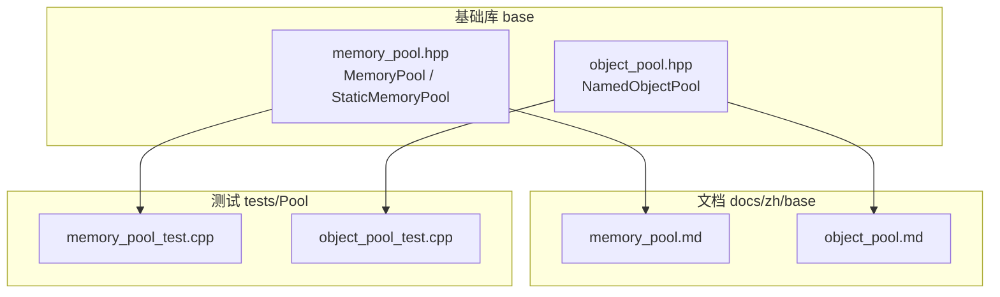
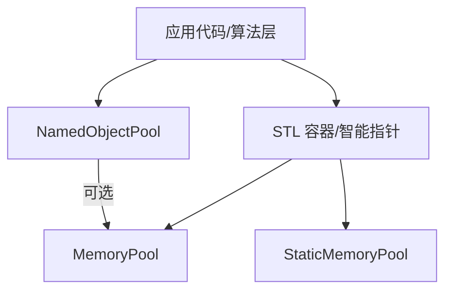
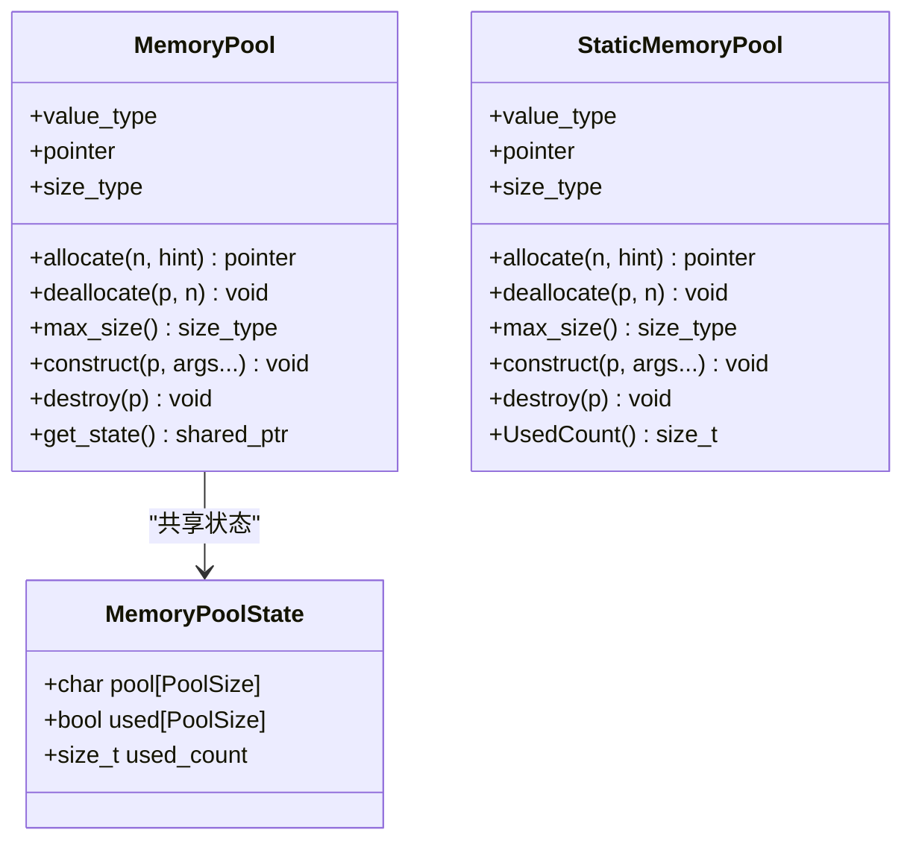
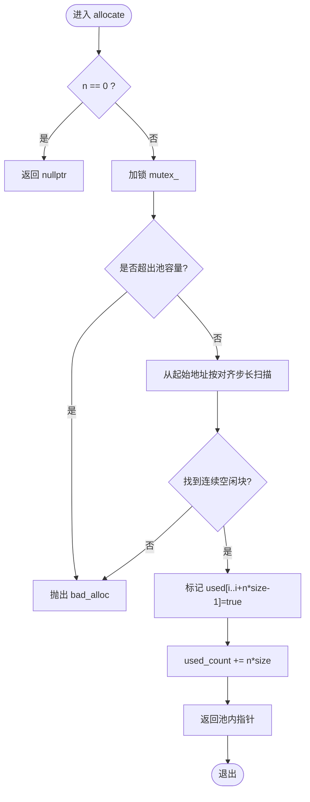
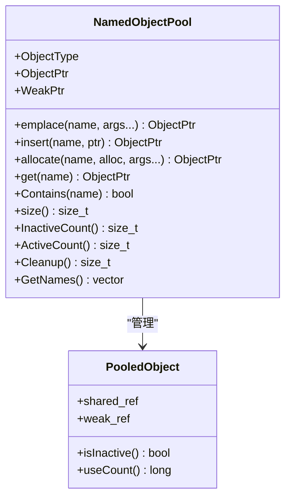
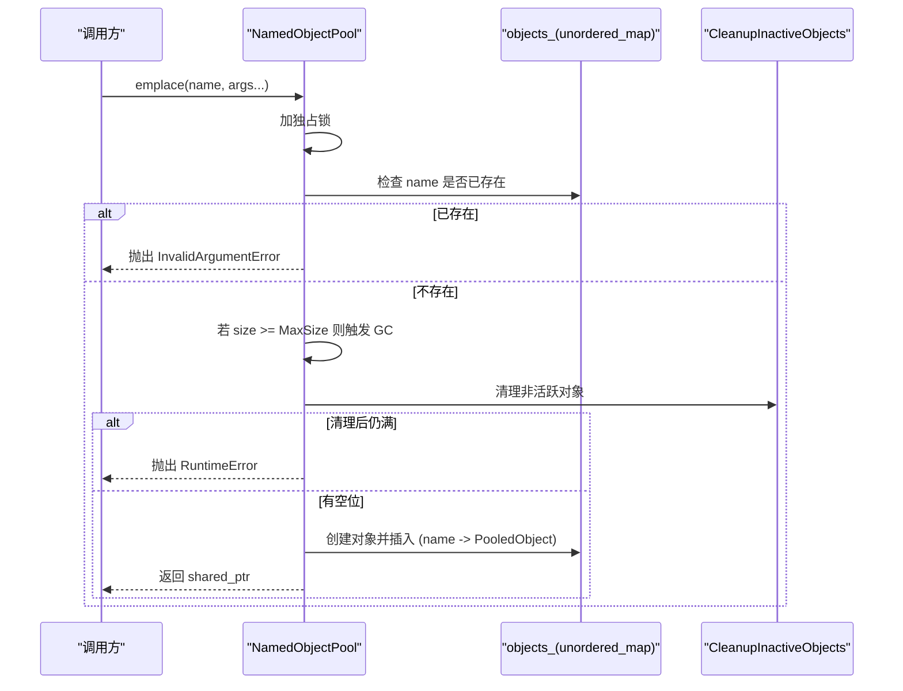
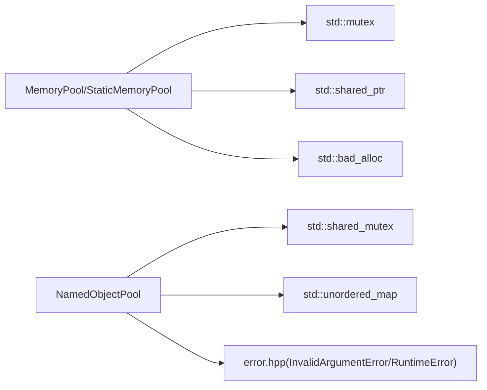

# 内存管理优化

<cite>
**本文引用的文件**   
- [memory_pool.hpp](file://base/memory_pool.hpp)
- [object_pool.hpp](file://base/object_pool.hpp)
- [memory_pool.md](file://docs/zh/base/memory_pool.md)
- [object_pool.md](file://docs/zh/base/object_pool.md)
- [memory_pool_test.cpp](file://tests/Pool/memory_pool_test.cpp)
- [object_pool_test.cpp](file://tests/Pool/object_pool_test.cpp)
</cite>

## 目录
1. [引言](#引言)
2. [项目结构](#项目结构)
3. [核心组件](#核心组件)
4. [架构总览](#架构总览)
5. [详细组件分析](#详细组件分析)
6. [依赖关系分析](#依赖关系分析)
7. [性能与复杂度](#性能与复杂度)
8. [最佳实践与调优](#最佳实践与调优)
9. [故障诊断与排错](#故障诊断与排错)
10. [结论](#结论)

## 引言
本技术文档聚焦 HsBaSlicer 的内存管理优化，围绕 MemoryPool、StaticMemoryPool 与 NamedObjectPool 三类核心组件展开。目标包括：
- 深入解析自定义内存分配器（MemoryPool/StaticMemoryPool）的实现原理：内存块管理、对齐处理、线程安全与异常行为。
- 详解对象池（NamedObjectPool）的设计模式：对象生命周期管理、引用计数、智能指针集成与自动清理机制。
- 总结内存池的优势：减少碎片、提升分配速度、降低系统调用开销等。
- 提供可操作的内存使用最佳实践：对象复用策略、池容量配置、监控指标与常见问题排查。

## 项目结构
与内存管理相关的代码集中在 base 模块，配套文档与测试位于 docs 与 tests 目录：
- base/memory_pool.hpp：实现 MemoryPool 与 StaticMemoryPool 两个 STL Allocator 兼容的内存池分配器。
- base/object_pool.hpp：实现 NamedObjectPool，基于名称的对象池，支持 shared_ptr/weak_ptr 与自动清理。
- docs/zh/base/*.md：中文文档，包含用法示例与注意事项。
- tests/Pool/*.cpp：单元测试覆盖容器集成、智能指针、协程分配器、容量限制与清理逻辑。

图表来源
- [memory_pool.hpp:1-375](file://base/memory_pool.hpp#L1-L375)
- [object_pool.hpp:1-286](file://base/object_pool.hpp#L1-L286)
- [memory_pool.md:1-325](file://docs/zh/base/memory_pool.md#L1-L325)
- [object_pool.md:1-274](file://docs/zh/base/object_pool.md#L1-L274)
- [memory_pool_test.cpp:1-100](file://tests/Pool/memory_pool_test.cpp#L1-L100)
- [object_pool_test.cpp:1-162](file://tests/Pool/object_pool_test.cpp#L1-L162)

章节来源
- [memory_pool.hpp:1-375](file://base/memory_pool.hpp#L1-L375)
- [object_pool.hpp:1-286](file://base/object_pool.hpp#L1-L286)

## 核心组件
- MemoryPool<T, PoolSize>：共享状态的内存池分配器，通过 std::shared_ptr 共享底层状态，适合多实例共享同一内存区域。
- StaticMemoryPool<T, PoolSize>：静态全局内存池，所有实例等价且共享同一块静态缓冲区，零实例开销。
- NamedObjectPool<T, MaxSize>：按名称管理的对象池，封装 std::shared_ptr/weak_ptr，具备活跃/非活跃对象统计与自动清理能力。

章节来源
- [memory_pool.hpp:28-208](file://base/memory_pool.hpp#L28-L208)
- [memory_pool.hpp:215-372](file://base/memory_pool.hpp#L215-L372)
- [object_pool.hpp:22-283](file://base/object_pool.hpp#L22-L283)

## 架构总览
下图展示两类内存池与对象池在系统中的角色与交互：
- MemoryPool/StaticMemoryPool 作为 STL Allocator，被标准容器或智能指针直接用于内存分配。
- NamedObjectPool 管理对象的生命周期，内部持有 std::shared_ptr，并可配合任意分配器（如 MemoryPool）进行对象构造。

图表来源
- [memory_pool.hpp:43-208](file://base/memory_pool.hpp#L43-L208)
- [memory_pool.hpp:215-372](file://base/memory_pool.hpp#L215-L372)
- [object_pool.hpp:22-283](file://base/object_pool.hpp#L22-L283)

## 详细组件分析

### MemoryPool 与 StaticMemoryPool 实现要点
- 内存布局与对齐
  - 使用 alignas(std::max_align_t) 保证最大对齐，满足任意类型对象的内存对齐需求。
  - 以字节数组 pool/buffer 作为底层存储，配合 bool used[] 标记每个字节的占用状态。
- 分配与释放
  - allocate 采用首次适配扫描空闲区间，检查连续可用空间并标记已用；失败抛出 std::bad_alloc。
  - deallocate 校验指针位于池内范围，将对应字节置为未用，更新 used_count。
- 线程安全
  - 分配/释放路径均使用 std::mutex 保护，确保并发安全。
- 构造与析构
  - 提供 construct/destroy 模板方法，支持 placement new 与显式析构。
- 共享 vs 静态
  - MemoryPool 通过 std::shared_ptr<MemoryPoolState> 共享状态，复制/移动语义下共享同一内存区。
  - StaticMemoryPool 使用 inline static buffer/used/used_count/mutex，所有实例等价（operator== 恒真）。

图表来源
- [memory_pool.hpp:28-34](file://base/memory_pool.hpp#L28-L34)
- [memory_pool.hpp:43-208](file://base/memory_pool.hpp#L43-L208)
- [memory_pool.hpp:215-372](file://base/memory_pool.hpp#L215-L372)

章节来源
- [memory_pool.hpp:100-142](file://base/memory_pool.hpp#L100-L142)
- [memory_pool.hpp:156-175](file://base/memory_pool.hpp#L156-L175)
- [memory_pool.hpp:266-296](file://base/memory_pool.hpp#L266-L296)
- [memory_pool.hpp:305-324](file://base/memory_pool.hpp#L305-L324)

#### 分配流程（MemoryPool）

图表来源
- [memory_pool.hpp:111-142](file://base/memory_pool.hpp#L111-L142)

章节来源
- [memory_pool.hpp:111-142](file://base/memory_pool.hpp#L111-L142)

### NamedObjectPool 设计要点
- 对象标识与存储
  - 以字符串 name 为键，unordered_map 存储 PooledObject{shared_ref, weak_ref}。
- 生命周期与引用计数
  - 通过 shared_ptr 强引用与 weak_ptr 弱引用组合，isInactive 判断仅池内持有（use_count==1）即视为非活跃。
- 线程安全
  - 读写分离：读操作使用 shared_lock，写操作使用 unique_lock，基于 std::shared_mutex。
- 容量控制与自动清理
  - emplace/insert/allocate 在达到 MaxSize 时先尝试 CleanupInactiveObjects，若仍满则抛出 RuntimeError。
  - CleanupInactiveObjects 遍历并移除 isInactive 的对象，释放强引用并从 map 中删除。
- 与自定义分配器的集成
  - allocate(name, alloc, args...) 使用 std::allocate_shared 结合外部分配器构造对象。

图表来源
- [object_pool.hpp:22-46](file://base/object_pool.hpp#L22-L46)
- [object_pool.hpp:66-92](file://base/object_pool.hpp#L66-L92)
- [object_pool.hpp:135-156](file://base/object_pool.hpp#L135-L156)
- [object_pool.hpp:261-279](file://base/object_pool.hpp#L261-L279)

章节来源
- [object_pool.hpp:66-92](file://base/object_pool.hpp#L66-L92)
- [object_pool.hpp:135-156](file://base/object_pool.hpp#L135-L156)
- [object_pool.hpp:261-279](file://base/object_pool.hpp#L261-L279)

#### 插入与自动清理时序（NamedObjectPool.emplace）

图表来源
- [object_pool.hpp:66-92](file://base/object_pool.hpp#L66-L92)
- [object_pool.hpp:261-279](file://base/object_pool.hpp#L261-L279)

章节来源
- [object_pool.hpp:66-92](file://base/object_pool.hpp#L66-L92)
- [object_pool.hpp:261-279](file://base/object_pool.hpp#L261-L279)

## 依赖关系分析
- MemoryPool/StaticMemoryPool 依赖：
  - <cstddef>, <memory>, <mutex>, <new>, <stdexcept>
  - 通过 rebind 适配不同元素类型，符合 STL Allocator 接口。
- NamedObjectPool 依赖：
  - <memory>, <mutex>, <shared_mutex>, <unordered_map>
  - 自定义错误类型（InvalidArgumentError/RuntimeError）来自 error.hpp。

图表来源
- [memory_pool.hpp:13-18](file://base/memory_pool.hpp#L13-L18)
- [object_pool.hpp:9-14](file://base/object_pool.hpp#L9-L14)

章节来源
- [memory_pool.hpp:13-18](file://base/memory_pool.hpp#L13-L18)
- [object_pool.hpp:9-14](file://base/object_pool.hpp#L9-L14)

## 性能与复杂度
- 分配复杂度
  - MemoryPool/StaticMemoryPool.allocate：O(PoolSize) 最坏情况（逐字节扫描），实际取决于空闲块分布与对齐步长。
  - deallocate：O(n*size)，线性标记释放。
  - NamedObjectPool.emplace/allocate：map 查找 O(log N) 或近似 O(1)（unordered_map），清理过程 O(N)。
- 空间复杂度
  - MemoryPool/StaticMemoryPool：固定 PoolSize 字节 + used 位图（bool 数组）。
  - NamedObjectPool：哈希表存储对象名到 PooledObject 的映射。
- 线程开销
  - 两者均在关键路径加锁，高并发场景下需权衡锁粒度与吞吐。

章节来源
- [memory_pool.hpp:111-142](file://base/memory_pool.hpp#L111-L142)
- [memory_pool.hpp:156-175](file://base/memory_pool.hpp#L156-L175)
- [object_pool.hpp:66-92](file://base/object_pool.hpp#L66-L92)
- [object_pool.hpp:261-279](file://base/object_pool.hpp#L261-L279)

## 最佳实践与调优
- 对象复用策略
  - 对频繁分配/释放的小对象优先使用 MemoryPool/StaticMemoryPool 作为容器分配器，减少堆分配次数与碎片。
  - 对需要集中管理与复用的对象，使用 NamedObjectPool，并通过 get/operator[] 获取共享指针，避免重复创建。
- 池容量配置
  - MemoryPool/StaticMemoryPool：根据典型工作负载估算峰值对象数量与单对象大小，设置 PoolSize 略大于峰值，预留对齐与碎片余量。
  - NamedObjectPool：MaxSize 应大于常驻对象数，并结合 InactiveCount/ActiveCount 监控调整。
- 监控与观测
  - 使用 StaticMemoryPool::UsedCount 观察静态池占用。
  - 使用 NamedObjectPool::size/ActiveCount/InactiveCount 评估对象活跃度与清理效果。
- 与智能指针和容器的集成
  - 将 MemoryPool/StaticMemoryPool 作为 std::vector/std::list 等的分配器参数传入，或在 std::allocate_shared 中使用。
  - NamedObjectPool 可通过 allocate(name, alloc, ...) 指定分配器，实现对象级内存池化。
- 协程与异步任务
  - 测试用例展示了与协程分配器的集成方式，可在异步执行器中统一注入自定义分配器，提升整体性能。

章节来源
- [memory_pool.md:82-316](file://docs/zh/base/memory_pool.md#L82-L316)
- [object_pool.md:45-266](file://docs/zh/base/object_pool.md#L45-L266)
- [memory_pool_test.cpp:30-98](file://tests/Pool/memory_pool_test.cpp#L30-L98)
- [object_pool_test.cpp:9-160](file://tests/Pool/object_pool_test.cpp#L9-L160)

## 故障诊断与排错
- 常见异常
  - std::bad_alloc：MemoryPool/StaticMemoryPool 分配时池容量不足或无连续空闲块。
  - std::invalid_argument：deallocate 传入指针越界或非池内指针。
  - InvalidArgumentError：NamedObjectPool 插入同名对象。
  - RuntimeError：NamedObjectPool 达到 MaxSize 且无可清理的非活跃对象。
- 定位步骤
  - 检查 allocate 前预估所需字节数与 PoolSize 的关系，必要时增大池容量。
  - 确认 deallocate 的指针来源确由对应池分配，避免混用分配器。
  - 对于 NamedObjectPool，使用 GetNames/Contains/ActiveCount/InactiveCount 核查对象状态与命名冲突。
- 调试建议
  - 在关键路径打印 UsedCount/size/ActiveCount/InactiveCount，观察增长趋势。
  - 使用最小复现用例隔离问题，逐步缩小至具体分配点。

章节来源
- [memory_pool.hpp:111-142](file://base/memory_pool.hpp#L111-L142)
- [memory_pool.hpp:156-175](file://base/memory_pool.hpp#L156-L175)
- [object_pool.hpp:66-92](file://base/object_pool.hpp#L66-L92)
- [object_pool.hpp:135-156](file://base/object_pool.hpp#L135-L156)

## 结论
HsBaSlicer 的内存管理方案通过两类内存池分配器与一个对象池，覆盖了从底层内存分配到对象生命周期管理的完整链路：
- MemoryPool/StaticMemoryPool 提供高效、可控的内存分配，减少碎片与系统调用开销，并与 STL 生态无缝集成。
- NamedObjectPool 以名称为中心管理对象，结合引用计数与自动清理，简化资源管理并防止泄漏。
在实际工程中，合理配置池容量、结合监控指标与测试用例，可显著提升高频分配场景的性能与稳定性。