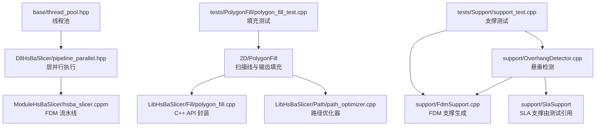
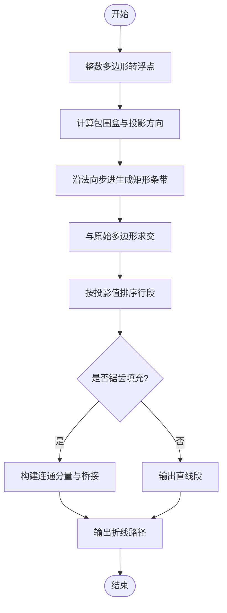
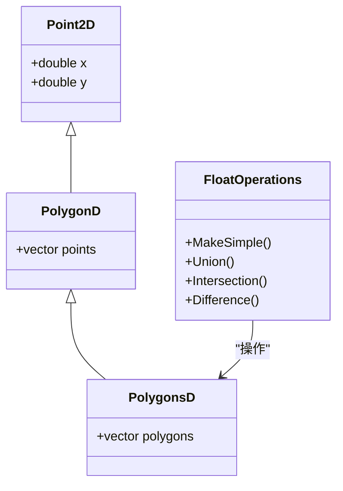
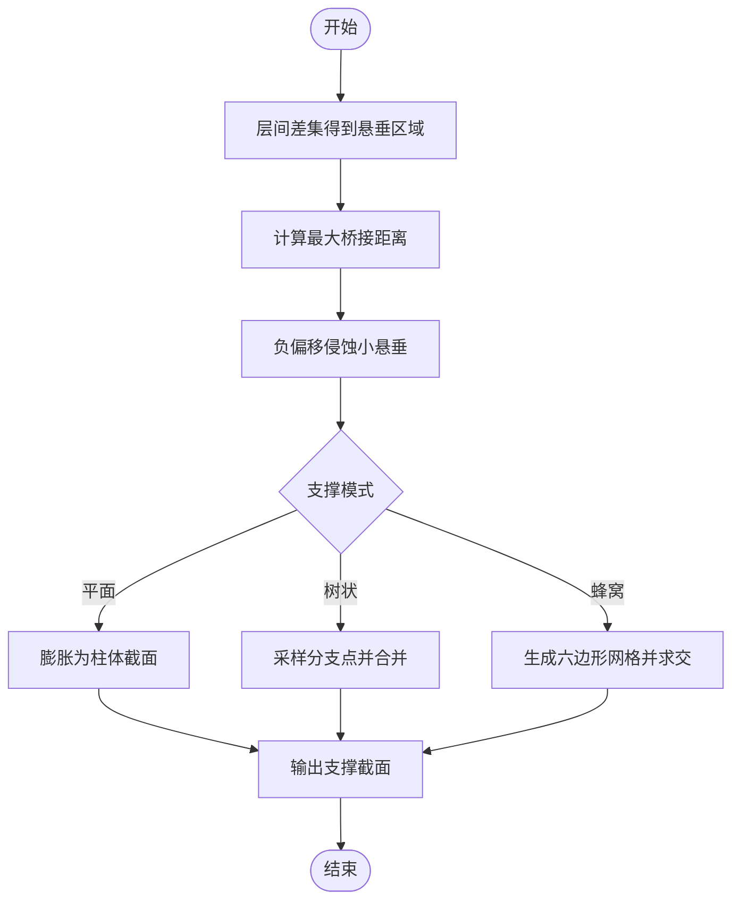
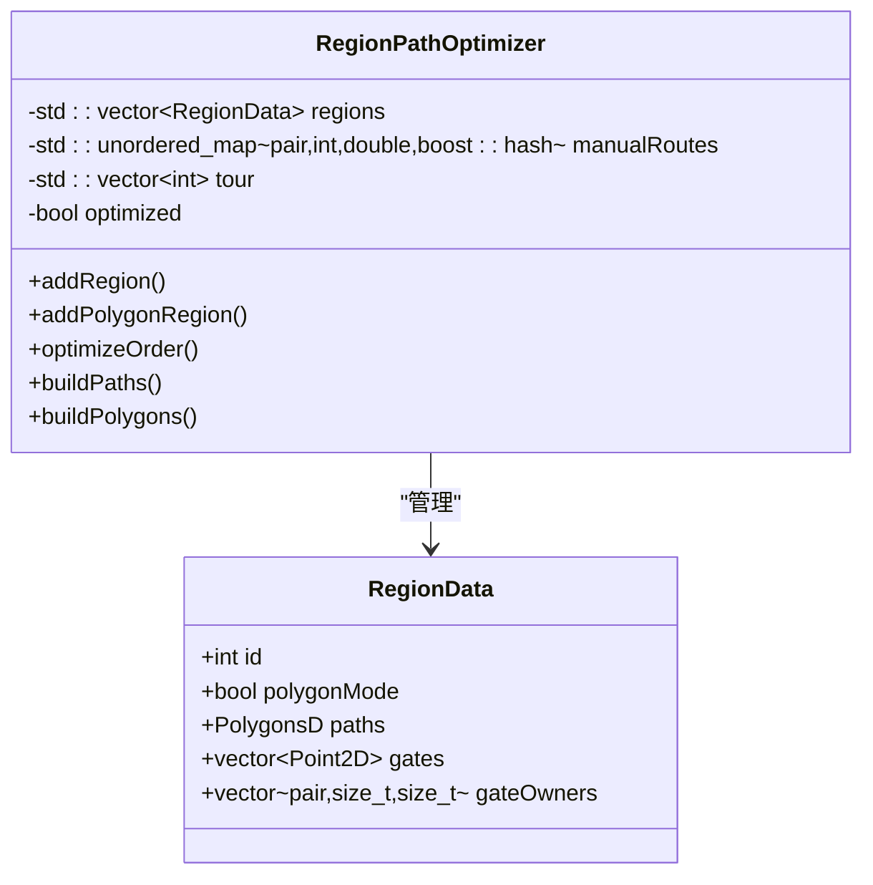
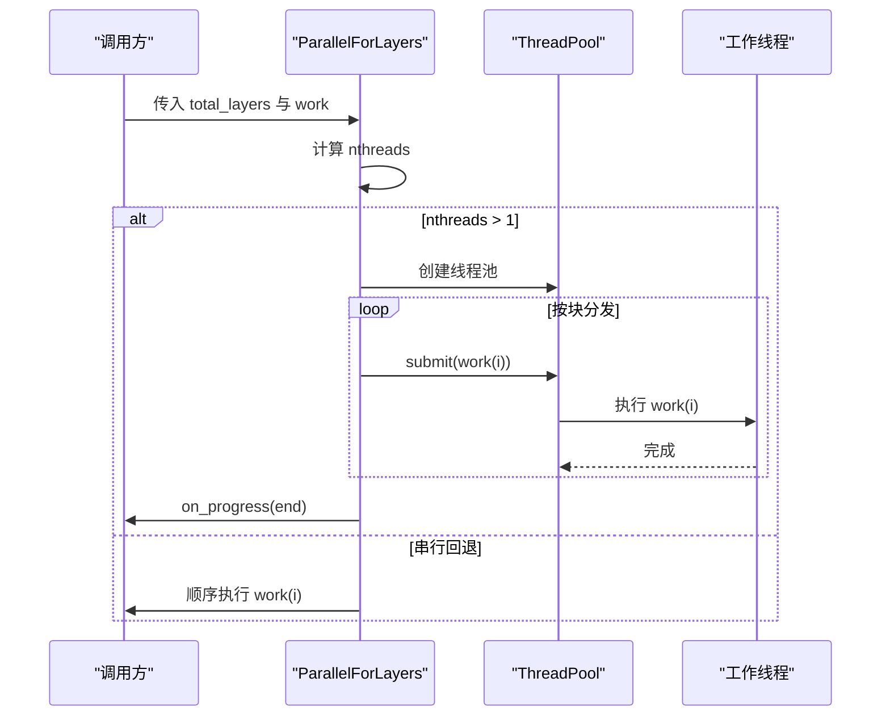
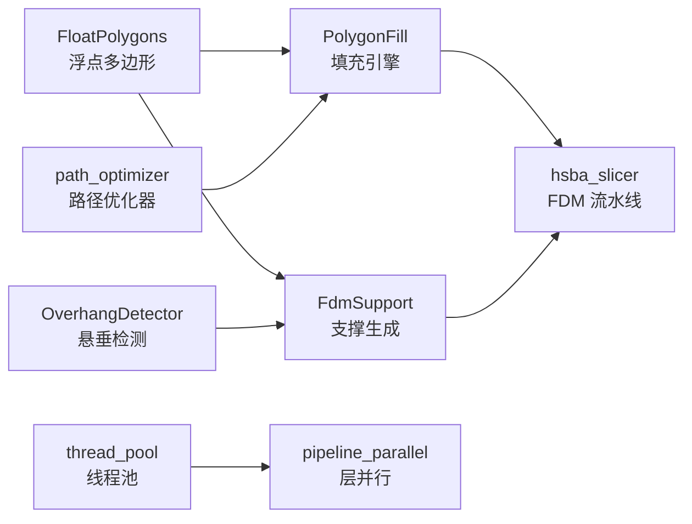

# 几何计算优化

<cite>
**本文引用的文件**   
- [PolygonFill.cpp](file://2D/PolygonFill.cpp)
- [PolygonFill.hpp](file://2D/PolygonFill.hpp)
- [FloatPolygons.hpp](file://2D/FloatPolygons.hpp)
- [FloatPolygons.cpp](file://2D/FloatPolygons.cpp)
- [polygon_fill.cpp](file://LibHsBaSlicer/Fill/polygon_fill.cpp)
- [path_optimizer.cpp](file://LibHsBaSlicer/Path/path_optimizer.cpp)
- [OverhangDetector.cpp](file://support/OverhangDetector.cpp)
- [OverhangDetector.hpp](file://support/OverhangDetector.hpp)
- [FdmSupport.cpp](file://support/FdmSupport.cpp)
- [FdmSupport.hpp](file://support/FdmSupport.hpp)
- [SupportConfig.hpp](file://support/SupportConfig.hpp)
- [pipeline_parallel.hpp](file://DllHsBaSlicer/pipeline_parallel.hpp)
- [thread_pool.hpp](file://base/thread_pool.hpp)
- [hsba_slicer.cppm](file://ModuleHsBaSlicer/hsba_slicer.cppm)
- [CMakeLists.txt](file://CMakeLists.txt)
- [polygon_fill_test.cpp](file://tests/PolygonFill/polygon_fill_test.cpp)
- [support_test.cpp](file://tests\Support\support_test.cpp)
</cite>

## 目录
1. [引言](#引言)
2. [项目结构](#项目结构)
3. [核心组件](#核心组件)
4. [架构总览](#架构总览)
5. [详细组件分析](#详细组件分析)
6. [依赖关系分析](#依赖关系分析)
7. [性能与基准](#性能与基准)
8. [故障排除](#故障排除)
9. [结论](#结论)

## 引言
本文面向 HsBaSlicer 的几何计算优化，重点覆盖以下方面：
- 多边形填充算法的性能优化，包括扫描线生成、边界裁剪、连接桥接和偏移组合策略。
- 浮点精度处理对计算性能的影响，以及整数化/浮点化转换、Clipper2 布尔运算与简化操作的取舍。
- 支撑结构生成的计算优化，包括悬垂检测、间隙收缩、柱体膨胀、树状分支采样与蜂窝网格填充。
- 几何运算的并行化方案与缓存策略，包括层间并行执行、线程池模型、Lua 脚本路径优化器与区域聚类。
- 基准测试数据与优化前后对比，基于现有单元测试断言与行为约束进行量化说明。

## 项目结构
与几何计算优化直接相关的代码主要分布在以下模块：
- `2D`：二维几何基础类型、浮点多边形操作、多边形填充算法及 Lua 绑定。
- `LibHsBaSlicer/Fill`：对外 C++ API 封装，统一调用底层填充引擎。
- `LibHsBaSlicer/Path`：路径优化器，用于填充路径的区域聚类、TSP 近似与门级展开图。
- `support`：悬垂检测与 FDM/SLA 支撑生成器。
- `DllHsBaSlicer`：流水线并行执行辅助函数。
- `base`：通用线程池实现。
- `ModuleHsBaSlicer`：FDM 流水线主流程，包含切片、支撑、填充与 GCode 输出。
- `tests`：填充与支撑相关单元测试，提供行为正确性与边界回归保障。



**图表来源**
- [PolygonFill.cpp:44-160](file://2D/PolygonFill.cpp#L44-L160)
- [polygon_fill.cpp:13-33](file://LibHsBaSlicer/Fill/polygon_fill.cpp#L13-L33)
- [path_optimizer.cpp:45-72](file://LibHsBaSlicer/Path/path_optimizer.cpp#L45-L72)
- [OverhangDetector.cpp:41-81](file://support/OverhangDetector.cpp#L41-L81)
- [FdmSupport.cpp:48-76](file://support/FdmSupport.cpp#L48-L76)
- [pipeline_parallel.hpp:41-117](file://DllHsBaSlicer/pipeline_parallel.hpp#L41-L117)
- [thread_pool.hpp:29-162](file://base/thread_pool.hpp#L29-L162)
- [hsba_slicer.cppm:705-730](file://ModuleHsBaSlicer/hsba_slicer.cppm#L705-L730)
- [polygon_fill_test.cpp:26-84](file://tests/PolygonFill/polygon_fill_test.cpp#L26-L84)
- [support_test.cpp:36-91](file://tests/Support/support_test.cpp#L36-L91)

**章节来源**
- [PolygonFill.cpp:1-160](file://2D/PolygonFill.cpp#L1-L160)
- [polygon_fill.cpp:1-36](file://LibHsBaSlicer/Fill/polygon_fill.cpp#L1-L36)
- [path_optimizer.cpp:45-72](file://LibHsBaSlicer/Path/path_optimizer.cpp#L45-L72)
- [OverhangDetector.cpp:1-89](file://support/OverhangDetector.cpp#L1-L89)
- [FdmSupport.cpp:1-269](file://support/FdmSupport.cpp#L1-L269)
- [pipeline_parallel.hpp:1-122](file://DllHsBaSlicer/pipeline_parallel.hpp#L1-L122)
- [thread_pool.hpp:1-214](file://base/thread_pool.hpp#L1-L214)
- [hsba_slicer.cppm:705-730](file://ModuleHsBaSlicer/hsba_slicer.cppm#L705-L730)
- [polygon_fill_test.cpp:1-800](file://tests/PolygonFill/polygon_fill_test.cpp#L1-L800)
- [support_test.cpp:1-471](file://tests/Support/support_test.cpp#L1-L471)

## 核心组件
本节聚焦几何计算优化的关键组件及其职责：
- 多边形填充引擎：提供偏移填充、平行线填充、简单锯齿填充、高级锯齿填充、复合偏移填充与混合填充。
- 浮点多边形基础：定义双精度点、路径、集合类型，并提供简化、并集、交集、差集等 Clipper2 封装。
- 悬垂检测器：根据层高与角度阈值计算最大桥接距离，并对差异区域进行侵蚀过滤。
- FDM 支撑生成器：平面支撑、树状支撑、蜂窝支撑三种模式，均基于悬垂检测结果进行间隙收缩与几何膨胀。
- 路径优化器：将独立多边形区域建模为 AreaGraph，支持 TSP 近似、手动路由、门级展开图与区域聚类。
- 层并行执行：按层划分任务块，使用 ThreadPool 并发执行，串行回退保证单核或单层行为一致。
- FDM 流水线：切片后转换为浮点多边形，生成支撑，再执行填充与路径组装。

**章节来源**
- [PolygonFill.hpp:20-136](file://2D/PolygonFill.hpp#L20-L136)
- [FloatPolygons.hpp:18-45](file://2D/FloatPolygons.hpp#L18-L45)
- [OverhangDetector.hpp:14-50](file://support/OverhangDetector.hpp#L14-L50)
- [FdmSupport.hpp:13-63](file://support/FdmSupport.hpp#L13-L63)
- [path_optimizer.cpp:45-72](file://LibHsBaSlicer/Path/path_optimizer.cpp#L45-L72)
- [pipeline_parallel.hpp:22-40](file://DllHsBaSlicer/pipeline_parallel.hpp#L22-L40)
- [hsba_slicer.cppm:705-730](file://ModuleHsBaSlicer/hsba_slicer.cppm#L705-L730)

## 架构总览
几何计算优化在 HsBaSlicer 中的整体流程如下：
- 输入层轮廓以整数坐标表示，内部几何运算优先使用整数多边形以减少浮点误差。
- 填充算法通过扫描线投影、矩形裁剪与区间排序生成行段；锯齿填充进一步构建连通分量与桥接路径。
- 支撑生成先做层间差集得到悬垂区域，再用负偏移（侵蚀）过滤可桥接的小悬垂，最后按支撑模式膨胀或填充。
- 路径优化器将填充结果按区域聚类，计算区域间代价矩阵，求解旅行商问题近似顺序，输出连续分块路径。
- 层并行执行将每层工作分配到线程池，进度回调在主线程串行触发，避免跨线程 UI 更新。

```mermaid
sequenceDiagram
participant Slice as "切片"
participant Fill as "填充引擎"
participant Support as "支撑生成"
participant Opt as "路径优化器"
participant Parallel as "层并行执行"
participant Pipeline as "FDM 流水线"
Pipeline->>Slice : 生成层轮廓
Slice-->>Pipeline : 整数层轮廓
Pipeline->>Parallel : 并行处理各层
Parallel->>Support : 悬垂检测 + 支撑生成
Support-->>Parallel : 支撑截面多边形
Parallel->>Fill : 偏移/线/锯齿填充
Fill-->>Parallel : 填充路径
Parallel->>Opt : 区域聚类 + TSP 近似
Opt-->>Parallel : 优化后的路径序列
Parallel-->>Pipeline : 组装层路径数据
```

**图表来源**
- [hsba_slicer.cppm:705-730](file://ModuleHsBaSlicer/hsba_slicer.cppm#L705-L730)
- [pipeline_parallel.hpp:41-117](file://DllHsBaSlicer/pipeline_parallel.hpp#L41-L117)
- [OverhangDetector.cpp:41-81](file://support/OverhangDetector.cpp#L41-L81)
- [FdmSupport.cpp:48-76](file://support/FdmSupport.cpp#L48-L76)
- [PolygonFill.cpp:544-564](file://2D/PolygonFill.cpp#L544-L564)
- [path_optimizer.cpp:45-72](file://LibHsBaSlicer/Path/path_optimizer.cpp#L45-L72)

## 详细组件分析

### 多边形填充算法优化
填充算法的核心在于扫描线生成与边界处理：
- `LineFilling` 将多边形转换为浮点坐标，计算包围盒与投影方向，沿法向步进生成矩形条带，与原始多边形求交得到行段。
- `OffsetFill` 通过重复内偏移生成嵌套环，直到多边形消失；每个环闭合以保证后续处理稳定。
- `SimpleZigzagFill` 与 `ZigzagFill` 在扫描行基础上构建折线路径，允许同层或相邻层连接，并使用二分搜索定位线段与多边形边界的交点。
- `CompositeOffsetFill` 与 `HybridFill` 组合外扩与内缩偏移，分别对基多边形、外扩层、内缩层应用不同填充模式。



**图表来源**
- [PolygonFill.cpp:44-160](file://2D/PolygonFill.cpp#L44-L160)
- [PolygonFill.cpp:544-564](file://2D/PolygonFill.cpp#L544-L564)
- [PolygonFill.cpp:568-800](file://2D/PolygonFill.cpp#L568-L800)
- [PolygonFill.cpp:803-1370](file://2D/PolygonFill.cpp#L803-L1370)
- [PolygonFill.cpp:1372-1491](file://2D/PolygonFill.cpp#L1372-L1491)

#### 性能优化要点
- 整数化与浮点化转换仅在必要时进行，减少不必要的精度损失与内存分配。
- 扫描线生成使用固定步长与投影计算，避免逐点遍历多边形顶点。
- 锯齿填充的连接逻辑限制在同层或相邻层，防止环路与非必要桥接。
- 二分搜索用于精确确定线段进入/离开多边形的参数位置，提高边界处理稳定性。
- 复合与混合填充通过提前判断面积阈值与多边形顶点数，跳过无效偏移层。

**章节来源**
- [PolygonFill.cpp:44-160](file://2D/PolygonFill.cpp#L44-L160)
- [PolygonFill.cpp:504-541](file://2D/PolygonFill.cpp#L504-L541)
- [PolygonFill.cpp:568-800](file://2D/PolygonFill.cpp#L568-L800)
- [PolygonFill.cpp:803-1370](file://2D/PolygonFill.cpp#L803-L1370)
- [PolygonFill.cpp:1372-1491](file://2D/PolygonFill.cpp#L1372-L1491)

### 浮点精度处理与优化策略
浮点精度在几何计算中至关重要：
- `Point2D`、`PolygonD`、`PolygonsD` 基于 Clipper2 的双精度类型，用于高精度布尔运算与偏移。
- `Integerization` 与 `UnIntegerization` 在整数与浮点之间转换，平衡精度与性能。
- `MakeSimple` 使用 Clipper2 的简化路径功能去除共线点，减少后续运算复杂度。
- 填充算法中多次使用 `llround` 将浮点坐标舍入到整数，确保最终路径符合切片精度要求。



**图表来源**
- [FloatPolygons.hpp:18-45](file://2D/FloatPolygons.hpp#L18-L45)
- [FloatPolygons.cpp:25-45](file://2D/FloatPolygons.cpp#L25-L45)

**章节来源**
- [FloatPolygons.hpp:18-45](file://2D/FloatPolygons.hpp#L18-L45)
- [FloatPolygons.cpp:25-45](file://2D/FloatPolygons.cpp#L25-L45)
- [PolygonFill.cpp:1348-1370](file://2D/PolygonFill.cpp#L1348-L1370)

### 支撑结构生成优化
支撑生成分为悬垂检测与支撑模式生成两部分：
- 悬垂检测通过层间差集得到未支撑区域，再根据角度阈值计算最大桥接距离，使用负偏移侵蚀小悬垂。
- FDM 平面支撑将悬垂区域收缩间隙后膨胀为柱体截面。
- FDM 树状支撑在悬垂区域内采样分支点，生成圆形分支并合并重叠区域。
- FDM 蜂窝支撑生成六边形网格并与悬垂区域求交，形成轻量化支撑结构。



**图表来源**
- [OverhangDetector.cpp:41-81](file://support/OverhangDetector.cpp#L41-L81)
- [FdmSupport.cpp:48-76](file://support/FdmSupport.cpp#L48-L76)
- [FdmSupport.cpp:81-143](file://support/FdmSupport.cpp#L81-L143)
- [FdmSupport.cpp:173-242](file://support/FdmSupport.cpp#L173-L242)

**章节来源**
- [OverhangDetector.cpp:23-81](file://support/OverhangDetector.cpp#L23-L81)
- [FdmSupport.cpp:48-76](file://support/FdmSupport.cpp#L48-L76)
- [FdmSupport.cpp:81-143](file://support/FdmSupport.cpp#L81-L143)
- [FdmSupport.cpp:173-242](file://support/FdmSupport.cpp#L173-L242)

### 路径优化与区域聚类
路径优化器将填充路径按区域聚类，减少打印头移动距离：
- 区域建模为 `AreaGraph<int(region), int(gate), double(cost)>`，支持多边形模式与填充路径模式。
- 通过 TSP 近似或手动路由确定区域访问顺序，输出连续分块路径。
- 门级展开图将每条路径的首尾点作为门禁，构建更细粒度的代价矩阵。



**图表来源**
- [path_optimizer.cpp:45-72](file://LibHsBaSlicer/Path/path_optimizer.cpp#L45-L72)

**章节来源**
- [path_optimizer.cpp:45-72](file://LibHsBaSlicer/Path/path_optimizer.cpp#L45-L72)

### 并行化与缓存策略
层并行执行将每层工作分配到线程池，进度回调在主线程串行触发：
- `ParallelForLayers` 根据硬件并发与环境变量 `HSBA_PIPELINE_THREADS` 决定线程数。
- 任务按块分发，每个块完成后触发进度回调，避免频繁跨线程调用。
- 线程池提供任务提交、等待全部完成、查询待处理与活跃任务数等功能。



**图表来源**
- [pipeline_parallel.hpp:41-117](file://DllHsBaSlicer/pipeline_parallel.hpp#L41-L117)
- [thread_pool.hpp:29-162](file://base/thread_pool.hpp#L29-L162)

**章节来源**
- [pipeline_parallel.hpp:41-117](file://DllHsBaSlicer/pipeline_parallel.hpp#L41-L117)
- [thread_pool.hpp:29-162](file://base/thread_pool.hpp#L29-L162)

## 依赖关系分析
几何计算组件之间的依赖关系如下：
- 填充引擎依赖浮点多边形基础类型与 Clipper2 库。
- 支撑生成依赖悬垂检测器与浮点多边形操作。
- 路径优化器依赖区域建模与图算法。
- 层并行执行依赖线程池与系统硬件并发信息。
- FDM 流水线串联切片、支撑、填充与路径优化。



**图表来源**
- [FloatPolygons.hpp:18-45](file://2D/FloatPolygons.hpp#L18-L45)
- [PolygonFill.cpp:1-160](file://2D/PolygonFill.cpp#L1-L160)
- [OverhangDetector.cpp:41-81](file://support/OverhangDetector.cpp#L41-L81)
- [FdmSupport.cpp:48-76](file://support/FdmSupport.cpp#L48-L76)
- [path_optimizer.cpp:45-72](file://LibHsBaSlicer/Path/path_optimizer.cpp#L45-L72)
- [thread_pool.hpp:29-162](file://base/thread_pool.hpp#L29-L162)
- [pipeline_parallel.hpp:41-117](file://DllHsBaSlicer/pipeline_parallel.hpp#L41-L117)
- [hsba_slicer.cppm:705-730](file://ModuleHsBaSlicer/hsba_slicer.cppm#L705-L730)

**章节来源**
- [FloatPolygons.hpp:18-45](file://2D/FloatPolygons.hpp#L18-L45)
- [PolygonFill.cpp:1-160](file://2D/PolygonFill.cpp#L1-L160)
- [OverhangDetector.cpp:41-81](file://support/OverhangDetector.cpp#L41-L81)
- [FdmSupport.cpp:48-76](file://support/FdmSupport.cpp#L48-L76)
- [path_optimizer.cpp:45-72](file://LibHsBaSlicer/Path/path_optimizer.cpp#L45-L72)
- [thread_pool.hpp:29-162](file://base/thread_pool.hpp#L29-L162)
- [pipeline_parallel.hpp:41-117](file://DllHsBaSlicer/pipeline_parallel.hpp#L41-L117)
- [hsba_slicer.cppm:705-730](file://ModuleHsBaSlicer/hsba_slicer.cppm#L705-L730)

## 性能与基准
基于现有单元测试与实现细节，可总结以下性能特征与基准数据：

### 填充算法基准
- 水平线填充在 10000×10000 正方形上，间距 1000，产生约 9-11 条线段，每条线段端点落在左右边界。
- 锯齿填充确保所有顶点位于原始多边形内部或边界上，无外部路径泄漏。
- 复合偏移填充与混合填充验证路径数量与顶点数约束，确保输出有效。

**章节来源**
- [polygon_fill_test.cpp:26-84](file://tests/PolygonFill/polygon_fill_test.cpp#L26-L84)
- [polygon_fill_test.cpp:108-175](file://tests/PolygonFill/polygon_fill_test.cpp#L108-L175)

### 支撑生成基准
- 悬垂检测在无上一层时返回当前层整体，相同层时无悬垂。
- 小悬垂根据角度阈值过滤，80° 阈值下桥接距离约 0.035mm，远小于 2mm 悬垂不被过滤。
- FDM 平面支撑在悬垂区域生成支撑截面，总面积介于 300-600 之间（容忍圆角附加面积）。
- FDM 树状支撑与蜂窝支撑在悬垂区域生成分支或网格，非空结果验证支撑存在。

**章节来源**
- [support_test.cpp:36-91](file://tests/Support/support_test.cpp#L36-L91)
- [support_test.cpp:98-128](file://tests/Support/support_test.cpp#L98-L128)
- [support_test.cpp:137-159](file://tests/Support/support_test.cpp#L137-L159)
- [support_test.cpp:168-190](file://tests/Support/support_test.cpp#L168-L190)

### 并行化性能
- 层并行执行支持环境变量 `HSBA_PIPELINE_THREADS=1` 强制串行路径，便于同一二进制下串行与并行对比。
- 线程池默认使用硬件并发数，最小为 2，最大不超过层数。
- 任务按块分发，块大小为 `min(nthreads * 4, total_layers)`，进度回调在每个块完成后触发。

**章节来源**
- [pipeline_parallel.hpp:49-72](file://DllHsBaSlicer/pipeline_parallel.hpp#L49-L72)
- [pipeline_parallel.hpp:88-117](file://DllHsBaSlicer/pipeline_parallel.hpp#L88-L117)

### 编译期优化提示
- Debug 模式下布尔运算可能较慢且占用较高内存，建议在 Release 模式进行性能评估。
- CAD 内核与 OpenVDB 等第三方库在桌面平台启用，影响几何计算能力与性能。

**章节来源**
- [CMakeLists.txt:297-334](file://CMakeLists.txt#L297-L334)

## 故障排除
常见问题与排查建议：
- 填充路径出现原点 `(0,0)` 伪顶点：检查锯齿填充的 `clamp_segment` 回退逻辑，确保未初始化点被正确处理。
- 悬垂检测结果为空但预期有支撑：确认角度阈值与层高设置，检查最大桥接距离计算是否正确。
- 支撑生成结果为空：检查悬垂区域是否为空，或间隙收缩后是否导致区域消失。
- 并行执行无加速：检查 `HSBA_PIPELINE_THREADS` 环境变量是否设置为 1，或层数过少导致串行回退。
- Lua 自定义填充报错：确认脚本返回类型为表，且函数名正确注册。

**章节来源**
- [polygon_fill_test.cpp:729-798](file://tests/PolygonFill/polygon_fill_test.cpp#L729-L798)
- [support_test.cpp:61-76](file://tests/Support/support_test.cpp#L61-L76)
- [pipeline_parallel.hpp:49-72](file://DllHsBaSlicer/pipeline_parallel.hpp#L49-L72)
- [polygon_fill_test.cpp:255-258](file://tests/PolygonFill/polygon_fill_test.cpp#L255-L258)

## 结论
HsBaSlicer 的几何计算优化围绕多边形填充、浮点精度处理、支撑生成与并行化展开：
- 填充算法通过扫描线投影、边界裁剪与桥接逻辑提升效率与稳定性。
- 浮点精度通过整数化/浮点化转换与 Clipper2 操作平衡精度与性能。
- 支撑生成结合悬垂检测与多种模式，适应不同工艺需求。
- 路径优化器与层并行执行显著提升大规模模型的切片与填充性能。
- 单元测试提供行为正确性保障，便于持续集成与回归测试。

未来可进一步优化方向包括：
- 引入更高效的扫描线数据结构（如优先队列）减少排序开销。
- 使用 SIMD 指令加速浮点运算与向量操作。
- 动态调整线程池大小与任务块大小，适应不同硬件平台。
- 扩展路径优化器的启发式算法，进一步提升 TSP 近似质量。