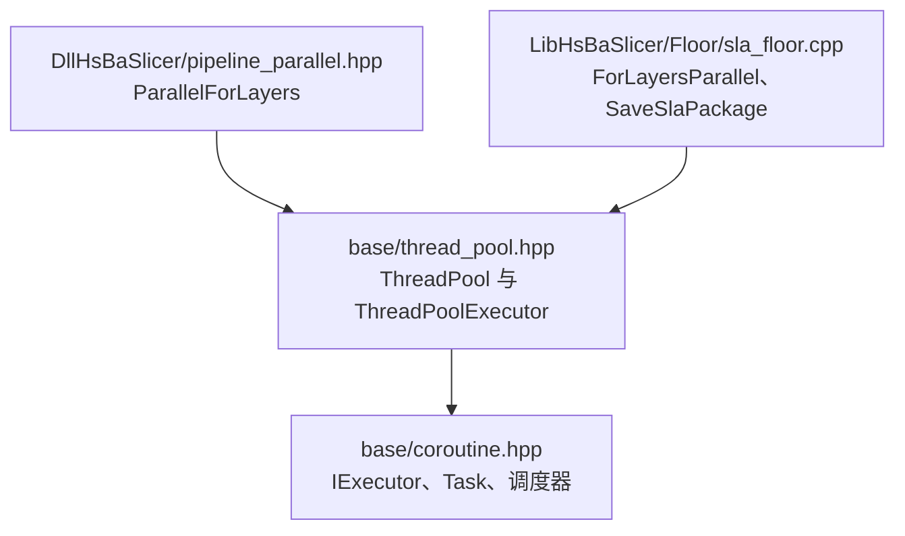
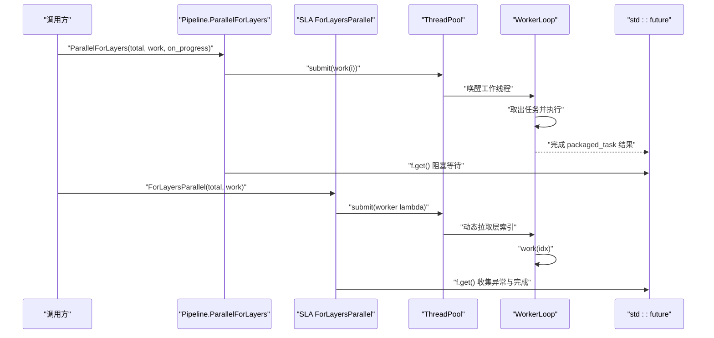
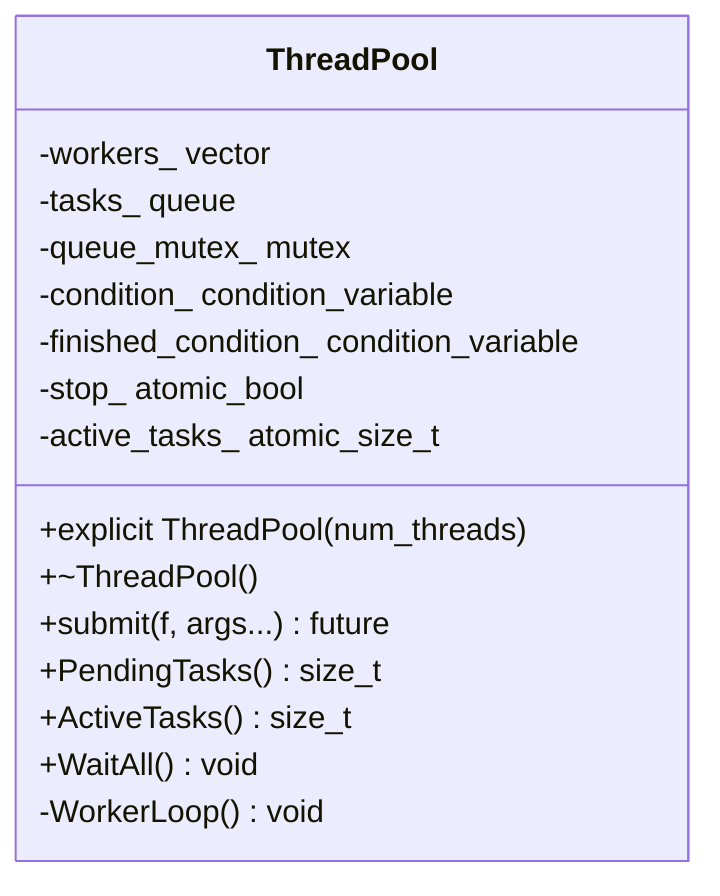
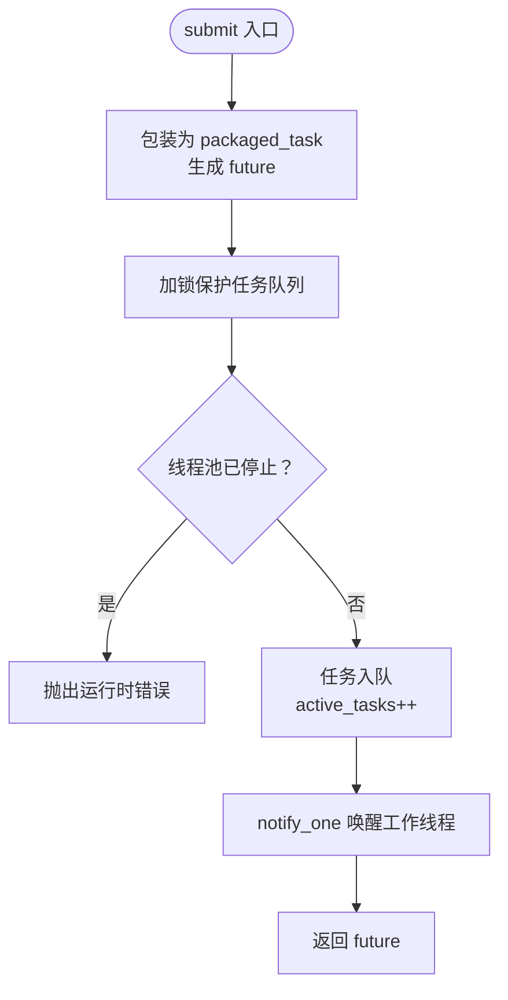
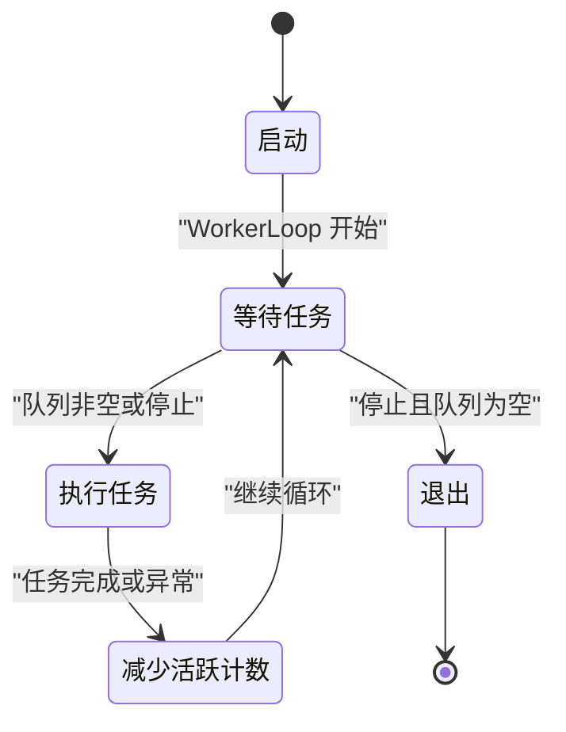
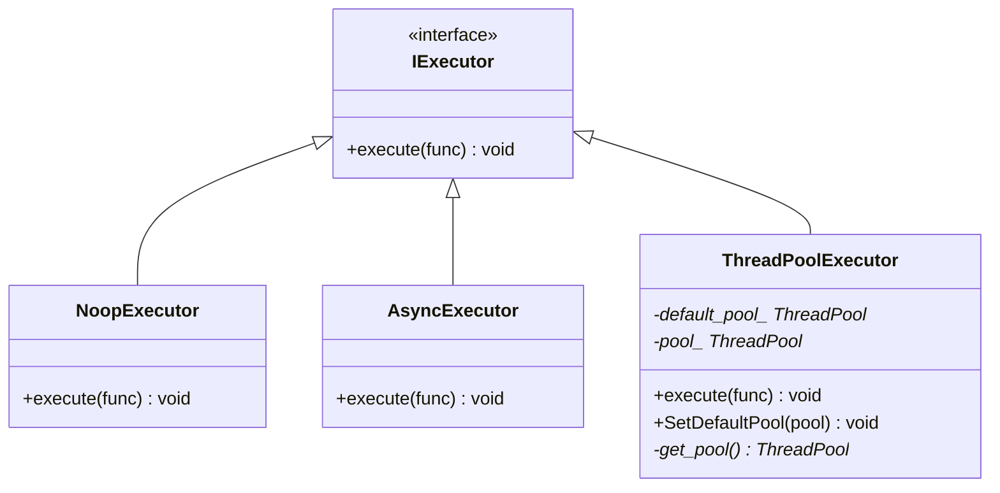
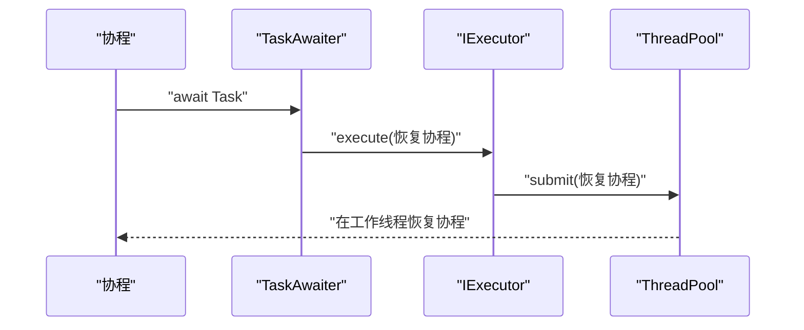
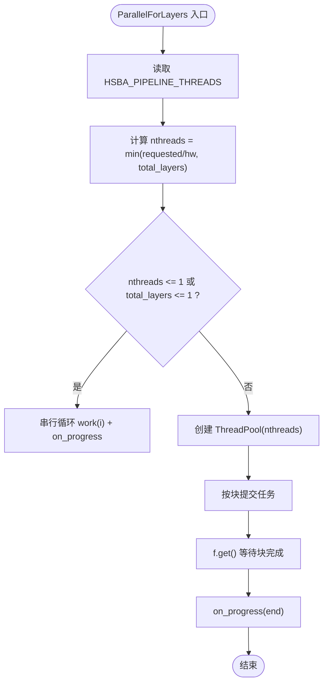
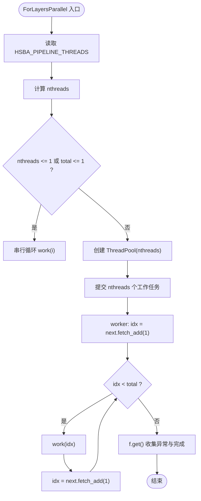
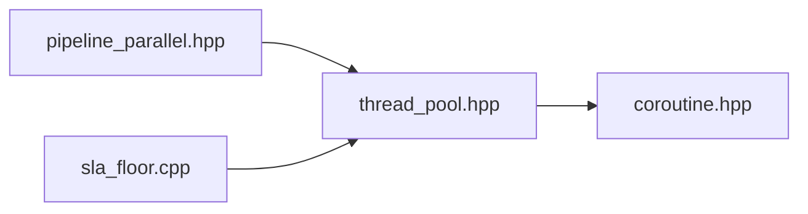

# 多线程优化

<cite>
**本文引用的文件**   
- [thread_pool.hpp](file://base/thread_pool.hpp)
- [coroutine.hpp](file://base/coroutine.hpp)
- [pipeline_parallel.hpp](file://DllHsBaSlicer/pipeline_parallel.hpp)
- [sla_floor.cpp](file://LibHsBaSlicer/Floor/sla_floor.cpp)
- [thread_pool.md（英文文档）](file://docs/en/base/thread_pool.md)
- [thread_pool.md（中文文档）](file://docs/zh/base/thread_pool.md)
</cite>

## 目录
1. [引言](#引言)
2. [项目结构与定位](#项目结构与定位)
3. [核心组件总览](#核心组件总览)
4. [架构与数据流总览](#架构与数据流总览)
5. [ThreadPool 实现原理深度解析](#threadpool-实现原理深度解析)
6. [协程与 ThreadPoolExecutor 集成机制](#协程与-threadpoolexecutor-集成机制)
7. [切片流水线中的并行化模式](#切片流水线中的并行化模式)
8. [依赖关系分析](#依赖关系分析)
9. [性能特征与调优建议](#性能特征与调优建议)
10. [多线程编程最佳实践](#多线程编程最佳实践)
11. [故障排查指南](#故障排查指南)
12. [结论](#结论)

## 引言
本文面向 HsBaSlicer 的多线程优化，重点围绕 `ThreadPool` 类的实现原理、任务队列管理、线程生命周期控制与同步机制展开，并说明其在切片与填充流水线中的实际使用方式。同时，文档梳理了协程执行器 `ThreadPoolExecutor` 的工作机制，给出在切片处理中应用多线程优化的具体思路、代码路径参考以及性能调优和排错建议。

## 项目结构与定位
HsBaSlicer 的多线程能力集中在基础库 `base` 中，并通过上层管线模块复用：
- `base/thread_pool.hpp`：线程池核心实现，包含 `ThreadPool` 与可选的协程执行器 `ThreadPoolExecutor`。
- `base/coroutine.hpp`：C++20 协程基础设施，定义 `IExecutor`、`Task`、调度等待器等。
- `DllHsBaSlicer/pipeline_parallel.hpp`：面向切片与填充热路径的层级并行辅助函数。
- `LibHsBaSlicer/Floor/sla_floor.cpp`：SLA 导出流程中对层数据的并行渲染与打包。

**图表来源**
- [thread_pool.hpp:29-162](file://base/thread_pool.hpp#L29-L162)
- [coroutine.hpp:47-53](file://base/coroutine.hpp#L47-L53)
- [pipeline_parallel.hpp:41-117](file://DllHsBaSlicer/pipeline_parallel.hpp#L41-L117)
- [sla_floor.cpp:406-466](file://LibHsBaSlicer/Floor/sla_floor.cpp#L406-L466)

**章节来源**
- [thread_pool.hpp:1-214](file://base/thread_pool.hpp#L1-L214)
- [coroutine.hpp:1-120](file://base/coroutine.hpp#L1-L120)
- [pipeline_parallel.hpp:1-122](file://DllHsBaSlicer/pipeline_parallel.hpp#L1-L122)
- [sla_floor.cpp:400-599](file://LibHsBaSlicer/Floor/sla_floor.cpp#L400-L599)

## 核心组件总览
- `ThreadPool`：通用线程池，提供任务提交、状态查询、全部等待等接口；内部维护任务队列、工作线程、条件变量与原子计数器。
- `ThreadPoolExecutor`：协程执行器，实现 `IExecutor`，将协程调度任务投递到 `ThreadPool`。
- `ParallelForLayers`：切片/填充热路径的层并行封装，按块提交任务，保证进度回调在主线程串行调用。
- `ForLayersParallel`：SLA 导出层的动态调度并行循环，通过原子计数器分配层索引，适合层间耗时不均的场景。

**章节来源**
- [thread_pool.hpp:29-162](file://base/thread_pool.hpp#L29-L162)
- [thread_pool.hpp:170-207](file://base/thread_pool.hpp#L170-L207)
- [pipeline_parallel.hpp:41-117](file://DllHsBaSlicer/pipeline_parallel.hpp#L41-L117)
- [sla_floor.cpp:406-466](file://LibHsBaSlicer/Floor/sla_floor.cpp#L406-L466)

## 架构与数据流总览
下图展示从高层切片/导出逻辑到线程池与协程执行器的调用链：

**图表来源**
- [pipeline_parallel.hpp:88-116](file://DllHsBaSlicer/pipeline_parallel.hpp#L88-L116)
- [sla_floor.cpp:445-465](file://LibHsBaSlicer/Floor/sla_floor.cpp#L445-L465)
- [thread_pool.hpp:67-90](file://base/thread_pool.hpp#L67-L90)
- [thread_pool.hpp:118-154](file://base/thread_pool.hpp#L118-L154)

## ThreadPool 实现原理深度解析

### 类结构与职责
`ThreadPool` 负责：
- 创建工作线程并启动工作循环。
- 接收任务并提交到任务队列。
- 通过条件变量通知工作线程。
- 统计待处理任务数与活跃任务数。
- 等待所有任务完成。
- 析构时安全停止并 join 所有工作线程。

**图表来源**
- [thread_pool.hpp:29-162](file://base/thread_pool.hpp#L29-L162)

**章节来源**
- [thread_pool.hpp:29-162](file://base/thread_pool.hpp#L29-L162)

### 初始化配置
- 默认线程数为系统硬件并发数；若传入 0 会抛出参数错误。
- 构造时立即创建指定数量的工作线程，每个线程运行 `WorkerLoop`。
- 支持通过环境变量 `HSBA_PIPELINE_THREADS` 在调用方侧调整实际使用的线程数（由上层并行辅助函数读取）。

**章节来源**
- [thread_pool.hpp:37-46](file://base/thread_pool.hpp#L37-L46)
- [pipeline_parallel.hpp:49-72](file://DllHsBaSlicer/pipeline_parallel.hpp#L49-L72)
- [sla_floor.cpp:413-432](file://LibHsBaSlicer/Floor/sla_floor.cpp#L413-L432)

### 任务队列管理与提交方式
- `submit` 将任意可调用对象包装为 `packaged_task`，返回 `std::future`。
- 任务入队前检查线程池是否已停止；若已停止则抛出运行时错误。
- 入队后增加活跃任务计数，并通知一个等待中的工作线程。
- 任务执行完成后，活跃任务计数减一，并通知“全部完成”条件变量。

**图表来源**
- [thread_pool.hpp:67-90](file://base/thread_pool.hpp#L67-L90)

**章节来源**
- [thread_pool.hpp:67-90](file://base/thread_pool.hpp#L67-L90)

### 线程生命周期控制
- 工作线程在 `WorkerLoop` 中循环等待条件变量。
- 当收到停止信号且队列为空时退出循环。
- 析构函数设置停止标志、通知所有等待者，并 join 所有工作线程。

**图表来源**
- [thread_pool.hpp:118-154](file://base/thread_pool.hpp#L118-L154)
- [thread_pool.hpp:47-61](file://base/thread_pool.hpp#L47-L61)

**章节来源**
- [thread_pool.hpp:47-61](file://base/thread_pool.hpp#L47-L61)
- [thread_pool.hpp:118-154](file://base/thread_pool.hpp#L118-L154)

### 同步机制
- `queue_mutex_`：保护任务队列与活跃任务计数。
- `condition_`：用于通知工作线程有新任务或需要停止。
- `finished_condition_`：用于 `WaitAll` 等待所有任务完成。
- `stop_`：原子布尔，表示线程池停止。
- `active_tasks_`：原子计数，记录当前正在执行的任务数量。

**章节来源**
- [thread_pool.hpp:155-161](file://base/thread_pool.hpp#L155-L161)
- [thread_pool.hpp:107-111](file://base/thread_pool.hpp#L107-L111)

### 结果获取方法
- `submit` 返回 `std::future`，调用方通过 `get()` 获取结果或捕获异常。
- `WaitAll` 阻塞直到队列为空且无活跃任务。
- `PendingTasks` 与 `ActiveTasks` 可用于监控线程池负载。

**章节来源**
- [thread_pool.hpp:67-90](file://base/thread_pool.hpp#L67-L90)
- [thread_pool.hpp:91-111](file://base/thread_pool.hpp#L91-L111)

## 协程与 ThreadPoolExecutor 集成机制

### IExecutor 与执行器体系
- `IExecutor` 定义统一的协程执行接口 `execute`。
- `NoopExecutor` 直接同步执行。
- `AsyncExecutor` 使用 `std::async` 异步执行。
- `ThreadPoolExecutor` 将任务投递到 `ThreadPool`，作为协程调度执行器。

**图表来源**
- [coroutine.hpp:47-70](file://base/coroutine.hpp#L47-L70)
- [thread_pool.hpp:170-207](file://base/thread_pool.hpp#L170-L207)

**章节来源**
- [coroutine.hpp:47-70](file://base/coroutine.hpp#L47-L70)
- [thread_pool.hpp:170-207](file://base/thread_pool.hpp#L170-L207)

### Task 与调度等待器
- `Task<T, Executor>` 基于 C++20 协程，提供 `then`、`catching`、`finally` 等链式回调。
- `DispatchAwaiter` 在协程初始挂起时将后续恢复调度到指定执行器。
- `TaskAwaiter` 在等待 `Task` 完成时，通过执行器恢复协程。

**图表来源**
- [coroutine.hpp:81-122](file://base/coroutine.hpp#L81-L122)
- [coroutine.hpp:184-198](file://base/coroutine.hpp#L184-L198)
- [thread_pool.hpp:180-184](file://base/thread_pool.hpp#L180-L184)

**章节来源**
- [coroutine.hpp:81-122](file://base/coroutine.hpp#L81-L122)
- [coroutine.hpp:184-198](file://base/coroutine.hpp#L184-L198)
- [thread_pool.hpp:180-184](file://base/thread_pool.hpp#L180-L184)

### 默认线程池与线程池选择
- `ThreadPoolExecutor` 支持显式绑定某个 `ThreadPool`。
- 可通过静态方法 `SetDefaultPool` 设置全局默认线程池。
- 若未设置，则在首次使用时创建一个基于硬件并发数的默认实例。

**章节来源**
- [thread_pool.hpp:175-206](file://base/thread_pool.hpp#L175-L206)

## 切片流水线中的并行化模式

### ParallelForLayers：分块并行
- 适用于切片与填充热路径，按固定块大小提交任务。
- 每块内并行处理若干层，块结束后在主线程调用进度回调。
- 通过环境变量 `HSBA_PIPELINE_THREADS` 控制线程数，便于性能对比验证。

**图表来源**
- [pipeline_parallel.hpp:41-117](file://DllHsBaSlicer/pipeline_parallel.hpp#L41-L117)

**章节来源**
- [pipeline_parallel.hpp:41-117](file://DllHsBaSlicer/pipeline_parallel.hpp#L41-L117)

### ForLayersParallel：动态调度
- 适用于 SLA 导出层渲染，使用原子计数器动态分配层索引。
- 各工作线程不断拉取下一个索引，直到超过总数。
- 适合层间耗时不均的场景，避免固定屏障导致的空闲等待。

**图表来源**
- [sla_floor.cpp:406-466](file://LibHsBaSlicer/Floor/sla_floor.cpp#L406-L466)

**章节来源**
- [sla_floor.cpp:406-466](file://LibHsBaSlicer/Floor/sla_floor.cpp#L406-L466)

## 依赖关系分析
- `pipeline_parallel.hpp` 依赖 `base/thread_pool.hpp`，用于层并行。
- `sla_floor.cpp` 依赖 `base/thread_pool.hpp`，用于 SLA 层渲染并行。
- `thread_pool.hpp` 依赖 `base/coroutine.hpp`，以提供协程执行器。
- `coroutine.hpp` 定义协程基础设施，被线程池执行器使用。

**图表来源**
- [pipeline_parallel.hpp:17](file://DllHsBaSlicer/pipeline_parallel.hpp#L17)
- [sla_floor.cpp:406-466](file://LibHsBaSlicer/Floor/sla_floor.cpp#L406-L466)
- [thread_pool.hpp:22-23](file://base/thread_pool.hpp#L22-L23)

**章节来源**
- [pipeline_parallel.hpp:1-122](file://DllHsBaSlicer/pipeline_parallel.hpp#L1-L122)
- [sla_floor.cpp:400-599](file://LibHsBaSlicer/Floor/sla_floor.cpp#L400-L599)
- [thread_pool.hpp:1-214](file://base/thread_pool.hpp#L1-L214)
- [coroutine.hpp:1-120](file://base/coroutine.hpp#L1-L120)

## 性能特征与调优建议

### 线程数选择
- 默认使用 `std::thread::hardware_concurrency()`。
- 可通过环境变量 `HSBA_PIPELINE_THREADS` 覆盖线程数，便于压测与对比。
- 对于 CPU 密集型任务，线程数等于核心数通常最优；对于 I/O 密集型任务可适当增加。

**章节来源**
- [thread_pool.hpp:37-46](file://base/thread_pool.hpp#L37-L46)
- [pipeline_parallel.hpp:49-72](file://DllHsBaSlicer/pipeline_parallel.hpp#L49-L72)
- [sla_floor.cpp:413-432](file://LibHsBaSlicer/Floor/sla_floor.cpp#L413-L432)

### 任务粒度划分
- 避免提交过多短任务，任务队列本身有开销。
- 对切片/填充场景，推荐按层或按块划分任务，使单任务具备足够计算量。
- 层间耗时不均时，优先采用动态调度（如 `ForLayersParallel`），避免固定屏障导致空闲。

**章节来源**
- [pipeline_parallel.hpp:88-116](file://DllHsBaSlicer/pipeline_parallel.hpp#L88-L116)
- [sla_floor.cpp:443-465](file://LibHsBaSlicer/Floor/sla_floor.cpp#L443-L465)

### 进度回调与主线程约束
- `ParallelForLayers` 保证进度回调在主线程串行调用，避免 UI 更新竞争。
- 工作函数仅能写入自身层索引对应的输出槽，确保线程安全。

**章节来源**
- [pipeline_parallel.hpp:22-39](file://DllHsBaSlicer/pipeline_parallel.hpp#L22-L39)
- [pipeline_parallel.hpp:104-115](file://DllHsBaSlicer/pipeline_parallel.hpp#L104-L115)

### 异常传播
- 工作线程抛出的异常会通过 `std::future::get()` 重新抛出给调用方。
- 建议在调用方统一捕获并记录异常，避免线程池因异常而不可用。

**章节来源**
- [pipeline_parallel.hpp:34-35](file://DllHsBaSlicer/pipeline_parallel.hpp#L34-L35)
- [pipeline_parallel.hpp:108-111](file://DllHsBaSlicer/pipeline_parallel.hpp#L108-L111)
- [sla_floor.cpp:462-465](file://LibHsBaSlicer/Floor/sla_floor.cpp#L462-L465)

## 多线程编程最佳实践

### 任务粒度划分
- 将大任务拆分为多个中等粒度的子任务，平衡负载均衡与调度开销。
- 对切片/填充场景，优先按层或按块组织任务，避免过细粒度。

**章节来源**
- [pipeline_parallel.hpp:88-116](file://DllHsBaSlicer/pipeline_parallel.hpp#L88-L116)
- [sla_floor.cpp:443-465](file://LibHsBaSlicer/Floor/sla_floor.cpp#L443-L465)

### 死锁避免
- 不要在任务中再次提交需要同步的结果到同一线程池并立即阻塞等待，避免嵌套死锁。
- 使用 `WaitAll` 或 `future::get()` 时注意调用顺序，避免主线程与工作线程互相等待。
- 进度回调在主线程串行调用，避免在回调中提交任务并阻塞。

**章节来源**
- [pipeline_parallel.hpp:22-39](file://DllHsBaSlicer/pipeline_parallel.hpp#L22-L39)
- [thread_pool.hpp:107-111](file://base/thread_pool.hpp#L107-L111)

### 性能调优技巧
- 根据任务类型调整线程数：CPU 密集接近核心数，I/O 密集可适当增加。
- 使用动态调度应对层间耗时不均。
- 合并短任务，减少队列竞争与上下文切换。
- 利用环境变量进行压测与回归对比。

**章节来源**
- [thread_pool.hpp:37-46](file://base/thread_pool.hpp#L37-L46)
- [pipeline_parallel.hpp:49-72](file://DllHsBaSlicer/pipeline_parallel.hpp#L49-L72)
- [sla_floor.cpp:413-432](file://LibHsBaSlicer/Floor/sla_floor.cpp#L413-L432)

### 协程与线程池集成
- 使用 `ThreadPoolExecutor` 作为协程执行器，将协程恢复调度到线程池。
- 通过 `SetDefaultPool` 设置全局默认线程池，简化协程调度配置。
- 在协程中使用 `Task` 的 `then`、`catching`、`finally` 进行链式回调管理。

**章节来源**
- [thread_pool.hpp:170-207](file://base/thread_pool.hpp#L170-L207)
- [coroutine.hpp:81-122](file://base/coroutine.hpp#L81-L122)
- [coroutine.hpp:322-359](file://base/coroutine.hpp#L322-L359)

## 故障排查指南

### 常见问题与定位
- 线程池已停止后提交任务：会抛出运行时错误。
- 任务抛出异常：通过 `future::get()` 捕获，确认工作函数是否正确处理异常。
- 进度回调未触发：检查是否在正确的主线程路径调用，并确保块边界计算无误。
- 性能不达预期：检查线程数、任务粒度、动态调度策略与环境变量设置。

**章节来源**
- [thread_pool.hpp:77-89](file://base/thread_pool.hpp#L77-L89)
- [pipeline_parallel.hpp:108-115](file://DllHsBaSlicer/pipeline_parallel.hpp#L108-L115)
- [sla_floor.cpp:462-465](file://LibHsBaSlicer/Floor/sla_floor.cpp#L462-L465)

### 调试建议
- 使用 `PendingTasks` 与 `ActiveTasks` 监控线程池负载。
- 通过 `HSBA_PIPELINE_THREADS=1` 强制串行路径，验证串行与并行结果一致性。
- 在关键路径添加日志，记录层索引、线程号与任务耗时。

**章节来源**
- [thread_pool.hpp:91-103](file://base/thread_pool.hpp#L91-L103)
- [pipeline_parallel.hpp:49-61](file://DllHsBaSlicer/pipeline_parallel.hpp#L49-L61)

## 结论
HsBaSlicer 的多线程优化以 `ThreadPool` 为核心，结合 `ThreadPoolExecutor` 与协程基础设施，提供了灵活高效的并行执行能力。切片与填充流水线通过 `ParallelForLayers` 与 `ForLayersParallel` 两种并行模式，分别适配固定块与动态调度场景。实践中应关注任务粒度、线程数配置、异常传播与进度回调约束，并结合环境变量进行性能对比与回归验证。