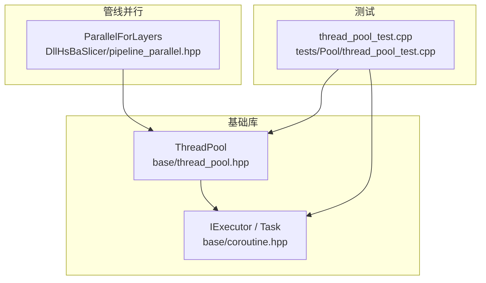
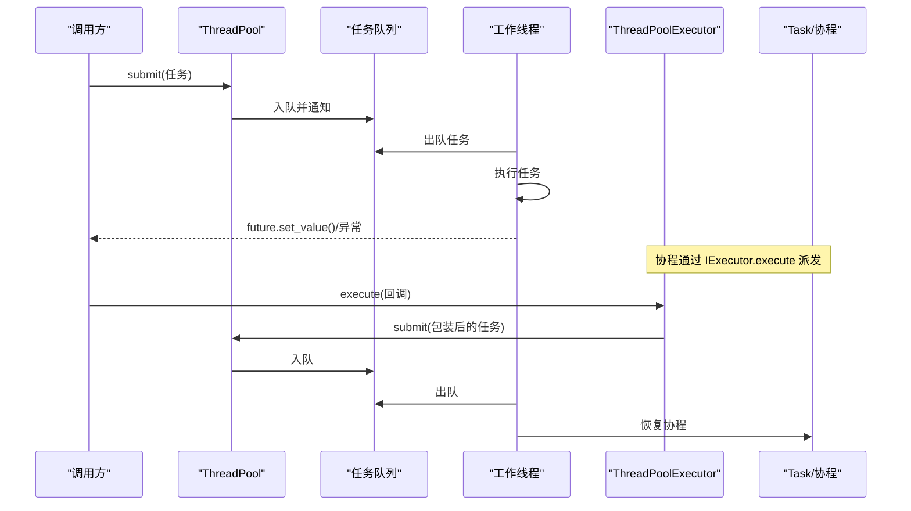
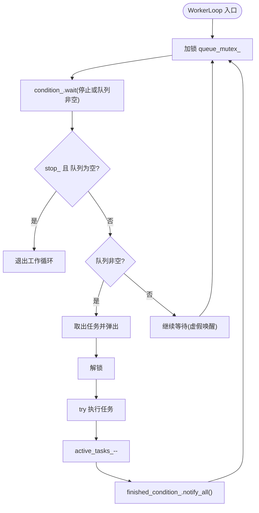
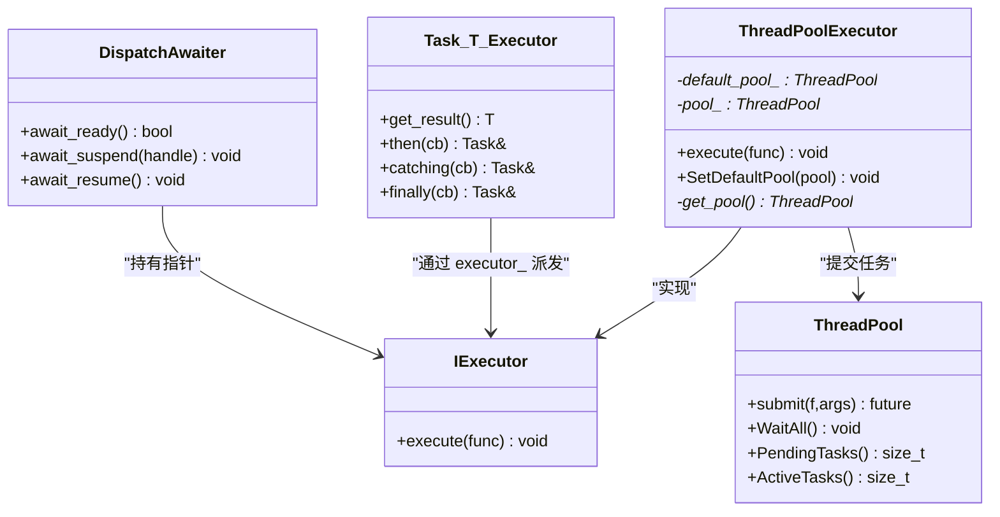
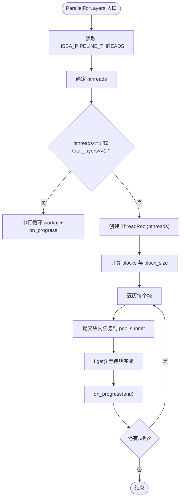
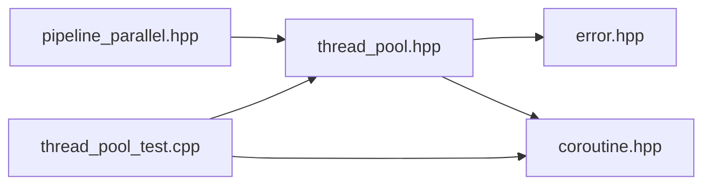

# 多线程优化

<cite>
**本文引用的文件**   
- [thread_pool.hpp](file://base/thread_pool.hpp)
- [coroutine.hpp](file://base/coroutine.hpp)
- [pipeline_parallel.hpp](file://DllHsBaSlicer/pipeline_parallel.hpp)
- [thread_pool_test.cpp](file://tests/Pool/thread_pool_test.cpp)
</cite>

## 目录
1. [引言](#引言)
2. [项目结构](#项目结构)
3. [核心组件](#核心组件)
4. [架构总览](#架构总览)
5. [详细组件分析](#详细组件分析)
6. [依赖关系分析](#依赖关系分析)
7. [性能与调优](#性能与调优)
8. [故障排查指南](#故障排查指南)
9. [结论](#结论)
10. [附录：使用示例与最佳实践](#附录使用示例与最佳实践)

## 引言
本技术文档聚焦 HsBaSlicer 的多线程优化，围绕 ThreadPool 的设计与实现、任务调度与生命周期管理、同步原语（互斥锁、条件变量、原子操作）的使用与性能影响，以及与 C++20 协程的集成机制展开。同时给出线程池配置策略、典型并行计算用法、常见并发问题与性能监控方法，帮助读者在真实业务中高效、安全地使用线程池。

## 项目结构
与多线程优化直接相关的代码主要位于以下位置：
- base/thread_pool.hpp：ThreadPool 与 ThreadPoolExecutor 的核心实现
- base/coroutine.hpp：C++20 协程框架与执行器接口 IExecutor
- DllHsBaSlicer/pipeline_parallel.hpp：切片/填充流水线中的层级并行封装
- tests/Pool/thread_pool_test.cpp：线程池基础功能与协程集成的测试用例

图表来源
- [thread_pool.hpp:29-162](file://base/thread_pool.hpp#L29-L162)
- [coroutine.hpp:47-73](file://base/coroutine.hpp#L47-L73)
- [pipeline_parallel.hpp:41-117](file://DllHsBaSlicer/pipeline_parallel.hpp#L41-L117)
- [thread_pool_test.cpp:14-85](file://tests/Pool/thread_pool_test.cpp#L14-L85)

章节来源
- [thread_pool.hpp:1-214](file://base/thread_pool.hpp#L1-L214)
- [coroutine.hpp:1-1091](file://base/coroutine.hpp#L1-L1091)
- [pipeline_parallel.hpp:1-122](file://DllHsBaSlicer/pipeline_parallel.hpp#L1-L122)
- [thread_pool_test.cpp:1-87](file://tests/Pool/thread_pool_test.cpp#L1-L87)

## 核心组件
- ThreadPool：基于固定数量工作线程的任务队列调度器，提供 submit、WaitAll、PendingTasks、ActiveTasks 等能力，内部使用互斥锁保护任务队列，条件变量唤醒工作线程，原子变量统计活跃任务数。
- ThreadPoolExecutor：实现 IExecutor 接口的执行器，将协程回调提交到 ThreadPool，支持默认线程池与实例线程池两种模式。
- ParallelForLayers：面向切片/填充流水线的层并行工具，按块分发任务，保证进度回调在主线程串行触发，异常透传。
- Task/IExecutor：C++20 协程抽象，TaskAwaiter/DispatchAwaiter 负责挂起/恢复与执行器派发。

章节来源
- [thread_pool.hpp:29-162](file://base/thread_pool.hpp#L29-L162)
- [thread_pool.hpp:164-207](file://base/thread_pool.hpp#L164-L207)
- [pipeline_parallel.hpp:41-117](file://DllHsBaSlicer/pipeline_parallel.hpp#L41-L117)
- [coroutine.hpp:47-73](file://base/coroutine.hpp#L47-L73)

## 架构总览
下图展示从调用方到工作线程的执行路径，以及协程与线程池的协作关系。

图表来源
- [thread_pool.hpp:67-90](file://base/thread_pool.hpp#L67-L90)
- [thread_pool.hpp:118-154](file://base/thread_pool.hpp#L118-L154)
- [thread_pool.hpp:180-184](file://base/thread_pool.hpp#L180-L184)
- [coroutine.hpp:184-198](file://base/coroutine.hpp#L184-L198)

## 详细组件分析

### ThreadPool 设计与实现
- 初始化与生命周期
  - 构造时根据指定线程数创建工作线程；若为 0 抛出参数错误。
  - 析构时设置停止标志、唤醒所有等待的工作线程，并 join 所有线程，确保资源释放。
- 任务提交
  - submit 将可调用对象包装为 packaged_task 放入队列，返回 std::future 以获取结果或异常。
  - 提交前检查是否已停止，避免向已销毁的线程池提交任务。
- 工作线程调度
  - WorkerLoop 循环等待条件变量，当队列非空或收到停止信号时处理任务。
  - 任务执行后减少活跃计数并通知 WaitAll 等待者。
- 状态查询与等待
  - PendingTasks 返回队列长度；ActiveTasks 返回原子计数的活跃任务数。
  - WaitAll 阻塞直到队列为空且无活跃任务。

图表来源
- [thread_pool.hpp:118-154](file://base/thread_pool.hpp#L118-L154)

章节来源
- [thread_pool.hpp:37-61](file://base/thread_pool.hpp#L37-L61)
- [thread_pool.hpp:67-90](file://base/thread_pool.hpp#L67-L90)
- [thread_pool.hpp:94-111](file://base/thread_pool.hpp#L94-L111)
- [thread_pool.hpp:118-154](file://base/thread_pool.hpp#L118-L154)

### 同步机制与性能影响
- 互斥锁（queue_mutex_）
  - 保护任务队列与 stop_ 标志，提交、取任务、查询 PendingTasks 均加锁。
  - 代价：频繁提交短任务会增加锁竞争；建议批量提交或增大任务粒度。
- 条件变量（condition_、finished_condition_）
  - condition_ 用于唤醒工作线程；finished_condition_ 用于 WaitAll 等待完成。
  - 注意虚假唤醒，WorkerLoop 使用谓词判断避免误判。
- 原子操作（stop_、active_tasks_）
  - stop_ 使用原子布尔，避免额外锁开销；active_tasks_ 使用原子计数，便于无锁查询活跃任务数。
  - 注意：ActiveTasks 仅反映“正在执行”的任务数，不包含排队任务。

章节来源
- [thread_pool.hpp:13-23](file://base/thread_pool.hpp#L13-L23)
- [thread_pool.hpp:37-61](file://base/thread_pool.hpp#L37-L61)
- [thread_pool.hpp:67-90](file://base/thread_pool.hpp#L67-L90)
- [thread_pool.hpp:118-154](file://base/thread_pool.hpp#L118-L154)

### 协程集成机制（ThreadPoolExecutor 与 Task）
- IExecutor 接口
  - 定义统一的 execute(func) 接口，ThreadPoolExecutor 将其委托给 ThreadPool.submit。
- ThreadPoolExecutor
  - 支持显式传入 ThreadPool 或使用默认线程池（静态实例）。
  - SetDefaultPool 允许全局设置默认线程池，简化协程使用。
- Task 与 Awaiter
  - Task<T, Executor> 提供协程返回值封装，promise_type 内包含结果与异常指针，并通过条件变量同步 get_result。
  - DispatchAwaiter 将协程初始挂起点派发到执行器指定的线程上执行。
  - TaskAwaiter 在协程 co_await 时，若未完成则注册 finally 回调，由执行器恢复协程。

图表来源
- [coroutine.hpp:47-73](file://base/coroutine.hpp#L47-L73)
- [coroutine.hpp:184-198](file://base/coroutine.hpp#L184-L198)
- [coroutine.hpp:205-382](file://base/coroutine.hpp#L205-L382)
- [thread_pool.hpp:164-207](file://base/thread_pool.hpp#L164-L207)

章节来源
- [thread_pool.hpp:164-207](file://base/thread_pool.hpp#L164-L207)
- [coroutine.hpp:47-73](file://base/coroutine.hpp#L47-L73)
- [coroutine.hpp:184-198](file://base/coroutine.hpp#L184-L198)
- [coroutine.hpp:205-382](file://base/coroutine.hpp#L205-L382)

### 流水线层并行（ParallelForLayers）
- 目标：对相互独立的层进行并行处理，保持进度回调在主线程串行触发。
- 线程数选择：优先使用硬件并发数，可通过环境变量 HSBA_PIPELINE_THREADS 覆盖；若单核或单层则回退串行。
- 分块策略：按 blocks = min(nthreads*4, total_layers) 切块，每块内并行提交任务，完成后统一 f.get() 等待并触发 on_progress。
- 异常传播：f.get() 会重抛工作线程中的异常，使调用方能感知失败。

图表来源
- [pipeline_parallel.hpp:41-117](file://DllHsBaSlicer/pipeline_parallel.hpp#L41-L117)

章节来源
- [pipeline_parallel.hpp:41-117](file://DllHsBaSlicer/pipeline_parallel.hpp#L41-L117)

## 依赖关系分析
- ThreadPool 依赖标准库并发原语（std::mutex、std::condition_variable、std::atomic、std::thread、std::future），以及自定义 error.hpp 抛出 InvalidArgumentError/RuntimeError。
- ThreadPoolExecutor 依赖 coroutine.hpp 的 IExecutor 接口，并在启用协程宏下编译。
- pipeline_parallel.hpp 依赖 thread_pool.hpp，作为上层业务封装。
- 测试用例验证正常流程、协程集成与混合场景。

图表来源
- [thread_pool.hpp:13-23](file://base/thread_pool.hpp#L13-L23)
- [thread_pool.hpp:22-23](file://base/thread_pool.hpp#L22-L23)
- [pipeline_parallel.hpp:17-17](file://DllHsBaSlicer/pipeline_parallel.hpp#L17-L17)
- [thread_pool_test.cpp:6-7](file://tests/Pool/thread_pool_test.cpp#L6-L7)

章节来源
- [thread_pool.hpp:13-23](file://base/thread_pool.hpp#L13-L23)
- [pipeline_parallel.hpp:17-17](file://DllHsBaSlicer/pipeline_parallel.hpp#L17-L17)
- [thread_pool_test.cpp:6-7](file://tests/Pool/thread_pool_test.cpp#L6-L7)

## 性能与调优
- 线程数量选择
  - CPU 密集型任务：通常设置为 std::thread::hardware_concurrency()，避免上下文切换开销。
  - I/O 密集型任务：可适当增加线程数，但需结合系统资源与任务阻塞特性评估。
  - 流水线层并行：可通过环境变量 HSBA_PIPELINE_THREADS 动态控制，便于基准对比。
- 任务队列大小调优
  - ThreadPool 未暴露队列容量上限，队列无限增长可能引发内存压力。建议：
    - 合理拆分任务，避免一次性提交海量短任务。
    - 使用分块策略（如 ParallelForLayers）限制并发规模。
- 内存使用优化
  - 避免在任务中捕获大对象值拷贝，尽量使用引用或移动语义。
  - 对于协程，合理使用 then/catching/finally 链式回调，避免不必要的中间对象分配。
- 同步开销
  - 减少细粒度提交，合并小任务以降低锁竞争。
  - 使用 ActiveTasks/PendingTasks 监控负载，必要时调整批次大小。
- 异常与健壮性
  - 任务异常通过 future.get() 抛出，确保调用方能感知失败。
  - 避免在析构期间提交新任务，防止 RuntimeError。

[本节为通用指导，不直接分析具体文件]

## 故障排查指南
- 症状：提交任务后程序卡住
  - 检查是否调用了 WaitAll 且存在活跃任务；确认任务逻辑不会死锁或长时间阻塞。
  - 检查工作线程是否正确被唤醒（条件变量谓词是否满足）。
- 症状：提交任务时报错
  - 可能在已停止的线程池中提交任务；确保线程池生命周期覆盖任务提交范围。
- 症状：协程无法在预期线程执行
  - 确认 ThreadPoolExecutor 已正确设置默认线程池或传入实例线程池。
  - 检查协程是否使用了正确的执行器模板参数。
- 症状：进度回调频率过高或过低
  - 调整 ParallelForLayers 的分块策略（blocks/block_size），平衡回调频率与并行度。
- 症状：内存占用持续增长
  - 检查是否存在大量短任务堆积；考虑批量化任务或限制并发规模。

章节来源
- [thread_pool.hpp:67-90](file://base/thread_pool.hpp#L67-L90)
- [thread_pool.hpp:118-154](file://base/thread_pool.hpp#L118-L154)
- [thread_pool.hpp:180-184](file://base/thread_pool.hpp#L180-L184)
- [pipeline_parallel.hpp:88-117](file://DllHsBaSlicer/pipeline_parallel.hpp#L88-L117)

## 结论
HsBaSlicer 的 ThreadPool 提供了简洁可靠的线程池抽象，配合 ThreadPoolExecutor 实现了与 C++20 协程的良好集成。通过互斥锁、条件变量与原子操作的组合，既保证了线程安全，又兼顾了基本性能。Pipeline 层的 ParallelForLayers 进一步将线程池能力落地到切片/填充热路径，提供可控的并行度与稳定的进度回调。在实际使用中，应关注任务粒度、线程数与队列规模，结合监控指标持续调优，以获得稳定高效的并行计算体验。

[本节为总结性内容，不直接分析具体文件]

## 附录：使用示例与最佳实践
- 基础用法
  - 创建线程池并提交任务，使用 future.get() 获取结果或异常。
  - 使用 WaitAll 等待所有任务完成。
- 协程集成
  - 通过 ThreadPoolExecutor::SetDefaultPool 设置默认线程池，或在构造时传入实例。
  - 在协程中使用 co_return/co_await，并由执行器调度到线程池。
- 流水线并行
  - 使用 ParallelForLayers 对层索引进行并行处理，确保 on_progress 在主线程串行触发。
- 最佳实践
  - 任务粒度适中，避免过多短任务。
  - 合理设置线程数，CPU 密集用核数，I/O 密集适当放大。
  - 监控 PendingTasks/ActiveTasks，动态调整批次大小。
  - 在析构前确保不再提交新任务。

章节来源
- [thread_pool_test.cpp:14-85](file://tests/Pool/thread_pool_test.cpp#L14-L85)
- [pipeline_parallel.hpp:41-117](file://DllHsBaSlicer/pipeline_parallel.hpp#L41-L117)
- [thread_pool.hpp:67-90](file://base/thread_pool.hpp#L67-L90)
- [thread_pool.hpp:180-184](file://base/thread_pool.hpp#L180-L184)