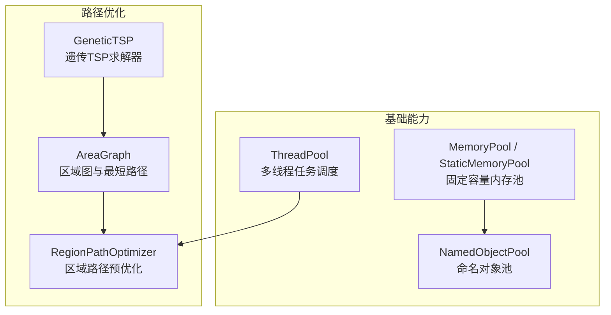
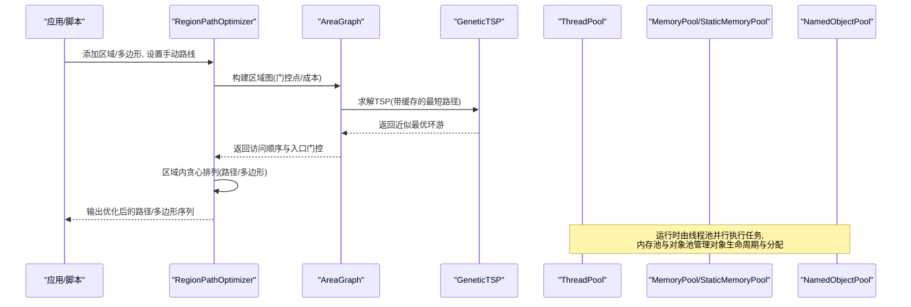
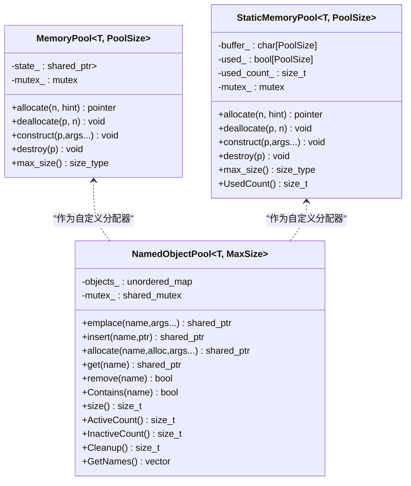
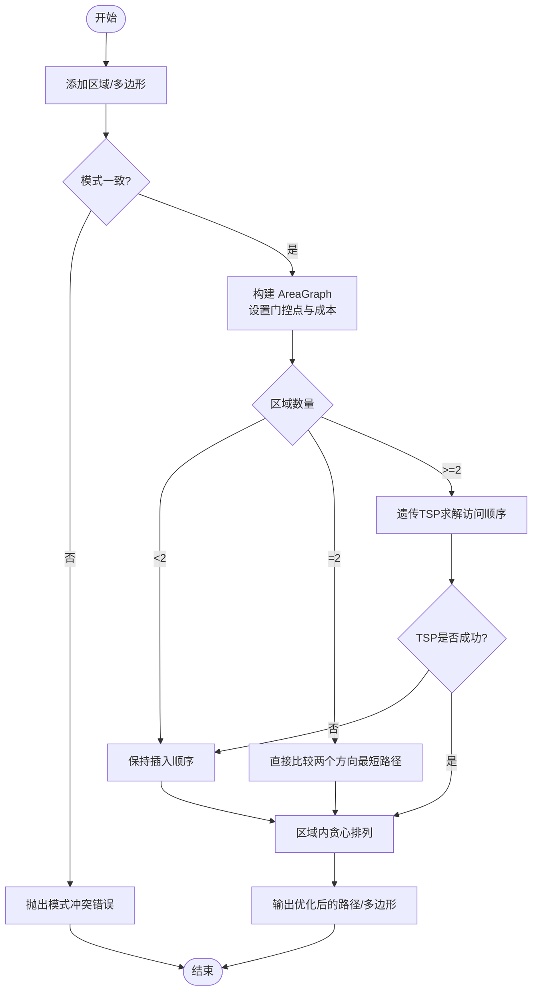
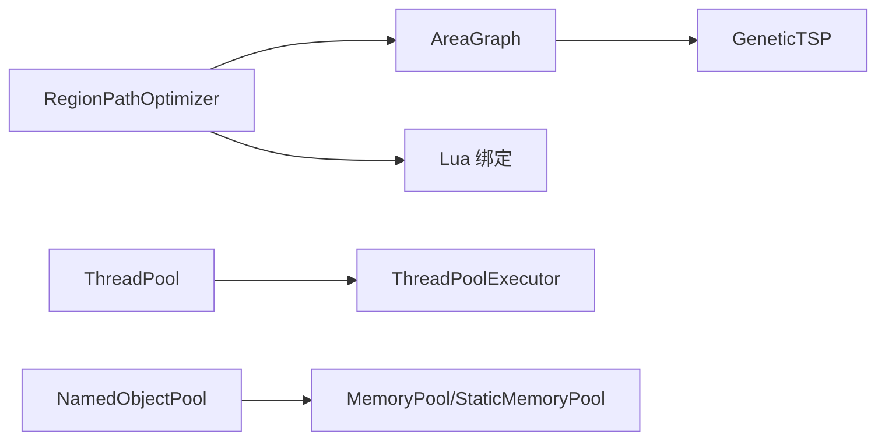

# 性能优化

<cite>
**本文引用的文件**   
- [thread_pool.hpp](file://base/thread_pool.hpp)
- [memory_pool.hpp](file://base/memory_pool.hpp)
- [object_pool.hpp](file://base/object_pool.hpp)
- [path_optimizer.hpp](file://LibHsBaSlicer/Path/path_optimizer.hpp)
- [path_optimizer.cpp](file://LibHsBaSlicer/Path/path_optimizer.cpp)
- [AreaGraph.hpp](file://utils/AreaGraph.hpp)
- [Graph.hpp](file://utils/Graph.hpp)
- [thread_pool_test.cpp](file://tests/Pool/thread_pool_test.cpp)
- [memory_pool_test.cpp](file://tests/Pool/memory_pool_test.cpp)
- [object_pool_test.cpp](file://tests/Pool/object_pool_test.cpp)
</cite>

## 目录
1. [引言](#引言)
2. [项目结构](#项目结构)
3. [核心组件](#核心组件)
4. [架构总览](#架构总览)
5. [详细组件分析](#详细组件分析)
6. [依赖关系分析](#依赖关系分析)
7. [性能考量与基准方法](#性能考量与基准方法)
8. [故障排查指南](#故障排查指南)
9. [结论](#结论)
10. [附录：使用示例与最佳实践](#附录使用示例与最佳实践)

## 引言
本技术文档面向高性能计算场景，围绕 HsBaSlicer 的多线程处理、内存管理与路径优化三大维度展开，系统性讲解 ThreadPool 的设计与调度、MemoryPool/StaticMemoryPool/NamedObjectPool 的分配策略与并发安全、以及 RegionPathOptimizer 的区域级路径优化算法（含 TSP 遗传求解与缓存策略）。文档同时给出监控指标、基准测试方法与调优建议，帮助读者在真实工程中稳定地提升吞吐、降低延迟并避免常见性能陷阱。

## 项目结构
与性能优化直接相关的代码主要分布在以下模块：
- base：通用基础设施，包含线程池、内存池、对象池等高性能原语
- LibHsBaSlicer/Path：路径生成与优化，包括区域路径预优化器
- utils：图与几何算法基础设施，包含 AreaGraph 与 GeneticTSP
- tests：覆盖上述组件的单元测试，可作为基准与回归用例参考



图表来源
- [thread_pool.hpp:29-162](file://base/thread_pool.hpp#L29-L162)
- [memory_pool.hpp:43-208](file://base/memory_pool.hpp#L43-L208)
- [memory_pool.hpp:215-372](file://base/memory_pool.hpp#L215-L372)
- [object_pool.hpp:22-283](file://base/object_pool.hpp#L22-L283)
- [path_optimizer.hpp:44-100](file://LibHsBaSlicer/Path/path_optimizer.hpp#L44-L100)
- [AreaGraph.hpp:253-318](file://utils/AreaGraph.hpp#L253-L318)
- [Graph.hpp:876-903](file://utils/Graph.hpp#L876-L903)

章节来源
- [thread_pool.hpp:1-214](file://base/thread_pool.hpp#L1-L214)
- [memory_pool.hpp:1-375](file://base/memory_pool.hpp#L1-L375)
- [object_pool.hpp:1-286](file://base/object_pool.hpp#L1-L286)
- [path_optimizer.hpp:1-191](file://LibHsBaSlicer/Path/path_optimizer.hpp#L1-L191)
- [path_optimizer.cpp:1-663](file://LibHsBaSlicer/Path/path_optimizer.cpp#L1-L663)
- [AreaGraph.hpp:253-318](file://utils/AreaGraph.hpp#L253-L318)
- [Graph.hpp:876-903](file://utils/Graph.hpp#L876-L903)

## 核心组件
本节从系统视角梳理关键性能组件的职责与交互：
- ThreadPool：提供可配置的线程池，支持提交任务、等待完成、统计活跃/待执行任务数，并提供协程 Executor 集成
- MemoryPool/StaticMemoryPool：实现 STL Allocator 接口的固定容量内存池，减少频繁 new/delete 带来的碎片与开销
- NamedObjectPool：基于 shared_ptr 的命名对象池，具备容量上限、惰性清理与并发访问控制
- RegionPathOptimizer：将独立多边形区域建模为 AreaGraph 顶点，通过 TSP 遗传算法求解最优访问顺序，并在区域内进行贪心排列以减少空移
- AreaGraph/GeneticTSP：提供区域间最短路径与 TSP 近似解，内部对 pairwise 路径进行缓存以加速遗传迭代

章节来源
- [thread_pool.hpp:29-162](file://base/thread_pool.hpp#L29-L162)
- [memory_pool.hpp:43-208](file://base/memory_pool.hpp#L43-L208)
- [memory_pool.hpp:215-372](file://base/memory_pool.hpp#L215-L372)
- [object_pool.hpp:22-283](file://base/object_pool.hpp#L22-L283)
- [path_optimizer.hpp:44-100](file://LibHsBaSlicer/Path/path_optimizer.hpp#L44-L100)
- [AreaGraph.hpp:253-318](file://utils/AreaGraph.hpp#L253-L318)
- [Graph.hpp:876-903](file://utils/Graph.hpp#L876-L903)

## 架构总览
下图展示从高层 API 到底层算法与资源管理的调用链：



图表来源
- [path_optimizer.cpp:118-166](file://LibHsBaSlicer/Path/path_optimizer.cpp#L118-L166)
- [AreaGraph.hpp:253-318](file://utils/AreaGraph.hpp#L253-L318)
- [Graph.hpp:876-903](file://utils/Graph.hpp#L876-L903)
- [thread_pool.hpp:67-111](file://base/thread_pool.hpp#L67-L111)
- [memory_pool.hpp:111-175](file://base/memory_pool.hpp#L111-L175)
- [object_pool.hpp:66-156](file://base/object_pool.hpp#L66-L156)

## 详细组件分析

### 多线程处理：ThreadPool 设计与调度
- 设计要点
  - 构造时创建固定数量的工作线程；析构时安全停止并 join
  - submit 将函数包装为 packaged_task 入队，返回 future
  - 维护 active_tasks_ 原子计数与 finished_condition_ 条件变量，WaitAll 阻塞直到队列空且无活跃任务
  - WorkerLoop 中条件等待 stop_ 或 tasks_.empty()，异常被捕获但不影响其他任务
  - 可选协程 Executor：ThreadPoolExecutor 实现 IExecutor，支持默认池与显式池切换

- 配置策略
  - 线程数默认取硬件并发度；也可根据负载特征（CPU-bound vs IO-bound）调整
  - 结合 WaitAll 做批次同步，适合“批量提交+统一收尾”的流水线阶段

- 并发控制
  - 互斥保护任务队列与状态
  - 原子计数器避免额外锁竞争
  - 停止标志与条件变量保证优雅退出

- 复杂度与性能
  - 任务入队/出队 O(1)
  - 活跃任务查询 O(1)
  - 等待全部完成 O(N) 唤醒次数，取决于任务完成节奏

```mermaid
classDiagram
class ThreadPool {
+submit(f,args) future
+PendingTasks() size_t
+ActiveTasks() size_t
+WaitAll() void
-WorkerLoop() void
-workers_ : vector<thread>
-tasks_ : queue<function<void()>>
-queue_mutex_ : mutex
-condition_ : condition_variable
-finished_condition_ : condition_variable
-stop_ : atomic<bool>
-active_tasks_ : atomic<size_t>
}
class ThreadPoolExecutor {
+execute(func) void
+SetDefaultPool(pool) void
-pool_ : ThreadPool*
-default_pool_ : ThreadPool*
}
ThreadPoolExecutor --> ThreadPool : "提交任务"
```

图表来源
- [thread_pool.hpp:29-162](file://base/thread_pool.hpp#L29-L162)
- [thread_pool.hpp:164-210](file://base/thread_pool.hpp#L164-L210)

章节来源
- [thread_pool.hpp:29-162](file://base/thread_pool.hpp#L29-L162)
- [thread_pool.hpp:164-210](file://base/thread_pool.hpp#L164-L210)
- [thread_pool_test.cpp:14-37](file://tests/Pool/thread_pool_test.cpp#L14-L37)
- [thread_pool_test.cpp:39-85](file://tests/Pool/thread_pool_test.cpp#L39-L85)

### 内存管理优化：MemoryPool、StaticMemoryPool 与 NamedObjectPool
- MemoryPool（实例化共享池）
  - 基于 shared_ptr 共享同一块内存区，多个实例可共享状态
  - 按字节粒度扫描空闲区间，满足对齐要求后标记已用
  - 线程安全：allocate/deallocate 加锁
  - 符合 STL Allocator 接口，可与 std::vector/list/shared_ptr 等配合

- StaticMemoryPool（静态全局池）
  - 所有实例共享静态 buffer，is_always_equal=true
  - 同样按字节扫描空闲区间，线程安全
  - 提供 UsedCount 用于监控

- NamedObjectPool（命名对象池）
  - 管理 std::shared_ptr<T>，支持 emplace/insert/allocate（可指定自定义分配器）
  - 容量 MaxSize，满时触发 CleanupInactiveObjects 清理 inactive 对象
  - 使用 shared_mutex 读写分离，get 读操作可并发
  - 提供 ActiveCount/InactiveCount/Cleanup/GetNames 等运维接口



图表来源
- [memory_pool.hpp:43-208](file://base/memory_pool.hpp#L43-L208)
- [memory_pool.hpp:215-372](file://base/memory_pool.hpp#L215-L372)
- [object_pool.hpp:22-283](file://base/object_pool.hpp#L22-L283)

章节来源
- [memory_pool.hpp:43-208](file://base/memory_pool.hpp#L43-L208)
- [memory_pool.hpp:215-372](file://base/memory_pool.hpp#L215-L372)
- [object_pool.hpp:22-283](file://base/object_pool.hpp#L22-L283)
- [memory_pool_test.cpp:30-51](file://tests/Pool/memory_pool_test.cpp#L30-L51)
- [memory_pool_test.cpp:53-74](file://tests/Pool/memory_pool_test.cpp#L53-L74)
- [memory_pool_test.cpp:76-98](file://tests/Pool/memory_pool_test.cpp#L76-L98)
- [object_pool_test.cpp:9-33](file://tests/Pool/object_pool_test.cpp#L9-L33)
- [object_pool_test.cpp:35-59](file://tests/Pool/object_pool_test.cpp#L35-L59)
- [object_pool_test.cpp:83-113](file://tests/Pool/object_pool_test.cpp#L83-L113)
- [object_pool_test.cpp:116-141](file://tests/Pool/object_pool_test.cpp#L116-L141)
- [object_pool_test.cpp:143-160](file://tests/Pool/object_pool_test.cpp#L143-L160)

### 算法优化：区域路径优化器与几何计算
- 区域建模
  - 每个独立区域映射为 AreaGraph 的一个 area 顶点
  - 两种模式不可混用：
    - 填充前（多边形模式）：所有顶点作为门控点，输出优化后的多边形序列
    - 填充后（路径模式）：每条折线的头尾作为门控点，输出完整填充路径

- 图构建与成本
  - 区域内门控点到门控点的成本为直线距离（区域内移动）
  - 区域间门控点对的成本为直线距离（空中移动），支持手动覆盖

- 访问顺序求解
  - 当区域数≥2 时使用遗传算法 TSP 求解近似最优环游
  - 两区域时直接比较两个方向的最短路径
  - 若 TSP 失败则回退到插入顺序

- 区域内排列
  - 路径模式：从入口端点出发，每次选择最近端点的路径，必要时反转方向
  - 多边形模式：从入口顶点出发，选择最近顶点的多边形，旋转起点至该顶点（保持绕向）



图表来源
- [path_optimizer.cpp:63-116](file://LibHsBaSlicer/Path/path_optimizer.cpp#L63-L116)
- [path_optimizer.cpp:118-166](file://LibHsBaSlicer/Path/path_optimizer.cpp#L118-L166)
- [path_optimizer.cpp:268-375](file://LibHsBaSlicer/Path/path_optimizer.cpp#L268-L375)
- [AreaGraph.hpp:253-318](file://utils/AreaGraph.hpp#L253-L318)
- [Graph.hpp:876-903](file://utils/Graph.hpp#L876-L903)

章节来源
- [path_optimizer.hpp:44-100](file://LibHsBaSlicer/Path/path_optimizer.hpp#L44-L100)
- [path_optimizer.cpp:63-116](file://LibHsBaSlicer/Path/path_optimizer.cpp#L63-L116)
- [path_optimizer.cpp:118-166](file://LibHsBaSlicer/Path/path_optimizer.cpp#L118-L166)
- [path_optimizer.cpp:268-375](file://LibHsBaSlicer/Path/path_optimizer.cpp#L268-L375)
- [AreaGraph.hpp:253-318](file://utils/AreaGraph.hpp#L253-L318)
- [Graph.hpp:876-903](file://utils/Graph.hpp#L876-L903)

## 依赖关系分析
- 组件耦合
  - RegionPathOptimizer 依赖 AreaGraph 与 GeneticTSP 完成跨区域的访问顺序优化
  - ThreadPool 与协程 Executor 松耦合，可通过 SetDefaultPool 注入
  - NamedObjectPool 可接受任意 Allocator（如 MemoryPool/StaticMemoryPool），实现对象级内存复用

- 外部依赖
  - Lua 绑定：路径优化器暴露 PathOptimize 表供脚本扩展
  - Boost Graph：AreaGraph 内部使用 boost::adjacency_list 与最大流算法



图表来源
- [path_optimizer.cpp:413-631](file://LibHsBaSlicer/Path/path_optimizer.cpp#L413-L631)
- [AreaGraph.hpp:253-318](file://utils/AreaGraph.hpp#L253-L318)
- [Graph.hpp:876-903](file://utils/Graph.hpp#L876-L903)
- [thread_pool.hpp:164-210](file://base/thread_pool.hpp#L164-L210)
- [object_pool.hpp:135-156](file://base/object_pool.hpp#L135-L156)
- [memory_pool.hpp:43-208](file://base/memory_pool.hpp#L43-L208)

章节来源
- [path_optimizer.cpp:413-631](file://LibHsBaSlicer/Path/path_optimizer.cpp#L413-L631)
- [AreaGraph.hpp:253-318](file://utils/AreaGraph.hpp#L253-L318)
- [Graph.hpp:876-903](file://utils/Graph.hpp#L876-L903)
- [thread_pool.hpp:164-210](file://base/thread_pool.hpp#L164-L210)
- [object_pool.hpp:135-156](file://base/object_pool.hpp#L135-L156)
- [memory_pool.hpp:43-208](file://base/memory_pool.hpp#L43-L208)

## 性能考量与基准方法
- 监控指标
  - 线程池：PendingTasks、ActiveTasks、WaitAll 耗时、任务平均执行时间
  - 内存池：UsedCount（StaticMemoryPool）、分配失败率、容器扩容次数
  - 对象池：ActiveCount/InactiveCount、Cleanup 回收数量、对象存活时长
  - 路径优化：TSP 代数、总成本、区域内贪心步数、空移距离总和

- 基准测试建议
  - 线程池：对比不同线程数下的吞吐与延迟；加入 CPU-bound 与 IO-bound 混合负载
  - 内存池：对比 new/delete 与 MemoryPool/StaticMemoryPool 的分配/释放时间与内存碎片
  - 对象池：对比 emplace 与 allocate（自定义分配器）的性能差异；验证容量上限与清理行为
  - 路径优化：在不同区域规模下评估 TSP 参数（种群大小、最大代数、变异率、交叉率）对时间与质量的影响

- 调优建议
  - 线程池：CPU 密集任务建议线程数≈物理核数；IO 密集可适当放大；批量化提交以降低调度开销
  - 内存池：预估峰值对象数量与类型分布，合理设置 PoolSize；对热点小对象优先使用 StaticMemoryPool
  - 对象池：为长生命周期对象启用 NamedObjectPool，配合定期 Cleanup；使用 allocate 传入 MemoryPool 进一步降低分配开销
  - 路径优化：区域数较少时遗传算法收益有限，可直接比较两端方向；对大规模区域适当增大种群与代数，但需权衡时间

章节来源
- [thread_pool.hpp:91-111](file://base/thread_pool.hpp#L91-L111)
- [memory_pool.hpp:358-365](file://base/memory_pool.hpp#L358-L365)
- [object_pool.hpp:216-245](file://base/object_pool.hpp#L216-L245)
- [AreaGraph.hpp:267-318](file://utils/AreaGraph.hpp#L267-L318)
- [Graph.hpp:891-903](file://utils/Graph.hpp#L891-L903)

## 故障排查指南
- 线程池
  - 向已停止的线程池提交任务会抛错；确保在析构前不再 submit
  - WaitAll 长时间不返回：检查是否有未完成的 future 或未正确 join 的任务

- 内存池
  - 分配超出 PoolSize 或越界指针释放会抛错；确认 PoolSize 与对象数量匹配
  - 多线程并发分配/释放需保证正确的生命周期，避免悬垂指针

- 对象池
  - 重复名称插入抛错；确保 name 唯一
  - 达到 MaxSize 且无 inactive 对象时插入抛错；先调用 Cleanup 或延长对象生命周期

- 路径优化
  - 混合添加路径与多边形区域会抛错；在同一优化器中只使用一种模式
  - TSP 失败时回退插入顺序；检查区域连通性与门控点配置

章节来源
- [thread_pool.hpp:77-89](file://base/thread_pool.hpp#L77-L89)
- [memory_pool.hpp:111-175](file://base/memory_pool.hpp#L111-L175)
- [object_pool.hpp:66-156](file://base/object_pool.hpp#L66-L156)
- [path_optimizer.cpp:63-91](file://LibHsBaSlicer/Path/path_optimizer.cpp#L63-L91)
- [path_optimizer.cpp:118-166](file://LibHsBaSlicer/Path/path_optimizer.cpp#L118-L166)

## 结论
HsBaSlicer 在多线程、内存与路径优化三个层面提供了完善的高性能基础设施。ThreadPool 提供可控的并发执行模型；MemoryPool/StaticMemoryPool 与 NamedObjectPool 显著降低分配开销并简化对象生命周期管理；RegionPathOptimizer 借助 AreaGraph 与 GeneticTSP 在区域级实现了低空移、高连贯性的路径排序。通过合理的参数配置与基准测试，可在复杂几何处理场景中取得稳定的性能提升。

## 附录：使用示例与最佳实践
- 线程池使用要点
  - 使用 submit 提交任务并获取 future；使用 WaitAll 统一等待
  - 结合 ThreadPoolExecutor 与协程，将异步任务卸载到线程池
  - 参考用例：[thread_pool_test.cpp:14-37](file://tests/Pool/thread_pool_test.cpp#L14-L37)、[thread_pool_test.cpp:39-85](file://tests/Pool/thread_pool_test.cpp#L39-L85)

- 内存池使用要点
  - 将 MemoryPool/StaticMemoryPool 作为容器分配器或 allocate_shared 的分配器
  - 使用 StaticMemoryPool::UsedCount 监控占用
  - 参考用例：[memory_pool_test.cpp:30-51](file://tests/Pool/memory_pool_test.cpp#L30-L51)、[memory_pool_test.cpp:53-74](file://tests/Pool/memory_pool_test.cpp#L53-L74)、[memory_pool_test.cpp:76-98](file://tests/Pool/memory_pool_test.cpp#L76-L98)

- 对象池使用要点
  - 使用 emplace/insert/allocate 注册对象；通过 get/operator[] 获取
  - 定期调用 Cleanup 清理 inactive 对象；使用 ActiveCount/InactiveCount 监控
  - 参考用例：[object_pool_test.cpp:9-33](file://tests/Pool/object_pool_test.cpp#L9-L33)、[object_pool_test.cpp:35-59](file://tests/Pool/object_pool_test.cpp#L35-L59)、[object_pool_test.cpp:83-113](file://tests/Pool/object_pool_test.cpp#L83-L113)、[object_pool_test.cpp:116-141](file://tests/Pool/object_pool_test.cpp#L116-L141)、[object_pool_test.cpp:143-160](file://tests/Pool/object_pool_test.cpp#L143-L160)

- 路径优化使用要点
  - 根据阶段选择 addRegion（填充后）或 addPolygonRegion（填充前），不要混用
  - 可手动设置区域间 cost 覆盖自动计算的直线距离
  - 调用 optimizeOrder 后分别使用 buildPaths/buildPolygons 输出结果
  - 参考实现：[path_optimizer.cpp:118-166](file://LibHsBaSlicer/Path/path_optimizer.cpp#L118-L166)、[path_optimizer.cpp:268-375](file://LibHsBaSlicer/Path/path_optimizer.cpp#L268-L375)