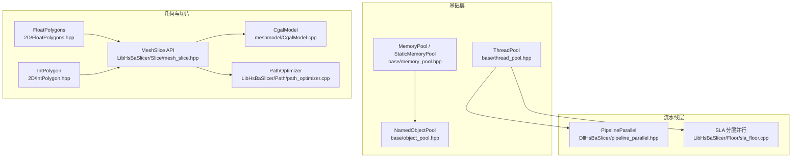
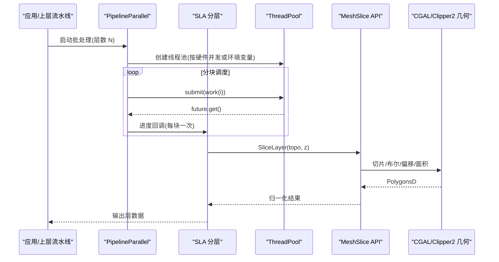
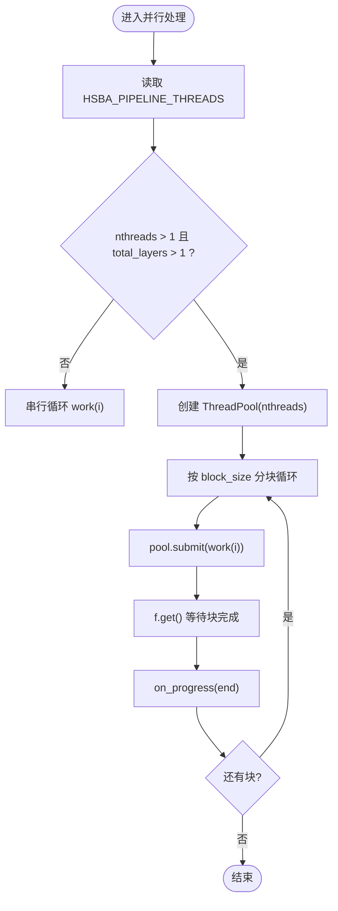
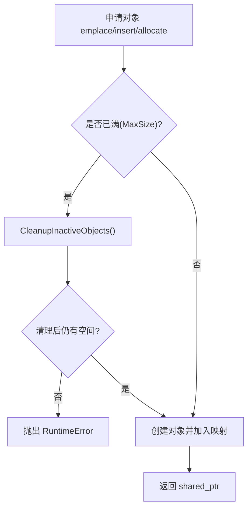
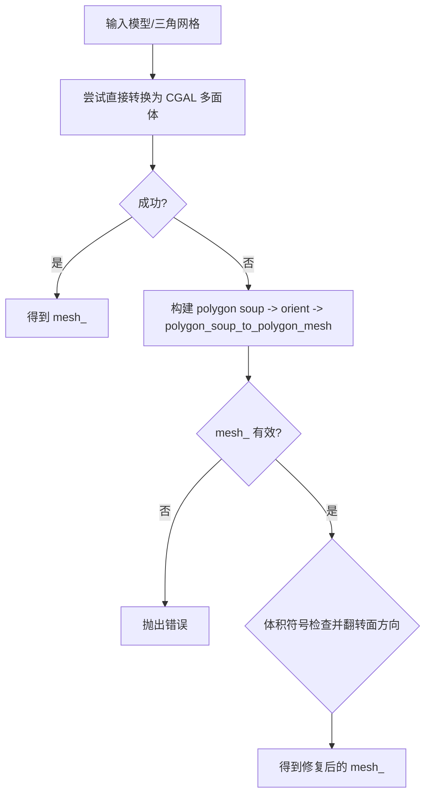
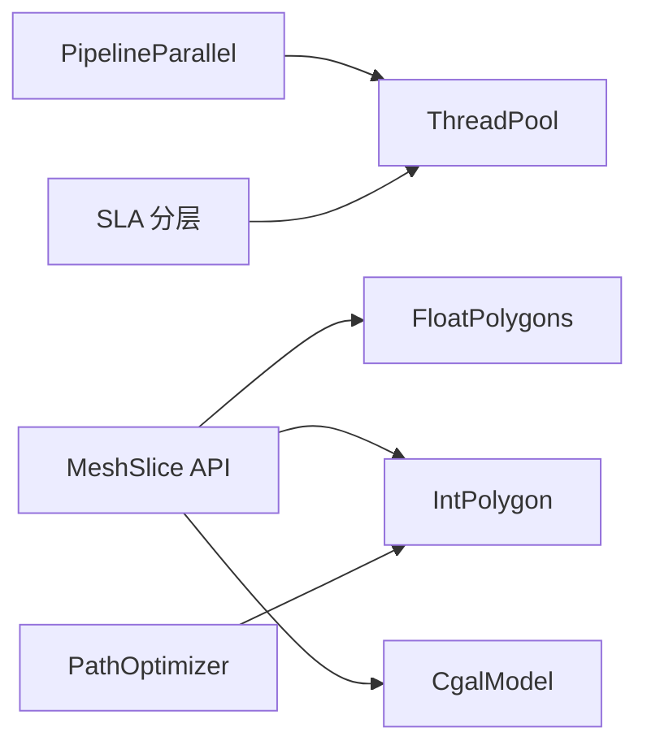
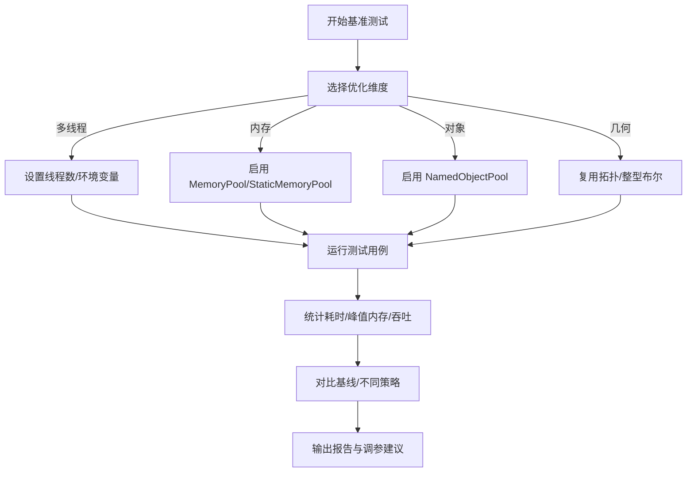

# 性能优化

<cite>
**本文引用的文件**   
- [thread_pool.hpp](file://base/thread_pool.hpp)
- [memory_pool.hpp](file://base/memory_pool.hpp)
- [object_pool.hpp](file://base/object_pool.hpp)
- [pipeline_parallel.hpp](file://DllHsBaSlicer/pipeline_parallel.hpp)
- [sla_floor.cpp](file://LibHsBaSlicer/Floor/sla_floor.cpp)
- [FloatPolygons.hpp](file://2D/FloatPolygons.hpp)
- [IntPolygon.hpp](file://2D/IntPolygon.hpp)
- [mesh_slice.hpp](file://LibHsBaSlicer/Slice/mesh_slice.hpp)
- [CgalModel.cpp](file://meshmodel/CgalModel.cpp)
- [path_optimizer.cpp](file://LibHsBaSlicer/Path/path_optimizer.cpp)
- [thread_pool_test.cpp](file://tests/Pool/thread_pool_test.cpp)
- [memory_pool_test.cpp](file://tests/Pool/memory_pool_test.cpp)
- [object_pool_test.cpp](file://tests/Pool/object_pool_test.cpp)
</cite>

## 目录
1. [引言](#引言)
2. [项目结构](#项目结构)
3. [核心组件](#核心组件)
4. [架构总览](#架构总览)
5. [详细组件分析](#详细组件分析)
6. [依赖关系分析](#依赖关系分析)
7. [性能考量与基准测试](#性能考量与基准测试)
8. [故障排除与瓶颈定位](#故障排除与瓶颈定位)
9. [结论](#结论)
10. [附录：配置与环境变量](#附录配置与环境变量)

## 引言
本指南聚焦 HsBaSlicer 的性能优化，围绕多线程处理、内存管理、几何计算三大主题展开。文档基于仓库中的线程池、内存池、对象池、切片与路径优化等实现，给出可操作的优化策略、调度模式、参数调优方法与监控定位技巧，帮助读者在真实场景中提升吞吐、降低延迟并稳定资源占用。

## 项目结构
与性能相关的核心代码分布在以下模块：
- base：通用基础设施（线程池、内存池、对象池）
- DllHsBaSlicer：流水线并行封装与任务分块调度
- LibHsBaSlicer：切片、填充、路径生成等核心算法
- 2D：多边形类型与布尔运算接口
- meshmodel：网格模型与 CGAL 几何处理
- tests：线程池、内存池、对象池的单元测试与行为验证



**图表来源**
- [thread_pool.hpp:29-162](file://base/thread_pool.hpp#L29-L162)
- [memory_pool.hpp:43-208](file://base/memory_pool.hpp#L43-L208)
- [object_pool.hpp:22-283](file://base/object_pool.hpp#L22-L283)
- [pipeline_parallel.hpp:72-117](file://DllHsBaSlicer/pipeline_parallel.hpp#L72-L117)
- [sla_floor.cpp:409-457](file://LibHsBaSlicer/Floor/sla_floor.cpp#L409-L457)
- [FloatPolygons.hpp:18-26](file://2D/FloatPolygons.hpp#L18-L26)
- [IntPolygon.hpp:16-26](file://2D/IntPolygon.hpp#L16-L26)
- [mesh_slice.hpp:20-103](file://LibHsBaSlicer/Slice/mesh_slice.hpp#L20-L103)
- [CgalModel.cpp:45-118](file://meshmodel/CgalModel.cpp#L45-L118)
- [path_optimizer.cpp:426-468](file://LibHsBaSlicer/Path/path_optimizer.cpp#L426-L468)

**章节来源**
- [thread_pool.hpp:29-162](file://base/thread_pool.hpp#L29-L162)
- [memory_pool.hpp:43-208](file://base/memory_pool.hpp#L43-L208)
- [object_pool.hpp:22-283](file://base/object_pool.hpp#L22-L283)
- [pipeline_parallel.hpp:72-117](file://DllHsBaSlicer/pipeline_parallel.hpp#L72-L117)
- [sla_floor.cpp:409-457](file://LibHsBaSlicer/Floor/sla_floor.cpp#L409-L457)
- [FloatPolygons.hpp:18-26](file://2D/FloatPolygons.hpp#L18-L26)
- [IntPolygon.hpp:16-26](file://2D/IntPolygon.hpp#L16-L26)
- [mesh_slice.hpp:20-103](file://LibHsBaSlicer/Slice/mesh_slice.hpp#L20-L103)
- [CgalModel.cpp:45-118](file://meshmodel/CgalModel.cpp#L45-L118)
- [path_optimizer.cpp:426-468](file://LibHsBaSlicer/Path/path_optimizer.cpp#L426-L468)

## 核心组件
本节概述三类关键性能组件的职责与使用要点：
- 线程池 ThreadPool：提供任务提交、等待完成、活跃任务计数；可选协程执行器集成。
- 内存池 MemoryPool / StaticMemoryPool：固定大小内存分配器，STL 兼容，支持共享或全局静态池。
- 对象池 NamedObjectPool：命名对象池，按名称管理 shared_ptr，自动清理非活跃对象。

```mermaid
classDiagram
class ThreadPool {
+submit(f, args...) future
+WaitAll() void
+PendingTasks() size_t
+ActiveTasks() size_t
}
class MemoryPool_T_PoolSize {
+allocate(n) pointer
+deallocate(p, n) void
+construct(p, args...) void
+destroy(p) void
+max_size() size_type
}
class StaticMemoryPool_T_PoolSize {
+allocate(n) pointer
+deallocate(p, n) void
+construct(p, args...) void
+destroy(p) void
+UsedCount() size_t
}
class NamedObjectPool_T_MaxSize {
+emplace(name, args...) shared_ptr
+insert(name, ptr) shared_ptr
+get(name) shared_ptr
+remove(name) bool
+Cleanup() size_t
+size() size_t
+InactiveCount() size_t
+ActiveCount() size_t
}
ThreadPool --> "uses" : "任务调度"
NamedObjectPool_T_MaxSize --> "manages" : "shared_ptr 生命周期"
MemoryPool_T_PoolSize <.. StaticMemoryPool_T_PoolSize : "同接口不同存储"
```

**图表来源**
- [thread_pool.hpp:29-162](file://base/thread_pool.hpp#L29-L162)
- [memory_pool.hpp:43-208](file://base/memory_pool.hpp#L43-L208)
- [memory_pool.hpp:215-372](file://base/memory_pool.hpp#L215-L372)
- [object_pool.hpp:22-283](file://base/object_pool.hpp#L22-L283)

**章节来源**
- [thread_pool.hpp:29-162](file://base/thread_pool.hpp#L29-L162)
- [memory_pool.hpp:43-208](file://base/memory_pool.hpp#L43-L208)
- [memory_pool.hpp:215-372](file://base/memory_pool.hpp#L215-L372)
- [object_pool.hpp:22-283](file://base/object_pool.hpp#L22-L283)

## 架构总览
下图展示从高层流水线到几何计算的调用链，以及线程池与内存池在其中的作用点。



**图表来源**
- [pipeline_parallel.hpp:72-117](file://DllHsBaSlicer/pipeline_parallel.hpp#L72-L117)
- [sla_floor.cpp:409-457](file://LibHsBaSlicer/Floor/sla_floor.cpp#L409-L457)
- [mesh_slice.hpp:80-103](file://LibHsBaSlicer/Slice/mesh_slice.hpp#L80-L103)
- [FloatPolygons.hpp:18-26](file://2D/FloatPolygons.hpp#L18-L26)
- [IntPolygon.hpp:16-26](file://2D/IntPolygon.hpp#L16-L26)

## 详细组件分析

### 多线程处理机制与任务调度
- 线程池 ThreadPool
  - 构造时根据传入数量创建工作线程；默认使用硬件并发数。
  - submit 将任务包装为 packaged_task 入队，返回 future；WaitAll 阻塞直到队列空且无活跃任务。
  - 可选协程执行器 ThreadPoolExecutor 通过 IExecutor 接口与协程协作。
- 流水线并行 PipelineParallel
  - 当层数大于 1 且线程数大于 1 时，采用“分块”调度：将层划分为若干块，每块内并行提交任务，完成后统一触发进度回调，减少跨线程回调频率。
- SLA 分层并行
  - 动态调度：每个工作线程从原子计数器拉取下一层索引，适合层间计算成本不均的场景。
  - 线程数可通过环境变量 HSBA_PIPELINE_THREADS 覆盖，否则退化为单线程串行。



**图表来源**
- [pipeline_parallel.hpp:72-117](file://DllHsBaSlicer/pipeline_parallel.hpp#L72-L117)
- [sla_floor.cpp:409-457](file://LibHsBaSlicer/Floor/sla_floor.cpp#L409-L457)

**章节来源**
- [thread_pool.hpp:29-162](file://base/thread_pool.hpp#L29-L162)
- [pipeline_parallel.hpp:72-117](file://DllHsBaSlicer/pipeline_parallel.hpp#L72-L117)
- [sla_floor.cpp:409-457](file://LibHsBaSlicer/Floor/sla_floor.cpp#L409-L457)
- [thread_pool_test.cpp:14-37](file://tests/Pool/thread_pool_test.cpp#L14-L37)

### 内存管理与对象池优化
- MemoryPool / StaticMemoryPool
  - 固定大小内存池，按字节位图标记已用区域，保证对齐；allocate/deallocate 线程安全。
  - StaticMemoryPool 为全局静态池，所有实例等价，零实例开销。
  - 与 STL 容器和智能指针兼容，可用于高频小对象分配场景。
- NamedObjectPool
  - 以名称管理 shared_ptr，读操作使用共享锁，写操作独占锁。
  - 达到容量上限时先清理 inactive 对象（use_count==1），仍满则抛异常。
  - 支持 allocate(name, allocator, args...) 结合自定义分配器。



**图表来源**
- [object_pool.hpp:66-92](file://base/object_pool.hpp#L66-L92)
- [object_pool.hpp:99-115](file://base/object_pool.hpp#L99-L115)
- [object_pool.hpp:135-156](file://base/object_pool.hpp#L135-L156)
- [object_pool.hpp:262-279](file://base/object_pool.hpp#L262-L279)

**章节来源**
- [memory_pool.hpp:43-208](file://base/memory_pool.hpp#L43-L208)
- [memory_pool.hpp:215-372](file://base/memory_pool.hpp#L215-L372)
- [object_pool.hpp:22-283](file://base/object_pool.hpp#L22-L283)
- [memory_pool_test.cpp:30-51](file://tests/Pool/memory_pool_test.cpp#L30-L51)
- [object_pool_test.cpp:9-33](file://tests/Pool/object_pool_test.cpp#L9-L33)
- [object_pool_test.cpp:83-113](file://tests/Pool/object_pool_test.cpp#L83-L113)
- [object_pool_test.cpp:116-141](file://tests/Pool/object_pool_test.cpp#L116-L141)

### 几何计算优化技术
- 多边形类型与布尔运算
  - FloatPolygons 与 IntPolygon 分别提供双精度与整型坐标的多边形集合，封装 Clipper2 的布尔运算、偏移、面积计算等。
  - 建议优先使用整型坐标进行布尔运算以减少浮点误差，再转换回双精度供下游使用。
- 切片拓扑复用
  - BuildSliceTopology 一次性构建可复用的切片拓扑，避免每层重复重建 O(total_faces) 的拓扑。
  - SliceLayer 对预构建拓扑进行只读切片，适合多线程并发调用（各线程写入各自输出）。
- 网格修复与变换
  - CgalModel 在直接转换失败时尝试通过 CGAL 的 Polygon Mesh Processing 修复方向、合并顶点、翻转面朝向等。
- 路径优化
  - path_optimizer 包含区域内贪婪排列、入口门选择、路径反转等启发式优化，减少打印头移动距离。



**图表来源**
- [CgalModel.cpp:45-118](file://meshmodel/CgalModel.cpp#L45-L118)

**章节来源**
- [FloatPolygons.hpp:18-26](file://2D/FloatPolygons.hpp#L18-L26)
- [IntPolygon.hpp:16-26](file://2D/IntPolygon.hpp#L16-L26)
- [mesh_slice.hpp:80-103](file://LibHsBaSlicer/Slice/mesh_slice.hpp#L80-L103)
- [CgalModel.cpp:45-118](file://meshmodel/CgalModel.cpp#L45-L118)
- [path_optimizer.cpp:426-468](file://LibHsBaSlicer/Path/path_optimizer.cpp#L426-L468)

## 依赖关系分析
- 组件耦合
  - PipelineParallel 依赖 ThreadPool 进行任务分发，并通过 on_progress 回调与上层交互。
  - SLA 分层逻辑同样依赖 ThreadPool，但采用动态调度策略。
  - MeshSlice API 依赖 2D 多边形库与 FullTopoModel，向上暴露稳定的 C++ 接口。
- 外部依赖
  - 2D 几何基于 Clipper2。
  - 网格几何基于 CGAL。
- 潜在环路与风险
  - 线程池与协程执行器之间通过 IExecutor 解耦，避免直接耦合。
  - 对象池与内存池组合使用时需注意分配器传递与生命周期管理。



**图表来源**
- [pipeline_parallel.hpp:72-117](file://DllHsBaSlicer/pipeline_parallel.hpp#L72-L117)
- [sla_floor.cpp:409-457](file://LibHsBaSlicer/Floor/sla_floor.cpp#L409-L457)
- [mesh_slice.hpp:20-103](file://LibHsBaSlicer/Slice/mesh_slice.hpp#L20-L103)
- [FloatPolygons.hpp:18-26](file://2D/FloatPolygons.hpp#L18-L26)
- [IntPolygon.hpp:16-26](file://2D/IntPolygon.hpp#L16-L26)
- [CgalModel.cpp:45-118](file://meshmodel/CgalModel.cpp#L45-L118)
- [path_optimizer.cpp:426-468](file://LibHsBaSlicer/Path/path_optimizer.cpp#L426-L468)

**章节来源**
- [pipeline_parallel.hpp:72-117](file://DllHsBaSlicer/pipeline_parallel.hpp#L72-L117)
- [sla_floor.cpp:409-457](file://LibHsBaSlicer/Floor/sla_floor.cpp#L409-L457)
- [mesh_slice.hpp:20-103](file://LibHsBaSlicer/Slice/mesh_slice.hpp#L20-L103)
- [FloatPolygons.hpp:18-26](file://2D/FloatPolygons.hpp#L18-L26)
- [IntPolygon.hpp:16-26](file://2D/IntPolygon.hpp#L16-L26)
- [CgalModel.cpp:45-118](file://meshmodel/CgalModel.cpp#L45-L118)
- [path_optimizer.cpp:426-468](file://LibHsBaSlicer/Path/path_optimizer.cpp#L426-L468)

## 性能考量与基准测试
- 多线程
  - 推荐将线程数设置为硬件并发数，或通过 HSBA_PIPELINE_THREADS 调整。
  - 对于层间计算成本差异大的模型，优先使用动态调度（SLA 分层）；对于均匀负载，PipelineParallel 的分块调度可减少回调开销。
- 内存管理
  - 高频小对象分配建议使用 MemoryPool 或 StaticMemoryPool，并结合 std::vector/std::list 的自定义分配器。
  - 需要集中管理对象生命周期时使用 NamedObjectPool，配合 Cleanup 控制内存增长。
- 几何计算
  - 优先使用整型坐标进行布尔运算，减少浮点误差与重算。
  - 多层切片务必复用 BuildSliceTopology，避免每层重建拓扑。
- 基准测试参考
  - 线程池：tests/Pool/thread_pool_test.cpp 验证任务提交、future 获取与 WaitAll 行为。
  - 内存池：tests/Pool/memory_pool_test.cpp 验证与 STL 容器、智能指针及协程的兼容性。
  - 对象池：tests/Pool/object_pool_test.cpp 验证 RAII、容量限制、混合分配与清理行为。



[此图为概念性流程，不直接映射具体源码文件]

**章节来源**
- [thread_pool_test.cpp:14-37](file://tests/Pool/thread_pool_test.cpp#L14-L37)
- [memory_pool_test.cpp:30-51](file://tests/Pool/memory_pool_test.cpp#L30-L51)
- [object_pool_test.cpp:9-33](file://tests/Pool/object_pool_test.cpp#L9-L33)
- [object_pool_test.cpp:83-113](file://tests/Pool/object_pool_test.cpp#L83-L113)
- [object_pool_test.cpp:116-141](file://tests/Pool/object_pool_test.cpp#L116-L141)

## 故障排除与瓶颈定位
- 线程相关
  - 现象：任务堆积、CPU 利用率低。
  - 排查：检查 HSBA_PIPELINE_THREADS 是否被强制设为 1；确认 total_layers 与 nthreads 分支是否退化到串行。
  - 参考：[pipeline_parallel.hpp:72-117](file://DllHsBaSlicer/pipeline_parallel.hpp#L72-L117)、[sla_floor.cpp:409-457](file://LibHsBaSlicer/Floor/sla_floor.cpp#L409-L457)。
- 内存相关
  - 现象：频繁 GC 或内存碎片上升。
  - 排查：确认是否使用 MemoryPool/StaticMemoryPool 作为容器分配器；检查 StaticMemoryPool::UsedCount 是否持续增长。
  - 参考：[memory_pool.hpp:215-372](file://base/memory_pool.hpp#L215-L372)、[memory_pool_test.cpp:53-74](file://tests/Pool/memory_pool_test.cpp#L53-L74)。
- 对象池相关
  - 现象：池满异常或对象未释放。
  - 排查：检查 ActiveCount/InactiveCount；必要时调用 Cleanup；确保 shared_ptr 正确析构。
  - 参考：[object_pool.hpp:219-245](file://base/object_pool.hpp#L219-L245)、[object_pool_test.cpp:35-59](file://tests/Pool/object_pool_test.cpp#L35-L59)。
- 几何相关
  - 现象：切片失败或结果异常。
  - 排查：确认是否使用 NormalizeUnSafePolygons 清理开放轮廓与非简单多边形；检查 CGAL 修复流程是否成功。
  - 参考：[mesh_slice.hpp:67-77](file://LibHsBaSlicer/Slice/mesh_slice.hpp#L67-L77)、[CgalModel.cpp:45-118](file://meshmodel/CgalModel.cpp#L45-L118)。

**章节来源**
- [pipeline_parallel.hpp:72-117](file://DllHsBaSlicer/pipeline_parallel.hpp#L72-L117)
- [sla_floor.cpp:409-457](file://LibHsBaSlicer/Floor/sla_floor.cpp#L409-L457)
- [memory_pool.hpp:215-372](file://base/memory_pool.hpp#L215-L372)
- [memory_pool_test.cpp:53-74](file://tests/Pool/memory_pool_test.cpp#L53-L74)
- [object_pool.hpp:219-245](file://base/object_pool.hpp#L219-L245)
- [object_pool_test.cpp:35-59](file://tests/Pool/object_pool_test.cpp#L35-L59)
- [mesh_slice.hpp:67-77](file://LibHsBaSlicer/Slice/mesh_slice.hpp#L67-L77)
- [CgalModel.cpp:45-118](file://meshmodel/CgalModel.cpp#L45-L118)

## 结论
HsBaSlicer 在多线程、内存与几何三个层面提供了完善的优化能力：
- 通过 ThreadPool 与两种并行调度模式（分块与动态）适配不同负载特征。
- 通过 MemoryPool/StaticMemoryPool 与 NamedObjectPool 降低分配开销并集中管理对象生命周期。
- 通过整型多边形布尔运算、拓扑复用与 CGAL 修复流程提升几何稳定性与吞吐。
建议在真实项目中以基准测试驱动调参，结合环境变量的最小侵入方式快速验证优化效果。

## 附录：配置与环境变量
- HSBA_PIPELINE_THREADS
  - 用途：覆盖工作线程数，便于压测与回归。
  - 生效位置：PipelineParallel 与 SLA 分层并行逻辑中读取。
  - 参考：[pipeline_parallel.hpp:49-63](file://DllHsBaSlicer/pipeline_parallel.hpp#L49-L63)、[sla_floor.cpp:414-423](file://LibHsBaSlicer/Floor/sla_floor.cpp#L414-L423)。

**章节来源**
- [pipeline_parallel.hpp:49-63](file://DllHsBaSlicer/pipeline_parallel.hpp#L49-L63)
- [sla_floor.cpp:414-423](file://LibHsBaSlicer/Floor/sla_floor.cpp#L414-L423)