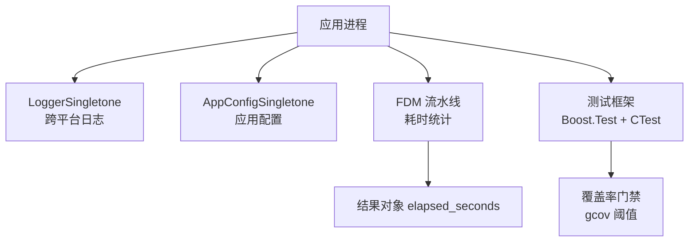
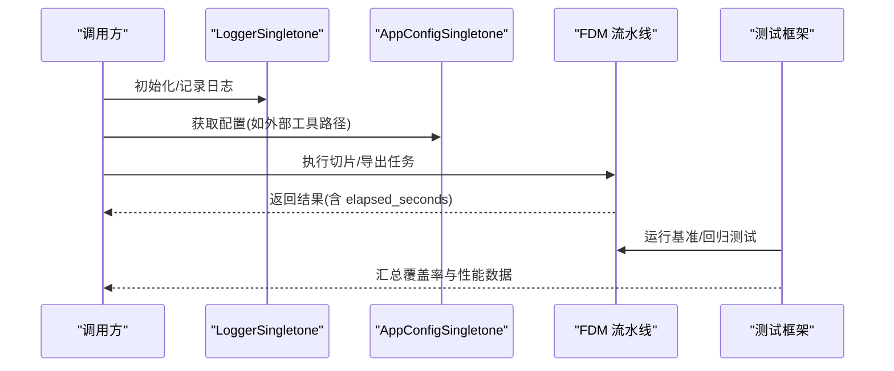
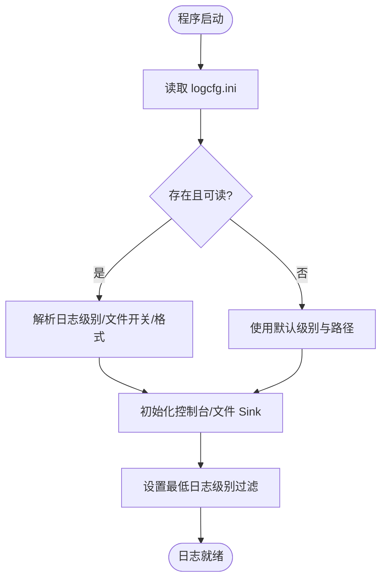
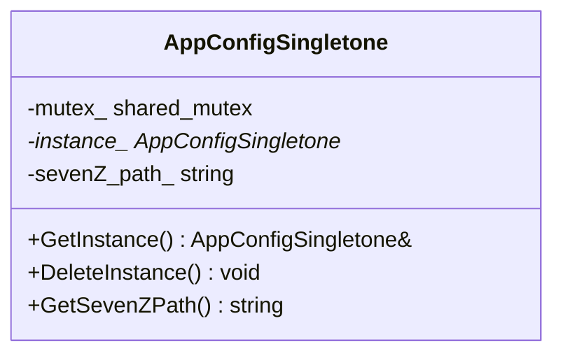
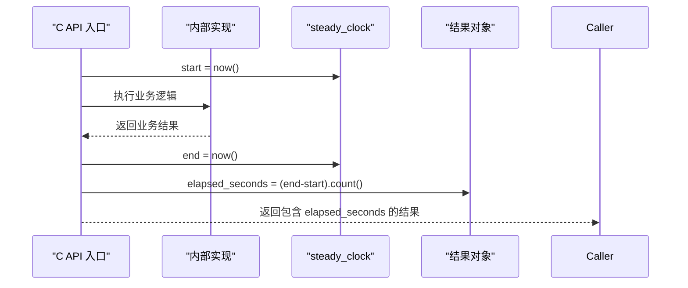
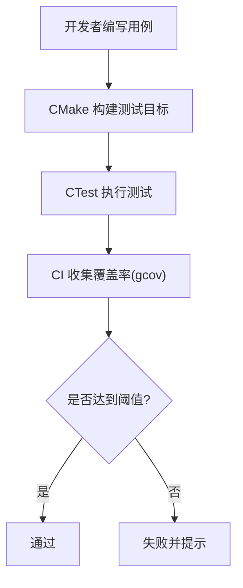
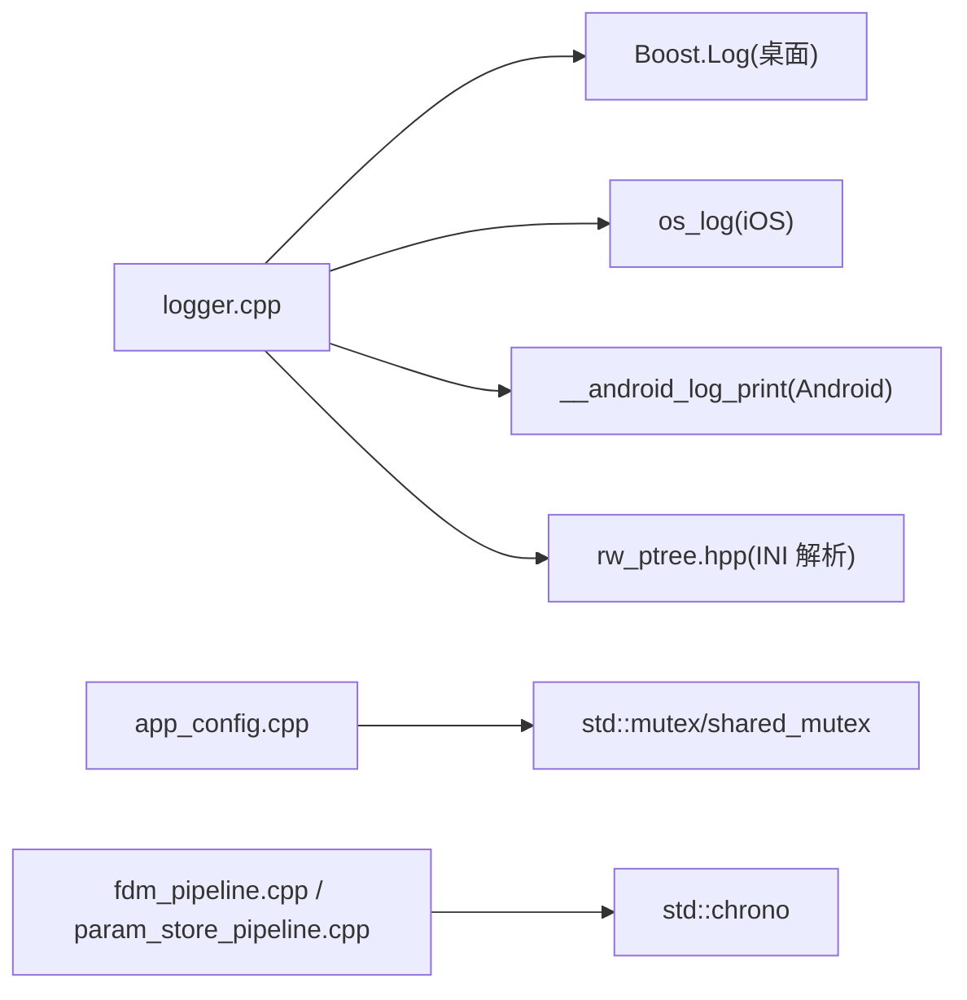

# 性能监控与分析

<cite>
**本文引用的文件**   
- [logger.hpp](file://logger/logger.hpp)
- [logger.cpp](file://logger/logger.cpp)
- [app_config.hpp](file://utils/app_config.hpp)
- [app_config.cpp](file://utils/app_config.cpp)
- [fdm_pipeline.cpp](file://DllHsBaSlicer/fdm_pipeline.cpp)
- [param_store_pipeline.cpp](file://DllHsBaSlicer/param_store_pipeline.cpp)
- [CMakeLists.txt](file://CMakeLists.txt)
- [test-coverage.yml](file://.github/workflows/test-coverage.yml)
- [tests/CMakeLists.txt](file://tests/CMakeLists.txt)
</cite>

## 目录
1. [引言](#引言)
2. [项目结构](#项目结构)
3. [核心组件](#核心组件)
4. [架构总览](#架构总览)
5. [详细组件分析](#详细组件分析)
6. [依赖关系分析](#依赖关系分析)
7. [性能注意事项](#性能注意事项)
8. [故障排除指南](#故障排除指南)
9. [结论](#结论)
10. [附录](#附录)

## 引言
本指南面向 HsBaSlicer 的性能监控与性能分析，聚焦以下目标：
- 使用内置日志系统采集性能指标与运行信息，并配置日志级别。
- 通过 AppConfig 进行运行时参数调整（当前暴露外部工具路径等共享设置）。
- 识别性能瓶颈的方法，包括 CPU 使用率分析与内存占用监控。
- 基于现有测试框架编写自定义性能测试用例。
- 常见性能问题的诊断流程与解决方案。

## 项目结构
与性能监控相关的关键位置如下：
- 日志子系统：logger/logger.hpp、logger/logger.cpp
- 应用配置单例：utils/app_config.hpp、utils/app_config.cpp
- 流水线耗时统计：DllHsBaSlicer 下各 pipeline 实现（以 FDM 为例）
- 构建与测试：根 CMakeLists.txt（复制日志配置文件）、.github/workflows/test-coverage.yml（覆盖率门禁）、tests/CMakeLists.txt（测试工程组织）

图表来源
- [logger.hpp:27-122](file://logger/logger.hpp#L27-L122)
- [logger.cpp:136-222](file://logger/logger.cpp#L136-L222)
- [app_config.hpp:19-46](file://utils/app_config.hpp#L19-L46)
- [fdm_pipeline.cpp:220-229](file://DllHsBaSlicer/fdm_pipeline.cpp#L220-L229)
- [test-coverage.yml:1-31](file://.github/workflows/test-coverage.yml#L1-L31)
- [tests/CMakeLists.txt:1-59](file://tests/CMakeLists.txt#L1-L59)

章节来源
- [logger.hpp:27-122](file://logger/logger.hpp#L27-L122)
- [logger.cpp:136-222](file://logger/logger.cpp#L136-L222)
- [app_config.hpp:19-46](file://utils/app_config.hpp#L19-L46)
- [fdm_pipeline.cpp:220-229](file://DllHsBaSlicer/fdm_pipeline.cpp#L220-L229)
- [test-coverage.yml:1-31](file://.github/workflows/test-coverage.yml#L1-L31)
- [tests/CMakeLists.txt:1-59](file://tests/CMakeLists.txt#L1-L59)

## 核心组件
- LoggerSingletone：线程安全的跨平台日志单例，支持多级别输出、控制台与文件输出、iOS/Android 平台适配。
- AppConfigSingletone：线程安全的应用配置单例，提供外部工具路径等共享设置访问。
- 流水线计时：在 C API 入口或内部异步执行处使用 steady_clock 测量耗时，并通过结果对象的 elapsed_seconds 字段返回。

章节来源
- [logger.hpp:27-122](file://logger/logger.hpp#L27-L122)
- [logger.cpp:136-222](file://logger/logger.cpp#L136-L222)
- [app_config.hpp:19-46](file://utils/app_config.hpp#L19-L46)
- [fdm_pipeline.cpp:220-229](file://DllHsBaSlicer/fdm_pipeline.cpp#L220-L229)

## 架构总览
下图展示“调用方 → 日志/配置 → 流水线 → 测试结果”的整体交互。

图表来源
- [logger.cpp:136-222](file://logger/logger.cpp#L136-L222)
- [app_config.cpp:14-42](file://utils/app_config.cpp#L14-L42)
- [fdm_pipeline.cpp:220-229](file://DllHsBaSlicer/fdm_pipeline.cpp#L220-L229)
- [tests/CMakeLists.txt:1-59](file://tests/CMakeLists.txt#L1-L59)

## 详细组件分析

### 日志系统与性能指标采集
- 日志级别映射：
  - 桌面端使用 Boost.Log；iOS 使用 os_log；Android 使用 __android_log_print。
  - 数值级别到平台类型的映射由内部函数完成。
- 日志配置：
  - 启动时从 logcfg.ini 读取 log_level/log_level_debug、use_log_file、log_file、log_format.log_datatime_format。
  - Debug 与 Release 默认级别不同；未找到配置时使用默认值。
- 输出方式：
  - 控制台输出始终启用；可选文件输出，带大小与时间轮转。
- 源码定位：
  - 级别映射与平台分支：[logger.cpp:54-133](file://logger/logger.cpp#L54-L133)
  - 配置加载与默认值：[logger.cpp:147-183](file://logger/logger.cpp#L147-L183)
  - 控制台/文件 sink 与过滤器：[logger.cpp:185-209](file://logger/logger.cpp#L185-L209)
  - 公共接口与字面量辅助：[logger.hpp:35-122](file://logger/logger.hpp#L35-L122)

图表来源
- [logger.cpp:147-209](file://logger/logger.cpp#L147-L209)

章节来源
- [logger.hpp:35-122](file://logger/logger.hpp#L35-L122)
- [logger.cpp:54-133](file://logger/logger.cpp#L54-L133)
- [logger.cpp:147-209](file://logger/logger.cpp#L147-L209)

### 使用 AppConfig 进行运行时参数调整
- 设计要点：
  - 单例模式，线程安全（shared_mutex）。
  - 当前暴露 GetSevenZPath() 用于获取外部压缩工具路径。
- 使用建议：
  - 在应用启动阶段获取实例，并在退出时清理。
  - 将外部工具路径作为可配置项写入配置中心或环境变量，再由 AppConfig 暴露给上层模块。
- 源码定位：
  - 接口定义：[app_config.hpp:19-46](file://utils/app_config.hpp#L19-L46)
  - 实现细节：[app_config.cpp:14-42](file://utils/app_config.cpp#L14-L42)

图表来源
- [app_config.hpp:19-46](file://utils/app_config.hpp#L19-L46)
- [app_config.cpp:14-42](file://utils/app_config.cpp#L14-L42)

章节来源
- [app_config.hpp:19-46](file://utils/app_config.hpp#L19-L46)
- [app_config.cpp:14-42](file://utils/app_config.cpp#L14-L42)

### 流水线耗时统计与性能指标
- FDM 流水线示例：
  - 在异步执行入口附近记录开始时间，结束时计算 elapsed_seconds 并回写到结果对象。
  - C API 层将内部耗时转换为对外结果结构体中的 elapsed_seconds。
- 其他流水线（如参数存储）同样采用 steady_clock 包裹关键操作，统一返回 elapsed_seconds。
- 源码定位：
  - FDM 内部计时与结果转换：[fdm_pipeline.cpp:220-229](file://DllHsBaSlicer/fdm_pipeline.cpp#L220-L229)、[fdm_pipeline.cpp:199-210](file://DllHsBaSlicer/fdm_pipeline.cpp#L199-L210)
  - 参数存储流水线计时：[param_store_pipeline.cpp:139-145](file://DllHsBaSlicer/param_store_pipeline.cpp#L139-L145)、[param_store_pipeline.cpp:156-162](file://DllHsBaSlicer/param_store_pipeline.cpp#L156-L162)

图表来源
- [fdm_pipeline.cpp:220-229](file://DllHsBaSlicer/fdm_pipeline.cpp#L220-L229)
- [param_store_pipeline.cpp:139-145](file://DllHsBaSlicer/param_store_pipeline.cpp#L139-L145)

章节来源
- [fdm_pipeline.cpp:199-229](file://DllHsBaSlicer/fdm_pipeline.cpp#L199-L229)
- [param_store_pipeline.cpp:139-162](file://DllHsBaSlicer/param_store_pipeline.cpp#L139-L162)

### 性能测试框架与自定义用例
- 测试基础设施：
  - 使用 Boost.Test 作为单元测试框架，CTest 注册测试用例。
  - CI 中通过 gcov 收集覆盖率，并对核心模块与其他模块设定不同阈值。
- 如何添加性能测试：
  - 在 tests 目录下新增测试目标，链接 HsBaSlicerBase/HsBaSlicerUtils 等库。
  - 使用 std::chrono 对关键路径计时，结合日志输出中间指标。
  - 将测试加入 CTest，便于自动化运行与回归。
- 源码定位：
  - 覆盖率门禁说明与阈值：[test-coverage.yml:1-31](file://.github/workflows/test-coverage.yml#L1-L31)
  - 测试工程组织与示例：[tests/CMakeLists.txt:1-59](file://tests/CMakeLists.txt#L1-L59)

图表来源
- [test-coverage.yml:1-31](file://.github/workflows/test-coverage.yml#L1-L31)
- [tests/CMakeLists.txt:1-59](file://tests/CMakeLists.txt#L1-L59)

章节来源
- [test-coverage.yml:1-31](file://.github/workflows/test-coverage.yml#L1-L31)
- [tests/CMakeLists.txt:1-59](file://tests/CMakeLists.txt#L1-L59)

## 依赖关系分析
- 日志子系统依赖：
  - 桌面端依赖 Boost.Log；iOS/Android 分别依赖系统日志能力。
  - 配置文件读取依赖 fileoperator/rw_ptree.hpp。
- 应用配置单例：
  - 仅依赖标准库互斥与字符串类型，无第三方依赖。
- 流水线计时：
  - 依赖 std::chrono 与具体业务实现。

图表来源
- [logger.cpp:17-35](file://logger/logger.cpp#L17-L35)
- [logger.cpp:37-37](file://logger/logger.cpp#L37-L37)
- [app_config.cpp:1-5](file://utils/app_config.cpp#L1-L5)
- [fdm_pipeline.cpp:220-229](file://DllHsBaSlicer/fdm_pipeline.cpp#L220-L229)
- [param_store_pipeline.cpp:139-145](file://DllHsBaSlicer/param_store_pipeline.cpp#L139-L145)

章节来源
- [logger.cpp:17-35](file://logger/logger.cpp#L17-L35)
- [logger.cpp:37-37](file://logger/logger.cpp#L37-L37)
- [app_config.cpp:1-5](file://utils/app_config.cpp#L1-L5)
- [fdm_pipeline.cpp:220-229](file://DllHsBaSlicer/fdm_pipeline.cpp#L220-L229)
- [param_store_pipeline.cpp:139-145](file://DllHsBaSlicer/param_store_pipeline.cpp#L139-L145)

## 性能注意事项
- 日志开销控制：
  - 在高频路径上避免频繁构造大字符串；优先使用轻量级消息与条件日志。
  - 生产环境建议关闭文件输出或降低日志级别，减少 I/O 压力。
- 计时精度与范围：
  - 使用 steady_clock 测量 CPU 相关耗时；wall-clock 适合端到端耗时。
  - 避免在极短临界区插入日志，以免放大测量误差。
- 内存分配热点：
  - 关注大量小对象分配场景，考虑复用对象池或预分配缓冲区。
- 并发与锁竞争：
  - 日志与配置单例已做线程安全处理；在高并发场景下注意避免热点锁竞争。

## 故障排除指南
- 日志不输出或级别不符合预期：
  - 检查 logcfg.ini 是否存在与可读，确认 log_level/log_level_debug 与 use_log_file 配置。
  - 确认构建类型为 Debug/Release，因为默认级别不同。
  - 参考：[logger.cpp:147-183](file://logger/logger.cpp#L147-L183)
- 文件日志未生成：
  - 检查 use_log_file 是否为 true，以及 log_file 路径是否有效。
  - 参考：[logger.cpp:196-203](file://logger/logger.cpp#L196-L203)
- 外部工具路径为空：
  - 确认 AppConfigSingletone 的 sevenZ_path_ 已被正确设置（例如通过配置中心或初始化流程）。
  - 参考：[app_config.cpp:38-42](file://utils/app_config.cpp#L38-L42)
- 流水线耗时为 0 或异常：
  - 检查是否在正确的作用域内包裹计时代码，确保 start/end 成对出现。
  - 参考：[fdm_pipeline.cpp:220-229](file://DllHsBaSlicer/fdm_pipeline.cpp#L220-L229)、[param_store_pipeline.cpp:139-145](file://DllHsBaSlicer/param_store_pipeline.cpp#L139-L145)

章节来源
- [logger.cpp:147-203](file://logger/logger.cpp#L147-L203)
- [app_config.cpp:38-42](file://utils/app_config.cpp#L38-L42)
- [fdm_pipeline.cpp:220-229](file://DllHsBaSlicer/fdm_pipeline.cpp#L220-L229)
- [param_store_pipeline.cpp:139-145](file://DllHsBaSlicer/param_store_pipeline.cpp#L139-L145)

## 结论
- HsBaSlicer 提供了跨平台的日志子系统与线程安全的配置单例，可用于性能数据采集与运行期参数管理。
- 流水线层统一通过 elapsed_seconds 暴露耗时指标，便于上层分析与回归对比。
- 借助 Boost.Test 与 CTest，可在本地与 CI 中稳定运行性能与覆盖率测试，保障质量基线。
- 建议在高频路径谨慎使用日志，合理配置日志级别与输出目标，并结合系统工具进行 CPU/内存分析，持续优化性能。

## 附录
- 日志配置文件说明：
  - 构建脚本会将 utils/logcfg.ini 复制到可执行文件输出目录，供运行时读取。
  - 参考：[CMakeLists.txt:355-363](file://CMakeLists.txt#L355-L363)

章节来源
- [CMakeLists.txt:355-363](file://CMakeLists.txt#L355-L363)