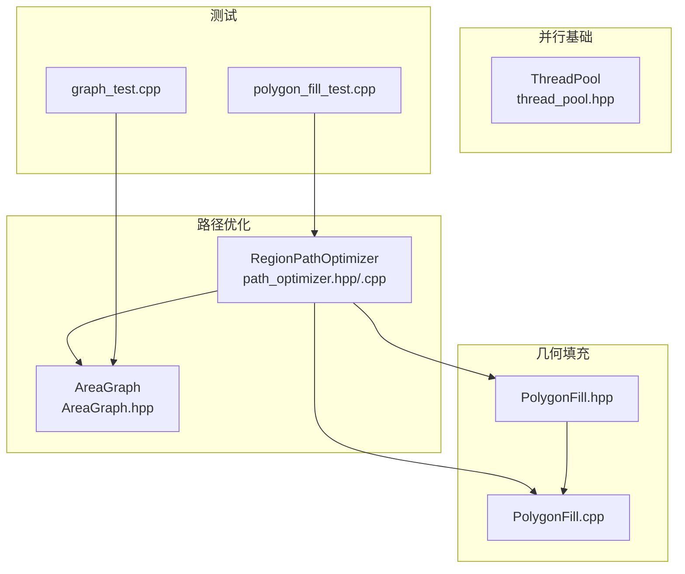
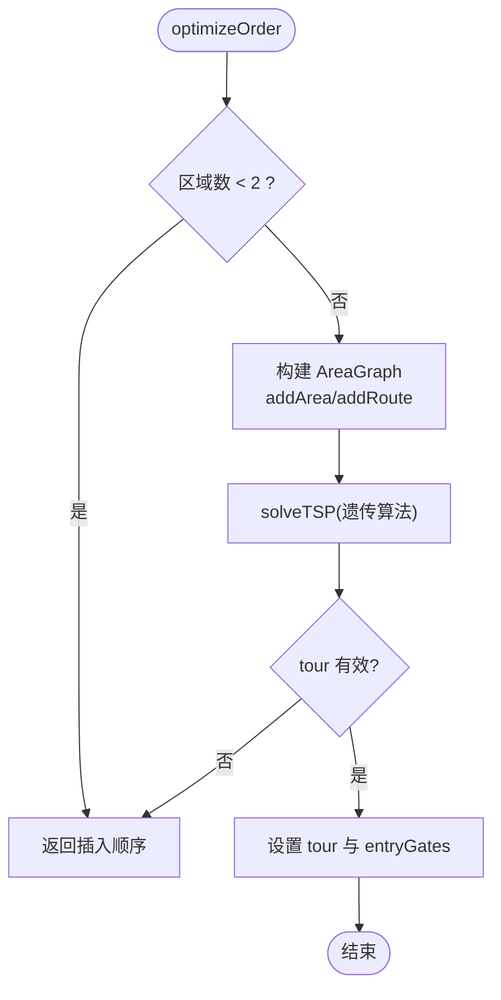
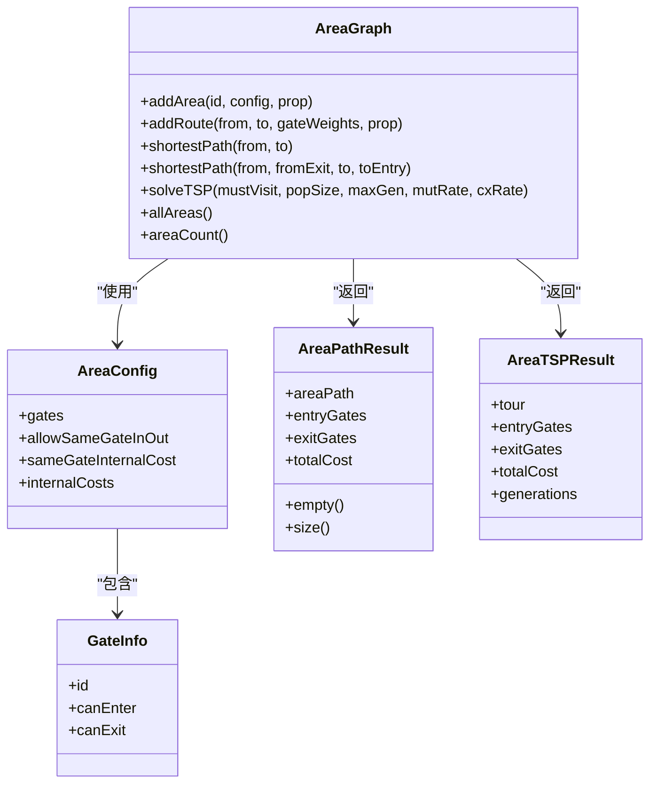
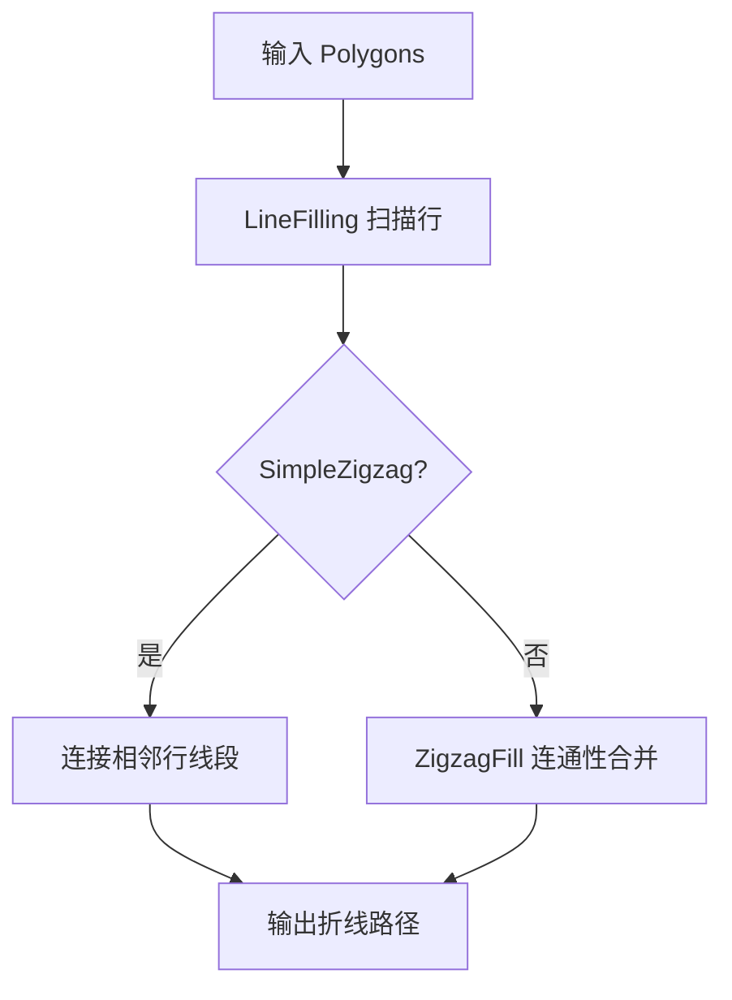
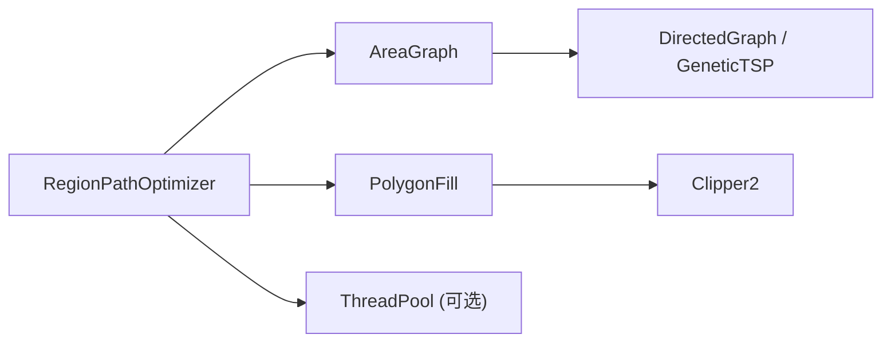
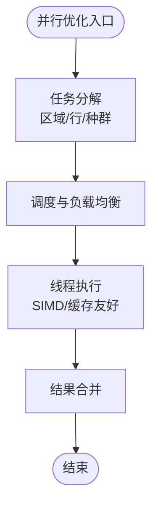

# 算法优化

<cite>
**本文引用的文件**   
- [path_optimizer.hpp](file://LibHsBaSlicer/Path/path_optimizer.hpp)
- [path_optimizer.cpp](file://LibHsBaSlicer/Path/path_optimizer.cpp)
- [AreaGraph.hpp](file://utils/AreaGraph.hpp)
- [PolygonFill.hpp](file://2D/PolygonFill.hpp)
- [PolygonFill.cpp](file://2D/PolygonFill.cpp)
- [thread_pool.hpp](file://base/thread_pool.hpp)
- [graph_test.cpp](file://tests/Graph/graph_test.cpp)
- [polygon_fill_test.cpp](file://tests/PolygonFill/polygon_fill_test.cpp)
</cite>

## 目录
1. [引言](#引言)
2. [项目结构](#项目结构)
3. [核心组件](#核心组件)
4. [架构总览](#架构总览)
5. [详细组件分析](#详细组件分析)
6. [依赖关系分析](#依赖关系分析)
7. [性能与复杂度分析](#性能与复杂度分析)
8. [并行计算优化](#并行计算优化)
9. [几何计算优化](#几何计算优化)
10. [基准测试与调优建议](#基准测试与调优建议)
11. [故障排查指南](#故障排查指南)
12. [结论](#结论)

## 引言
本文面向 HsBaSlicer 的算法优化，重点围绕路径优化器 PathOptimizer、几何填充与布尔运算、空间分割与缓存策略，以及并行计算优化展开。文档从系统架构出发，逐步深入到关键类的实现细节，给出时间/空间复杂度分析、瓶颈识别方法、基准测试思路与可操作的调优建议，帮助读者在保持正确性的前提下获得更优的性能表现。

## 项目结构
与本次优化主题直接相关的代码主要分布在以下模块：
- LibHsBaSlicer/Path：路径优化器 RegionPathOptimizer 及其 Lua 绑定
- utils：通用图与区域图 AreaGraph，支撑 TSP 求解
- 2D：多边形填充 PolygonFill，包含偏移、直线、折线等填充算法
- base：线程池 ThreadPool，用于任务分解与并发执行
- tests：覆盖路径优化、TSP、填充等算法的单元测试



**图表来源**
- [path_optimizer.hpp:23-99](file://LibHsBaSlicer/Path/path_optimizer.hpp#L23-L99)
- [AreaGraph.hpp:95-114](file://utils/AreaGraph.hpp#L95-L114)
- [PolygonFill.hpp:20-136](file://2D/PolygonFill.hpp#L20-L136)
- [thread_pool.hpp:29-162](file://base/thread_pool.hpp#L29-L162)

**章节来源**
- [path_optimizer.hpp:23-99](file://LibHsBaSlicer/Path/path_optimizer.hpp#L23-L99)
- [AreaGraph.hpp:95-114](file://utils/AreaGraph.hpp#L95-L114)
- [PolygonFill.hpp:20-136](file://2D/PolygonFill.hpp#L20-L136)
- [thread_pool.hpp:29-162](file://base/thread_pool.hpp#L29-L162)

## 核心组件
- RegionPathOptimizer：将独立多边形区域建模为 AreaGraph 的区域顶点，通过遗传 TSP 求解区域访问顺序；支持“填充前（多边形模式）”和“填充后（路径模式）”两种优化阶段，并提供内聚的路径/多边形重排策略以减少跳跃移动。
- AreaGraph：两层区域/门图，支持带门的最短路径与 TSP 规划；内部使用 Dijkstra 在扩展图上求解，并通过缓存 pairwise 最短路径加速遗传 TSP。
- PolygonFill：提供 OffsetFill、LineFill、SimpleZigzagFill、ZigzagFill、CompositeOffsetFill、HybridFill 等填充算法，并暴露 Lua 接口供脚本扩展。
- ThreadPool：通用线程池，支持任务提交、等待完成、协程执行器集成，可用于并行化填充或路径优化中的独立子任务。

**章节来源**
- [path_optimizer.hpp:23-99](file://LibHsBaSlicer/Path/path_optimizer.hpp#L23-L99)
- [AreaGraph.hpp:95-114](file://utils/AreaGraph.hpp#L95-L114)
- [PolygonFill.hpp:20-136](file://2D/PolygonFill.hpp#L20-L136)
- [thread_pool.hpp:29-162](file://base/thread_pool.hpp#L29-L162)

## 架构总览
路径优化的整体流程如下：
1. 输入：多个独立区域的多边形轮廓或填充路径集合。
2. 建模：每个区域作为 AreaGraph 的一个 area，其所有顶点或路径端点作为 gate。
3. 建图：构建区域内 gate-to-gate 的内部成本，以及区域间 gate-pair 的空中移动成本。
4. 求解：对 >=3 个区域调用遗传 TSP 得到最优访问顺序；<=2 个区域直接比较方向。
5. 输出：按优化顺序输出完整路径或多边形集，并在区域内进行贪心排列减少跳跃。

```mermaid
sequenceDiagram
participant Client as "调用方"
participant Opt as "RegionPathOptimizer"
participant AG as "AreaGraph"
participant GA as "GeneticTSP"
Client->>Opt : addRegion()/addPolygonRegion()
Opt->>AG : addArea() + addRoute()
Client->>Opt : optimizeOrder()
Opt->>AG : shortestPath(i,j) for all pairs
AG-->>Opt : dist/cache
Opt->>AG : solveTSP(mustVisit)
AG->>GA : GeneticTSP.solve()
GA-->>AG : tour, totalCost
AG-->>Opt : TSPResult
Opt->>Opt : arrangeRegionPaths()/arrangeRegionPolygons()
Opt-->>Client : buildPaths()/buildPolygons()
```

**图表来源**
- [path_optimizer.cpp:118-166](file://LibHsBaSlicer/Path/path_optimizer.cpp#L118-L166)
- [AreaGraph.hpp:197-256](file://utils/AreaGraph.hpp#L197-L256)
- [AreaGraph.hpp:267-345](file://utils/AreaGraph.hpp#L267-L345)

## 详细组件分析

### 路径优化器 RegionPathOptimizer
- 双模式设计：
  - 多边形模式（填充前）：gate 为所有多边形顶点；输出优化后的多边形序列，并按入口 gate 旋转起点，保持环绕方向。
  - 路径模式（填充后）：gate 为每条路径的首尾端点；输出完整填充路径，并按最近邻贪心选择下一条路径，必要时反转路径方向。
- 区域间代价：
  - 默认采用所有 gate 对的欧氏距离作为空中移动成本；可通过 addRoute 手动覆盖对称代价。
- 内部排序：
  - 路径模式：从入口 gate 端点开始，每次选择最近路径端点，若尾端更近则反转路径。
  - 多边形模式：从入口 gate 顶点开始，每次选择最近多边形的最近顶点，旋转该多边形起点到该顶点。



**图表来源**
- [path_optimizer.cpp:118-166](file://LibHsBaSlicer/Path/path_optimizer.cpp#L118-L166)

**章节来源**
- [path_optimizer.hpp:23-99](file://LibHsBaSlicer/Path/path_optimizer.hpp#L23-L99)
- [path_optimizer.cpp:43-116](file://LibHsBaSlicer/Path/path_optimizer.cpp#L43-L116)
- [path_optimizer.cpp:268-375](file://LibHsBaSlicer/Path/path_optimizer.cpp#L268-L375)

### 区域图 AreaGraph
- 数据结构：
  - GateInfo：门的标识与进出权限。
  - AreaConfig：区域的门集合、同门进出策略、内部 gate-to-gate 成本表。
  - AreaPathResult/TSPResult：最短路径与 TSP 结果，含每站 entry/exit gates。
- 核心算法：
  - 最短路径：将每个区域展开为 per-gate 的 entry/exit 顶点，使用 Dijkstra 在扩展图上求解。
  - TSP：先对所有 must-visit 区域计算 pairwise 最短路径并缓存，再压缩为完全有向图，调用 GeneticTSP 求解。
- 缓存策略：
  - pathCache[i][j] 缓存 i→j 的完整路径，避免重复最短路径计算。
  - ensureExpanded 惰性重建扩展图，dirty_ 标记控制增量更新。



**图表来源**
- [AreaGraph.hpp:32-52](file://utils/AreaGraph.hpp#L32-L52)
- [AreaGraph.hpp:54-92](file://utils/AreaGraph.hpp#L54-L92)
- [AreaGraph.hpp:95-114](file://utils/AreaGraph.hpp#L95-L114)

**章节来源**
- [AreaGraph.hpp:32-52](file://utils/AreaGraph.hpp#L32-L52)
- [AreaGraph.hpp:95-114](file://utils/AreaGraph.hpp#L95-L114)
- [AreaGraph.hpp:197-256](file://utils/AreaGraph.hpp#L197-L256)
- [AreaGraph.hpp:267-345](file://utils/AreaGraph.hpp#L267-L345)

### 多边形填充 PolygonFill
- 算法族：
  - OffsetFill：基于偏移生成填充层。
  - LineFill：平行线扫描，裁剪出线段。
  - SimpleZigzagFill/ZigzagFill：连接相邻行线段形成连续折线，处理凹形缺口桥接。
  - CompositeOffsetFill/HybridFill：组合偏移与内部填充，支持内外偏移层数与填充模式。
- 几何优化：
  - 整数化/反整数化：在 Clipper2 几何库上操作以提升布尔运算稳定性。
  - 扫描行排序与连通性合并：使用并查集合并相邻行区间，提升折线连通效率。
  - 二分查找边界点：在 SimpleZigzagFill 中二分定位首尾入点/出点，提高精度与鲁棒性。



**图表来源**
- [PolygonFill.cpp:39-137](file://2D/PolygonFill.cpp#L39-L137)
- [PolygonFill.cpp:477-674](file://2D/PolygonFill.cpp#L477-L674)
- [PolygonFill.cpp:676-799](file://2D/PolygonFill.cpp#L676-L799)

**章节来源**
- [PolygonFill.hpp:20-136](file://2D/PolygonFill.hpp#L20-L136)
- [PolygonFill.cpp:39-137](file://2D/PolygonFill.cpp#L39-L137)
- [PolygonFill.cpp:477-674](file://2D/PolygonFill.cpp#L477-L674)
- [PolygonFill.cpp:676-799](file://2D/PolygonFill.cpp#L676-L799)

## 依赖关系分析
- RegionPathOptimizer 依赖 AreaGraph 进行区域间最短路径与 TSP 求解。
- AreaGraph 依赖 Boost Graph 与自定义 DirectedGraph/GeneticTSP。
- PolygonFill 依赖 Clipper2 几何库与 Lua 适配器。
- ThreadPool 为可选并行基础设施，可在上层管线中并行化填充或路径优化任务。



**图表来源**
- [path_optimizer.cpp:1-22](file://LibHsBaSlicer/Path/path_optimizer.cpp#L1-L22)
- [AreaGraph.hpp:9-13](file://utils/AreaGraph.hpp#L9-L13)
- [PolygonFill.cpp:7-16](file://2D/PolygonFill.cpp#L7-L16)
- [thread_pool.hpp:1-23](file://base/thread_pool.hpp#L1-L23)

**章节来源**
- [path_optimizer.cpp:1-22](file://LibHsBaSlicer/Path/path_optimizer.cpp#L1-L22)
- [AreaGraph.hpp:9-13](file://utils/AreaGraph.hpp#L9-L13)
- [PolygonFill.cpp:7-16](file://2D/PolygonFill.cpp#L7-L16)
- [thread_pool.hpp:1-23](file://base/thread_pool.hpp#L1-L23)

## 性能与复杂度分析

### 路径优化器
- 建图阶段：
  - 区域内 gate-to-gate 成本：O(G^2)，G 为区域内 gate 数量。
  - 区域间 gate-pair 成本：O(R^2 * G_a * G_b)，R 为区域数，G_a/G_b 为两端区域 gate 数。
- 最短路径：
  - Dijkstra 在扩展图上运行，节点数为 O(ΣG_i)，边数为 O(ΣG_i^2 + Σ_route_edges)。
- TSP：
  - 遗传算法参数：种群大小 P、最大代数 G、变异率 m、交叉率 c。
  - 单次评估复杂度近似 O(R^2)，总体 O(P * G * R^2)。
- 区域内重排：
  - 路径模式：O(K^2)，K 为路径条数。
  - 多边形模式：O(K^2 * V)，V 为多边形顶点数。

### 多边形填充
- LineFilling：
  - 扫描行数 S ≈ 投影长度/间距；每行裁剪与排序 O(N log N)，N 为交点多边形顶点数。
- SimpleZigzagFill：
  - 连接相邻行线段 O(S * L)，L 为每行线段数；二分查找 O(log M)，M 为迭代次数。
- ZigzagFill：
  - 并查集合并 O(E α(V))，E 为相邻行区间重叠边数。

### 空间复杂度
- AreaGraph 扩展图：O(ΣG_i^2 + Σ_route_edges)。
- TSP 缓存：O(R^2) 条路径缓存。
- PolygonFill 中间结构：每行线段集合与并查集数组，线性于扫描行与线段数。

[本节为一般性分析，不直接引用具体文件]

## 并行计算优化

### 任务分解策略
- 区域级并行：对不同区域的多边形填充或路径优化任务分派到不同线程。
- 行级并行：LineFilling 的扫描行可并行裁剪与排序。
- 遗传 TSP 并行：种群评估可并行化，但需权衡同步开销。

### 负载均衡
- 动态任务队列：根据区域面积或顶点数分配权重，使各线程负载均衡。
- 自适应线程数：依据硬件并发数与任务特征调整。

### 数据局部性优化
- 预取与缓存：将频繁访问的 gate 坐标、路径端点放入连续内存。
- 分块处理：对大区域分块填充，减少缓存失效。

### SIMD 指令利用
- 向量距离计算：PointDist 可使用 SIMD 批量计算。
- 扫描行裁剪：矩形与多边形交集可借助 SIMD 加速。



[本图为概念流程图，不映射具体源码]

**章节来源**
- [thread_pool.hpp:29-162](file://base/thread_pool.hpp#L29-L162)

## 几何计算优化

### 多边形填充算法性能改进
- 整数化/反整数化：在 Clipper2 上操作，提升布尔运算稳定性与速度。
- 扫描行排序：按 s_min 排序，减少后续连接判断开销。
- 连通性合并：并查集快速合并相邻行区间，降低复杂连接逻辑。

### 布尔运算优化
- 批量 offset：CompositeOffsetFill/HybridFill 中分层 offset，提前终止小面积层。
- 裁剪优化：矩形扫描线与多边形交集仅保留有效段。

### 空间分割与缓存策略
- AreaGraph 的 lazy 扩展图：dirty_ 标记避免重复构建。
- TSP 路径缓存：pairwise 最短路径缓存避免重复计算。
- PolygonFill 的行缓存：每行线段集合复用，减少重复构造。

**章节来源**
- [PolygonFill.cpp:139-183](file://2D/PolygonFill.cpp#L139-L183)
- [PolygonFill.cpp:1230-1260](file://2D/PolygonFill.cpp#L1230-L1260)
- [AreaGraph.hpp:407-413](file://utils/AreaGraph.hpp#L407-L413)
- [AreaGraph.hpp:276-295](file://utils/AreaGraph.hpp#L276-L295)

## 基准测试与调优建议

### 时间复杂度分析
- 路径优化：O(R^2 * G^2 + P * G * R^2)，R 为区域数，G 为平均 gate 数，P 为种群大小，G 为代数。
- 填充算法：O(S * N log N + S * L)，S 为扫描行数，N 为顶点数，L 为线段数。

### 空间复杂度评估
- AreaGraph 扩展图与 TSP 缓存主导空间占用。
- PolygonFill 中间结构随扫描行与线段数线性增长。

### 基准测试方法
- 单区域路径反转与手动路由覆盖：验证路径优化器的基本行为。
- TSP 小规模与自定义权重：验证遗传算法的正确性与鲁棒性。
- 凹形 U 形多边形折线桥接：验证 ZigzagFill 的连通性处理。

### 性能瓶颈识别
- 高 R 与高 G：区域与 gate 数量过大导致建图与 TSP 耗时显著上升。
- 大量扫描行与线段：填充算法的 I/O 与排序成为瓶颈。
- Lua 脚本开销：嵌入脚本加载与函数调用可能引入额外延迟。

### 调优建议
- 减小 R 与 G：合并相近区域，简化多边形顶点。
- 调整遗传参数：降低 P 或 G 以平衡质量与速度。
- 并行化填充：对独立区域或扫描行并行处理。
- 缓存热点数据：gate 坐标、路径端点、扫描行结果。

**章节来源**
- [polygon_fill_test.cpp:354-388](file://tests/PolygonFill/polygon_fill_test.cpp#L354-L388)
- [graph_test.cpp:506-531](file://tests/Graph/graph_test.cpp#L506-L531)
- [polygon_fill_test.cpp:546-553](file://tests/PolygonFill/polygon_fill_test.cpp#L546-L553)

## 故障排查指南
- 区域重复 ID：RegionPathOptimizer 会抛出运行时错误，检查 addRegion/addPolygonRegion 的 id 唯一性。
- 混合模式：同一优化器不能同时添加路径区域与多边形区域，确保模式一致性。
- TSP 无解：当区域不可达时，tour 无效，回退到插入顺序；检查 addRoute 是否合理。
- Lua 脚本错误：脚本加载或函数调用失败会抛出异常，检查脚本路径与函数名。

**章节来源**
- [path_optimizer.cpp:63-116](file://LibHsBaSlicer/Path/path_optimizer.cpp#L63-L116)
- [path_optimizer.cpp:588-617](file://LibHsBaSlicer/Path/path_optimizer.cpp#L588-L617)

## 结论
HsBaSlicer 的路径优化与几何填充体系通过 AreaGraph 的两层图模型与遗传 TSP 实现了高效的区域访问顺序优化，结合 PolygonFill 的多类填充算法与 Lua 扩展能力，提供了灵活且高性能的切片路径生成方案。通过合理的任务分解、负载均衡、数据局部性优化与 SIMD 指令利用，可进一步提升整体性能。基准测试覆盖了关键场景，为持续优化提供了可靠依据。