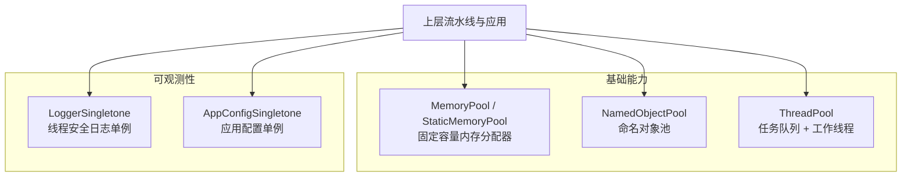
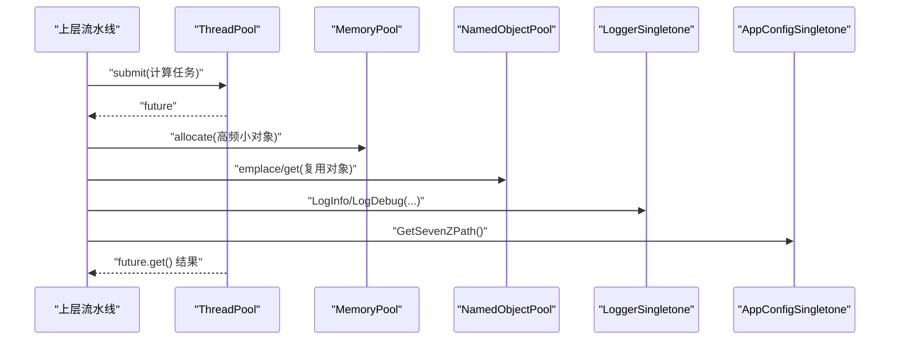
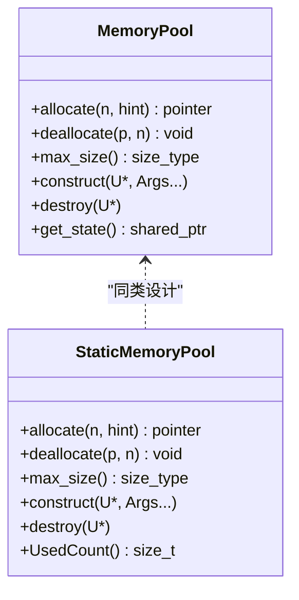
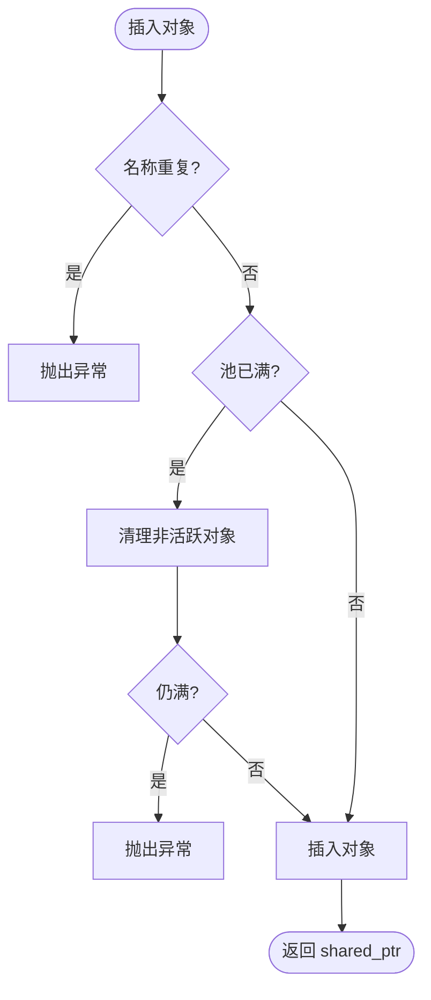
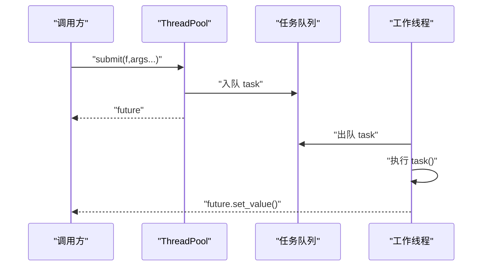
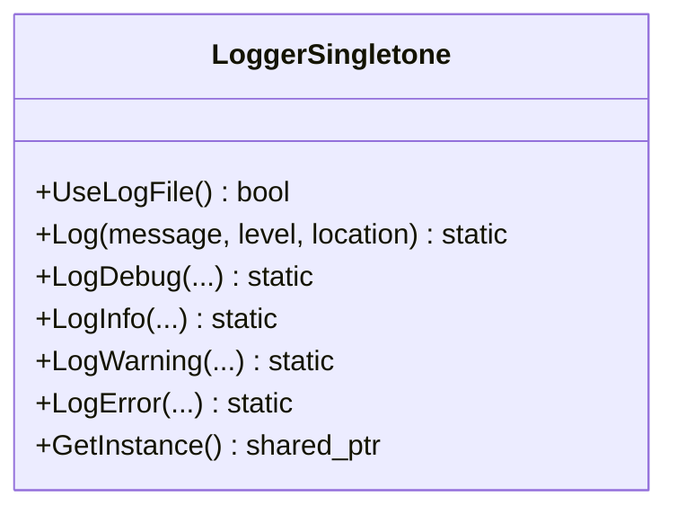
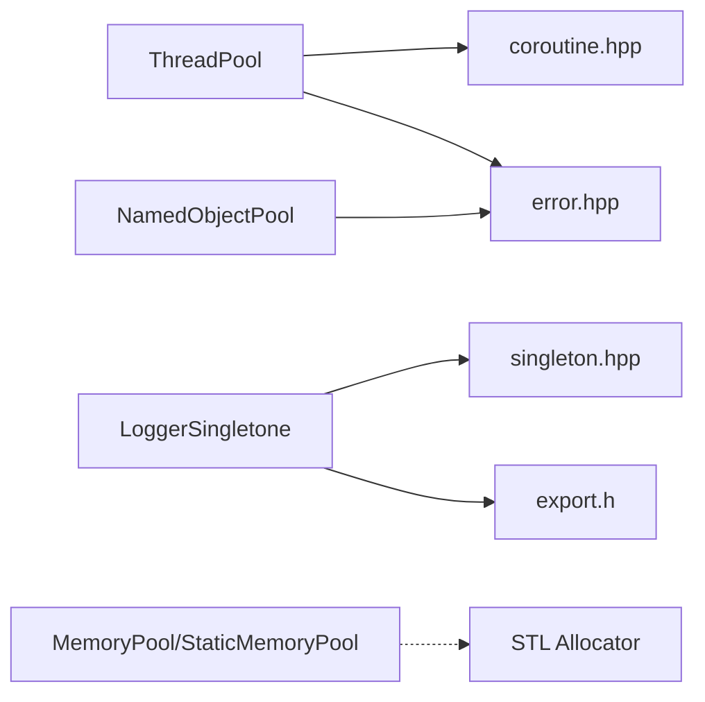

# 性能调优与监控

<cite>
**本文引用的文件**   
- [README.md](file://README.md)
- [memory_pool.hpp](file://base/memory_pool.hpp)
- [object_pool.hpp](file://base/object_pool.hpp)
- [thread_pool.hpp](file://base/thread_pool.hpp)
- [logger.hpp](file://logger/logger.hpp)
- [app_config.hpp](file://utils/app_config.hpp)
- [memory_pool.md](file://docs/zh/base/memory_pool.md)
- [object_pool.md](file://docs/zh/base/object_pool.md)
- [thread_pool.md](file://docs/zh/base/thread_pool.md)
</cite>

## 目录
1. [引言](#引言)
2. [项目结构](#项目结构)
3. [核心组件](#核心组件)
4. [架构总览](#架构总览)
5. [详细组件分析](#详细组件分析)
6. [依赖关系分析](#依赖关系分析)
7. [性能考量](#性能考量)
8. [故障排查指南](#故障排查指南)
9. [结论](#结论)
10. [附录](#附录)

## 引言
本文件面向有经验的开发者，聚焦 HsBaSlicer 的性能调优与监控。内容覆盖：
- 内存使用监控、CPU 利用率分析与 I/O 性能评估方法
- 日志系统的配置与性能影响
- 应用配置的优化选项
- 对象池与内存池的性能优势
- 瓶颈识别、代码级优化策略与批量处理优化
- 基准测试设计、压力测试实施与生产环境监控方案
- 实战案例与最佳实践建议

HsBaSlicer 是一个模块化、跨平台的 C++ 切片框架，提供静态库与动态库目标，便于在桌面、移动端及游戏引擎等环境中集成与扩展。

**章节来源**
- [README.md:21-39](file://README.md#L21-L39)

## 项目结构
围绕性能调优与监控，本项目关键基础设施位于 base、logger 与 utils 三个模块：
- base：内存池、对象池、线程池等高性能基础组件
- logger：线程安全、跨平台日志单例
- utils：应用配置单例（如外部工具路径）

**图表来源**
- [memory_pool.hpp:43-208](file://base/memory_pool.hpp#L43-L208)
- [object_pool.hpp:22-283](file://base/object_pool.hpp#L22-L283)
- [thread_pool.hpp:29-162](file://base/thread_pool.hpp#L29-L162)
- [logger.hpp:35-122](file://logger/logger.hpp#L35-L122)
- [app_config.hpp:19-46](file://utils/app_config.hpp#L19-L46)

**章节来源**
- [README.md:29-39](file://README.md#L29-L39)

## 核心组件
本节从性能视角梳理四个核心组件的职责与关键接口。

- 内存池 MemoryPool / StaticMemoryPool
  - 提供 STL Allocator 兼容的固定容量内存分配，减少频繁 new/delete 的开销与碎片
  - 支持共享状态（MemoryPool）或全局静态（StaticMemoryPool）两种模式
  - 通过 UsedCount 等接口辅助内存占用观测

- 对象池 NamedObjectPool
  - 基于名称管理 shared_ptr 对象，自动清理非活跃对象，避免重复创建
  - 读写分离锁提升并发读取性能，容量上限保护内存使用

- 线程池 ThreadPool
  - 提交任务返回 std::future，支持 WaitAll 等待全部完成
  - 暴露 PendingTasks / ActiveTasks 用于运行时负载观测
  - 可选协程执行器 ThreadPoolExecutor 与 IExecutor 集成

- 日志 LoggerSingletone
  - 线程安全、跨平台（iOS/Android/桌面），支持多级别输出
  - 提供 UseLogFile 判断是否启用文件日志，便于控制 I/O 开销

- 应用配置 AppConfigSingletone
  - 提供外部工具路径等共享设置，避免重复解析与硬编码

**章节来源**
- [memory_pool.hpp:43-208](file://base/memory_pool.hpp#L43-L208)
- [object_pool.hpp:22-283](file://base/object_pool.hpp#L22-L283)
- [thread_pool.hpp:29-162](file://base/thread_pool.hpp#L29-L162)
- [logger.hpp:35-122](file://logger/logger.hpp#L35-L122)
- [app_config.hpp:19-46](file://utils/app_config.hpp#L19-L46)

## 架构总览
下图展示性能相关组件在系统内的交互关系：上层流水线通过线程池并行执行任务；对高频小对象的分配走内存池；对需要复用且带生命周期的对象走对象池；所有运行期诊断信息经日志输出；外部工具路径由应用配置集中管理。

**图表来源**
- [thread_pool.hpp:67-90](file://base/thread_pool.hpp#L67-L90)
- [memory_pool.hpp:111-142](file://base/memory_pool.hpp#L111-L142)
- [object_pool.hpp:66-92](file://base/object_pool.hpp#L66-L92)
- [logger.hpp:50-83](file://logger/logger.hpp#L50-L83)
- [app_config.hpp:39-39](file://utils/app_config.hpp#L39-L39)

## 详细组件分析

### 内存池 MemoryPool 与 StaticMemoryPool
- 设计要点
  - 固定大小池，按字节对齐扫描空闲块，分配失败抛出 bad_alloc
  - 线程安全：分配/释放加互斥锁
  - 支持 rebind 以适配不同元素类型
  - StaticMemoryPool 为全局静态实例，所有实例相等，适合跨进程/模块共享

- 复杂度与性能
  - allocate/deallocate 最坏 O(PoolSize)，但常数极小；适合短生命周期、同尺寸对象
  - 相比通用分配器，显著降低分配次数与碎片

- 监控与调优
  - 使用 StaticMemoryPool::UsedCount 观察已用字节数
  - 合理设置 PoolSize，避免频繁扩容或溢出
  - 将热点容器（如向量、列表）绑定到对应内存池

**图表来源**
- [memory_pool.hpp:43-208](file://base/memory_pool.hpp#L43-L208)
- [memory_pool.hpp:215-372](file://base/memory_pool.hpp#L215-L372)

**章节来源**
- [memory_pool.hpp:111-142](file://base/memory_pool.hpp#L111-L142)
- [memory_pool.hpp:266-296](file://base/memory_pool.hpp#L266-L296)
- [memory_pool.hpp:358-365](file://base/memory_pool.hpp#L358-L365)
- [memory_pool.md:1-325](file://docs/zh/base/memory_pool.md#L1-L325)

### 对象池 NamedObjectPool
- 设计要点
  - 以名称索引 shared_ptr 对象，插入前检查重复名
  - 达到 MaxSize 时先尝试清理 inactive 对象（use_count==1）
  - 读写分离锁：读操作共享锁，写操作独占锁
  - 支持自定义分配器 allocate(name, alloc, args...)

- 复杂度与性能
  - get/Contains 为 O(logN) 或 O(1) 取决于底层 map 实现
  - CleanupInactiveObjects 线性遍历，仅在必要时触发

- 监控与调优
  - 使用 size()/ActiveCount()/InactiveCount() 观察池状态
  - 合理设置 MaxSize，避免频繁清理抖动
  - 对昂贵对象（IO 句柄、大缓冲区）优先复用

**图表来源**
- [object_pool.hpp:66-92](file://base/object_pool.hpp#L66-L92)
- [object_pool.hpp:262-279](file://base/object_pool.hpp#L262-L279)

**章节来源**
- [object_pool.hpp:66-92](file://base/object_pool.hpp#L66-L92)
- [object_pool.hpp:135-156](file://base/object_pool.hpp#L135-L156)
- [object_pool.hpp:219-231](file://base/object_pool.hpp#L219-L231)
- [object_pool.md:1-274](file://docs/zh/base/object_pool.md#L1-L274)

### 线程池 ThreadPool
- 设计要点
  - 构造时创建 worker 线程，析构时停止并 join
  - submit 包装 packaged_task 返回 future，支持参数转发
  - WaitAll 阻塞直到队列为空且无活跃任务
  - 可选 ThreadPoolExecutor 实现 IExecutor，配合协程

- 复杂度与性能
  - 任务入队/出队 O(1)
  - 活跃任务计数 atomic，PendingTasks 需加锁

- 监控与调优
  - 使用 PendingTasks/ActiveTasks 观察吞吐与背压
  - 根据 CPU 密集型/I-O 密集型调整线程数
  - 避免过多短任务导致队列抖动

**图表来源**
- [thread_pool.hpp:67-90](file://base/thread_pool.hpp#L67-L90)
- [thread_pool.hpp:118-154](file://base/thread_pool.hpp#L118-L154)

**章节来源**
- [thread_pool.hpp:37-61](file://base/thread_pool.hpp#L37-L61)
- [thread_pool.hpp:67-90](file://base/thread_pool.hpp#L67-L90)
- [thread_pool.hpp:94-111](file://base/thread_pool.hpp#L94-L111)
- [thread_pool.md:1-317](file://docs/zh/base/thread_pool.md#L1-L317)

### 日志 LoggerSingletone
- 设计要点
  - 线程安全单例，跨平台（iOS/Android/桌面）
  - 提供 Debug/Info/Warning/Error 级别输出
  - UseLogFile 指示是否写入文件，便于控制 I/O 成本

- 性能影响
  - 高频日志会放大 I/O 与序列化开销
  - 建议在热路径仅保留必要级别的日志，或使用条件开关

**图表来源**
- [logger.hpp:35-122](file://logger/logger.hpp#L35-L122)

**章节来源**
- [logger.hpp:42-83](file://logger/logger.hpp#L42-L83)
- [logger.hpp:96-102](file://logger/logger.hpp#L96-L102)

### 应用配置 AppConfigSingletone
- 设计要点
  - 单例提供外部工具路径（如 7-Zip）
  - 读写共享锁保护，避免重复解析

- 性能意义
  - 集中管理外部路径，减少重复 IO 与字符串拼接
  - 便于在不同环境切换工具链

**章节来源**
- [app_config.hpp:19-46](file://utils/app_config.hpp#L19-L46)

## 依赖关系分析
- 组件耦合
  - ThreadPool 依赖 coroutine.hpp 与 error.hpp
  - NamedObjectPool 依赖 error.hpp
  - LoggerSingletone 依赖 singleton.hpp 与 export.h
  - MemoryPool/StaticMemoryPool 为自包含的基础设施

- 外部依赖
  - 日志在非 Android/iOS 平台依赖 boost.log
  - 构建产物通过 CMake 安装导出，供下游 find_package 引用

**图表来源**
- [thread_pool.hpp:22-23](file://base/thread_pool.hpp#L22-L23)
- [object_pool.hpp:14-14](file://base/object_pool.hpp#L14-L14)
- [logger.hpp:24-25](file://logger/logger.hpp#L24-L25)
- [memory_pool.hpp:13-18](file://base/memory_pool.hpp#L13-L18)

**章节来源**
- [thread_pool.hpp:22-23](file://base/thread_pool.hpp#L22-L23)
- [object_pool.hpp:14-14](file://base/object_pool.hpp#L14-L14)
- [logger.hpp:24-25](file://logger/logger.hpp#L24-L25)
- [README.md:104-124](file://README.md#L104-L124)

## 性能考量
- 内存使用监控
  - 使用 StaticMemoryPool::UsedCount 观察已用字节，结合容器 size 估算峰值
  - 对 NamedObjectPool 使用 InactiveCount/ActiveCount 观察对象回收情况
  - 结合系统工具（perf、valgrind、Visual Studio Profiler）验证内存增长曲线

- CPU 利用率分析
  - 使用 ThreadPool::PendingTasks/ActiveTasks 观察任务堆积与饱和
  - 针对 CPU 密集任务，线程数建议接近硬件并发数；I/O 密集可适当增加
  - 利用采样型性能分析器定位热点函数与锁竞争

- I/O 性能评估
  - 日志写入文件会引入同步 I/O 开销，生产环境建议关闭 Debug 日志或降级至 Info
  - 外部工具路径通过 AppConfigSingletone 集中获取，避免重复解析

- 对象池与内存池的优势
  - 减少分配/释放次数，降低碎片化，提高缓存局部性
  - 对短生命周期、同尺寸对象效果显著

- 批量处理优化
  - 将大量独立子任务提交到 ThreadPool，合并结果后再落盘
  - 使用 NamedObjectPool 复用昂贵资源（如临时缓冲区、编码器）

- 基准测试设计
  - 对比“默认分配器 vs 内存池”、“串行 vs 并行”、“对象池 vs 直接 new”
  - 指标包括：吞吐、延迟分布、峰值内存、GC/分配次数（若适用）

- 压力测试步骤
  - 逐步增加并发度与数据规模，观察 PendingTasks/ActiveTasks 与错误率
  - 注入慢 I/O 与异常，验证 WaitAll 与异常传播行为
  - 长时间运行观察内存泄漏与对象池清理行为

- 生产监控方案
  - 开启 UseLogFile=false 或仅 Info 级别
  - 定期采集 PendingTasks/ActiveTasks、池容量与活跃对象数
  - 结合系统指标（CPU、内存、磁盘 I/O）建立告警阈值

[本节为通用指导，不直接分析具体文件]

## 故障排查指南
- 常见问题
  - 内存池溢出：allocate 抛出 bad_alloc，检查 PoolSize 与对象尺寸
  - 对象池满：插入时抛出 RuntimeError，检查 MaxSize 与 inactive 清理逻辑
  - 线程池停止后提交任务：抛出 RuntimeError，确保生命周期管理正确
  - 日志未写入文件：UseLogFile 为 false，检查配置与权限

- 定位手段
  - 使用 PendingTasks/ActiveTasks 观察任务积压
  - 使用 InactiveCount/ActiveCount 观察对象回收
  - 使用 StaticMemoryPool::UsedCount 观察内存占用趋势
  - 在关键路径添加 LogInfo/LogDebug，注意控制频率

**章节来源**
- [memory_pool.hpp:111-142](file://base/memory_pool.hpp#L111-L142)
- [object_pool.hpp:78-85](file://base/object_pool.hpp#L78-L85)
- [thread_pool.hpp:77-89](file://base/thread_pool.hpp#L77-L89)
- [logger.hpp:42-42](file://logger/logger.hpp#L42-L42)

## 结论
HsBaSlicer 通过内存池、对象池与线程池提供了高性能的基础设施，配合线程安全的日志系统与集中化的应用配置，能够在研发与生产环境中实现可控的性能与可观测性。实践中应结合业务特征选择合适的池容量与线程数，并通过基准与压力测试持续验证，最终在生产环境以最小日志开销与合理的监控指标保障稳定性。

[本节为总结性内容，不直接分析具体文件]

## 附录
- 参考文档
  - 内存池中文文档：[memory_pool.md](file://docs/zh/base/memory_pool.md)
  - 对象池中文文档：[object_pool.md](file://docs/zh/base/object_pool.md)
  - 线程池中文文档：[thread_pool.md](file://docs/zh/base/thread_pool.md)

[本节为补充说明，不直接分析具体文件]