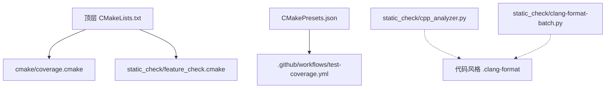
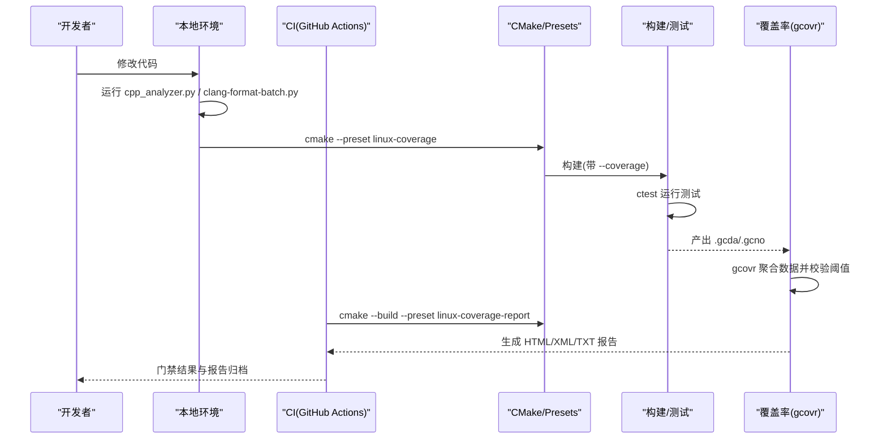
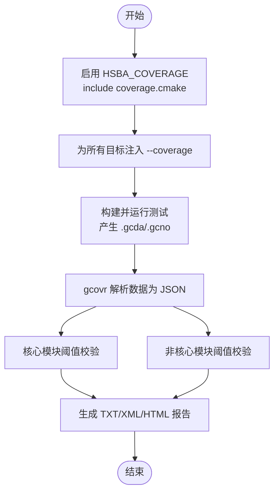
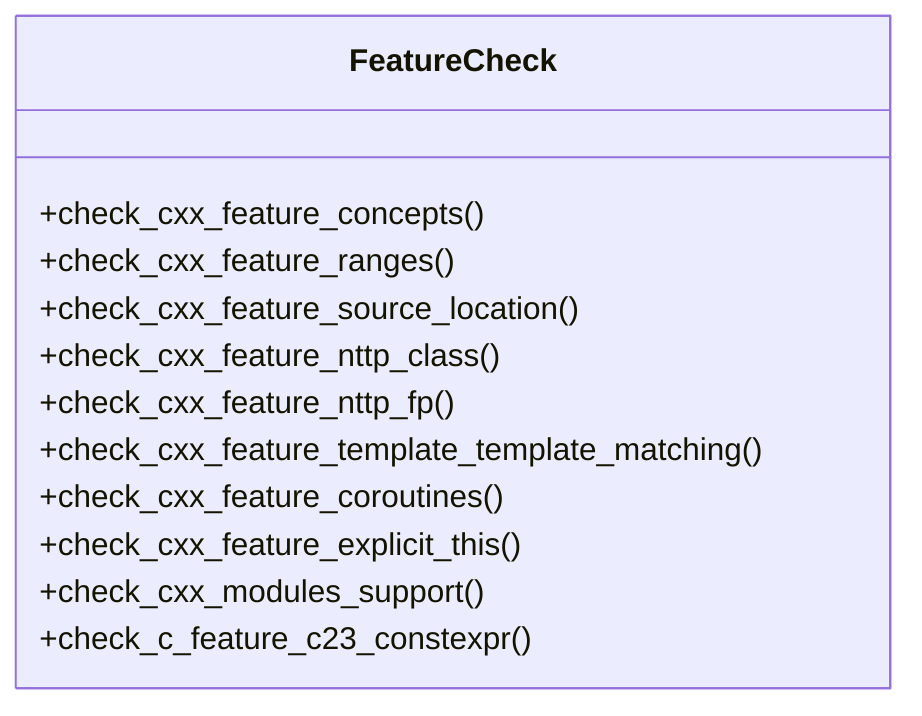
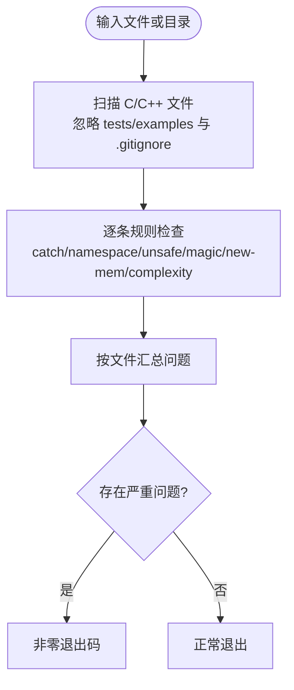
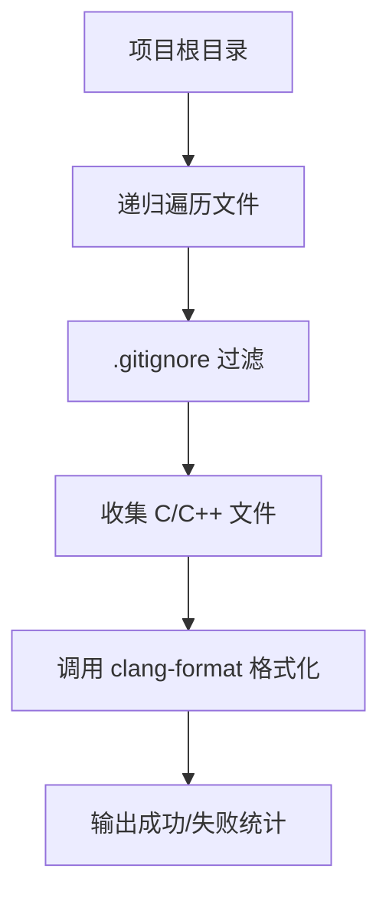
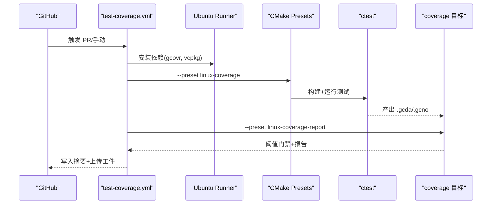
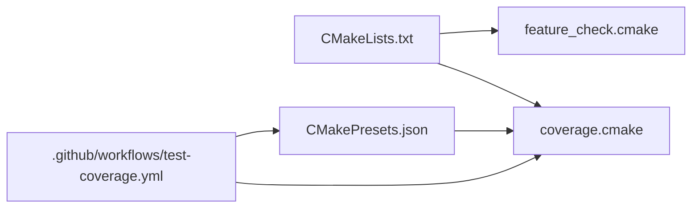

# 代码质量检查

<cite>
**本文引用的文件**
- [CMakeLists.txt](file://CMakeLists.txt)
- [CMakePresets.json](file://CMakePresets.json)
- [.clang-format](file://.clang-format)
- [cmake/coverage.cmake](file://cmake/coverage.cmake)
- [static_check/feature_check.cmake](file://static_check/feature_check.cmake)
- [static_check/cpp_analyzer.py](file://static_check/cpp_analyzer.py)
- [static_check/clang-format-batch.py](file://static_check/clang-format-batch.py)
- [.github/workflows/test-coverage.yml](file://.github/workflows/test-coverage.yml)
</cite>

## 目录
1. [简介](#简介)
2. [项目结构](#项目结构)
3. [核心组件](#核心组件)
4. [架构总览](#架构总览)
5. [详细组件分析](#详细组件分析)
6. [依赖关系分析](#依赖关系分析)
7. [性能与可维护性建议](#性能与可维护性建议)
8. [故障排查指南](#故障排查指南)
9. [结论](#结论)
10. [附录：实践示例与操作清单](#附录实践示例与操作清单)

## 简介
本文件面向 HsBaSlicer 的代码质量保障体系，系统性说明静态分析、覆盖率统计、代码风格检查以及持续集成中的质量门禁。重点覆盖以下方面：
- 静态分析工具集成与规则定制（项目自研脚本 + C++ 特性检测）
- 代码覆盖率收集、报告生成与阈值门禁（gcov/gcovr + CMake 目标）
- 代码风格检查与自动化格式化（clang-format 配置与批量脚本）
- CI 流水线与质量门禁（GitHub Actions + CMake Presets）
- 常见问题定位与修复建议

## 项目结构
HsBaSlicer 的质量相关能力主要分布在以下位置：
- 根级构建入口与选项：顶层 CMakeLists.txt
- 平台预设与覆盖率预设：CMakePresets.json
- 覆盖率实现：cmake/coverage.cmake
- 语言特性探测：static_check/feature_check.cmake
- 静态检查脚本：static_check/cpp_analyzer.py
- 批量格式化脚本：static_check/clang-format-batch.py
- 代码风格配置：.clang-format
- CI 覆盖率门禁：.github/workflows/test-coverage.yml

图示来源
- [CMakeLists.txt:106-112](file://CMakeLists.txt#L106-L112)
- [cmake/coverage.cmake:1-173](file://cmake/coverage.cmake#L1-L173)
- [static_check/feature_check.cmake:1-123](file://static_check/feature_check.cmake#L1-L123)
- [CMakePresets.json:84-111](file://CMakePresets.json#L84-L111)
- [.github/workflows/test-coverage.yml:1-136](file://.github/workflows/test-coverage.yml#L1-L136)
- [static_check/cpp_analyzer.py:1-383](file://static_check/cpp_analyzer.py#L1-L383)
- [static_check/clang-format-batch.py:1-274](file://static_check/clang-format-batch.py#L1-L274)
- [.clang-format:1-99](file://.clang-format#L1-L99)

章节来源
- [CMakeLists.txt:1-112](file://CMakeLists.txt#L1-L112)
- [CMakePresets.json:84-111](file://CMakePresets.json#L84-L111)

## 核心组件
- 覆盖率子系统（gcov + gcovr）
  - 通过 HSBA_COVERAGE 开关启用，为所有目标注入 --coverage 编译/链接选项
  - 定义核心与非核心模块的覆盖率阈值，并输出 HTML/XML/TXT 报告
  - 提供 coverage 自定义目标用于门禁
- 语言特性探测
  - 在构建早期探测 C/C++ 新特性（如 concepts、ranges、source_location、coroutines 等），缺失则失败或降级
- 静态检查脚本
  - 基于 Python 的项目内静态检查：catch(...)、using namespace、不安全函数、魔法数字、内存分配未配对释放、圈复杂度等
- 代码风格与批量格式化
  - clang-format 统一风格配置
  - 批量脚本支持并行格式化、忽略 .gitignore、dry-run 预览
- CI 覆盖率门禁
  - GitHub Actions 使用 linux-coverage 预设构建、运行测试、执行覆盖率门禁，上传报告

章节来源
- [cmake/coverage.cmake:1-173](file://cmake/coverage.cmake#L1-L173)
- [static_check/feature_check.cmake:1-123](file://static_check/feature_check.cmake#L1-L123)
- [static_check/cpp_analyzer.py:1-383](file://static_check/cpp_analyzer.py#L1-L383)
- [static_check/clang-format-batch.py:1-274](file://static_check/clang-format-batch.py#L1-L274)
- [.clang-format:1-99](file://.clang-format#L1-L99)
- [.github/workflows/test-coverage.yml:1-136](file://.github/workflows/test-coverage.yml#L1-L136)

## 架构总览
下图展示从开发者提交到 CI 门禁的端到端流程，包括本地静态检查、覆盖率构建与门禁。

图示来源
- [CMakePresets.json:84-111](file://CMakePresets.json#L84-L111)
- [CMakePresets.json:207-234](file://CMakePresets.json#L207-L234)
- [cmake/coverage.cmake:106-173](file://cmake/coverage.cmake#L106-L173)
- [.github/workflows/test-coverage.yml:88-136](file://.github/workflows/test-coverage.yml#L88-L136)

## 详细组件分析

### 覆盖率子系统（gcov + gcovr）
- 启用方式
  - 顶层 CMakeLists.txt 暴露 HSBA_COVERAGE 选项，开启后包含 cmake/coverage.cmake
  - CMakePresets.json 提供 linux-coverage 预设，自动设置 HSBA_COVERAGE=ON 及相关阈值
- 编译/链接插桩
  - 对所有目标添加 --coverage 编译与链接选项
- 阈值与分组
  - 核心模块阈值：HSBA_COVERAGE_THRESHOLD_CORE（默认 45%）
  - 非核心模块阈值：HSBA_COVERAGE_THRESHOLD_OTHER（默认 25%）
  - 核心目录过滤列表与非核心排除列表分别定义
- 报告与门禁
  - 生成 JSON 中间产物，再分别对核心/其他模块进行阈值校验
  - 输出 core_summary.txt、other_summary.txt、coverage_core.xml、coverage_other.xml 与 HTML 详情
  - 若任一阈值不满足，coverage 目标失败，CI 门禁失败
- 并发与性能
  - 根据 gcovr 版本与 CPU 数量自动选择并行度，可通过 HSBA_COVERAGE_JOBS 控制

图示来源
- [cmake/coverage.cmake:16-31](file://cmake/coverage.cmake#L16-L31)
- [cmake/coverage.cmake:67-91](file://cmake/coverage.cmake#L67-L91)
- [cmake/coverage.cmake:119-173](file://cmake/coverage.cmake#L119-L173)

章节来源
- [CMakeLists.txt:106-112](file://CMakeLists.txt#L106-L112)
- [CMakePresets.json:84-111](file://CMakePresets.json#L84-L111)
- [cmake/coverage.cmake:1-173](file://cmake/coverage.cmake#L1-L173)

### 语言特性探测（feature_check.cmake）
- 目的
  - 在构建早期探测编译器是否支持所需的 C/C++ 特性，必要时给出警告或错误，保证代码可编译性与一致性
- 已探测特性
  - C: _Generic
  - C++: concepts、ranges、source_location、NTTP(class/fp)、template-template matching、coroutines、explicit this、modules 支持判断、C23 constexpr 风格
- 行为
  - 必需特性缺失时直接 FATAL_ERROR 终止配置
  - 可选特性缺失时给出 WARNING 或定义宏以走兼容路径

图示来源
- [static_check/feature_check.cmake:1-123](file://static_check/feature_check.cmake#L1-L123)

章节来源
- [static_check/feature_check.cmake:1-123](file://static_check/feature_check.cmake#L1-L123)
- [CMakeLists.txt:48-104](file://CMakeLists.txt#L48-L104)

### 静态检查脚本（cpp_analyzer.py）
- 功能范围
  - 跳过 tests/examples 与 .gitignore 中内容
  - 命名空间含 Literals 即放行 using namespace
  - 仅在纯代码区检测 new/malloc/calloc/realloc，避免误报字符串/注释/胶水代码
- 检测项
  - catch(...) 禁止
  - using namespace 限制（允许含 Literals 的命名空间）
  - 不安全函数（gets/strcpy/strcat/sprintf/vsprintf）
  - 魔法数字（含常见常量白名单）
  - 潜在内存泄漏（new/delete 或 malloc/free 配对检测）
  - 圈复杂度（可配置阈值）
- 输出
  - 按文件汇总问题，支持输出到文件；遇到严重问题（catch_all_exception、unsafe_function、file_error）返回非零退出码

图示来源
- [static_check/cpp_analyzer.py:17-41](file://static_check/cpp_analyzer.py#L17-L41)
- [static_check/cpp_analyzer.py:43-193](file://static_check/cpp_analyzer.py#L43-L193)
- [static_check/cpp_analyzer.py:196-339](file://static_check/cpp_analyzer.py#L196-L339)
- [static_check/cpp_analyzer.py:342-383](file://static_check/cpp_analyzer.py#L342-L383)

章节来源
- [static_check/cpp_analyzer.py:1-383](file://static_check/cpp_analyzer.py#L1-L383)

### 代码风格与批量格式化（clang-format + clang-format-batch.py）
- 风格配置
  - .clang-format 采用 Allman 大括号风格，列宽 120，指针/引用左对齐，排序 include 等
- 批量脚本
  - 递归扫描 C/C++ 源文件，遵循 .gitignore 规则
  - 支持并行线程数、dry-run 预览、指定 style 覆盖
  - 自动跳过部分生成/特殊文件（如 encoding_convert.cpp、version.cpp）

图示来源
- [.clang-format:1-99](file://.clang-format#L1-L99)
- [static_check/clang-format-batch.py:24-111](file://static_check/clang-format-batch.py#L24-L111)
- [static_check/clang-format-batch.py:114-151](file://static_check/clang-format-batch.py#L114-L151)
- [static_check/clang-format-batch.py:154-181](file://static_check/clang-format-batch.py#L154-L181)
- [static_check/clang-format-batch.py:183-274](file://static_check/clang-format-batch.py#L183-L274)

章节来源
- [.clang-format:1-99](file://.clang-format#L1-L99)
- [static_check/clang-format-batch.py:1-274](file://static_check/clang-format-batch.py#L1-L274)

### CI 覆盖率门禁（GitHub Actions）
- 触发条件
  - pull_request 至 master/dev 分支，或手动触发 workflow_dispatch
- 关键步骤
  - 安装依赖（含 gcovr）
  - 初始化 vcpkg 与缓存
  - 使用 linux-coverage 预设配置与构建
  - 运行 ctest 产生覆盖率数据
  - 执行 coverage 目标进行阈值门禁
  - 将覆盖率摘要写入 Job Summary，并上传 HTML/XML 报告作为工件

图示来源
- [.github/workflows/test-coverage.yml:1-136](file://.github/workflows/test-coverage.yml#L1-L136)
- [CMakePresets.json:84-111](file://CMakePresets.json#L84-L111)
- [CMakePresets.json:207-234](file://CMakePresets.json#L207-L234)

章节来源
- [.github/workflows/test-coverage.yml:1-136](file://.github/workflows/test-coverage.yml#L1-L136)
- [CMakePresets.json:84-111](file://CMakePresets.json#L84-L111)

## 依赖关系分析
- 顶层 CMakeLists.txt
  - 引入 feature_check.cmake 并在配置期执行特性探测
  - 暴露 HSBA_COVERAGE 选项，按需包含 coverage.cmake
- CMakePresets.json
  - 定义 linux-coverage 预设，设置 HSBA_COVERAGE=ON 及阈值
  - 定义 build/test presets 以驱动 coverage 目标
- CI 工作流
  - 依赖 linux-coverage 预设与 coverage 目标
  - 依赖 gcovr 二进制

图示来源
- [CMakeLists.txt:48-112](file://CMakeLists.txt#L48-L112)
- [CMakePresets.json:84-111](file://CMakePresets.json#L84-L111)
- [.github/workflows/test-coverage.yml:88-136](file://.github/workflows/test-coverage.yml#L88-L136)

章节来源
- [CMakeLists.txt:48-112](file://CMakeLists.txt#L48-L112)
- [CMakePresets.json:84-111](file://CMakePresets.json#L84-L111)
- [.github/workflows/test-coverage.yml:88-136](file://.github/workflows/test-coverage.yml#L88-L136)

## 性能与可维护性建议
- 覆盖率门禁
  - 在内存受限的 CI 环境中，适当降低 HSBA_COVERAGE_JOBS 以避免 gcovr 并行解析导致 OOM
  - 逐步提升阈值需配合新增用例，避免“为了达标而放宽”
- 静态检查
  - 将 cpp_analyzer.py 纳入预提交钩子，减少问题流入主分支
  - 对高复杂度函数优先拆分，而非单纯提高阈值
- 代码风格
  - 在 IDE 中启用 clang-format on-save，保持风格一致
  - 批量脚本定期运行，确保历史代码逐步收敛

[本节为通用建议，不直接分析具体文件]

## 故障排查指南
- 覆盖率目标失败
  - 确认已安装 gcovr 且版本可用
  - 检查是否使用 linux-coverage 预设构建与运行测试
  - 查看 coverage/core_summary.txt 与 coverage/other_summary.txt 的具体失败阈值
- 特性探测失败
  - 检查编译器版本是否满足 requirements（C++20、GCC/Clang 对应版本）
  - 查看 CMake 配置日志中的 FATAL_ERROR 信息
- 静态检查报错
  - 针对 catch(...)、using namespace、不安全函数、魔法数字、内存泄漏、高复杂度逐一修复
  - 若确属例外，可在脚本逻辑允许的范围内调整规则（例如命名空间含 Literals 放行）
- 批量格式化失败
  - 确认 clang-format 已安装且在 PATH 中
  - 使用 --dry-run 预览将要格式化的文件，逐步缩小范围定位问题

章节来源
- [cmake/coverage.cmake:67-71](file://cmake/coverage.cmake#L67-L71)
- [cmake/coverage.cmake:158-173](file://cmake/coverage.cmake#L158-L173)
- [static_check/cpp_analyzer.py:342-383](file://static_check/cpp_analyzer.py#L342-L383)
- [static_check/clang-format-batch.py:210-218](file://static_check/clang-format-batch.py#L210-L218)

## 结论
HsBaSlicer 的质量保障体系以 CMake 为核心编排，结合 gcov/gcovr 覆盖率门禁、Python 静态检查脚本与 clang-format 风格规范，并通过 GitHub Actions 在 PR 阶段强制执行。该体系具备：
- 明确的阈值与分组策略，防止覆盖率退化
- 严格的语言特性探测，保证跨编译器兼容性
- 可扩展的规则与脚本，便于团队演进
- 完善的 CI 门禁与报告归档，提升协作效率

[本节为总结性内容，不直接分析具体文件]

## 附录：实践示例与操作清单
- 本地运行静态检查
  - 对单个文件或目录执行 cpp_analyzer.py，必要时指定复杂度阈值与输出文件
- 批量格式化
  - 在项目根目录运行 clang-format-batch.py，支持 --dry-run 预览与并行线程数
- 覆盖率门禁
  - 使用 CMakePresets.json 中的 linux-coverage 预设构建与运行测试
  - 执行 linux-coverage-report 预设对应的 coverage 目标，查看阈值是否达标
- CI 门禁
  - 提交 PR 后观察 test-coverage.yml 任务，查看 Job Summary 与附件报告

[本节为操作指引，不直接分析具体文件]