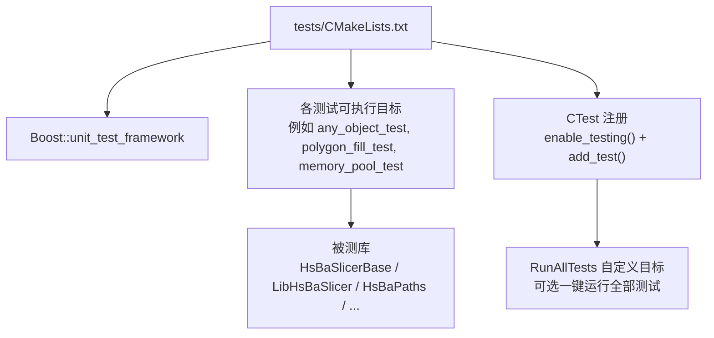
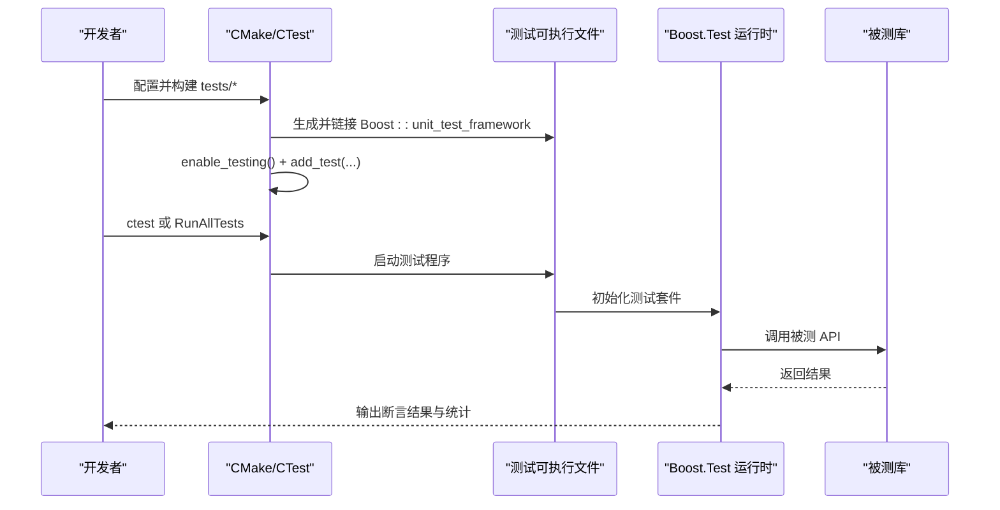
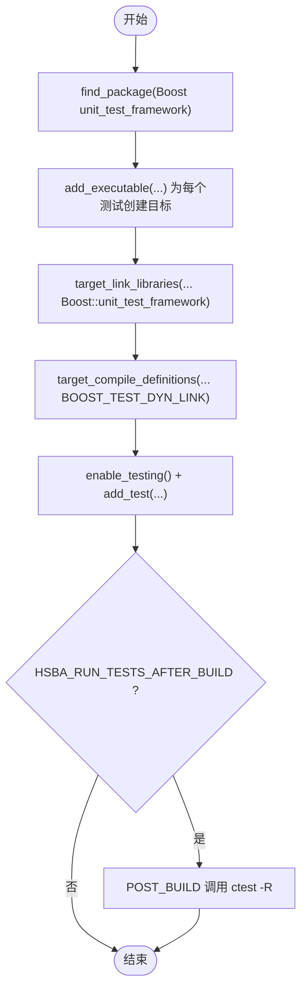
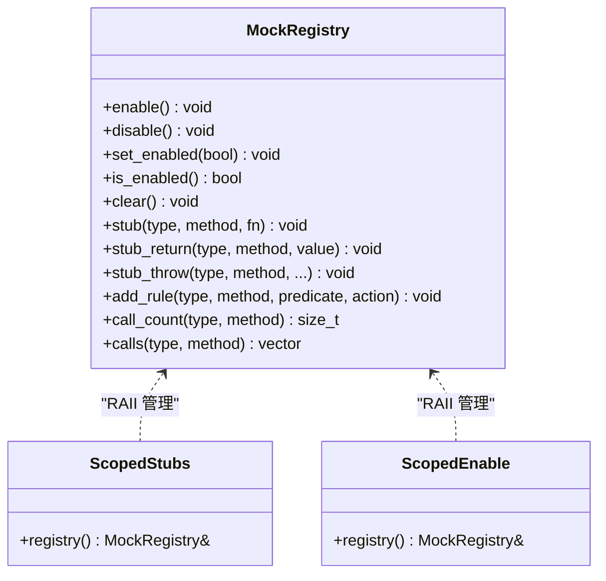
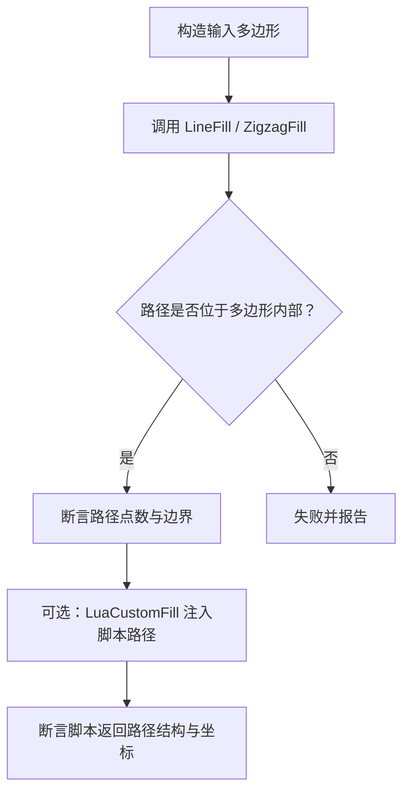
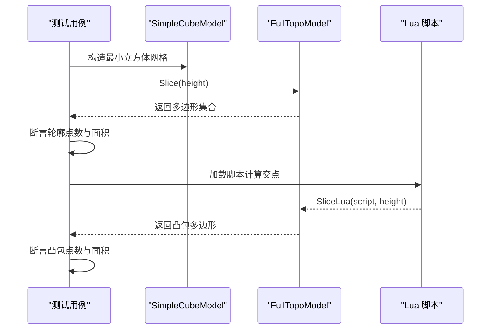
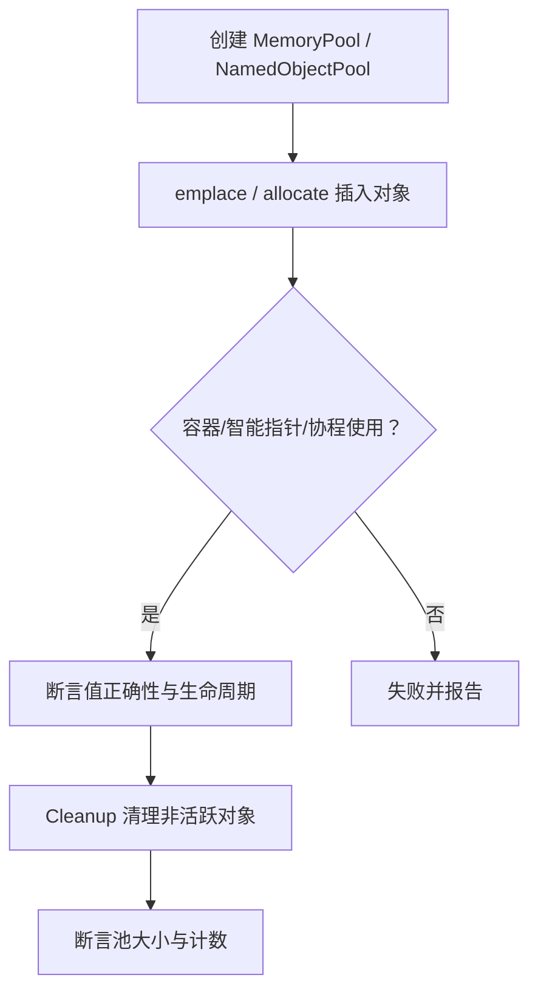
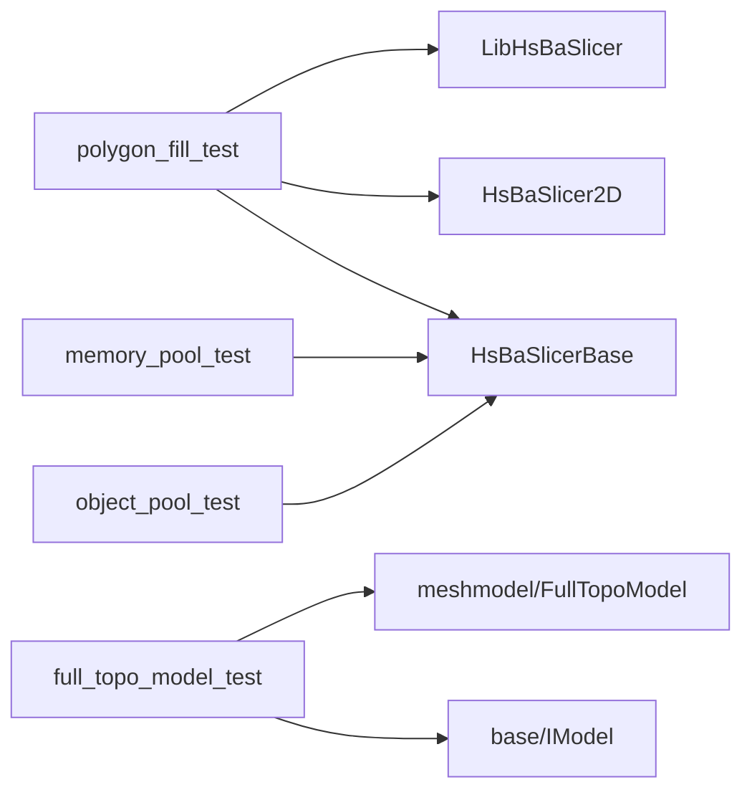

# 单元测试

<cite>
**本文引用的文件**   
- [tests/CMakeLists.txt](file://tests/CMakeLists.txt)
- [tests/PolygonFill/polygon_fill_test.cpp](file://tests/PolygonFill/polygon_fill_test.cpp)
- [tests/Pool/memory_pool_test.cpp](file://tests/Pool/memory_pool_test.cpp)
- [tests/Pool/object_pool_test.cpp](file://tests/Pool/object_pool_test.cpp)
- [tests/Models/full_topo_model_test.cpp](file://tests/Models/full_topo_model_test.cpp)
- [tests/PolygonFill/float_polygons_test.cpp](file://tests/PolygonFill/float_polygons_test.cpp)
- [base/any_object.hpp](file://base/any_object.hpp)
- [docs/zh/base/any_object.md](file://docs/zh/base/any_object.md)
</cite>

## 目录
1. [引言](#引言)
2. [项目结构](#项目结构)
3. [核心组件](#核心组件)
4. [架构总览](#架构总览)
5. [详细组件分析](#详细组件分析)
6. [依赖关系分析](#依赖关系分析)
7. [性能与可维护性](#性能与可维护性)
8. [故障排查指南](#故障排查指南)
9. [结论](#结论)

## 引言
本文件面向 HsBaSlicer 的单元测试体系，系统性说明测试框架选择、CMake 集成方式、测试用例组织与命名约定；详解断言库使用模式（基本断言、异常断言、自定义断言）；介绍 Mock 对象创建与外部依赖模拟策略，以及接口隔离和测试数据准备方法；并通过多边形填充、模型处理、内存池等模块的具体测试示例，给出可复用的最佳实践与性能优化建议。

## 项目结构
HsBaSlicer 的测试代码集中在 `tests` 目录，按功能域划分子目录，每个子目录对应一个或多个被测模块。顶层 `tests/CMakeLists.txt` 负责：
- 发现并链接 Boost.Test 框架
- 为每个测试目标定义可执行文件、链接库、编译宏
- 通过 CTest 注册测试用例，支持构建后自动运行

**图表来源**
- [tests/CMakeLists.txt:1-10](file://tests/CMakeLists.txt#L1-L10)
- [tests/CMakeLists.txt:29-39](file://tests/CMakeLists.txt#L29-L39)
- [tests/CMakeLists.txt:355-411](file://tests/CMakeLists.txt#L355-L411)

**章节来源**
- [tests/CMakeLists.txt:1-10](file://tests/CMakeLists.txt#L1-L10)
- [tests/CMakeLists.txt:29-39](file://tests/CMakeLists.txt#L29-L39)
- [tests/CMakeLists.txt:355-411](file://tests/CMakeLists.txt#L355-L411)

## 核心组件
- 测试框架：Boost.Test（头文件内嵌 runner，避免链接问题）
- 构建系统：CMake + CTest
- 断言库：Boost.Test 提供的 `BOOST_*` 系列宏
- Mock 机制：AnyObject 内置 MockRegistry（受宏控制，默认关闭）

关键要点：
- 测试源文件统一以 `BOOST_AUTO_TEST_SUITE` 分组，`BOOST_AUTO_TEST_CASE` 定义用例
- 每个测试目标链接 `Boost::unit_test_framework`，并定义 `BOOST_TEST_DYN_LINK`
- 通过 `enable_testing()` 与 `add_test(NAME ... COMMAND ...)` 将测试加入 CTest
- 可选启用 `HSBA_RUN_TESTS_AFTER_BUILD`，在构建后自动运行单个或全部测试

**章节来源**
- [tests/CMakeLists.txt:1-13](file://tests/CMakeLists.txt#L1-L13)
- [tests/CMakeLists.txt:15-39](file://tests/CMakeLists.txt#L15-L39)
- [tests/CMakeLists.txt:29-39](file://tests/CMakeLists.txt#L29-L39)
- [tests/CMakeLists.txt:355-411](file://tests/CMakeLists.txt#L355-L411)

## 架构总览
下图展示从 CMake 到测试执行的端到端流程，包括 Boost.Test 入口、测试目标、被测库与 CTest 的关系。

**图表来源**
- [tests/CMakeLists.txt:29-39](file://tests/CMakeLists.txt#L29-L39)
- [tests/CMakeLists.txt:355-411](file://tests/CMakeLists.txt#L355-L411)

## 详细组件分析

### 测试框架与 CMake 集成
- 框架选择：Boost.Test，采用头文件内嵌 runner（`boost/test/included/unit_test.hpp`），避免动态链接问题
- 测试目标：每个测试目录生成独立可执行目标，便于并行运行与定位失败
- CTest 集成：通过 `enable_testing()` 与 `add_test(NAME ... COMMAND $<TARGET_FILE:...>)` 注册
- 构建后运行：可选 `HSBA_RUN_TESTS_AFTER_BUILD`，在每个测试目标上添加 POST_BUILD 命令调用 `ctest -R <name>`
- 全量运行：提供 `RunAllTests` 自定义目标，依赖所有测试目标并执行 `ctest -V`

**图表来源**
- [tests/CMakeLists.txt:1-13](file://tests/CMakeLists.txt#L1-L13)
- [tests/CMakeLists.txt:15-39](file://tests/CMakeLists.txt#L15-L39)
- [tests/CMakeLists.txt:355-411](file://tests/CMakeLists.txt#L355-L411)

**章节来源**
- [tests/CMakeLists.txt:1-13](file://tests/CMakeLists.txt#L1-L13)
- [tests/CMakeLists.txt:15-39](file://tests/CMakeLists.txt#L15-L39)
- [tests/CMakeLists.txt:355-411](file://tests/CMakeLists.txt#L355-L411)

### 断言库使用方法
项目中广泛使用 Boost.Test 断言宏，常见模式如下：
- 基本断言
  - `BOOST_CHECK_EQUAL(a, b)`：相等性检查
  - `BOOST_CHECK_CLOSE(a, b, tol)`：浮点近似相等
  - `BOOST_REQUIRE(condition)`：强断言，失败即终止当前用例
  - `BOOST_CHECK(condition)`：弱断言，继续执行后续断言
- 异常断言
  - `BOOST_CHECK_THROW(expr, ExceptionType)`：验证抛出指定异常类型
- 消息化断言
  - `BOOST_REQUIRE_MESSAGE(cond, msg)` / `BOOST_CHECK_MESSAGE(cond, msg)`：带消息的断言

典型用法参考：
- 数值范围与几何属性断言：[polygon_fill_test.cpp:42-83](file://tests/PolygonFill/polygon_fill_test.cpp#L42-L83)
- 浮点面积与边界校验：[float_polygons_test.cpp:75-124](file://tests/PolygonFill/float_polygons_test.cpp#L75-L124)
- 异常路径验证：[polygon_fill_test.cpp:254-258](file://tests/PolygonFill/polygon_fill_test.cpp#L254-L258)

**章节来源**
- [tests/PolygonFill/polygon_fill_test.cpp:42-83](file://tests/PolygonFill/polygon_fill_test.cpp#L42-L83)
- [tests/PolygonFill/float_polygons_test.cpp:75-124](file://tests/PolygonFill/float_polygons_test.cpp#L75-L124)
- [tests/PolygonFill/polygon_fill_test.cpp:254-258](file://tests/PolygonFill/polygon_fill_test.cpp#L254-L258)

### Mock 对象与外部依赖模拟
项目提供了基于 `AnyObject` 的轻量级 Mock 机制，适用于对动态调度或脚本绑定的方法进行隔离测试。关键点：
- 编译期开关：当检测到常见测试框架宏或显式定义 `HSBA_ANY_OBJECT_ENABLE_MOCK` 时启用
- 运行期开关：默认关闭，需通过 `Mock::EnableMock()` / `MockRegistry::instance().enable()` 开启
- RAII 管理：推荐使用 `MockRegistry::ScopedStubs` 或 `ScopedEnable`，保证用例间状态隔离
- 桩与规则：
  - `stub<T>(method_name, fn)`：自定义桩函数
  - `stub_return<T>(method_name, value)`：固定返回值
  - `stub_throw<T>(...)` / `ThrowOf<E, Args...>`：抛异常桩
  - `add_rule<T>(method_name, predicate, action)`：条件规则
- 调用记录：`call_count<T>(method_name)` 与 `calls<T>(method_name)` 用于验证交互

**图表来源**
- [base/any_object.hpp:262-304](file://base/any_object.hpp#L262-L304)
- [docs/zh/base/any_object.md:531-574](file://docs/zh/base/any_object.md#L531-L574)

**章节来源**
- [base/any_object.hpp:262-304](file://base/any_object.hpp#L262-L304)
- [docs/zh/base/any_object.md:531-574](file://docs/zh/base/any_object.md#L531-L574)

### 测试用例组织与命名约定
- 目录组织：按功能域划分，如 `PolygonFill`、`Pool`、`Models`、`FilesOperator`、`Support` 等
- 文件命名：测试文件以 `_test.cpp` 结尾，如 `polygon_fill_test.cpp`、`memory_pool_test.cpp`
- 测试分组：使用 `BOOST_AUTO_TEST_SUITE(name)` 包裹一组相关用例
- 用例命名：使用 `BOOST_AUTO_TEST_CASE(name)`，名称描述具体行为或场景

示例：
- 多边形填充测试组：[polygon_fill_test.cpp:26-84](file://tests/PolygonFill/polygon_fill_test.cpp#L26-L84)
- 内存池测试组：[memory_pool_test.cpp:28-98](file://tests/Pool/memory_pool_test.cpp#L28-L98)
- 对象池测试组：[object_pool_test.cpp:7-160](file://tests/Pool/object_pool_test.cpp#L7-L160)

**章节来源**
- [tests/PolygonFill/polygon_fill_test.cpp:26-84](file://tests/PolygonFill/polygon_fill_test.cpp#L26-L84)
- [tests/Pool/memory_pool_test.cpp:28-98](file://tests/Pool/memory_pool_test.cpp#L28-L98)
- [tests/Pool/object_pool_test.cpp:7-160](file://tests/Pool/object_pool_test.cpp#L7-L160)

### 核心功能测试示例

#### 多边形填充（PolygonFill）
- 基础填充：Line/Zigzag 填充路径数量与顶点位置约束
- 自交多边形归一化：拆分为简单多边形并校验面积
- Lua 自定义填充：通过脚本注入路径，断言返回路径结构与坐标
- 偏移填充与边界情况：非正间距短路为空集
- 路径优化器：区域聚簇、路径反转、手动代价覆盖、Lua 嵌入优化

**图表来源**
- [tests/PolygonFill/polygon_fill_test.cpp:26-84](file://tests/PolygonFill/polygon_fill_test.cpp#L26-L84)
- [tests/PolygonFill/polygon_fill_test.cpp:108-175](file://tests/PolygonFill/polygon_fill_test.cpp#L108-L175)
- [tests/PolygonFill/polygon_fill_test.cpp:177-200](file://tests/PolygonFill/polygon_fill_test.cpp#L177-L200)

**章节来源**
- [tests/PolygonFill/polygon_fill_test.cpp:26-84](file://tests/PolygonFill/polygon_fill_test.cpp#L26-L84)
- [tests/PolygonFill/polygon_fill_test.cpp:108-175](file://tests/PolygonFill/polygon_fill_test.cpp#L108-L175)
- [tests/PolygonFill/polygon_fill_test.cpp:177-200](file://tests/PolygonFill/polygon_fill_test.cpp#L177-L200)

#### 模型处理（FullTopoModel）
- 立方体切片：z=0 截面为正方形，断言轮廓点数与面积
- Lua 切片：通过脚本计算边交点并生成凸包，断言结果
- 重复顶点闭合：四棱锥在特定高度截面的面积与点数

**图表来源**
- [tests/Models/full_topo_model_test.cpp:15-53](file://tests/Models/full_topo_model_test.cpp#L15-L53)
- [tests/Models/full_topo_model_test.cpp:55-75](file://tests/Models/full_topo_model_test.cpp#L55-L75)
- [tests/Models/full_topo_model_test.cpp:77-142](file://tests/Models/full_topo_model_test.cpp#L77-L142)

**章节来源**
- [tests/Models/full_topo_model_test.cpp:15-53](file://tests/Models/full_topo_model_test.cpp#L15-L53)
- [tests/Models/full_topo_model_test.cpp:55-75](file://tests/Models/full_topo_model_test.cpp#L55-L75)
- [tests/Models/full_topo_model_test.cpp:77-142](file://tests/Models/full_topo_model_test.cpp#L77-L142)

#### 内存池与对象池（MemoryPool / ObjectPool）
- 内存池：与标准容器、智能指针、协程配合，验证分配与生命周期
- 对象池：命名对象池的增删查、容量限制、清理回收、混合分配策略

**图表来源**
- [tests/Pool/memory_pool_test.cpp:28-98](file://tests/Pool/memory_pool_test.cpp#L28-L98)
- [tests/Pool/object_pool_test.cpp:7-160](file://tests/Pool/object_pool_test.cpp#L7-L160)

**章节来源**
- [tests/Pool/memory_pool_test.cpp:28-98](file://tests/Pool/memory_pool_test.cpp#L28-L98)
- [tests/Pool/object_pool_test.cpp:7-160](file://tests/Pool/object_pool_test.cpp#L7-L160)

### 测试数据准备策略
- 几何数据：直接构造多边形顶点序列，或使用工厂函数（如 `MakeRectangle`、`MakeCircle`）
- 脚本数据：内联 Lua 字符串或通过临时文件写入脚本路径
- 字体资源：探测系统可用字体路径，若无则跳过相关断言
- 随机/边界输入：构造自交多边形、凹形 U 型、堆叠岛屿等复杂拓扑以驱动分支

**章节来源**
- [tests/PolygonFill/float_polygons_test.cpp:75-124](file://tests/PolygonFill/float_polygons_test.cpp#L75-L124)
- [tests/PolygonFill/polygon_fill_test.cpp:108-175](file://tests/PolygonFill/polygon_fill_test.cpp#L108-L175)
- [tests/PolygonFill/polygon_fill_test.cpp:542-571](file://tests/PolygonFill/polygon_fill_test.cpp#L542-L571)

## 依赖关系分析
- 测试目标与被测库的耦合：
  - `polygon_fill_test` 依赖 `HsBaSlicer2D`、`LibHsBaSlicer`、`HsBaSlicerBase`
  - `full_topo_model_test` 依赖 `meshmodel/FullTopoModel`、`base/IModel`
  - `memory_pool_test` 与 `object_pool_test` 依赖 `base/memory_pool.hpp`、`base/object_pool.hpp`
- 外部依赖：
  - Boost.Test 作为测试框架
  - Lua 绑定（部分测试通过 Lua 脚本驱动）
  - FreeType/Eigen 等第三方库（视具体测试而定）

**图表来源**
- [tests/CMakeLists.txt:15-39](file://tests/CMakeLists.txt#L15-L39)
- [tests/CMakeLists.txt:107-129](file://tests/CMakeLists.txt#L107-L129)
- [tests/CMakeLists.txt:157-180](file://tests/CMakeLists.txt#L157-L180)

**章节来源**
- [tests/CMakeLists.txt:15-39](file://tests/CMakeLists.txt#L15-L39)
- [tests/CMakeLists.txt:107-129](file://tests/CMakeLists.txt#L107-L129)
- [tests/CMakeLists.txt:157-180](file://tests/CMakeLists.txt#L157-L180)

## 性能与可维护性
- 性能优化技巧
  - 使用静态内存池减少频繁分配开销，并在协程中复用分配器
  - 对大型模板实例化（如 Boost.Graph）在 MSVC 下启用 `/bigobj`
  - Debug 配置下跳过耗时操作（如 CGAL 布尔运算）
- 可维护性考虑
  - 测试用例命名清晰，聚焦单一职责
  - 使用 RAII 管理 Mock 状态，避免跨用例污染
  - 通过 CTest 分组与正则过滤快速定位失败用例
- 最佳实践
  - 优先使用确定性输入与精确断言（面积、点数、边界）
  - 对异常路径进行显式断言（`BOOST_CHECK_THROW`）
  - 对 Lua 脚本路径进行健壮性检查（存在性、可读性）

**章节来源**
- [tests/CMakeLists.txt:182-211](file://tests/CMakeLists.txt#L182-L211)
- [tests/CMakeLists.txt:1039-1046](file://tests/CMakeLists.txt#L1039-L1046)
- [tests/Pool/memory_pool_test.cpp:76-98](file://tests/Pool/memory_pool_test.cpp#L76-L98)

## 故障排查指南
- 常见问题
  - 测试未注册：确认 `enable_testing()` 与 `add_test()` 已调用
  - 动态链接失败：确保定义 `BOOST_TEST_DYN_LINK`
  - 构建后未运行：检查 `HSBA_RUN_TESTS_AFTER_BUILD` 选项
  - Lua 脚本错误：确认脚本路径与函数名正确，捕获 `RuntimeError`
- 调试建议
  - 使用 `BOOST_TEST_MESSAGE` 输出上下文信息
  - 针对浮点比较使用 `BOOST_CHECK_CLOSE`
  - 对异常路径使用 `BOOST_CHECK_THROW` 明确期望异常类型

**章节来源**
- [tests/CMakeLists.txt:29-39](file://tests/CMakeLists.txt#L29-L39)
- [tests/CMakeLists.txt:355-411](file://tests/CMakeLists.txt#L355-L411)
- [tests/PolygonFill/polygon_fill_test.cpp:254-258](file://tests/PolygonFill/polygon_fill_test.cpp#L254-L258)

## 结论
HsBaSlicer 的单元测试体系以 Boost.Test 为核心，结合 CMake/CTest 实现模块化、可扩展的测试架构。通过清晰的目录组织、命名约定与丰富的断言宏，测试覆盖了多边形填充、模型切片、内存池等关键模块。AnyObject 内置的 Mock 机制为外部依赖隔离提供了灵活方案。遵循本文的最佳实践与性能优化建议，可进一步提升测试的可维护性与稳定性。