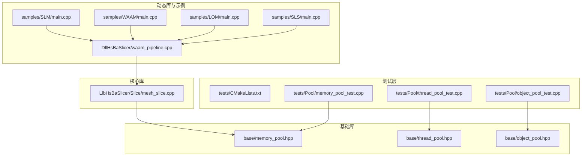
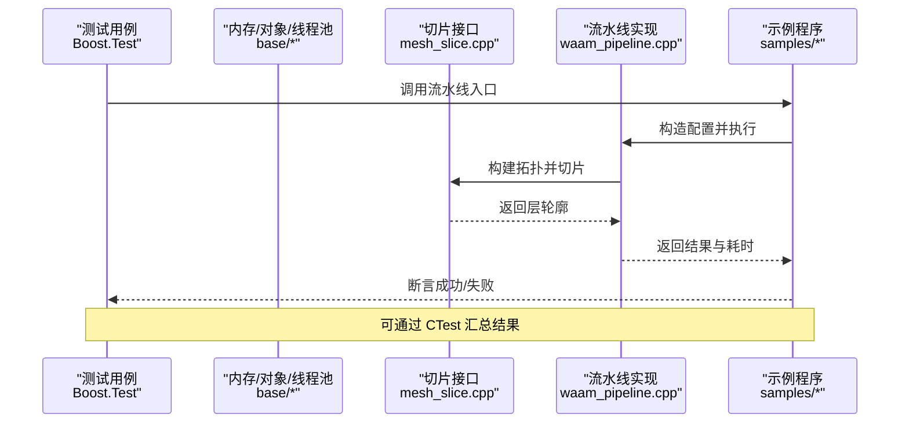
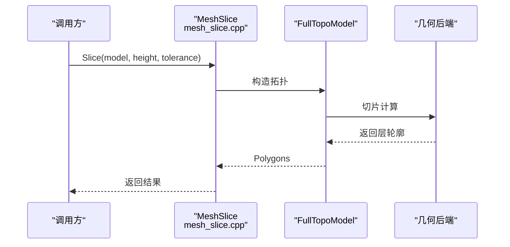
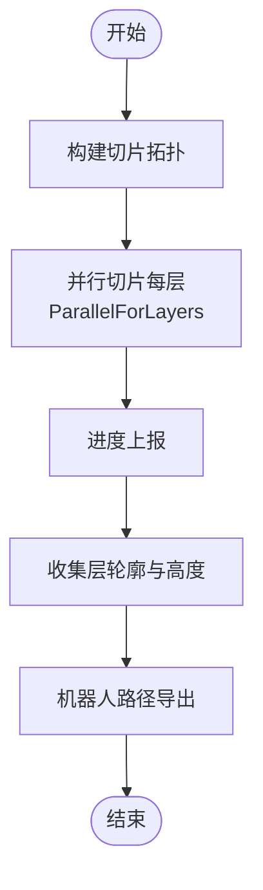
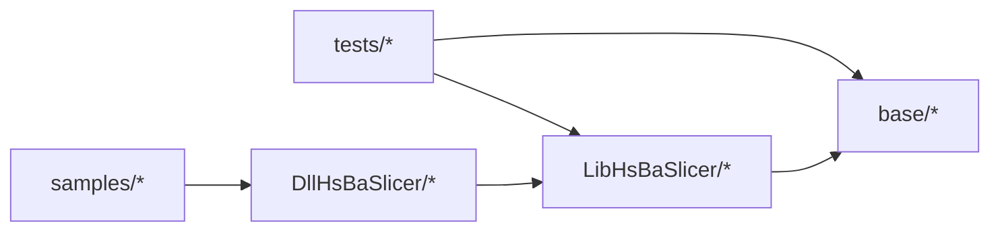

# 性能测试

<cite>
**本文引用的文件**   
- [tests/CMakeLists.txt](file://tests/CMakeLists.txt)
- [tests/Pool/memory_pool_test.cpp](file://tests/Pool/memory_pool_test.cpp)
- [tests/Pool/thread_pool_test.cpp](file://tests/Pool/thread_pool_test.cpp)
- [tests/Pool/object_pool_test.cpp](file://tests/Pool/object_pool_test.cpp)
- [base/memory_pool.hpp](file://base/memory_pool.hpp)
- [base/thread_pool.hpp](file://base/thread_pool.hpp)
- [base/object_pool.hpp](file://base/object_pool.hpp)
- [LibHsBaSlicer/Slice/mesh_slice.cpp](file://LibHsBaSlicer/Slice/mesh_slice.cpp)
- [DllHsBaSlicer/waam_pipeline.cpp](file://DllHsBaSlicer/waam_pipeline.cpp)
- [samples/SLM/main.cpp](file://samples/SLM/main.cpp)
- [samples/WAAM/main.cpp](file://samples/WAAM/main.cpp)
- [samples/LOM/main.cpp](file://samples/LOM/main.cpp)
- [samples/SLS/main.cpp](file://samples/SLS/main.cpp)
</cite>

## 目录
1. [引言](#引言)
2. [项目结构](#项目结构)
3. [核心组件](#核心组件)
4. [架构总览](#架构总览)
5. [详细组件分析](#详细组件分析)
6. [依赖关系分析](#依赖关系分析)
7. [性能考量](#性能考量)
8. [故障排查指南](#故障排查指南)
9. [结论](#结论)
10. [附录](#附录)

## 引言
本文件面向 HsBaSlicer 的性能测试与基准评测，目标是：
- 说明如何基于现有测试框架配置和使用基准测试；
- 明确性能指标收集、用例设计与结果分析方法；
- 解释性能回归测试的实现思路，包括关键算法监控、阈值设置与自动告警；
- 提供内存使用测试方法，涵盖内存泄漏检测、内存池性能评估与资源管理验证；
- 给出多线程性能测试策略，包括并发安全、线程池效率与锁竞争优化；
- 提供具体示例，覆盖切片算法性能优化、大数据集处理与实时渲染性能的测试方法。

本项目采用 CMake + Boost.Test 的测试体系，并通过 CTest 统一执行。核心切片能力封装在 LibHsBaSlicer，运行时流水线通过 DllHsBaSlicer 暴露 C ABI，配合 samples 中的多工艺示例（SLM/WAAM/LOM/SLS）可构建端到端性能场景。

## 项目结构
与性能测试直接相关的目录与文件：
- tests：所有单元测试与基准入口，按功能模块组织；
- base：基础库，包含内存池、对象池、线程池等高性能原语；
- LibHsBaSlicer：核心切片接口，如 mesh_slice；
- DllHsBaSlicer：流水线实现，包含并行切片路径；
- samples：各工艺示例，展示完整流水线调用与耗时统计。

图表来源
- [tests/CMakeLists.txt:1-150](file://tests/CMakeLists.txt#L1-L150)
- [tests/Pool/memory_pool_test.cpp:1-100](file://tests/Pool/memory_pool_test.cpp#L1-L100)
- [tests/Pool/thread_pool_test.cpp:1-87](file://tests/Pool/thread_pool_test.cpp#L1-L87)
- [tests/Pool/object_pool_test.cpp:1-162](file://tests/Pool/object_pool_test.cpp#L1-L162)
- [base/memory_pool.hpp](file://base/memory_pool.hpp)
- [base/thread_pool.hpp](file://base/thread_pool.hpp)
- [base/object_pool.hpp](file://base/object_pool.hpp)
- [LibHsBaSlicer/Slice/mesh_slice.cpp:39-80](file://LibHsBaSlicer/Slice/mesh_slice.cpp#L39-L80)
- [DllHsBaSlicer/waam_pipeline.cpp:197-227](file://DllHsBaSlicer/waam_pipeline.cpp#L197-L227)
- [samples/SLM/main.cpp:117-158](file://samples/SLM/main.cpp#L117-L158)
- [samples/WAAM/main.cpp:115-150](file://samples/WAAM/main.cpp#L115-L150)
- [samples/LOM/main.cpp:121-161](file://samples/LOM/main.cpp#L121-L161)
- [samples/SLS/main.cpp:81-118](file://samples/SLS/main.cpp#L81-L118)

章节来源
- [tests/CMakeLists.txt:1-150](file://tests/CMakeLists.txt#L1-L150)

## 核心组件
- 测试框架与执行器
  - 使用 Boost.Test 编写用例，CMake 中为每个测试目标链接 Boost::unit_test_framework，并通过 enable_testing() 与 add_test() 注册到 CTest。
  - 支持构建后自动运行单个测试或全部测试（HSBA_RUN_TESTS_AFTER_BUILD）。
- 内存池与对象池
  - MemoryPool/StaticMemoryPool 提供 STL 兼容分配器，支持容器、智能指针与协程自定义分配器。
  - NamedObjectPool 提供命名对象池，支持 RAII 生命周期管理与容量限制检查。
- 线程池与协程
  - ThreadPool 提供 submit 与 WaitAll 接口，支持异步任务与协程集成（可选 HSBA_ENABLE_THREAD_POOL_COROUTINE）。
- 切片与流水线
  - LibHsBaSlicer 暴露 Slice/UnSafeSlice/SliceLua 等接口，内部通过 FullTopoModel 进行切片。
  - DllHsBaSlicer 的 WAAM 流水线演示了并行切片（ParallelForLayers）与进度上报。
- 示例程序
  - SLM/WAAM/LOM/SLS 示例展示了完整流水线调用、耗时统计与错误处理。

章节来源
- [tests/CMakeLists.txt:1-150](file://tests/CMakeLists.txt#L1-L150)
- [tests/Pool/memory_pool_test.cpp:1-100](file://tests/Pool/memory_pool_test.cpp#L1-L100)
- [tests/Pool/thread_pool_test.cpp:1-87](file://tests/Pool/thread_pool_test.cpp#L1-L87)
- [tests/Pool/object_pool_test.cpp:1-162](file://tests/Pool/object_pool_test.cpp#L1-L162)
- [LibHsBaSlicer/Slice/mesh_slice.cpp:39-80](file://LibHsBaSlicer/Slice/mesh_slice.cpp#L39-L80)
- [DllHsBaSlicer/waam_pipeline.cpp:197-227](file://DllHsBaSlicer/waam_pipeline.cpp#L197-L227)
- [samples/SLM/main.cpp:117-158](file://samples/SLM/main.cpp#L117-L158)
- [samples/WAAM/main.cpp:115-150](file://samples/WAAM/main.cpp#L115-L150)
- [samples/LOM/main.cpp:121-161](file://samples/LOM/main.cpp#L121-L161)
- [samples/SLS/main.cpp:81-118](file://samples/SLS/main.cpp#L81-L118)

## 架构总览
下图展示从测试入口到核心切片与流水线的调用链，以及示例程序的集成方式。

图表来源
- [tests/CMakeLists.txt:1-150](file://tests/CMakeLists.txt#L1-L150)
- [LibHsBaSlicer/Slice/mesh_slice.cpp:39-80](file://LibHsBaSlicer/Slice/mesh_slice.cpp#L39-L80)
- [DllHsBaSlicer/waam_pipeline.cpp:197-227](file://DllHsBaSlicer/waam_pipeline.cpp#L197-L227)
- [samples/SLM/main.cpp:117-158](file://samples/SLM/main.cpp#L117-L158)
- [samples/WAAM/main.cpp:115-150](file://samples/WAAM/main.cpp#L115-L150)
- [samples/LOM/main.cpp:121-161](file://samples/LOM/main.cpp#L121-L161)
- [samples/SLS/main.cpp:81-118](file://samples/SLS/main.cpp#L81-L118)

## 详细组件分析

### 基准测试框架配置与使用
- 测试目标定义
  - 每个测试目标通过 add_executable 创建，并链接 Boost::unit_test_framework。
  - 通过 target_compile_definitions 启用 BOOST_TEST_DYN_LINK。
- 测试注册与执行
  - 使用 enable_testing() 与 add_test(NAME ... COMMAND ...) 将测试加入 CTest。
  - 支持构建后自动运行（HSBA_RUN_TESTS_AFTER_BUILD），并提供 RunAllTests 自定义目标。
- 推荐实践
  - 对性能相关用例，建议单独建立测试目标，便于选择性运行与计时。
  - 结合 CTest 输出与外部工具（如 perf、valgrind、AddressSanitizer）进行深度分析。

章节来源
- [tests/CMakeLists.txt:1-150](file://tests/CMakeLists.txt#L1-L150)

### 性能指标收集
- 时间指标
  - 在示例程序中，流水线结果包含 elapsed_seconds，可用于端到端耗时统计。
  - 建议在测试中记录关键阶段耗时（模型加载、切片、导出）。
- 吞吐与规模
  - 通过改变模型大小、层数、扫描参数等维度，测量不同规模下的耗时与内存占用。
- 稳定性与方差
  - 多次重复运行，计算均值与标准差，识别抖动与异常值。

章节来源
- [samples/SLM/main.cpp:117-158](file://samples/SLM/main.cpp#L117-L158)
- [samples/WAAM/main.cpp:115-150](file://samples/WAAM/main.cpp#L115-L150)
- [samples/LOM/main.cpp:121-161](file://samples/LOM/main.cpp#L121-L161)
- [samples/SLS/main.cpp:81-118](file://samples/SLS/main.cpp#L81-L118)

### 基准测试用例设计
- 切片算法对比
  - 针对 Slice/UnSafeSlice/SliceLua 三种模式，分别测量时间与内存。
  - 使用相同输入模型与参数，确保可比性。
- 大数据集处理
  - 逐步增大模型面片数量与层数，观察线性/非线性增长趋势。
- 实时渲染性能
  - 在流水线中加入可视化步骤（例如生成图像路径），测量帧率与延迟。

章节来源
- [LibHsBaSlicer/Slice/mesh_slice.cpp:39-80](file://LibHsBaSlicer/Slice/mesh_slice.cpp#L39-L80)

### 结果分析与报告
- 自动化报告
  - 使用 CTest 输出测试结果，结合脚本解析 JSON/XML 报告。
- 基线对比
  - 维护历史基线数据，比较当前分支与主分支的差异。
- 可视化
  - 将耗时、内存、吞吐绘制成图表，辅助定位瓶颈。

[本节为概念性内容，不直接分析具体文件]

### 性能回归测试实现
- 关键算法监控
  - 对切片、路径生成、支撑生成等关键路径添加计时点。
- 阈值设置
  - 设定允许退化比例（如 5%），超过阈值触发告警。
- 自动告警机制
  - 在 CI 中集成阈值检查，失败时标记构建并通知团队。

[本节为概念性内容，不直接分析具体文件]

### 内存使用测试方法
- 内存泄漏检测
  - 使用 AddressSanitizer 或 Valgrind 检测未释放内存。
  - 通过 NamedObjectPool 的 ActiveCount/InactiveCount 与 Cleanup 验证生命周期。
- 内存池性能评估
  - 对比 MemoryPool 与默认分配器的分配/释放开销。
  - 验证 STL 容器与智能指针在 MemoryPool 上的行为。
- 资源管理验证
  - 验证协程与线程池在使用自定义分配器时的正确性与性能。

章节来源
- [tests/Pool/memory_pool_test.cpp:1-100](file://tests/Pool/memory_pool_test.cpp#L1-L100)
- [tests/Pool/object_pool_test.cpp:1-162](file://tests/Pool/object_pool_test.cpp#L1-L162)
- [base/memory_pool.hpp](file://base/memory_pool.hpp)
- [base/object_pool.hpp](file://base/object_pool.hpp)

### 多线程性能测试策略
- 并发安全性验证
  - 使用原子计数器验证任务执行的完整性与顺序无关性。
- 线程池效率分析
  - 调整线程池大小，测量吞吐与延迟的变化。
- 锁竞争优化
  - 减少共享状态访问，避免热点锁；必要时引入无锁数据结构。

章节来源
- [tests/Pool/thread_pool_test.cpp:1-87](file://tests/Pool/thread_pool_test.cpp#L1-L87)
- [base/thread_pool.hpp](file://base/thread_pool.hpp)

### 具体性能测试示例
- 切片算法性能优化
  - 对比 Slice/UnSafeSlice/SliceLua 的时间与内存差异。
  - 使用不同 tolerance 参数，观察精度与性能的权衡。
- 大数据集处理
  - 以 WAAM 流水线为例，使用 ParallelForLayers 并行切片，测量层数增加对耗时的影响。
- 实时渲染性能
  - 在 SLM/WAAM/LOM/SLS 示例中，加入图像或路径导出步骤，测量端到端延迟。

章节来源
- [LibHsBaSlicer/Slice/mesh_slice.cpp:39-80](file://LibHsBaSlicer/Slice/mesh_slice.cpp#L39-L80)
- [DllHsBaSlicer/waam_pipeline.cpp:197-227](file://DllHsBaSlicer/waam_pipeline.cpp#L197-L227)
- [samples/SLM/main.cpp:117-158](file://samples/SLM/main.cpp#L117-L158)
- [samples/WAAM/main.cpp:115-150](file://samples/WAAM/main.cpp#L115-L150)
- [samples/LOM/main.cpp:121-161](file://samples/LOM/main.cpp#L121-L161)
- [samples/SLS/main.cpp:81-118](file://samples/SLS/main.cpp#L81-L118)

#### 切片流程时序图

图表来源
- [LibHsBaSlicer/Slice/mesh_slice.cpp:39-80](file://LibHsBaSlicer/Slice/mesh_slice.cpp#L39-L80)

#### 并行切片流程图

图表来源
- [DllHsBaSlicer/waam_pipeline.cpp:197-227](file://DllHsBaSlicer/waam_pipeline.cpp#L197-L227)

## 依赖关系分析
- 测试层依赖基础库（MemoryPool、ThreadPool、NamedObjectPool）与核心库（Slice）。
- 示例程序依赖动态库（DllHsBaSlicer），进而依赖核心库与基础库。
- CMake 中通过 find_package(Boost) 引入 Boost.Test，并为每个测试目标链接相应库。

图表来源
- [tests/CMakeLists.txt:1-150](file://tests/CMakeLists.txt#L1-L150)
- [LibHsBaSlicer/Slice/mesh_slice.cpp:39-80](file://LibHsBaSlicer/Slice/mesh_slice.cpp#L39-L80)
- [DllHsBaSlicer/waam_pipeline.cpp:197-227](file://DllHsBaSlicer/waam_pipeline.cpp#L197-L227)

章节来源
- [tests/CMakeLists.txt:1-150](file://tests/CMakeLists.txt#L1-L150)

## 性能考量
- 时间复杂度
  - 切片算法通常与模型面片数量与层数相关，需关注线性/非线性增长。
- 空间复杂度
  - 层轮廓与中间拓扑结构可能占用大量内存，需评估峰值内存。
- 缓存友好性
  - 尽量顺序访问数据，减少随机访问与跨页跳转。
- 并行度
  - 合理划分任务粒度，避免过细导致调度开销过大。
- I/O 瓶颈
  - 大文件读写与导出可能成为瓶颈，考虑异步与缓冲策略。

[本节为通用指导，不直接分析具体文件]

## 故障排查指南
- 常见错误
  - 线程池任务未完成：检查 WaitAll 是否调用，确认任务提交与回调逻辑。
  - 内存池溢出：检查容量配置与对象生命周期，确保及时释放。
  - 切片失败：检查模型合法性与 tolerance 参数设置。
- 诊断工具
  - 使用 AddressSanitizer 检测内存问题；
  - 使用 perf 或 VTune 分析 CPU 热点；
  - 使用日志与进度上报定位流水线卡点。

章节来源
- [tests/Pool/thread_pool_test.cpp:1-87](file://tests/Pool/thread_pool_test.cpp#L1-L87)
- [tests/Pool/memory_pool_test.cpp:1-100](file://tests/Pool/memory_pool_test.cpp#L1-L100)
- [LibHsBaSlicer/Slice/mesh_slice.cpp:39-80](file://LibHsBaSlicer/Slice/mesh_slice.cpp#L39-L80)

## 结论
HsBaSlicer 提供了完善的测试框架与高性能基础库，结合示例程序可构建端到端的性能测试场景。通过合理的用例设计、指标收集与回归监控，可有效保障切片算法与流水线的性能稳定与持续优化。

[本节为总结性内容，不直接分析具体文件]

## 附录
- 常用命令
  - 构建测试：cmake --build . --config Release
  - 运行测试：ctest -V
  - 运行特定测试：ctest -R memory_pool_test
- 扩展建议
  - 引入 Google Benchmark 或 Criterion 进行更精细的微基准；
  - 集成 CI 中的性能回归检查与告警；
  - 建立性能基线数据库，支持趋势分析与回溯。

[本节为补充信息，不直接分析具体文件]