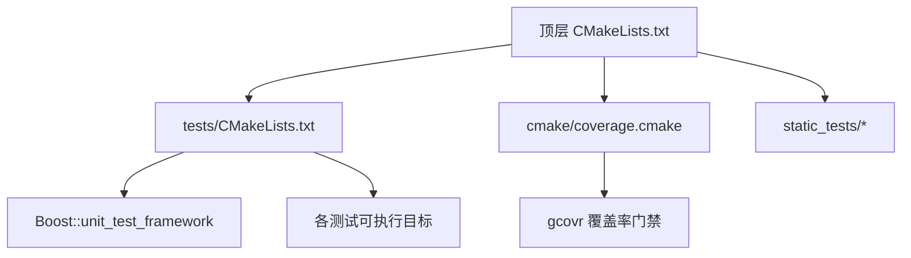
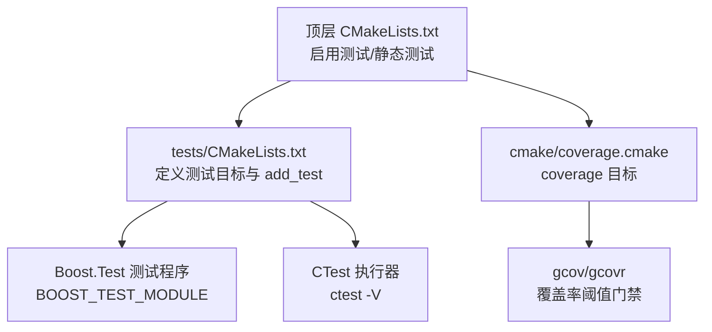
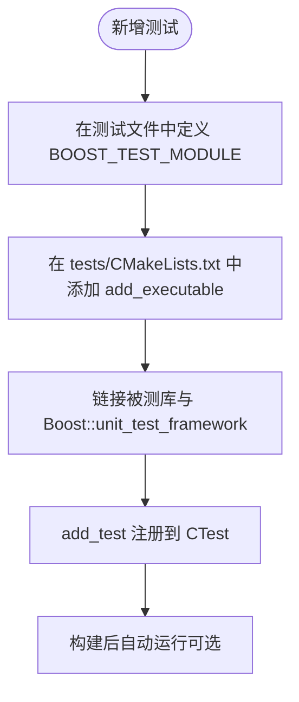
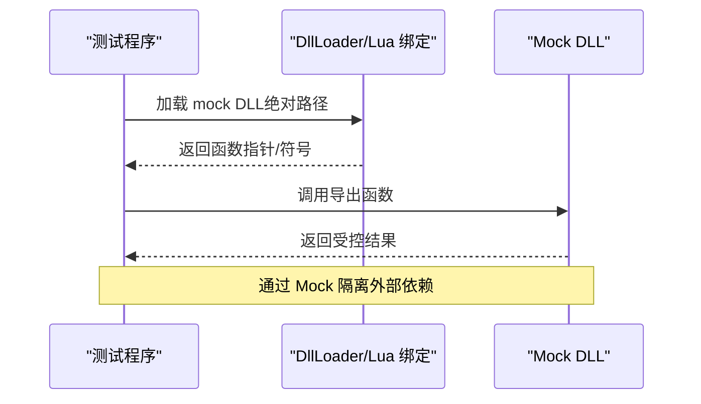
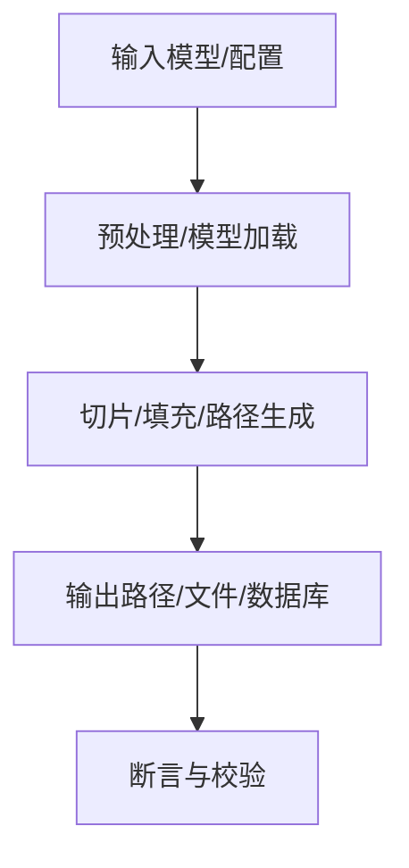
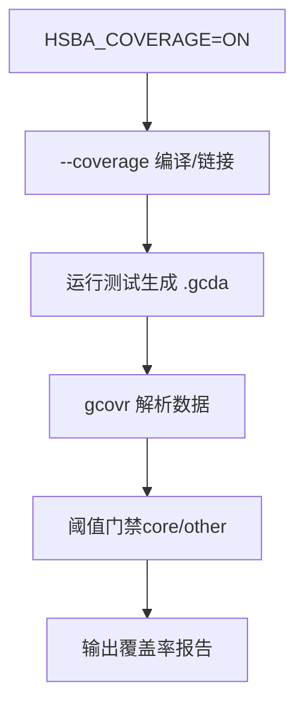
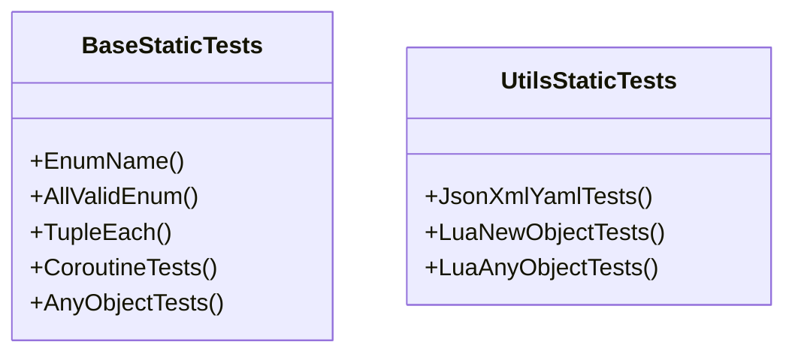
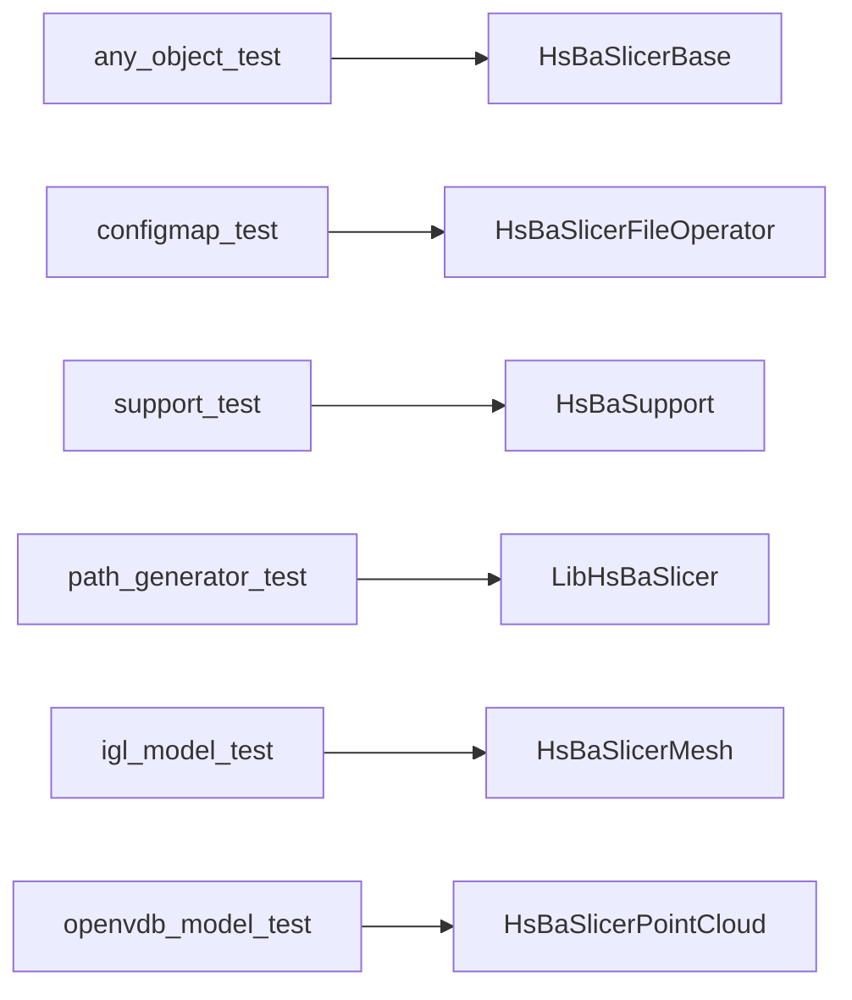

# 测试和验证

<cite>
**本文引用的文件**   
- [CMakeLists.txt](file://CMakeLists.txt)
- [tests/CMakeLists.txt](file://tests/CMakeLists.txt)
- [cmake/coverage.cmake](file://cmake/coverage.cmake)
- [static_tests/base_static_tests/base_static_tests.cpp](file://static_tests/base_static_tests/base_static_tests.cpp)
- [static_tests/utils_static_tests/utils_static_tests.cpp](file://static_tests/utils_static_tests/utils_static_tests.cpp)
- [any_object.hpp](file://base/any_object.hpp)
- [any_object_test.cpp](file://tests/AnyObject/any_object_test.cpp)
- [user_custom_cad_model_test.cpp](file://tests/CADModel/user_custom_cad_model_test.cpp)
- [mock_cad_dll.cpp](file://tests/CADModel/mock_cad_dll.cpp)
- [dll_loader_test.cpp](file://tests/DllLoader/dll_loader_test.cpp)
- [mock_dll_loader_dll.cpp](file://tests/DllLoader/mock_dll_loader_dll.cpp)
</cite>

## 目录
1. [简介](#简介)
2. [项目结构](#项目结构)
3. [核心组件](#核心组件)
4. [架构总览](#架构总览)
5. [详细组件分析](#详细组件分析)
6. [依赖分析](#依赖分析)
7. [性能考虑](#性能考虑)
8. [故障排查指南](#故障排查指南)
9. [结论](#结论)
10. [附录](#附录)

## 简介
本文件系统性梳理 HsBaSlicer 的测试与验证体系，覆盖单元测试、集成测试、静态测试、覆盖率门禁、持续集成与质量工具链，并给出 TDD 实践、用例设计模式与维护策略。文档以仓库现有实现为依据，重点说明：
- 单元测试框架与断言库（Boost.Test）的组织方式与运行入口
- Mock 对象与外部依赖模拟（动态库加载、Lua 绑定、SQL/IO）
- 集成测试与端到端流程（参数存储、路径生成、模型处理等）
- 覆盖率统计与回归门禁（gcov/gcovr）
- 静态检查与编译期测试（static_assert/static tests）
- 在 CI 中的自动化执行与监控建议

## 项目结构
HsBaSlicer 将测试相关配置集中在顶层 CMake 与 tests 子目录中，并通过 CTest 统一注册与执行；覆盖率通过 cmake/coverage.cmake 提供“coverage”目标进行门禁。

**图示来源**
- [CMakeLists.txt:392-440](file://CMakeLists.txt#L392-L440)
- [CMakeLists.txt:667-680](file://CMakeLists.txt#L667-L680)
- [tests/CMakeLists.txt:1-20](file://tests/CMakeLists.txt#L1-L20)
- [cmake/coverage.cmake:1-14](file://cmake/coverage.cmake#L1-L14)

**章节来源**
- [CMakeLists.txt:392-440](file://CMakeLists.txt#L392-L440)
- [CMakeLists.txt:667-680](file://CMakeLists.txt#L667-L680)
- [tests/CMakeLists.txt:1-20](file://tests/CMakeLists.txt#L1-L20)
- [cmake/coverage.cmake:1-14](file://cmake/coverage.cmake#L1-L14)

## 核心组件
- 单元测试框架：Boost.Test（包含式或动态链接均可），每个测试目标定义 BOOST_TEST_MODULE，并在 tests/CMakeLists.txt 中统一 add_executable/add_test。
- 测试编排与执行：CTest（enable_testing + add_test），支持构建后自动运行（HSBA_RUN_TESTS_AFTER_BUILD）。
- 覆盖率门禁：cmake/coverage.cmake 提供 coverage 目标，使用 gcov/gcovr 对核心与非核心模块分别设置行覆盖率阈值。
- 静态测试：static_tests 下使用 static_assert 与模板编译期检查，确保接口与类型约束正确。
- Mock 与外部依赖：通过运行时动态加载 mock DLL（CAD/PointCloud/DllLoader）与 Lua 绑定进行测试隔离。

**章节来源**
- [tests/CMakeLists.txt:1-20](file://tests/CMakeLists.txt#L1-L20)
- [tests/CMakeLists.txt:355-411](file://tests/CMakeLists.txt#L355-L411)
- [cmake/coverage.cmake:158-173](file://cmake/coverage.cmake#L158-L173)
- [static_tests/base_static_tests/base_static_tests.cpp:1-10](file://static_tests/base_static_tests/base_static_tests.cpp#L1-L10)

## 架构总览
下图展示从顶层 CMake 到测试目标、再到覆盖率门禁的整体关系。

**图示来源**
- [CMakeLists.txt:392-440](file://CMakeLists.txt#L392-L440)
- [CMakeLists.txt:667-680](file://CMakeLists.txt#L667-L680)
- [tests/CMakeLists.txt:1-20](file://tests/CMakeLists.txt#L1-L20)
- [cmake/coverage.cmake:158-173](file://cmake/coverage.cmake#L158-L173)

## 详细组件分析

### 单元测试框架与用例组织
- 框架选择：Boost.Test。每个测试源文件顶部定义 BOOST_TEST_MODULE，tests/CMakeLists.txt 为每个测试创建独立可执行目标，并链接 Boost::unit_test_framework。
- 用例组织：按功能域分目录（如 AnyObject、ConfigMap、PathsOut、Support 等），便于定位与维护。
- 运行控制：通过 add_test 注册到 CTest；可选在 POST_BUILD 阶段自动运行单个测试或全部测试（RunAllTests）。

**图示来源**
- [tests/CMakeLists.txt:15-39](file://tests/CMakeLists.txt#L15-L39)
- [tests/CMakeLists.txt:355-411](file://tests/CMakeLists.txt#L355-L411)

**章节来源**
- [tests/CMakeLists.txt:15-39](file://tests/CMakeLists.txt#L15-L39)
- [tests/CMakeLists.txt:355-411](file://tests/CMakeLists.txt#L355-L411)

### 断言库与测试数据准备
- 断言：Boost.Test 提供的 BOOST_CHECK_* / BOOST_REQUIRE_* 宏用于条件断言与强制断言。
- 测试数据：常见做法包括内联构造、读取样例文件或通过 Lua 脚本驱动（例如 PolygonFill 下的 lua 脚本）。
- 隔离性：AnyObject 提供了在 BOOST_AUTO_TEST_CASE 内的作用域隔离机制，便于 Mock 与桩替换。

**章节来源**
- [any_object.hpp:584-590](file://base/any_object.hpp#L584-L590)
- [any_object_test.cpp:1-5](file://tests/AnyObject/any_object_test.cpp#L1-L5)

### Mock 对象与外部依赖模拟
- 动态库 Mock：针对 CAD/PointCloud/DllLoader 等外部依赖，通过构建小型共享库（mock_*.dll/.so）并在测试中动态加载，从而隔离真实实现。
- 路径注入：通过 target_compile_definitions 注入 MOCK_*_DLL_DIR，使测试在构建产物目录下查找 mock DLL。
- Lua 绑定：部分测试通过 Lua 脚本驱动（如 PolygonFill 的 lua_polygon_operations_test），验证 Lua 与 C++ 交互行为。

**图示来源**
- [tests/CMakeLists.txt:1377-1420](file://tests/CMakeLists.txt#L1377-L1420)
- [tests/CMakeLists.txt:1422-1465](file://tests/CMakeLists.txt#L1422-L1465)
- [tests/CMakeLists.txt:1467-1508](file://tests/CMakeLists.txt#L1467-L1508)

**章节来源**
- [tests/CADModel/user_custom_cad_model_test.cpp:1-10](file://tests/CADModel/user_custom_cad_model_test.cpp#L1-L10)
- [tests/CADModel/mock_cad_dll.cpp:1-20](file://tests/CADModel/mock_cad_dll.cpp#L1-L20)
- [tests/DllLoader/dll_loader_test.cpp:1-10](file://tests/DllLoader/dll_loader_test.cpp#L1-L10)
- [tests/DllLoader/mock_dll_loader_dll.cpp:1-20](file://tests/DllLoader/mock_dll_loader_dll.cpp#L1-L20)
- [tests/CMakeLists.txt:1377-1508](file://tests/CMakeLists.txt#L1377-L1508)

### 集成测试策略
- 模块间交互：通过组合多个内部库（如 HsBaSlicerBase/HsBaSlicer2D/LibHsBaSlicer/HsBaPaths）构建端到端场景，验证跨模块数据流。
- 端到端流程：参数存储（ParamStore）、路径生成（PathGenerator）、支撑生成（Support）、网格切片（MeshSlice）等均有对应测试目标。
- 外部依赖模拟：SQL（SQLite）、压缩（zipper）、远程执行（remote_executor）等通过测试目标直接验证，必要时结合 Mock。

**图示来源**
- [tests/CMakeLists.txt:479-511](file://tests/CMakeLists.txt#L479-L511)
- [tests/CMakeLists.txt:1344-1375](file://tests/CMakeLists.txt#L1344-L1375)
- [tests/CMakeLists.txt:994-1052](file://tests/CMakeLists.txt#L994-L1052)

**章节来源**
- [tests/CMakeLists.txt:479-511](file://tests/CMakeLists.txt#L479-L511)
- [tests/CMakeLists.txt:1344-1375](file://tests/CMakeLists.txt#L1344-L1375)
- [tests/CMakeLists.txt:994-1052](file://tests/CMakeLists.txt#L994-L1052)

### 覆盖率统计与回归门禁
- 启用方式：顶层 CMake 选项 HSBA_COVERAGE 开启，cmake/coverage.cmake 为所有目标添加 --coverage 编译/链接选项。
- 阈值门禁：core 与 other 两类目录分别设置最低行覆盖率阈值，未达标时 coverage 目标失败。
- 报告输出：生成 JSON/TXT/XML/HTML 报告，便于 CI 归档与分析。

**图示来源**
- [cmake/coverage.cmake:16-31](file://cmake/coverage.cmake#L16-L31)
- [cmake/coverage.cmake:158-173](file://cmake/coverage.cmake#L158-L173)

**章节来源**
- [CMakeLists.txt:106-112](file://CMakeLists.txt#L106-L112)
- [cmake/coverage.cmake:16-31](file://cmake/coverage.cmake#L16-L31)
- [cmake/coverage.cmake:158-173](file://cmake/coverage.cmake#L158-L173)

### 静态检查与编译期测试
- 静态测试：static_tests 使用 static_assert 与模板特性检查，确保接口契约与类型安全。
- 示例：枚举名称转换、AnyVisit/TupleEach 泛型遍历、协程 Task/Generator 编译期验证、AnyObject 反射注册等。

**图示来源**
- [static_tests/base_static_tests/base_static_tests.cpp:1-10](file://static_tests/base_static_tests/base_static_tests.cpp#L1-L10)
- [static_tests/base_static_tests/base_static_tests.cpp:214-257](file://static_tests/base_static_tests/base_static_tests.cpp#L214-L257)
- [static_tests/utils_static_tests/utils_static_tests.cpp:55-108](file://static_tests/utils_static_tests/utils_static_tests.cpp#L55-L108)

**章节来源**
- [static_tests/base_static_tests/base_static_tests.cpp:1-10](file://static_tests/base_static_tests/base_static_tests.cpp#L1-L10)
- [static_tests/base_static_tests/base_static_tests.cpp:214-257](file://static_tests/base_static_tests/base_static_tests.cpp#L214-L257)
- [static_tests/utils_static_tests/utils_static_tests.cpp:55-108](file://static_tests/utils_static_tests/utils_static_tests.cpp#L55-L108)

### 测试驱动开发（TDD）最佳实践
- 先写失败用例：在 tests 下新增测试目标，断言预期失败，再实现最小代码使其通过。
- 小步快跑：每次变更仅修改必要逻辑，保持测试快速反馈。
- 隔离与稳定：优先使用 Mock 与桩，避免网络/磁盘/数据库等不稳定因素。
- 命名与分组：测试目标与用例命名清晰，便于 CTest 筛选与定位。

[本节为通用实践指导，不直接分析具体文件]

### 测试用例设计模式
- 给定-当-则（Given-When-Then）：明确前置条件、触发操作与断言结果。
- 边界值与异常路径：覆盖空输入、非法参数、越界、异常抛出等。
- 数据驱动：使用参数化或外部数据（Lua/JSON/YAML）驱动多组用例。
- 状态机与流程：对复杂流水线（如路径生成）建立状态转换图，逐段验证。

[本节为通用设计模式，不直接分析具体文件]

### 测试维护策略
- 分层维护：单元层聚焦单函数/类，集成层关注模块协作，端到端层验证关键业务流。
- 定期清理：移除过时用例，合并重复断言，提炼公共夹具。
- 覆盖率提升：为新功能补充用例，逐步提高 core/other 覆盖率阈值。
- 文档同步：更新 README/文档，记录新增测试目的与用法。

[本节为通用维护策略，不直接分析具体文件]

## 依赖分析
测试目标与被测库之间的依赖关系如下：

**图示来源**
- [tests/CMakeLists.txt:15-22](file://tests/CMakeLists.txt#L15-L22)
- [tests/CMakeLists.txt:260-280](file://tests/CMakeLists.txt#L260-L280)
- [tests/CMakeLists.txt:994-1003](file://tests/CMakeLists.txt#L994-L1003)
- [tests/CMakeLists.txt:1344-1356](file://tests/CMakeLists.txt#L1344-L1356)
- [tests/CMakeLists.txt:800-805](file://tests/CMakeLists.txt#L800-L805)
- [tests/CMakeLists.txt:1054-1064](file://tests/CMakeLists.txt#L1054-L1064)

**章节来源**
- [tests/CMakeLists.txt:15-22](file://tests/CMakeLists.txt#L15-L22)
- [tests/CMakeLists.txt:260-280](file://tests/CMakeLists.txt#L260-L280)
- [tests/CMakeLists.txt:994-1003](file://tests/CMakeLists.txt#L994-L1003)
- [tests/CMakeLists.txt:1344-1356](file://tests/CMakeLists.txt#L1344-L1356)
- [tests/CMakeLists.txt:800-805](file://tests/CMakeLists.txt#L800-L805)
- [tests/CMakeLists.txt:1054-1064](file://tests/CMakeLists.txt#L1054-L1064)

## 性能考虑
- 基准测试框架：当前仓库未内置专用基准框架（如 Google Benchmark）。建议在需要时引入第三方基准库，并为关键路径（网格布尔运算、路径优化）编写基准用例。
- 指标收集：建议使用计时器与采样统计（CPU 时间、内存峰值、I/O 次数），并结合 gcovr 覆盖率门禁保证回归。
- 回归测试：将基准结果纳入 CI，对比历史基线，超阈报警。
- 并行与缓存：利用多线程/协程（ThreadPool/Coroutines）加速批量测试与基准运行，注意线程安全与资源复用。

[本节为通用性能建议，不直接分析具体文件]

## 故障排查指南
- 测试无法运行：确认 enable_testing() 已在顶层 CMake 调用，且 add_test 已注册；检查 HSBA_SLICER_USE_TESTS 与 HSBA_RUN_TESTS_AFTER_BUILD 开关。
- 覆盖率门禁失败：检查是否安装 gcovr，确认 core/other 阈值设置合理；查看 coverage.json 与 HTML 报告定位未覆盖分支。
- Mock DLL 加载失败：确保 WORKING_DIRECTORY 指向 DLL 所在目录，或通过 MOCK_*_DLL_DIR 注入绝对路径；检查 Debug Postfix 与平台差异。
- Lua 绑定问题：确认 LUA_INCLUDE_DIR 与 LUA_LIBRARIES 正确链接；必要时在测试工作目录下放置所需 Lua 脚本。

**章节来源**
- [CMakeLists.txt:667-680](file://CMakeLists.txt#L667-L680)
- [cmake/coverage.cmake:67-71](file://cmake/coverage.cmake#L67-L71)
- [tests/CMakeLists.txt:1377-1420](file://tests/CMakeLists.txt#L1377-L1420)
- [tests/CMakeLists.txt:1467-1508](file://tests/CMakeLists.txt#L1467-L1508)

## 结论
HsBaSlicer 的测试体系以 Boost.Test 为核心，配合 CTest 统一编排，辅以 gcov/gcovr 覆盖率门禁与 static_assert 编译期检查，形成从单元到集成的完整质量保障。通过 Mock DLL 与 Lua 绑定，有效隔离外部依赖，确保测试稳定性。建议在后续迭代中引入基准测试框架，完善性能回归与可视化报告，进一步提升工程质量与交付效率。

[本节为总结性内容，不直接分析具体文件]

## 附录
- 常用命令
  - 构建并运行全部测试：cmake --build . && ctest -V
  - 运行覆盖率门禁：cmake --build . && cmake --build . --target coverage
  - 运行特定测试：ctest -R <test_name>
- 参考路径
  - 测试目标定义：tests/CMakeLists.txt
  - 覆盖率门禁脚本：cmake/coverage.cmake
  - 静态测试示例：static_tests/base_static_tests/base_static_tests.cpp

[本节为补充信息，不直接分析具体文件]