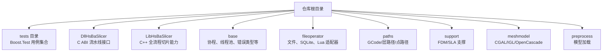
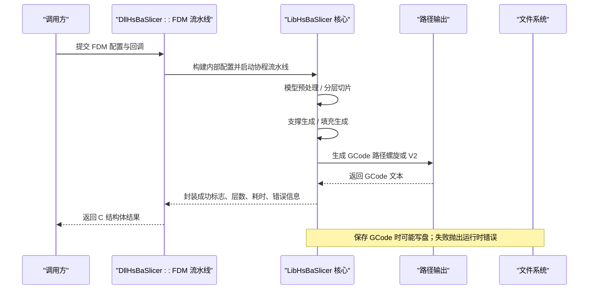
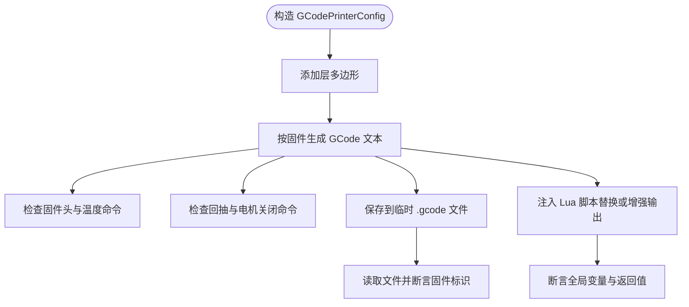
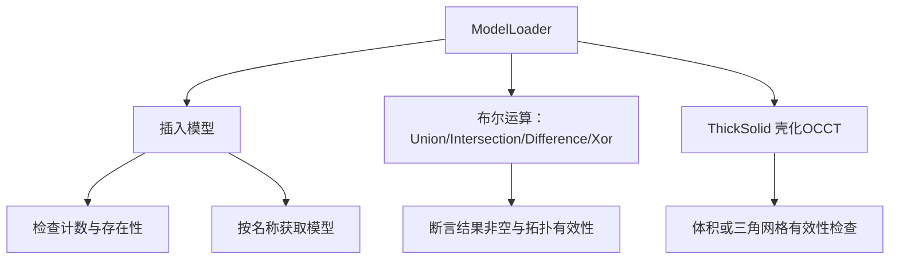
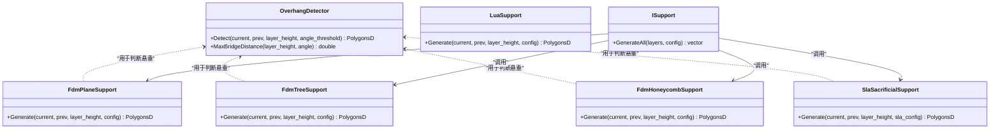
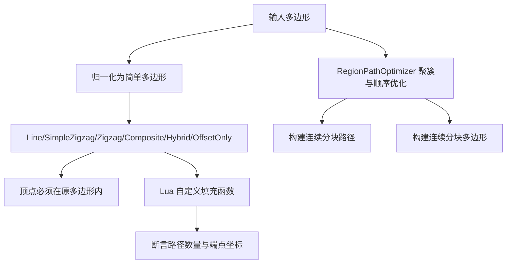
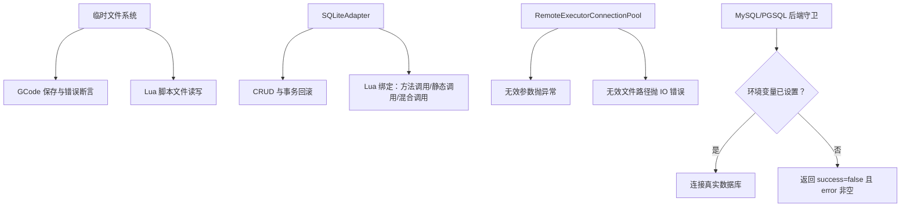
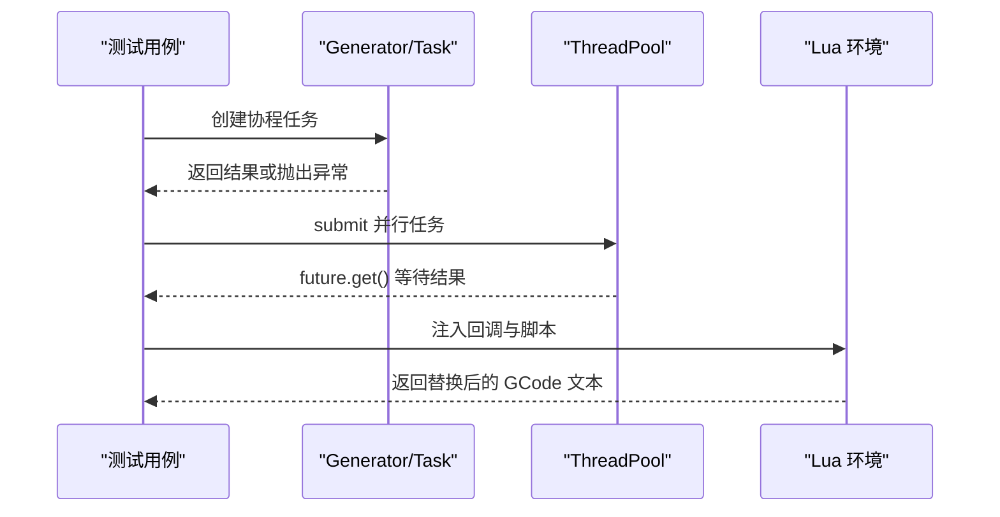
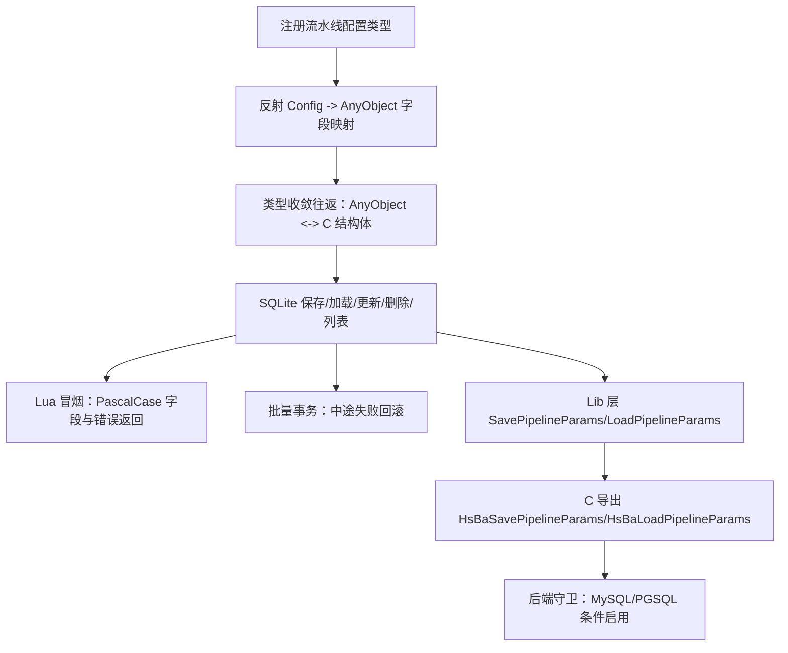
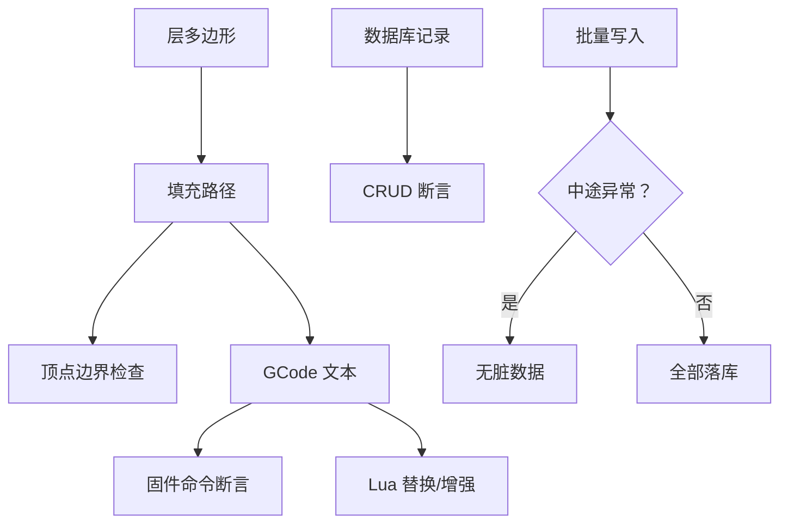

# 集成测试

<cite>
**本文引用的文件**   
- [tests/CMakeLists.txt](file://tests/CMakeLists.txt)
- [README.md](file://README.md)
- [tests/PathsOut/gcode_path_test.cpp](file://tests/PathsOut/gcode_path_test.cpp)
- [tests/Preprocess/model_loader_test.cpp](file://tests/Preprocess/model_loader_test.cpp)
- [tests/Support/support_test.cpp](file://tests/Support/support_test.cpp)
- [tests/PolygonFill/polygon_fill_test.cpp](file://tests/PolygonFill/polygon_fill_test.cpp)
- [tests/Coroutines/coroutines_test.cpp](file://tests/Coroutines/coroutines_test.cpp)
- [tests/Pool/thread_pool_test.cpp](file://tests/Pool/thread_pool_test.cpp)
- [tests/FilesOperator/sqlite_test.cpp](file://tests/FilesOperator/sqlite_test.cpp)
- [tests/FilesOperator/remote_executor_test.cpp](file://tests/FilesOperator/remote_executor_test.cpp)
- [tests/ParamStore\param_store_test.cpp](file://tests/ParamStore\param_store_test.cpp)
- [DllHsBaSlicer/fdm_pipeline.cpp](file://DllHsBaSlicer/fdm_pipeline.cpp)
</cite>

## 目录
1. [引言](#引言)
2. [项目结构与测试体系总览](#项目结构与测试体系总览)
3. [核心集成测试目标与策略](#核心集成测试目标与策略)
4. [架构总览：从模型到 GCode 的端到端切片流程](#架构总览从模型到-gcode-的端到端切片流程)
5. [关键组件与集成测试详解](#关键组件与集成测试详解)
6. [依赖模拟与外部系统隔离方案](#依赖模拟与外部系统隔离方案)
7. [异步操作与并发测试方法](#异步操作与并发测试方法)
8. [端到端流水线测试示例](#端到端流水线测试示例)
9. [数据流验证与状态一致性检查](#数据流验证与状态一致性检查)
10. [性能与稳定性注意事项](#性能与稳定性注意事项)
11. [故障排查指南](#故障排查指南)
12. [结论](#结论)

## 引言
本文面向 HsBaSlicer 的集成测试，重点说明模块间交互测试的策略与方法。内容覆盖：
- 流水线测试：从模型加载、支撑生成、填充、路径生成到 GCode 输出的完整链路。
- 数据流验证：层多边形、路径、GCode 文本、参数存储等中间结果的一致性校验。
- 状态一致性检查：数据库事务回滚、Lua 脚本副作用、协程与线程池任务完成状态。
- 外部依赖模拟：文件操作、SQLite、远程执行器、可选 MySQL/PostgreSQL 后端。
- 异步操作测试：协程、线程池、事件回调与 Lua 环境集成。
- 实际集成测试示例：基于现有测试用例提炼复杂业务流程的设计思路。

## 项目结构与测试体系总览
HsBaSlicer 是一个模块化 C++ 切片框架，包含基础库、网格模型、CAD、路径输出、支撑、Lua 绑定、动态库导出等模块。测试位于 `tests` 目录，使用 Boost.Test 组织用例，并通过根级 `tests/CMakeLists.txt` 统一注册可执行测试目标与 CTest。

**图示来源**
- [README.md:25-39](file://README.md#L25-L39)
- [tests/CMakeLists.txt:1-15](file://tests/CMakeLists.txt#L1-L15)

**章节来源**
- [README.md:25-39](file://README.md#L25-L39)
- [tests/CMakeLists.txt:1-15](file://tests/CMakeLists.txt#L1-L15)

## 核心集成测试目标与策略
- 模块间交互测试：通过真实或受控的外部依赖（SQLite、Lua、文件系统）验证多个子系统协作。
- 流水线测试：以 FDM/SLA 等流水线为核心，串联预处理、支撑、填充、路径生成、GCode 输出。
- 数据流验证：对层多边形、路径段、GCode 关键字、数据库记录进行断言。
- 状态一致性：确保批量写入回滚、Lua 脚本副作用可控、协程异常传播正确。
- 外部依赖模拟：使用临时文件、内存 SQLite、条件宏与环境变量控制外部数据库连接。
- 异步测试：覆盖协程 Generator/Task、线程池 ThreadPool、Lua 回调与事件驱动场景。

**章节来源**
- [tests/CMakeLists.txt:355-411](file://tests/CMakeLists.txt#L355-L411)

## 架构总览：从模型到 GCode 的端到端切片流程
FDM 流水线在动态库中提供 C ABI 接口，内部通过协程实现阶段化处理，包括：
- 配置转换与进度回调安装
- 模型预处理
- 分层切片
- 支撑生成
- 填充生成
- 路径生成（螺旋模式或常规 V2 路径）
- GCode 文本生成与返回

**图示来源**
- [DllHsBaSlicer/fdm_pipeline.cpp:183-206](file://DllHsBaSlicer/fdm_pipeline.cpp#L183-L206)
- [DllHsBaSlicer/fdm_pipeline.cpp:214-429](file://DllHsBaSlicer/fdm_pipeline.cpp#L214-L429)

**章节来源**
- [DllHsBaSlicer/fdm_pipeline.cpp:183-206](file://DllHsBaSlicer/fdm_pipeline.cpp#L183-L206)
- [DllHsBaSlicer/fdm_pipeline.cpp:214-429](file://DllHsBaSlicer/fdm_pipeline.cpp#L214-L429)

## 关键组件与集成测试详解

### GCode 路径与固件适配测试
GCode 路径测试验证不同固件（Marlin、RepRap、Klipper）的头部、尾部、温度命令、风扇命令、相对挤出、连续壁面螺旋路径、文件保存与 Lua 后处理。

**图示来源**
- [tests/PathsOut/gcode_path_test.cpp:43-82](file://tests/PathsOut/gcode_path_test.cpp#L43-L82)
- [tests/PathsOut/gcode_path_test.cpp:171-190](file://tests/PathsOut/gcode_path_test.cpp#L171-L190)
- [tests/PathsOut/gcode_path_test.cpp:192-238](file://tests/PathsOut/gcode_path_test.cpp#L192-L238)

**章节来源**
- [tests/PathsOut/gcode_path_test.cpp:43-82](file://tests/PathsOut/gcode_path_test.cpp#L43-L82)
- [tests/PathsOut/gcode_path_test.cpp:171-190](file://tests/PathsOut/gcode_path_test.cpp#L171-L190)
- [tests/PathsOut/gcode_path_test.cpp:192-238](file://tests/PathsOut/gcode_path_test.cpp#L192-L238)

### 模型加载与布尔运算集成测试
模型加载器测试覆盖模型池管理、XYZ 点云加载、布尔运算（并集、交集、差集、异或）、ThickSolid 与 OCCT 后端分支。

**图示来源**
- [tests/Preprocess/model_loader_test.cpp:25-129](file://tests/Preprocess/model_loader_test.cpp#L25-L129)
- [tests/Preprocess/model_loader_test.cpp:154-266](file://tests/Preprocess/model_loader_test.cpp#L154-L266)
- [tests/Preprocess/model_loader_test.cpp:273-383](file://tests/Preprocess/model_loader_test.cpp#L273-L383)

**章节来源**
- [tests/Preprocess/model_loader_test.cpp:25-129](file://tests/Preprocess/model_loader_test.cpp#L25-L129)
- [tests/Preprocess/model_loader_test.cpp:154-266](file://tests/Preprocess/model_loader_test.cpp#L154-L266)
- [tests/Preprocess/model_loader_test.cpp:273-383](file://tests/Preprocess/model_loader_test.cpp#L273-L383)

### 支撑生成与悬垂检测集成测试
支撑测试覆盖悬垂检测、FDM 平面/树形/蜂窝支撑、SLA 牺牲支撑、Lua 支撑脚本与 ISupport::GenerateAll 多层生成。

**图示来源**
- [tests/Support/support_test.cpp:39-91](file://tests/Support/support_test.cpp#L39-L91)
- [tests/Support/support_test.cpp:96-192](file://tests/Support/support_test.cpp#L96-L192)
- [tests/Support/support_test.cpp:194-224](file://tests/Support/support_test.cpp#L194-L224)
- [tests/Support/support_test.cpp:226-308](file://tests/Support/support_test.cpp#L226-L308)
- [tests/Support/support_test.cpp:310-338](file://tests/Support/support_test.cpp#L310-L338)

**章节来源**
- [tests/Support/support_test.cpp:39-91](file://tests/Support/support_test.cpp#L39-L91)
- [tests/Support/support_test.cpp:96-192](file://tests/Support/support_test.cpp#L96-L192)
- [tests/Support/support_test.cpp:194-224](file://tests/Support/support_test.cpp#L194-L224)
- [tests/Support/support_test.cpp:226-308](file://tests/Support/support_test.cpp#L226-L308)
- [tests/Support/support_test.cpp:310-338](file://tests/Support/support_test.cpp#L310-L338)

### 填充与路径优化集成测试
填充测试覆盖 Line/Zigzag/CompositeOffset/Hybrid/OffsetOnly、自交多边形归一化、Lua 自定义填充、区域路径优化与多边形模式优化。

**图示来源**
- [tests/PolygonFill/polygon_fill_test.cpp:26-84](file://tests/PolygonFill/polygon_fill_test.cpp#L26-L84)
- [tests/PolygonFill/polygon_fill_test.cpp:86-106](file://tests/PolygonFill/polygon_fill_test.cpp#L86-L106)
- [tests/PolygonFill/polygon_fill_test.cpp:108-175](file://tests/PolygonFill/polygon_fill_test.cpp#L108-L175)
- [tests/PolygonFill/polygon_fill_test.cpp:177-200](file://tests/PolygonFill/polygon_fill_test.cpp#L177-L200)
- [tests/PolygonFill/polygon_fill_test.cpp:202-258](file://tests/PolygonFill/polygon_fill_test.cpp#L202-L258)
- [tests/PolygonFill/polygon_fill_test.cpp:325-388](file://tests/PolygonFill/polygon_fill_test.cpp#L325-L388)
- [tests/PolygonFill/polygon_fill_test.cpp:390-419](file://tests/PolygonFill/polygon_fill_test.cpp#L390-L419)
- [tests/PolygonFill/polygon_fill_test.cpp:421-483](file://tests/PolygonFill/polygon_fill_test.cpp#L421-L483)
- [tests/PolygonFill/polygon_fill_test.cpp:485-514](file://tests/PolygonFill/polygon_fill_test.cpp#L485-L514)
- [tests/PolygonFill/polygon_fill_test.cpp:516-540](file://tests/PolygonFill/polygon_fill_test.cpp#L516-L540)

**章节来源**
- [tests/PolygonFill/polygon_fill_test.cpp:26-84](file://tests/PolygonFill/polygon_fill_test.cpp#L26-L84)
- [tests/PolygonFill/polygon_fill_test.cpp:86-106](file://tests/PolygonFill/polygon_fill_test.cpp#L86-L106)
- [tests/PolygonFill/polygon_fill_test.cpp:108-175](file://tests/PolygonFill/polygon_fill_test.cpp#L108-L175)
- [tests/PolygonFill/polygon_fill_test.cpp:177-200](file://tests/PolygonFill/polygon_fill_test.cpp#L177-L200)
- [tests/PolygonFill/polygon_fill_test.cpp:202-258](file://tests/PolygonFill/polygon_fill_test.cpp#L202-L258)
- [tests/PolygonFill/polygon_fill_test.cpp:325-388](file://tests/PolygonFill/polygon_fill_test.cpp#L325-L388)
- [tests/PolygonFill/polygon_fill_test.cpp:390-419](file://tests/PolygonFill/polygon_fill_test.cpp#L390-L419)
- [tests/PolygonFill/polygon_fill_test.cpp:421-483](file://tests/PolygonFill/polygon_fill_test.cpp#L421-L483)
- [tests/PolygonFill/polygon_fill_test.cpp:485-514](file://tests/PolygonFill/polygon_fill_test.cpp#L485-L514)
- [tests/PolygonFill/polygon_fill_test.cpp:516-540](file://tests/PolygonFill/polygon_fill_test.cpp#L516-L540)

## 依赖模拟与外部系统隔离方案
- 文件操作：使用临时目录与临时文件，避免污染工作区；对不可写路径断言运行时错误。
- SQLite：通过 SQLiteAdapter 创建本地数据库，结合 Lua 适配器验证方法调用与静态调用两种约定。
- 远程执行器：验证无效参数与无效文件路径的错误分支。
- MySQL/PostgreSQL：通过编译宏与环境变量控制是否连接真实实例；未启用时走安全路径返回失败。

**图示来源**
- [tests/PathsOut/gcode_path_test.cpp:171-190](file://tests/PathsOut/gcode_path_test.cpp#L171-L190)
- [tests/FilesOperator/sqlite_test.cpp:25-57](file://tests/FilesOperator/sqlite_test.cpp#L25-L57)
- [tests/FilesOperator/sqlite_test.cpp:59-123](file://tests/FilesOperator/sqlite_test.cpp#L59-L123)
- [tests/FilesOperator/sqlite_test.cpp:125-185](file://tests/FilesOperator/sqlite_test.cpp#L125-L185)
- [tests/FilesOperator/sqlite_test.cpp:187-249](file://tests/FilesOperator/sqlite_test.cpp#L187-L249)
- [tests/FilesOperator/remote_executor_test.cpp:9-19](file://tests/FilesOperator/remote_executor_test.cpp#L9-L19)
- [tests/ParamStore\param_store_test.cpp:449-516](file://tests/ParamStore\param_store_test.cpp#L449-L516)

**章节来源**
- [tests/PathsOut/gcode_path_test.cpp:171-190](file://tests/PathsOut/gcode_path_test.cpp#L171-L190)
- [tests/FilesOperator/sqlite_test.cpp:25-57](file://tests/FilesOperator/sqlite_test.cpp#L25-L57)
- [tests/FilesOperator/sqlite_test.cpp:59-123](file://tests/FilesOperator/sqlite_test.cpp#L59-L123)
- [tests/FilesOperator/sqlite_test.cpp:125-185](file://tests/FilesOperator/sqlite_test.cpp#L125-L185)
- [tests/FilesOperator/sqlite_test.cpp:187-249](file://tests/FilesOperator/sqlite_test.cpp#L187-L249)
- [tests/FilesOperator/remote_executor_test.cpp:9-19](file://tests/FilesOperator/remote_executor_test.cpp#L9-L19)
- [tests/ParamStore\param_store_test.cpp:449-516](file://tests/ParamStore\param_store_test.cpp#L449-L516)

## 异步操作与并发测试方法
- 协程 Generator/Task：验证 co_yield/co_return、迭代终止、异常传播、catching 回调、NoopExecutor 行为。
- 线程池：submit 任务聚合、WaitAll 同步、协程与线程池混用。
- 事件驱动：Lua 回调注入 GCode 后处理，支持全局变量与返回值替换。

**图示来源**
- [tests/Coroutines/coroutines_test.cpp:9-26](file://tests/Coroutines/coroutines_test.cpp#L9-L26)
- [tests/Coroutines/coroutines_test.cpp:91-124](file://tests/Coroutines/coroutines_test.cpp#L91-L124)
- [tests/Coroutines/coroutines_test.cpp:144-179](file://tests/Coroutines/coroutines_test.cpp#L144-L179)
- [tests/Coroutines/coroutines_test.cpp:181-242](file://tests/Coroutines/coroutines_test.cpp#L181-L242)
- [tests/Pool/thread_pool_test.cpp:14-37](file://tests/Pool/thread_pool_test.cpp#L14-L37)
- [tests/Pool/thread_pool_test.cpp:39-85](file://tests/Pool/thread_pool_test.cpp#L39-L85)
- [tests/PathsOut/gcode_path_test.cpp:192-238](file://tests/PathsOut/gcode_path_test.cpp#L192-L238)

**章节来源**
- [tests/Coroutines/coroutines_test.cpp:9-26](file://tests/Coroutines/coroutines_test.cpp#L9-L26)
- [tests/Coroutines/coroutines_test.cpp:91-124](file://tests/Coroutines/coroutines_test.cpp#L91-L124)
- [tests/Coroutines/coroutines_test.cpp:144-179](file://tests/Coroutines/coroutines_test.cpp#L144-L179)
- [tests/Coroutines/coroutines_test.cpp:181-242](file://tests/Coroutines/coroutines_test.cpp#L181-L242)
- [tests/Pool/thread_pool_test.cpp:14-37](file://tests/Pool/thread_pool_test.cpp#L14-L37)
- [tests/Pool/thread_pool_test.cpp:39-85](file://tests/Pool/thread_pool_test.cpp#L39-L85)
- [tests/PathsOut/gcode_path_test.cpp:192-238](file://tests/PathsOut/gcode_path_test.cpp#L192-L238)

## 端到端流水线测试示例
以 ParamStore 工艺参数流水线为例，展示反射完整性、类型收敛往返、SQLite CRUD、Lua 冒烟、批量事务回滚、Lib 层写入读取往返、C 导出冒烟与后端可用性守卫。

**图示来源**
- [tests/ParamStore\param_store_test.cpp:89-113](file://tests/ParamStore\param_store_test.cpp#L89-L113)
- [tests/ParamStore\param_store_test.cpp:115-153](file://tests/ParamStore\param_store_test.cpp#L115-L153)
- [tests/ParamStore\param_store_test.cpp:155-224](file://tests/ParamStore\param_store_test.cpp#L155-L224)
- [tests/ParamStore\param_store_test.cpp:226-281](file://tests/ParamStore\param_store_test.cpp#L226-L281)
- [tests/ParamStore\param_store_test.cpp:283-328](file://tests/ParamStore\param_store_test.cpp#L283-L328)
- [tests/ParamStore\param_store_test.cpp:330-354](file://tests/ParamStore\param_store_test.cpp#L330-L354)
- [tests/ParamStore\param_store_test.cpp:356-396](file://tests/ParamStore\param_store_test.cpp#L356-L396)
- [tests/ParamStore\param_store_test.cpp:398-447](file://tests/ParamStore\param_store_test.cpp#L398-L447)
- [tests/ParamStore\param_store_test.cpp:449-516](file://tests/ParamStore\param_store_test.cpp#L449-L516)

**章节来源**
- [tests/ParamStore\param_store_test.cpp:89-113](file://tests/ParamStore\param_store_test.cpp#L89-L113)
- [tests/ParamStore\param_store_test.cpp:115-153](file://tests/ParamStore\param_store_test.cpp#L115-L153)
- [tests/ParamStore\param_store_test.cpp:155-224](file://tests/ParamStore\param_store_test.cpp#L155-L224)
- [tests/ParamStore\param_store_test.cpp:226-281](file://tests/ParamStore\param_store_test.cpp#L226-L281)
- [tests/ParamStore\param_store_test.cpp:283-328](file://tests/ParamStore\param_store_test.cpp#L283-L328)
- [tests/ParamStore\param_store_test.cpp:330-354](file://tests/ParamStore\param_store_test.cpp#L330-L354)
- [tests/ParamStore\param_store_test.cpp:356-396](file://tests/ParamStore\param_store_test.cpp#L356-L396)
- [tests/ParamStore\param_store_test.cpp:398-447](file://tests/ParamStore\param_store_test.cpp#L398-L447)
- [tests/ParamStore\param_store_test.cpp:449-516](file://tests/ParamStore\param_store_test.cpp#L449-L516)

## 数据流验证与状态一致性检查
- 层多边形与路径：确保 Zigzag/Line 填充路径顶点位于原多边形内，避免越界或伪顶点。
- GCode 文本：按固件关键字断言头部/尾部命令、挤出模式、风扇命令、温度设置。
- 数据库记录：Save/Load/List/Delete 后断行计数、字段值、主键 ID、Upsert 幂等性。
- 批量事务：中途异常触发 ROLLBACK，最终无脏数据；正常批量全部落库。
- Lua 副作用：脚本返回值或全局变量替换输出；非法返回或未知函数名抛出运行时错误。

**图示来源**
- [tests/PolygonFill/polygon_fill_test.cpp:542-571](file://tests/PolygonFill/polygon_fill_test.cpp#L542-L571)
- [tests/PolygonFill/polygon_fill_test.cpp:619-647](file://tests/PolygonFill/polygon_fill_test.cpp#L619-L647)
- [tests/PolygonFill/polygon_fill_test.cpp:649-688](file://tests/PolygonFill/polygon_fill_test.cpp#L649-L688)
- [tests/PathsOut/gcode_path_test.cpp:43-82](file://tests/PathsOut/gcode_path_test.cpp#L43-L82)
- [tests/ParamStore\param_store_test.cpp:155-224](file://tests/ParamStore\param_store_test.cpp#L155-L224)
- [tests/ParamStore\param_store_test.cpp:283-328](file://tests/ParamStore\param_store_test.cpp#L283-L328)
- [tests/PathsOut/gcode_path_test.cpp:192-238](file://tests/PathsOut/gcode_path_test.cpp#L192-L238)

**章节来源**
- [tests/PolygonFill/polygon_fill_test.cpp:542-571](file://tests/PolygonFill/polygon_fill_test.cpp#L542-L571)
- [tests/PolygonFill/polygon_fill_test.cpp:619-647](file://tests/PolygonFill/polygon_fill_test.cpp#L619-L647)
- [tests/PolygonFill/polygon_fill_test.cpp:649-688](file://tests/PolygonFill/polygon_fill_test.cpp#L649-L688)
- [tests/PathsOut/gcode_path_test.cpp:43-82](file://tests/PathsOut/gcode_path_test.cpp#L43-L82)
- [tests/ParamStore\param_store_test.cpp:155-224](file://tests/ParamStore\param_store_test.cpp#L155-L224)
- [tests/ParamStore\param_store_test.cpp:283-328](file://tests/ParamStore\param_store_test.cpp#L283-L328)
- [tests/PathsOut/gcode_path_test.cpp:192-238](file://tests/PathsOut/gcode_path_test.cpp#L192-L238)

## 性能与稳定性注意事项
- 大对象与模板实例化：Graph 测试在 MSVC 下需要 `/bigobj` 以避免段限制。
- CGAL/OCCT 条件构建：仅在启用 copyleft 内核或找到依赖时构建对应测试。
- 临时文件清理：SQLite 与 Lua 测试显式关闭 Lua 状态后再删除数据库文件，避免锁文件。
- 协程与线程池：使用 WaitAll 确保任务完成，避免资源竞争与悬挂任务。

**章节来源**
- [tests/CMakeLists.txt:182-211](file://tests/CMakeLists.txt#L182-L211)
- [tests/CMakeLists.txt:775-800](file://tests/CMakeLists.txt#L775-L800)
- [tests/FilesOperator/sqlite_test.cpp:98-123](file://tests/FilesOperator/sqlite_test.cpp#L98-L123)
- [tests/Pool/thread_pool_test.cpp:35-37](file://tests/Pool/thread_pool_test.cpp#L35-L37)

## 故障排查指南
- GCode 保存失败：检查父目录是否存在，捕获 RuntimeError；确认固件配置与挤出模式。
- SQLite 锁文件：显式销毁 Lua 状态后重试删除；增加轮询与延迟。
- 远程执行器无效参数：构造函数参数校验失败抛 InvalidArgumentError；发送文件路径不存在抛 IOError。
- 协程异常未传播：检查 catching 回调与 get_result 调用；确认 NoopExecutor 行为。
- 后端不可用：MySQL/PGSQL 未编译或未设置环境变量时，应返回 success=false 且 error 非空。

**章节来源**
- [tests/PathsOut/gcode_path_test.cpp:171-190](file://tests/PathsOut/gcode_path_test.cpp#L171-L190)
- [tests/FilesOperator/sqlite_test.cpp:98-123](file://tests/FilesOperator/sqlite_test.cpp#L98-L123)
- [tests/FilesOperator/remote_executor_test.cpp:9-19](file://tests/FilesOperator/remote_executor_test.cpp#L9-L19)
- [tests/Coroutines/coroutines_test.cpp:181-242](file://tests/Coroutines/coroutines_test.cpp#L181-L242)
- [tests/ParamStore\param_store_test.cpp:449-516](file://tests/ParamStore\param_store_test.cpp#L449-L516)

## 结论
HsBaSlicer 的集成测试围绕模块化切片流水线展开，覆盖模型加载、支撑生成、填充、路径生成、GCode 输出、参数存储与外部依赖交互。通过临时文件、SQLite、Lua 环境与条件宏/环境变量，测试既保证真实流程验证，又有效隔离外部系统。协程与线程池测试确保异步行为稳定，批量事务与 Lua 副作用断言保障状态一致性。这些测试为后续扩展新流水线、新后端与新算法提供了可靠的回归保障。