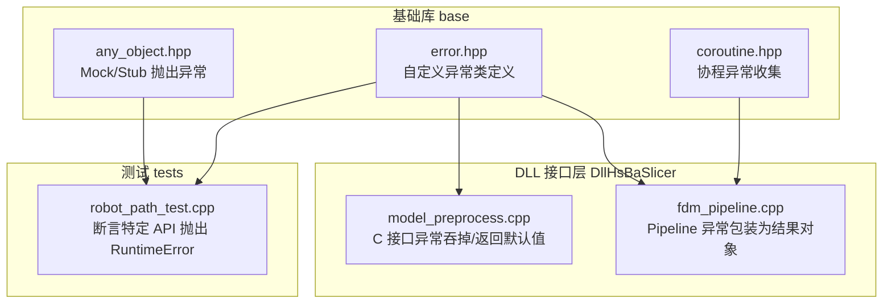
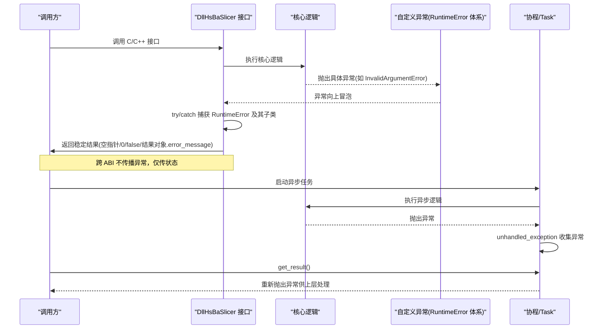
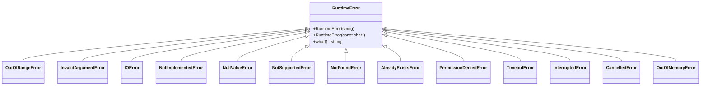
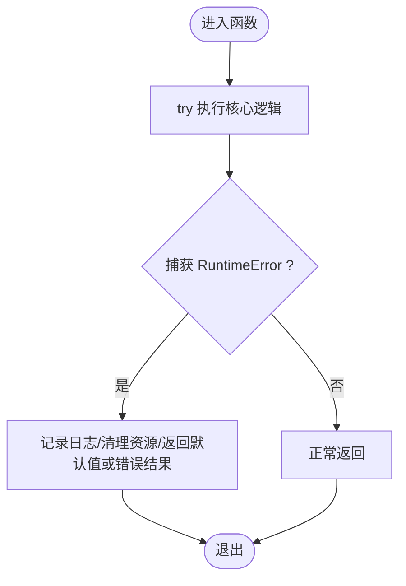
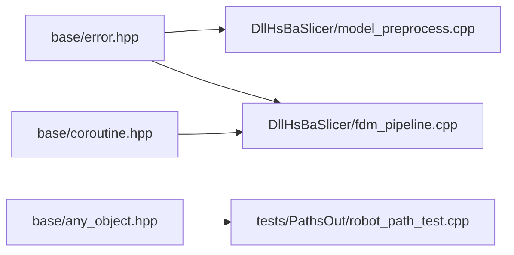

# 异常处理框架

<cite>
**本文引用的文件**   
- [base/error.hpp](file://base/error.hpp)
- [base/error.cpp](file://base/error.cpp)
- [DllHsBaSlicer/model_preprocess.cpp](file://DllHsBaSlicer/model_preprocess.cpp)
- [DllHsBaSlicer/fdm_pipeline.cpp](file://DllHsBaSlicer/fdm_pipeline.cpp)
- [base/any_object.hpp](file://base/any_object.hpp)
- [base/coroutine.hpp](file://base/coroutine.hpp)
- [tests/PathsOut/robot_path_test.cpp](file://tests/PathsOut/robot_path_test.cpp)
</cite>

## 目录
1. [简介](#简介)
2. [项目结构](#项目结构)
3. [核心组件](#核心组件)
4. [架构总览](#架构总览)
5. [详细组件分析](#详细组件分析)
6. [依赖关系分析](#依赖关系分析)
7. [性能与内存管理](#性能与内存管理)
8. [故障排查指南](#故障排查指南)
9. [结论](#结论)

## 简介
本文件面向 HsBaSlicer 的异常处理框架，系统性梳理自定义异常类型的设计模式、错误码规范（命名约定、范围分配、国际化支持）、异常传播机制（捕获策略、包装模式、恢复机制），以及最佳实践（资源清理、事务回滚、用户友好提示）。文档同时给出实际代码示例路径，说明如何在不同模块间传递错误信息，并讨论异常处理的性能与内存管理策略。

## 项目结构
异常处理相关代码主要位于基础库 base 中，并在 DllHsBaSlicer 层进行统一捕获与结果封装；测试用例覆盖异常抛出的行为验证。

**图表来源**
- [base/error.hpp:15-145](file://base/error.hpp#L15-L145)
- [base/coroutine.hpp:421-455](file://base/coroutine.hpp#L421-L455)
- [base/any_object.hpp:339-355](file://base/any_object.hpp#L339-L355)
- [DllHsBaSlicer/model_preprocess.cpp:30-229](file://DllHsBaSlicer/model_preprocess.cpp#L30-L229)
- [DllHsBaSlicer/fdm_pipeline.cpp:420-480](file://DllHsBaSlicer/fdm_pipeline.cpp#L420-L480)
- [tests/PathsOut/robot_path_test.cpp:183-191](file://tests/PathsOut/robot_path_test.cpp#L183-L191)

**章节来源**
- [base/error.hpp:1-147](file://base/error.hpp#L1-L147)
- [base/error.cpp:1-5](file://base/error.cpp#L1-L5)
- [DllHsBaSlicer/model_preprocess.cpp:30-229](file://DllHsBaSlicer/model_preprocess.cpp#L30-L229)
- [DllHsBaSlicer/fdm_pipeline.cpp:420-480](file://DllHsBaSlicer/fdm_pipeline.cpp#L420-L480)
- [base/any_object.hpp:339-355](file://base/any_object.hpp#L339-L355)
- [base/coroutine.hpp:421-455](file://base/coroutine.hpp#L421-L455)
- [tests/PathsOut/robot_path_test.cpp:183-191](file://tests/PathsOut/robot_path_test.cpp#L183-L191)

## 核心组件
- 自定义异常基类与分类：所有业务异常继承自 std::runtime_error，并通过统一的 RuntimeError 作为根异常类型，便于上层统一捕获。
- 异常层次结构：提供 OutOfRangeError、InvalidArgumentError、IOError、NotImplementedError、NullValueError、NotSupportedError、NotFoundError、AlreadyExistsError、PermissionDeniedError、TimeoutError、InterruptedError、CancelledError、OutOfMemoryError 等细分类型，用于表达具体错误语义。
- 异常传播与包装：在 DLL 边界处将内部异常转换为稳定的返回值或结构化结果对象，避免跨 ABI 边界传播异常。
- 协程与异步任务：协程实现通过 unhandled_exception 收集异常，get_result 时再抛出，保证异步调用链中的错误可被正确感知。
- Mock/Stub 异常：测试框架支持以异常作为 stub 行为，便于模拟异常分支。

**章节来源**
- [base/error.hpp:15-145](file://base/error.hpp#L15-L145)
- [base/coroutine.hpp:421-455](file://base/coroutine.hpp#L421-L455)
- [base/any_object.hpp:339-355](file://base/any_object.hpp#L339-L355)

## 架构总览
下图展示异常从底层抛出到上层捕获与包装的整体流程。

**图表来源**
- [DllHsBaSlicer/model_preprocess.cpp:30-229](file://DllHsBaSlicer/model_preprocess.cpp#L30-L229)
- [DllHsBaSlicer/fdm_pipeline.cpp:420-480](file://DllHsBaSlicer/fdm_pipeline.cpp#L420-L480)
- [base/coroutine.hpp:421-455](file://base/coroutine.hpp#L421-L455)

## 详细组件分析

### 自定义异常类型与层次结构
- 设计要点
  - 所有异常均继承自 std::runtime_error，确保兼容标准异常体系。
  - 通过 RuntimeError 作为统一入口，上层可按基类捕获，也可按具体子类精细化处理。
  - 每个异常类仅提供构造与 what() 复用，保持轻量与一致性。
- 分类建议
  - 参数校验：InvalidArgumentError、OutOfRangeError
  - I/O 与系统：IOError、PermissionDeniedError、TimeoutError、InterruptedError
  - 业务语义：NotFoundError、AlreadyExistsError、NotSupportedError、NotImplementedError
  - 资源与状态：NullValueError、OutOfMemoryError、CancelledError

**图表来源**
- [base/error.hpp:15-145](file://base/error.hpp#L15-L145)

**章节来源**
- [base/error.hpp:15-145](file://base/error.hpp#L15-L145)

### 错误码定义规范
- 现状
  - 当前仓库未定义集中式错误码枚举或数字错误码表；异常通过字符串消息 what() 传递错误详情。
- 建议规范（扩展性指导）
  - 命名约定：采用领域前缀+场景+原因三段式，例如 IO_FILE_NOT_FOUND、PARAM_INVALID_TYPE。
  - 范围分配：按子系统划分区间，如 1000-1999 表示 I/O，2000-2999 表示参数校验，3000-3999 表示网络/超时等。
  - 国际化支持：错误码映射至多语言文案表，运行时根据 locale 选择显示文本；异常携带 code 与 message_id，UI 层负责翻译。
  - 向后兼容：新增错误码不得破坏既有范围；废弃错误码需保留映射并标记弃用。
- 落地方式
  - 在现有异常类中增加 code 字段与 message_id，保留 what() 兼容旧行为。
  - 在 DLL 边界统一将 code/message_id 写入结果对象，供上层 UI 渲染。

[本节为概念性规范建议，不直接分析具体文件]

### 异常传播机制
- 捕获策略
  - DLL 层对内部异常进行 try/catch 捕获，避免跨 ABI 传播异常；对外返回稳定状态（空指针、0、false、结果对象）。
  - 典型模式：捕获 RuntimeError 及其子类，记录日志，返回默认值或失败标志。
- 异常包装模式
  - Pipeline 层将异常包装为结构化结果对象，包含 success、error_message、elapsed_seconds 等字段，便于上层统一处理。
- 错误恢复机制
  - 对于可恢复错误（如临时 I/O 失败），可在捕获后重试或降级；不可恢复错误则快速失败并释放资源。
  - 结合协程：unhandled_exception 收集异常，get_result 时再抛出，保证异步链路错误可见。

**图表来源**
- [DllHsBaSlicer/model_preprocess.cpp:30-229](file://DllHsBaSlicer/model_preprocess.cpp#L30-L229)
- [DllHsBaSlicer/fdm_pipeline.cpp:420-480](file://DllHsBaSlicer/fdm_pipeline.cpp#L420-L480)
- [base/coroutine.hpp:421-455](file://base/coroutine.hpp#L421-L455)

**章节来源**
- [DllHsBaSlicer/model_preprocess.cpp:30-229](file://DllHsBaSlicer/model_preprocess.cpp#L30-L229)
- [DllHsBaSlicer/fdm_pipeline.cpp:420-480](file://DllHsBaSlicer/fdm_pipeline.cpp#L420-L480)
- [base/coroutine.hpp:421-455](file://base/coroutine.hpp#L421-L455)

### 最佳实践
- 资源清理
  - 使用 RAII 管理资源；在 catch 块中避免重复释放，优先依赖析构器。
  - DLL 接口返回指针/句柄时，若发生异常应返回空值，并确保调用方能安全释放。
- 事务回滚
  - 数据库操作应在 try/catch 中显式 BEGIN/COMMIT/ROLLBACK；捕获异常后执行 ROLLBACK，保证数据一致性。
- 用户友好的错误提示
  - 将技术细节隐藏在 error_message 中，向用户展示简洁、可操作的提示；必要时提供错误码以便定位。
- 跨模块错误传递
  - 在模块边界统一转换异常为结果对象或错误码；内部模块使用具体异常类型进行精细处理。

[本节为通用实践建议，不直接分析具体文件]

### 实际代码示例与用法指引
- 在 DLL 接口中捕获异常并返回稳定状态
  - 参考路径：[DllHsBaSlicer/model_preprocess.cpp:30-229](file://DllHsBaSlicer/model_preprocess.cpp#L30-L229)
  - 要点：对可能失败的模型加载、查询、变换等操作包裹 try/catch，捕获 RuntimeError 后返回 nullptr 或 0。
- 在 Pipeline 中将异常包装为结果对象
  - 参考路径：[DllHsBaSlicer/fdm_pipeline.cpp:420-480](file://DllHsBaSlicer/fdm_pipeline.cpp#L420-L480)
  - 要点：捕获 RuntimeError，设置 result.success=false 与 result.error_message，计算 elapsed_seconds 后返回。
- 协程异常收集与重抛
  - 参考路径：[base/coroutine.hpp:421-455](file://base/coroutine.hpp#L421-L455)
  - 要点：unhandled_exception 保存 std::current_exception，get_result 等待并抛出。
- Mock/Stub 抛出异常
  - 参考路径：[base/any_object.hpp:339-355](file://base/any_object.hpp#L339-L355)
  - 要点：stub_throw 支持构造异常并存储为 exception_ptr，便于测试模拟异常分支。
- 单元测试断言异常
  - 参考路径：[tests/PathsOut/robot_path_test.cpp:183-191](file://tests/PathsOut/robot_path_test.cpp#L183-L191)
  - 要点：使用 BOOST_CHECK_THROW 断言特定 API 抛出 RuntimeError，验证异常契约。

**章节来源**
- [DllHsBaSlicer/model_preprocess.cpp:30-229](file://DllHsBaSlicer/model_preprocess.cpp#L30-L229)
- [DllHsBaSlicer/fdm_pipeline.cpp:420-480](file://DllHsBaSlicer/fdm_pipeline.cpp#L420-L480)
- [base/coroutine.hpp:421-455](file://base/coroutine.hpp#L421-L455)
- [base/any_object.hpp:339-355](file://base/any_object.hpp#L339-L355)
- [tests/PathsOut/robot_path_test.cpp:183-191](file://tests/PathsOut/robot_path_test.cpp#L183-L191)

## 依赖关系分析
- 耦合与内聚
  - base/error.hpp 提供低耦合的异常类型定义，被多个模块引用，内聚度高。
  - DllHsBaSlicer 层对异常进行统一捕获与包装，降低对外暴露面，提高稳定性。
- 外部依赖
  - 基于 std::runtime_error，兼容标准异常体系；协程部分依赖 std::exception_ptr 与条件变量。
- 潜在循环依赖
  - 异常定义无循环依赖；DLL 层仅消费异常类型，不反向依赖核心实现细节。

**图表来源**
- [base/error.hpp:15-145](file://base/error.hpp#L15-L145)
- [base/coroutine.hpp:421-455](file://base/coroutine.hpp#L421-L455)
- [base/any_object.hpp:339-355](file://base/any_object.hpp#L339-L355)
- [DllHsBaSlicer/model_preprocess.cpp:30-229](file://DllHsBaSlicer/model_preprocess.cpp#L30-L229)
- [DllHsBaSlicer/fdm_pipeline.cpp:420-480](file://DllHsBaSlicer/fdm_pipeline.cpp#L420-L480)
- [tests/PathsOut/robot_path_test.cpp:183-191](file://tests/PathsOut/robot_path_test.cpp#L183-L191)

**章节来源**
- [base/error.hpp:15-145](file://base/error.hpp#L15-L145)
- [base/coroutine.hpp:421-455](file://base/coroutine.hpp#L421-L455)
- [base/any_object.hpp:339-355](file://base/any_object.hpp#L339-L355)
- [DllHsBaSlicer/model_preprocess.cpp:30-229](file://DllHsBaSlicer/model_preprocess.cpp#L30-L229)
- [DllHsBaSlicer/fdm_pipeline.cpp:420-480](file://DllHsBaSlicer/fdm_pipeline.cpp#L420-L480)
- [tests/PathsOut/robot_path_test.cpp:183-191](file://tests/PathsOut/robot_path_test.cpp#L183-L191)

## 性能与内存管理
- 异常开销
  - 异常构造与栈展开存在一定开销；应避免在热路径频繁抛出异常，改用错误码或可选返回值处理预期内的错误分支。
- 内存管理
  - 使用 std::exception_ptr 保存异常时需关注生命周期；协程中已内置收集与重抛机制，无需手动管理。
  - DLL 结果对象中的 error_message 由上层负责释放（如 HsBaFreePipelineResult），避免双重释放。
- 优化建议
  - 在高频路径使用快速失败策略，减少异常创建；仅在真正异常时使用异常。
  - 批量操作中尽量聚合错误，减少多次异常抛掷与日志输出。

[本节为通用性能建议，不直接分析具体文件]

## 故障排查指南
- 常见问题
  - 跨 ABI 异常泄漏：确认 DLL 层是否统一捕获 RuntimeError 并返回稳定状态。
  - 异步异常未捕获：检查协程 get_result 是否被调用，确保异常能重抛给上层。
  - 用户提示不友好：检查 error_message 是否包含过多技术细节，建议在 UI 层做本地化与简化。
- 定位步骤
  - 在 DLL 层添加日志，记录捕获的异常类型与 what() 内容。
  - 在 Pipeline 层打印 result.success 与 result.error_message，确认异常是否被正确包装。
  - 使用单元测试断言关键 API 抛出预期异常，验证异常契约。

**章节来源**
- [DllHsBaSlicer/model_preprocess.cpp:30-229](file://DllHsBaSlicer/model_preprocess.cpp#L30-L229)
- [DllHsBaSlicer/fdm_pipeline.cpp:420-480](file://DllHsBaSlicer/fdm_pipeline.cpp#L420-L480)
- [base/coroutine.hpp:421-455](file://base/coroutine.hpp#L421-L455)
- [tests/PathsOut/robot_path_test.cpp:183-191](file://tests/PathsOut/robot_path_test.cpp#L183-L191)

## 结论
HsBaSlicer 的异常处理框架以 std::runtime_error 为基础，构建了清晰的自定义异常层次结构，并在 DLL 边界进行统一捕获与包装，确保跨 ABI 的稳定交互。协程与异步任务通过异常收集与重抛机制保证错误可见性。当前未定义集中式错误码，建议引入错误码与国际化支持以提升可维护性与用户体验。实践中应遵循资源清理、事务回滚与用户友好提示的最佳实践，并在热路径避免频繁异常抛掷以优化性能。