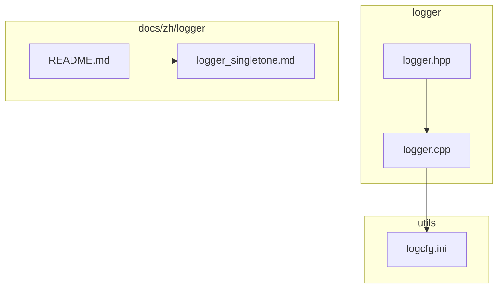
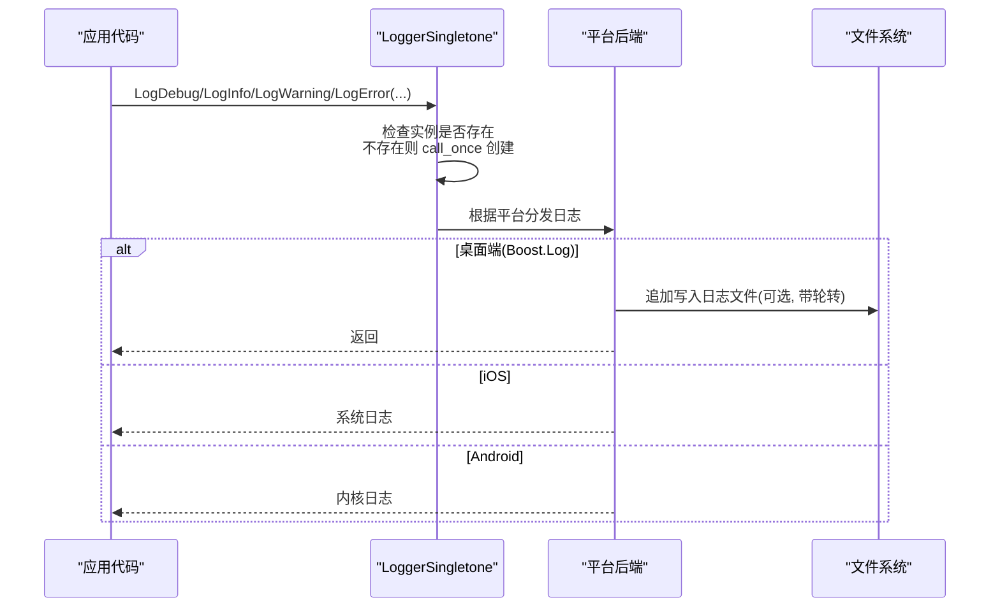
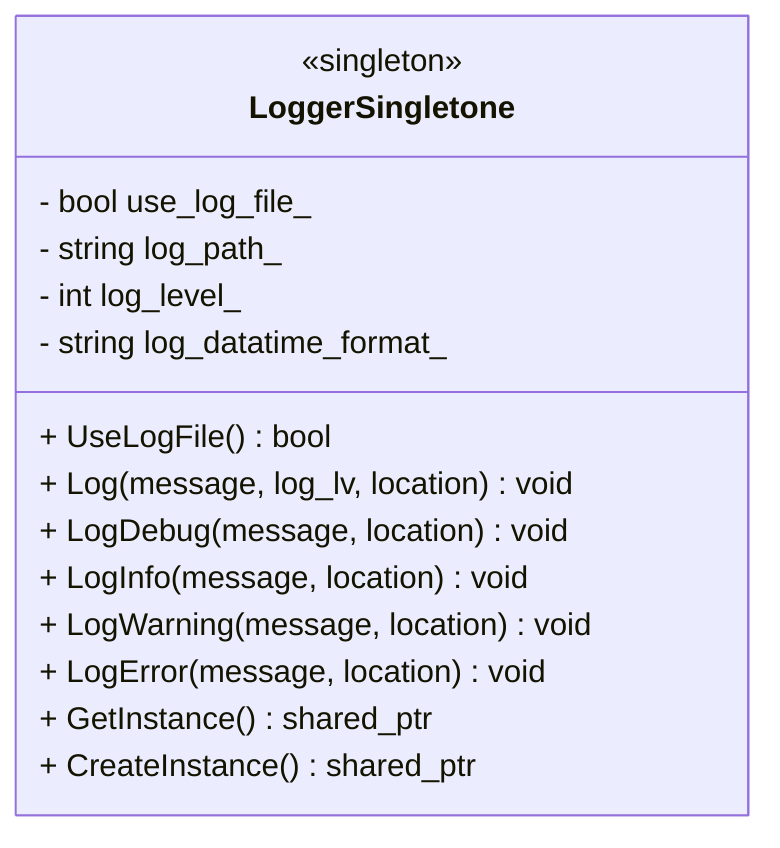
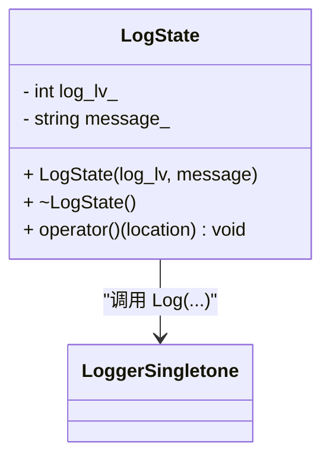
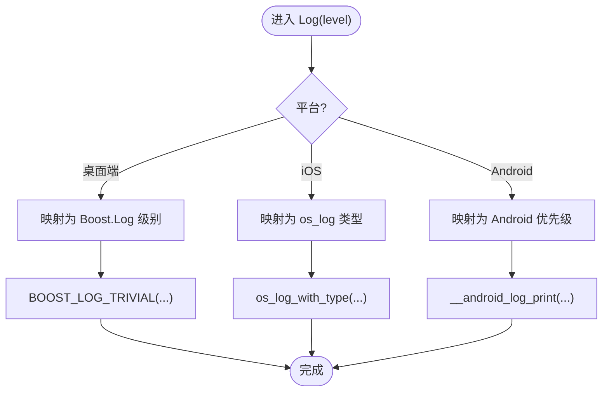
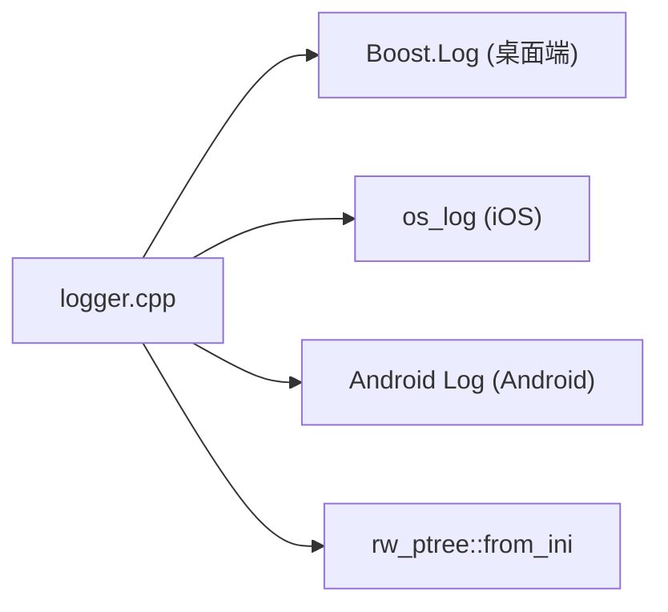

# 日志系统

<cite>
**本文引用的文件**   
- [logger.hpp](file://logger/logger.hpp)
- [logger.cpp](file://logger/logger.cpp)
- [logcfg.ini](file://utils/logcfg.ini)
- [README.md（logger 模块）](file://docs/zh/logger/README.md)
- [logger_singletone.md](file://docs/zh/logger/logger_singletone.md)
</cite>

## 目录
1. [简介](#简介)
2. [项目结构](#项目结构)
3. [核心组件](#核心组件)
4. [架构总览](#架构总览)
5. [详细组件分析](#详细组件分析)
6. [依赖关系分析](#依赖关系分析)
7. [性能与并发特性](#性能与并发特性)
8. [配置与格式化](#配置与格式化)
9. [使用示例与最佳实践](#使用示例与最佳实践)
10. [故障排查](#故障排查)
11. [结论](#结论)

## 简介
本章节面向 HsBaSlicer 的日志子系统，聚焦 Logger 类的架构设计与核心能力：多级别日志、线程安全、跨平台输出、基于 Boost.Log 的文件与控制台输出、以及 INI 配置文件驱动的动态行为。文档同时覆盖日志级别管理、输出目标、轮转策略、时间戳格式、上下文信息捕获，并给出集成与使用建议。

## 项目结构
日志相关代码位于 logger 目录，配套示例配置文件位于 utils 目录，文档位于 docs/zh/logger。



图表来源
- [logger.hpp:1-196](file://logger/logger.hpp#L1-L196)
- [logger.cpp:1-422](file://logger/logger.cpp#L1-L422)
- [logcfg.ini:1-8](file://utils/logcfg.ini#L1-L8)
- [README.md（logger 模块）:1-8](file://docs/zh/logger/README.md#L1-L8)
- [logger_singletone.md:1-51](file://docs/zh/logger/logger_singletone.md#L1-L51)

章节来源
- [logger.hpp:1-196](file://logger/logger.hpp#L1-L196)
- [logger.cpp:1-422](file://logger/logger.cpp#L1-L422)
- [logcfg.ini:1-8](file://utils/logcfg.ini#L1-L8)
- [README.md（logger 模块）:1-8](file://docs/zh/logger/README.md#L1-L8)
- [logger_singletone.md:1-51](file://docs/zh/logger/logger_singletone.md#L1-L51)

## 核心组件
- LoggerSingletone：单例日志器，提供线程安全的日志记录接口，支持 DEBUG/INFO/WARNING/ERROR/FATAL 等日志级别，自动捕获源码位置，跨平台适配（桌面端使用 Boost.Log，iOS 使用 os_log，Android 使用 Android Log）。
- LogState + 自定义字面量：提供“_log_debug/_log_info/_log_warning/_log_error”等便捷语法，延迟执行日志写入。
- 配置加载：启动时读取 logcfg.ini，设置日志级别、是否写文件、日志路径、时间戳格式等。

章节来源
- [logger.hpp:35-122](file://logger/logger.hpp#L35-L122)
- [logger.hpp:130-192](file://logger/logger.hpp#L130-L192)
- [logger.cpp:136-222](file://logger/logger.cpp#L136-L222)

## 架构总览
LoggerSingletone 在首次使用时通过 call_once 创建实例；日志写入根据平台选择不同后端：
- 桌面端（非 iOS/Android）：Boost.Log，同时输出到控制台和可选文件，支持按大小和时间轮转。
- iOS：os_log 系统日志。
- Android：__android_log_print 内核日志。



图表来源
- [logger.cpp:242-343](file://logger/logger.cpp#L242-L343)
- [logger.cpp:136-222](file://logger/logger.cpp#L136-L222)

## 详细组件分析

### LoggerSingletone 类设计
- 单例模式：静态 instance_、mutex_、once_flag_，通过 GetInstance()/CreateInstance() 控制构造。
- 线程安全：GetLogFile() 使用 shared_lock；构造与初始化逻辑通过 once_flag_ 保证一次性。
- 日志级别映射：内部整数级别映射到平台后端枚举（Boost.Log severity、os_log_type_t、Android priority）。
- 源码位置：通过 std::source_location 自动捕获文件名、行号、函数名，统一前缀输出。
- 配置驱动：构造函数中读取 logcfg.ini，设置日志级别、文件开关、路径、时间格式。



图表来源
- [logger.hpp:35-122](file://logger/logger.hpp#L35-L122)
- [logger.cpp:136-222](file://logger/logger.cpp#L136-L222)
- [logger.cpp:236-240](file://logger/logger.cpp#L236-L240)
- [logger.cpp:418-421](file://logger/logger.cpp#L418-L421)

章节来源
- [logger.hpp:35-122](file://logger/logger.hpp#L35-L122)
- [logger.cpp:136-222](file://logger/logger.cpp#L136-L222)
- [logger.cpp:236-240](file://logger/logger.cpp#L236-L240)
- [logger.cpp:418-421](file://logger/logger.cpp#L418-L421)

### LogState 与自定义字面量
- LogState 持有日志级别与消息，析构或调用 operator() 时触发实际日志写入。
- 提供 _log_debug/_log_info/_log_warning/_log_error 字面量，便于链式风格调用。



图表来源
- [logger.hpp:130-192](file://logger/logger.hpp#L130-L192)
- [logger.cpp:382-407](file://logger/logger.cpp#L382-L407)

章节来源
- [logger.hpp:130-192](file://logger/logger.hpp#L130-L192)
- [logger.cpp:382-407](file://logger/logger.cpp#L382-L407)

### 日志级别与平台映射
- 内部整数级别：0=trace/verbose，1=debug，2=info，3=warning，4=error，5=fatal。
- 桌面端：映射到 boost::log::trivial::severity。
- iOS：映射到 OS_LOG_TYPE_*。
- Android：映射到 ANDROID_LOG_*。



图表来源
- [logger.cpp:54-78](file://logger/logger.cpp#L54-L78)
- [logger.cpp:80-105](file://logger/logger.cpp#L80-L105)
- [logger.cpp:107-133](file://logger/logger.cpp#L107-L133)
- [logger.cpp:242-343](file://logger/logger.cpp#L242-L343)

章节来源
- [logger.cpp:54-78](file://logger/logger.cpp#L54-L78)
- [logger.cpp:80-105](file://logger/logger.cpp#L80-L105)
- [logger.cpp:107-133](file://logger/logger.cpp#L107-L133)
- [logger.cpp:242-343](file://logger/logger.cpp#L242-L343)

### 源码位置与上下文信息
- 通过 std::source_location 自动获取文件名、行号、函数名，统一拼接为日志前缀。
- 所有日志 API 均默认携带 source_location，便于定位问题。

章节来源
- [logger.cpp:47-52](file://logger/logger.cpp#L47-L52)
- [logger.cpp:242-343](file://logger/logger.cpp#L242-L343)

## 依赖关系分析
- 平台条件编译：
  - 桌面端：Boost.Log（expressions、sinks/text_file_backend、sources/severity_logger、utility/setup/*）。
  - iOS：os_log。
  - Android：__android_log_print。
- 配置读取：使用 fileoperator/rw_ptree 提供的 from_ini 解析 INI。



图表来源
- [logger.cpp:17-27](file://logger/logger.cpp#L17-L27)
- [logger.cpp:29-35](file://logger/logger.cpp#L29-L35)
- [logger.cpp:37-37](file://logger/logger.cpp#L37-L37)

章节来源
- [logger.cpp:17-27](file://logger/logger.cpp#L17-L27)
- [logger.cpp:29-35](file://logger/logger.cpp#L29-L35)
- [logger.cpp:37-37](file://logger/logger.cpp#L37-L37)

## 性能与并发特性
- 单例初始化：使用 std::call_once 确保仅初始化一次，避免重复开销。
- 线程安全：GetLogFile() 使用 shared_mutex 保护；其余日志写入直接委托给平台后端，未引入额外锁。
- 异步写入：当前实现为同步写入（Boost.Log sink 默认同步），并非异步队列。若需高吞吐，可考虑扩展为独立写入线程+无锁队列。
- 日志轮转：
  - 文件大小：固定阈值（50MB）轮转。
  - 时间轮转：每日零点轮转。
- 控制台与文件：默认启用控制台输出；文件输出受配置项控制。

章节来源
- [logger.cpp:236-240](file://logger/logger.cpp#L236-L240)
- [logger.cpp:224-234](file://logger/logger.cpp#L224-L234)
- [logger.cpp:196-209](file://logger/logger.cpp#L196-L209)

## 配置与格式化

### 配置文件格式（INI）
- 位置：程序运行目录下 logcfg.ini。
- 关键键值：
  - [log]
    - log_level：常规构建下的日志级别阈值。
    - log_level_debug：调试构建下的日志级别阈值。
    - use_log_file：是否启用文件输出。
    - log_file：日志文件相对路径（与当前工作目录拼接）。
  - [log_format]
    - log_datatime_format：时间戳格式（strftime）。

```ini
[log]
log_level = 3
log_level_debug = 1
use_log_file = false
log_file = /log/log.txt
[log_format]
log_datatime_format=%Y-%m-%d %H:%M:%S
log_time_format=%H:%M:%S
```

章节来源
- [logcfg.ini:1-8](file://utils/logcfg.ini#L1-L8)
- [logger.cpp:147-183](file://logger/logger.cpp#L147-L183)

### 动态配置更新
- 当前实现仅在构造时读取一次配置，未提供运行时热重载接口。
- 如需动态更新，可在 LoggerSingletone 暴露 SetLogLevel/SetUseLogFile/SetLogPath/SetDateTimeFormat 等方法，并在修改后重新配置 Boost.Log 过滤器与 sink。

章节来源
- [logger.cpp:147-183](file://logger/logger.cpp#L147-L183)

### 输出目标与轮转策略
- 控制台：始终启用。
- 文件：当 use_log_file=true 时启用，路径由 log_file 指定。
- 轮转：
  - rotation_size：50MB。
  - time_based_rotation：每天 00:00:00 轮转。
  - open_mode：追加写入。

章节来源
- [logger.cpp:196-209](file://logger/logger.cpp#L196-L209)

### 日志格式化与时间戳
- 桌面端使用 Boost.Log formatter，包含时间戳、严重级别、消息文本。
- 时间戳格式来自配置项 log_datatime_format。

章节来源
- [logger.cpp:190-209](file://logger/logger.cpp#L190-L209)

## 使用示例与最佳实践

### 集成与基本用法
- 获取单例：LoggerSingletone::GetInstance()。
- 常用 API：
  - LogDebug("...")
  - LogInfo("...")
  - LogWarning("...")
  - LogError("...")
- 自定义字面量：
  - "msg"_log_debug()
  - "msg"_log_info()
  - "msg"_log_warning()
  - "msg"_log_error()

章节来源
- [logger.hpp:50-83](file://logger/logger.hpp#L50-L83)
- [logger.hpp:167-191](file://logger/logger.hpp#L167-L191)
- [logger.cpp:345-379](file://logger/logger.cpp#L345-L379)
- [logger.cpp:392-407](file://logger/logger.cpp#L392-L407)

### 错误日志记录
- 在异常分支或失败路径使用 LogError 记录错误信息与上下文。
- 结合源码位置自动打印文件、行号、函数名，便于快速定位。

章节来源
- [logger.cpp:242-343](file://logger/logger.cpp#L242-L343)

### 调试信息输出
- 开发阶段将 log_level_debug 调低以输出更多调试信息。
- 生产环境保持较高阈值以减少 IO 压力。

章节来源
- [logger.cpp:150-167](file://logger/logger.cpp#L150-L167)

### 性能分析日志
- 建议在关键路径使用 LogInfo 或 LogDebug 记录耗时点，配合外部计时工具进行分析。
- 注意在高频路径避免过多日志，必要时关闭文件输出或使用更高阈值。

章节来源
- [logger.cpp:196-209](file://logger/logger.cpp#L196-L209)

### 最佳实践
- 日志级别选择：
  - 调试期：DEBUG/TRACE 级别，便于排障。
  - 测试期：INFO 为主，WARNING 以上必出。
  - 生产期：WARNING/ERROR 为主，必要时开启 INFO。
- 敏感信息处理：
  - 不要在日志中输出密码、密钥、用户隐私数据。
  - 对必要字段进行脱敏或哈希处理。
- 性能优化：
  - 合理设置日志级别，减少不必要的字符串拼接与 IO。
  - 高频路径谨慎使用 LogDebug，必要时通过宏或开关控制。
  - 文件输出过大时启用轮转，避免单文件膨胀。

章节来源
- [logger.cpp:150-167](file://logger/logger.cpp#L150-L167)
- [logger.cpp:196-209](file://logger/logger.cpp#L196-L209)

## 故障排查
- 日志不输出：
  - 检查 logcfg.ini 是否存在且可读。
  - 确认 log_level 与当前构建模式（_DEBUG）匹配。
  - 桌面端确认 Boost.Log 已正确链接。
- 文件未生成：
  - 检查 use_log_file 是否为 true。
  - 校验 log_file 路径是否有效且具备写入权限。
- 轮转异常：
  - 确认 rotation_size 与时间轮转参数是否符合预期。
  - 检查磁盘空间与权限。
- 平台差异：
  - iOS 使用系统日志，Android 使用内核日志，行为与桌面端不同。

章节来源
- [logger.cpp:147-183](file://logger/logger.cpp#L147-L183)
- [logger.cpp:196-209](file://logger/logger.cpp#L196-L209)
- [logger.cpp:212-221](file://logger/logger.cpp#L212-L221)

## 结论
HsBaSlicer 的日志系统以 LoggerSingletone 为核心，采用单例与平台适配策略，提供跨平台的稳定日志能力。其通过 INI 配置驱动日志级别、输出目标与格式化，满足从开发调试到生产运行的多样化需求。当前实现为同步写入，具备基础的文件轮转能力；若业务需要更高吞吐，可扩展为异步写入与动态配置热重载。遵循本文的最佳实践，可在保证可观测性的同时兼顾性能与安全。