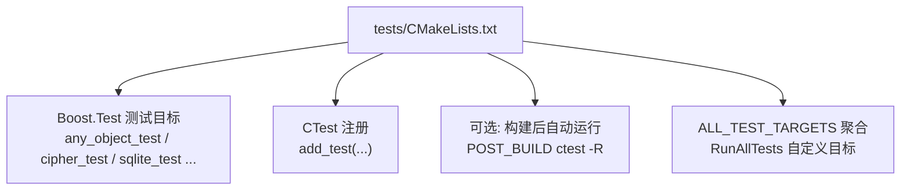
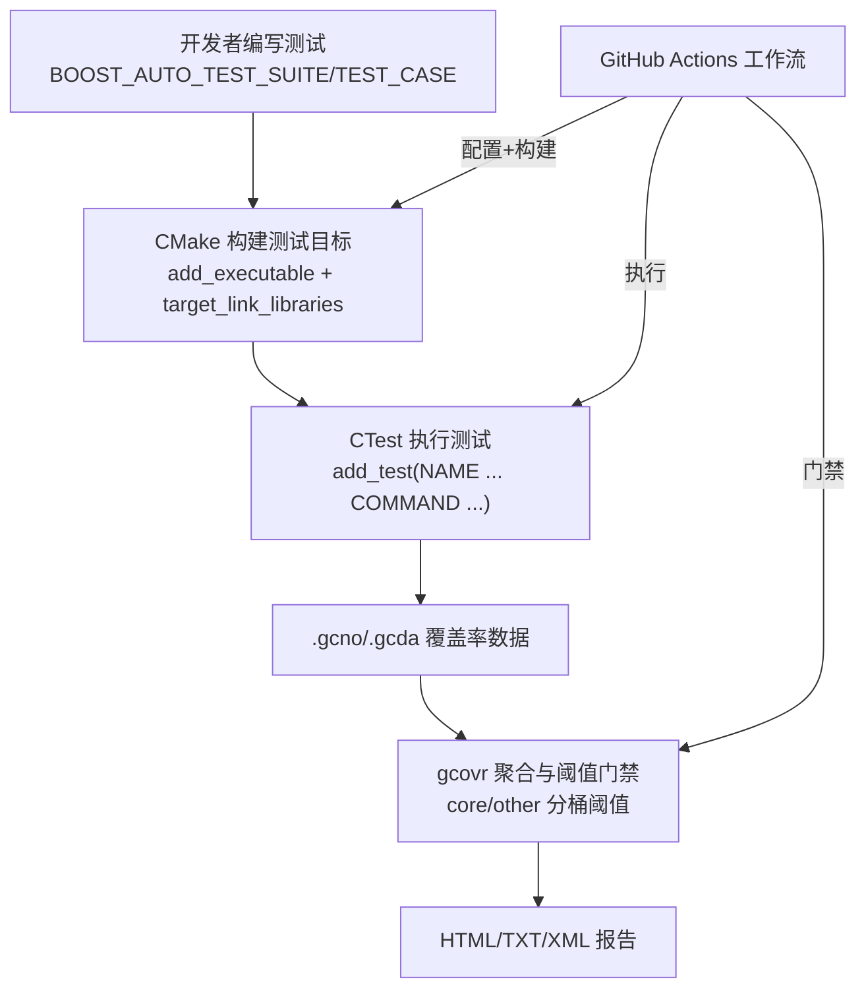
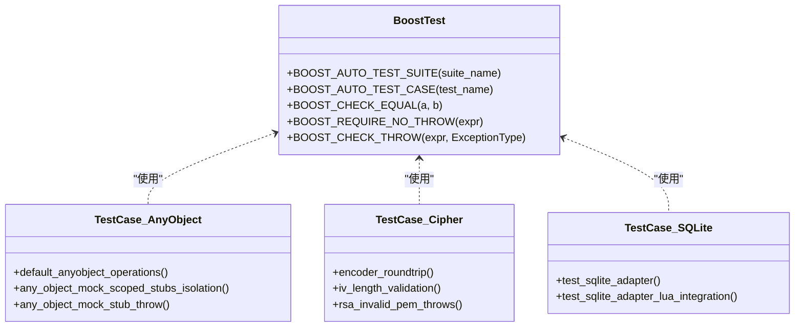
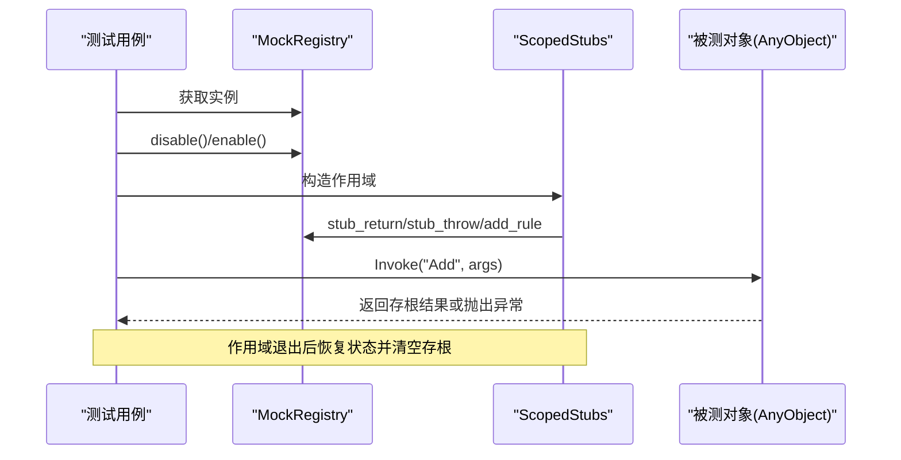
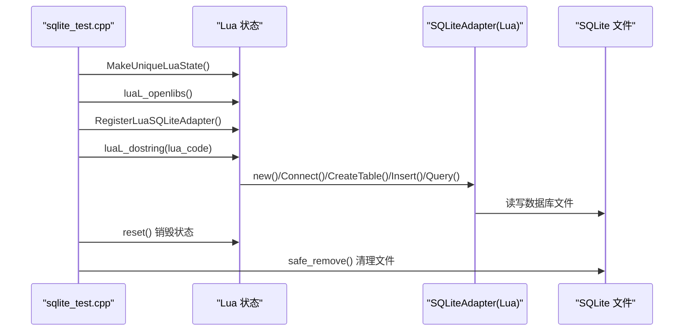
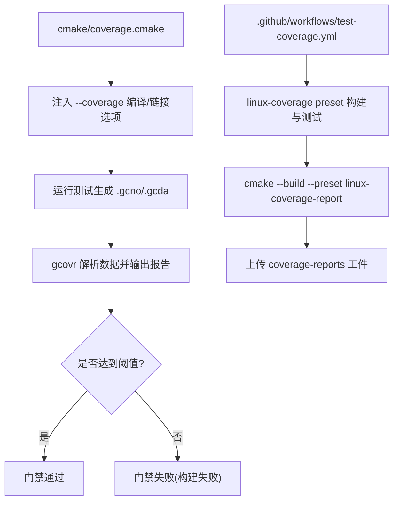
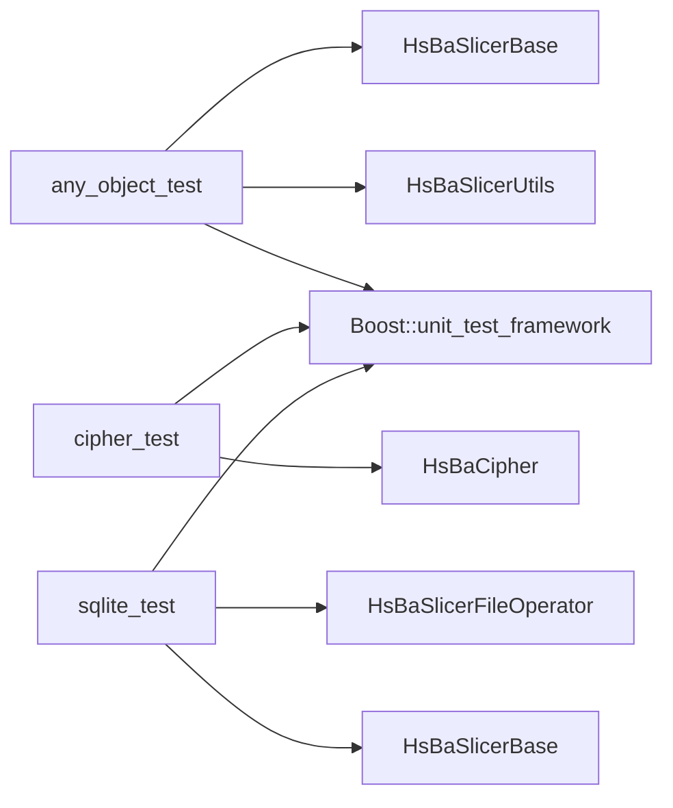

# 测试框架和单元测试

<cite>
**本文引用的文件**   
- [tests/CMakeLists.txt](file://tests/CMakeLists.txt)
- [cmake/coverage.cmake](file://cmake/coverage.cmake)
- [.github/workflows/test-coverage.yml](file://.github/workflows/test-coverage.yml)
- [tests/AnyObject/any_object_test.cpp](file://tests/AnyObject/any_object_test.cpp)
- [tests/Cipher/cipher_test.cpp](file://tests/Cipher/cipher_test.cpp)
- [tests/FilesOperator/sqlite_test.cpp](file://tests/FilesOperator/sqlite_test.cpp)
</cite>

## 目录
1. [简介](#简介)
2. [项目结构](#项目结构)
3. [核心组件](#核心组件)
4. [架构总览](#架构总览)
5. [详细组件分析](#详细组件分析)
6. [依赖关系分析](#依赖关系分析)
7. [性能与基准测试](#性能与基准测试)
8. [故障排查指南](#故障排查指南)
9. [结论](#结论)
10. [附录：编写规范与最佳实践](#附录编写规范与最佳实践)

## 简介
本指南面向 HsBaSlicer 的测试开发者，系统性说明测试框架的架构、用例组织、数据管理、模拟对象创建、集成测试方法、性能基准构建以及持续集成中的自动化执行与覆盖率门禁。HsBaSlicer 使用 Boost.Test 作为单元测试框架，通过 CMake 为每个测试目标注册可执行文件并统一接入 CTest；同时提供基于 gcov/gcovr 的覆盖率统计与阈值门禁脚本，并在 GitHub Actions 中实现端到端的测试与报告流水线。

## 项目结构
测试代码位于 tests 目录下，按功能模块划分子目录（如 AnyObject、Cipher、FilesOperator、Models、PathsOut、Support 等），每个子目录包含一个或多个以 _test.cpp 结尾的测试源文件。顶层 tests/CMakeLists.txt 负责：
- 查找 Boost unit_test_framework
- 为每个测试目标 add_executable 并链接被测库与 Boost::unit_test_framework
- 启用 enable_testing() 并通过 add_test 将测试目标注册到 CTest
- 可选在构建后自动运行单个测试或全部测试
- 汇总 ALL_TEST_TARGETS 列表，并提供 RunAllTests 自定义目标

图表来源
- [tests/CMakeLists.txt:1-15](file://tests/CMakeLists.txt#L1-L15)
- [tests/CMakeLists.txt:29-39](file://tests/CMakeLists.txt#L29-L39)
- [tests/CMakeLists.txt:355-411](file://tests/CMakeLists.txt#L355-L411)

章节来源
- [tests/CMakeLists.txt:1-15](file://tests/CMakeLists.txt#L1-L15)
- [tests/CMakeLists.txt:29-39](file://tests/CMakeLists.txt#L29-L39)
- [tests/CMakeLists.txt:355-411](file://tests/CMakeLists.txt#L355-L411)

## 核心组件
- 测试框架与入口
  - 使用 Boost.Test 的 BOOST_AUTO_TEST_SUITE 与 BOOST_AUTO_TEST_CASE 组织测试套件与用例。
  - 每个测试文件定义 BOOST_TEST_MODULE，并使用 boost/test/included/unit_test.hpp 进行内联编译。
- 构建与执行
  - 通过 CMake 为每个测试生成独立可执行文件，并链接被测库与 Boost::unit_test_framework。
  - 使用 enable_testing() 与 add_test(NAME ... COMMAND ...) 将测试纳入 CTest。
  - 支持 HSBA_RUN_TESTS_AFTER_BUILD 开关，在 POST_BUILD 阶段自动运行指定测试。
- 覆盖率与门禁
  - cmake/coverage.cmake 提供 --coverage 编译/链接选项注入，gcovr 聚合 .gcda/.gcno 数据，输出 JSON/TXT/XML/HTML 报告，并按“核心模块”与“其他模块”分别设置行覆盖率阈值。
  - GitHub Actions 工作流 .github/workflows/test-coverage.yml 在 Linux 上执行完整测试集合并触发覆盖率门禁。

章节来源
- [tests/CMakeLists.txt:1-15](file://tests/CMakeLists.txt#L1-L15)
- [tests/CMakeLists.txt:29-39](file://tests/CMakeLists.txt#L29-L39)
- [cmake/coverage.cmake:1-37](file://cmake/coverage.cmake#L1-L37)
- [.github/workflows/test-coverage.yml:1-15](file://.github/workflows/test-coverage.yml#L1-L15)

## 架构总览
下图展示从源码到测试执行与覆盖率门禁的整体流程：

图表来源
- [tests/CMakeLists.txt:29-39](file://tests/CMakeLists.txt#L29-L39)
- [cmake/coverage.cmake:115-172](file://cmake/coverage.cmake#L115-L172)
- [.github/workflows/test-coverage.yml:88-102](file://.github/workflows/test-coverage.yml#L88-L102)

## 详细组件分析

### 单元测试框架与用例组织
- 测试套件与用例命名
  - 使用 BOOST_AUTO_TEST_SUITE 包裹一组相关用例，便于分组与筛选。
  - 使用 BOOST_AUTO_TEST_CASE 定义最小粒度的测试用例，名称应语义化描述断言意图。
- 测试隔离原则
  - 每个测试用例尽量保持自包含，避免共享全局可变状态。
  - 对需要临时启用的特性（如 Mock）使用作用域 RAII 控制，确保用例间互不干扰。
- 断言模式
  - 使用 BOOST_CHECK_* 系列进行条件检查，使用 BOOST_REQUIRE_* 在失败时立即终止当前用例。
  - 对异常路径使用 BOOST_CHECK_THROW 验证抛出类型与消息。
- 示例参考
  - AnyObject 测试展示了基本操作、字段遍历、方法调用、Mock 开关与作用域隔离、参数匹配规则、Lua 交互错误传播等。
  - Cipher 测试展示了加密/解密往返、IV 长度校验、RSA PEM 输入合法性校验、哈希值断言等。
  - SQLite 测试展示了数据库连接、建表、插入、查询、更新、删除，以及与 Lua 适配器的双向调用约定。

图表来源
- [tests/AnyObject/any_object_test.cpp:103-116](file://tests/AnyObject/any_object_test.cpp#L103-L116)
- [tests/AnyObject/any_object_test.cpp:190-252](file://tests/AnyObject/any_object_test.cpp#L190-L252)
- [tests/Cipher/cipher_test.cpp:66-80](file://tests/Cipher/cipher_test.cpp#L66-L80)
- [tests/Cipher/cipher_test.cpp:166-182](file://tests/Cipher/cipher_test.cpp#L166-L182)
- [tests/FilesOperator/sqlite_test.cpp:23-57](file://tests/FilesOperator/sqlite_test.cpp#L23-L57)

章节来源
- [tests/AnyObject/any_object_test.cpp:103-116](file://tests/AnyObject/any_object_test.cpp#L103-L116)
- [tests/AnyObject/any_object_test.cpp:190-252](file://tests/AnyObject/any_object_test.cpp#L190-L252)
- [tests/Cipher/cipher_test.cpp:66-80](file://tests/Cipher/cipher_test.cpp#L66-L80)
- [tests/Cipher/cipher_test.cpp:166-182](file://tests/Cipher/cipher_test.cpp#L166-L182)
- [tests/FilesOperator/sqlite_test.cpp:23-57](file://tests/FilesOperator/sqlite_test.cpp#L23-L57)

### 测试数据管理
- 内联构造数据
  - 在测试函数内部直接构造向量、字符串、数值等基础数据，保证用例自包含。
- 动态生成密钥与证书
  - 在 Cipher 测试中，使用 OpenSSL 接口动态生成 RSA 公私钥 PEM，用于加密/解密往返测试。
- 临时文件与清理
  - SQLite 测试在运行前检测并删除 test.db/lua_test.db 等临时数据库文件，测试结束后显式销毁 Lua 状态以确保文件句柄释放，再安全删除文件。
- 建议
  - 所有外部资源（文件、网络、数据库）应在测试开始前准备，在测试结束或析构时清理，避免跨用例污染。

章节来源
- [tests/Cipher/cipher_test.cpp:30-63](file://tests/Cipher/cipher_test.cpp#L30-L63)
- [tests/FilesOperator/sqlite_test.cpp:33-36](file://tests/FilesOperator/sqlite_test.cpp#L33-L36)
- [tests/FilesOperator/sqlite_test.cpp:98-122](file://tests/FilesOperator/sqlite_test.cpp#L98-L122)

### 模拟对象与隔离策略
- Mock 机制
  - 通过 Mock::MockRegistry 提供 stub_return、stub_throw、add_rule 等方法，结合 ScopedStubs 作用域控制，实现方法级替换与调用记录。
- 隔离原则
  - 使用 ScopedStubs 的作用域退出自动恢复 Mock 状态并清空存根，确保用例之间互不影响。
- 参数匹配与优先级
  - 支持 ArgAtIs、ArgAtMatches 等参数匹配器，配合 add_rule 定义不同参数条件下的行为，便于覆盖分支逻辑。
- 示例参考
  - any_object_test.cpp 展示了手动开关 Mock、作用域隔离、异常抛出的存根、参数依赖规则与优先级、Lua 调用错误传播等。

图表来源
- [tests/AnyObject/any_object_test.cpp:190-252](file://tests/AnyObject/any_object_test.cpp#L190-L252)
- [tests/AnyObject/any_object_test.cpp:254-333](file://tests/AnyObject/any_object_test.cpp#L254-L333)

章节来源
- [tests/AnyObject/any_object_test.cpp:190-252](file://tests/AnyObject/any_object_test.cpp#L190-L252)
- [tests/AnyObject/any_object_test.cpp:254-333](file://tests/AnyObject/any_object_test.cpp#L254-L333)

### 集成测试与端到端流程
- 组件间交互
  - SQLite 测试不仅验证 SQLAdapter 的基本 CRUD，还通过 Lua 适配器验证 C++ 类在 Lua 环境中的方法与静态调用约定。
- 外部依赖模拟
  - 对于 OpenSSL、Lua、SQLite 等外部依赖，测试通过真实库调用与内存对象模拟相结合，确保关键路径被覆盖。
- 端到端流程
  - 在 SQLite Lua 集成测试中，创建 Lua 状态、注册 SQLiteAdapter、执行 Lua 脚本完成建表/插入/查询，最后显式销毁 Lua 状态并安全删除数据库文件。

图表来源
- [tests/FilesOperator/sqlite_test.cpp:59-122](file://tests/FilesOperator/sqlite_test.cpp#L59-L122)
- [tests/FilesOperator/sqlite_test.cpp:125-184](file://tests/FilesOperator/sqlite_test.cpp#L125-L184)

章节来源
- [tests/FilesOperator/sqlite_test.cpp:59-122](file://tests/FilesOperator/sqlite_test.cpp#L59-L122)
- [tests/FilesOperator/sqlite_test.cpp:125-184](file://tests/FilesOperator/sqlite_test.cpp#L125-L184)

### 覆盖率与门禁
- 覆盖率采集
  - cmake/coverage.cmake 在 GNU/Clang 工具链下注入 --coverage 编译与链接选项，使测试运行后生成 .gcno/.gcda 数据。
  - 通过 gcovr 解析数据，输出 JSON、TXT、XML、HTML 报告，并分别对“核心模块”与“其他模块”应用阈值门禁。
- 阈值与过滤
  - 核心模块过滤器包括 base、2D、utils、cipher、meshmodel、paths、preprocess、support、LibHsBaSlicer 等目录。
  - 排除 tests、samples、static_tests、third_parts_without_vcpkg、docs、out、build 等目录。
- 并行与性能
  - 支持 HSBA_COVERAGE_JOBS 控制 gcovr 并行度，避免在慢文件系统或低内存环境中 OOM。
- CI 集成
  - .github/workflows/test-coverage.yml 在 Ubuntu 上安装依赖、克隆 vcpkg、配置 linux-coverage preset、构建、运行测试、执行覆盖率门禁，并将报告上传为工件。

图表来源
- [cmake/coverage.cmake:16-37](file://cmake/coverage.cmake#L16-L37)
- [cmake/coverage.cmake:115-172](file://cmake/coverage.cmake#L115-L172)
- [.github/workflows/test-coverage.yml:88-102](file://.github/workflows/test-coverage.yml#L88-L102)
- [.github/workflows/test-coverage.yml:104-136](file://.github/workflows/test-coverage.yml#L104-L136)

章节来源
- [cmake/coverage.cmake:16-37](file://cmake/coverage.cmake#L16-L37)
- [cmake/coverage.cmake:115-172](file://cmake/coverage.cmake#L115-L172)
- [.github/workflows/test-coverage.yml:88-102](file://.github/workflows/test-coverage.yml#L88-L102)
- [.github/workflows/test-coverage.yml:104-136](file://.github/workflows/test-coverage.yml#L104-L136)

## 依赖关系分析
- 测试目标与被测库的依赖
  - 每个测试目标通过 target_link_libraries 链接被测库（如 HsBaSlicerBase、HsBaSlicerUtils、HsBaCipher、HsBaPaths、HsBaSupport、LibHsBaSlicer、DllHsBaSlicer 等）与 Boost::unit_test_framework。
  - 部分测试需要额外依赖（如 Eigen3、Lua、Fontconfig、Freetype）。
- 平台与编译器差异
  - MSVC 下对某些模板膨胀较大的测试（如 Graph）添加 /bigobj 编译选项。
  - 针对 Debug 配置跳过耗时测试（如 CGAL boolean operations）。
- 可选组件
  - OCCT 与 CGAL 相关测试仅在对应目标可用或启用 HSBA_COPL 时构建。

图表来源
- [tests/CMakeLists.txt:15-27](file://tests/CMakeLists.txt#L15-L27)
- [tests/CMakeLists.txt:601-626](file://tests/CMakeLists.txt#L601-L626)
- [tests/CMakeLists.txt:451-477](file://tests/CMakeLists.txt#L451-L477)

章节来源
- [tests/CMakeLists.txt:15-27](file://tests/CMakeLists.txt#L15-L27)
- [tests/CMakeLists.txt:601-626](file://tests/CMakeLists.txt#L601-L626)
- [tests/CMakeLists.txt:451-477](file://tests/CMakeLists.txt#L451-L477)

## 性能与基准测试
- 现状
  - 仓库未引入专门的基准测试框架（如 Google Benchmark）。现有测试主要关注正确性与覆盖率。
- 建议方案
  - 引入 Google Benchmark 或类似框架，建立独立的 benchmarks 目录，按模块划分基准用例。
  - 在 CMake 中新增 benchmark 目标，链接被测库与基准框架，并通过 CTest 注册基准用例。
  - 在 CI 中增加性能回归门禁（例如对比基线时间或吞吐量的阈值）。
- 指标收集与分析
  - 记录平均耗时、P95/P99 延迟、吞吐量、内存占用等指标。
  - 使用 gcov 辅助定位热点路径，结合性能剖析工具（如 perf、VTune）进行深度分析。

[本节为通用指导，不涉及具体文件]

## 故障排查指南
- 覆盖率门禁失败
  - 确认工具链为 GCC/Clang，且已安装 gcovr。
  - 检查 HSBA_COVERAGE_THRESHOLD_CORE 与 HSBA_COVERAGE_THRESHOLD_OTHER 阈值是否合理。
  - 调整 HSBA_COVERAGE_JOBS 以降低并行度，避免内存不足。
- 测试无法运行或超时
  - 检查是否需要特定依赖（如 Lua、Eigen、OCCT、CGAL）。
  - 对耗时测试（如 CGAL boolean ops）在 Debug 配置下跳过。
- 文件锁与清理问题
  - SQLite 测试中显式销毁 Lua 状态后再删除数据库文件，必要时加入重试与延时逻辑。

章节来源
- [cmake/coverage.cmake:16-37](file://cmake/coverage.cmake#L16-L37)
- [cmake/coverage.cmake:73-91](file://cmake/coverage.cmake#L73-L91)
- [tests/CMakeLists.txt:1039-1041](file://tests/CMakeLists.txt#L1039-L1041)
- [tests/FilesOperator/sqlite_test.cpp:98-122](file://tests/FilesOperator/sqlite_test.cpp#L98-L122)

## 结论
HsBaSlicer 的测试体系以 Boost.Test 为核心，通过 CMake 统一管理测试目标与 CTest 执行，辅以 gcov/gcovr 的覆盖率门禁与 GitHub Actions 的 CI 流水线，形成从本地开发到远程集成的闭环。建议在后续迭代中补充基准测试框架与性能门禁，进一步完善质量保障体系。

## 附录：编写规范与最佳实践
- 测试用例命名
  - 使用动词短语描述行为，如 encoder_roundtrip、iv_length_validation、test_sqlite_adapter。
- 断言使用模式
  - 优先使用 BOOST_REQUIRE_* 在关键前置条件失败时快速失败；使用 BOOST_CHECK_* 进行非致命检查。
  - 对异常路径使用 BOOST_CHECK_THROW 明确断言异常类型与消息。
- 测试隔离原则
  - 避免共享全局可变状态；如需 Mock，使用 ScopedStubs 作用域确保自动恢复。
- 测试数据准备
  - 内联构造基础数据；对外部资源（文件、网络、数据库）在测试前后进行准备与清理。
- 集成测试要点
  - 对组件间交互（如 Lua 适配器）进行端到端验证；对第三方库的错误路径进行健壮性测试。
- 持续集成
  - 使用预设（如 linux-coverage）统一构建与测试环境；在 PR 与调度任务中强制执行覆盖率门禁。

章节来源
- [tests/Cipher/cipher_test.cpp:66-80](file://tests/Cipher/cipher_test.cpp#L66-L80)
- [tests/Cipher/cipher_test.cpp:166-182](file://tests/Cipher/cipher_test.cpp#L166-L182)
- [tests/FilesOperator/sqlite_test.cpp:59-122](file://tests/FilesOperator/sqlite_test.cpp#L59-L122)
- [.github/workflows/test-coverage.yml:88-102](file://.github/workflows/test-coverage.yml#L88-L102)