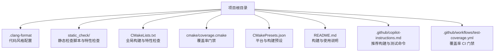
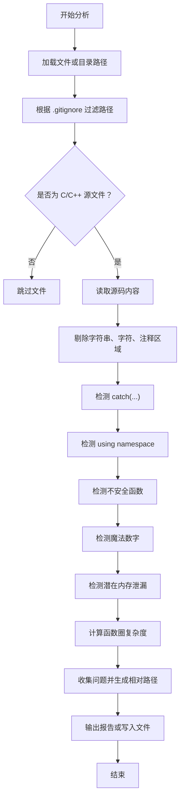
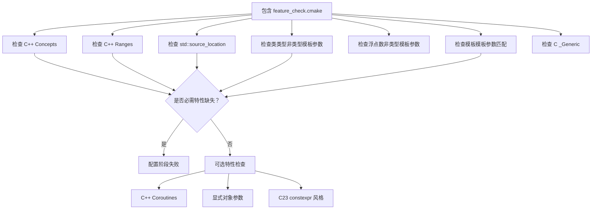
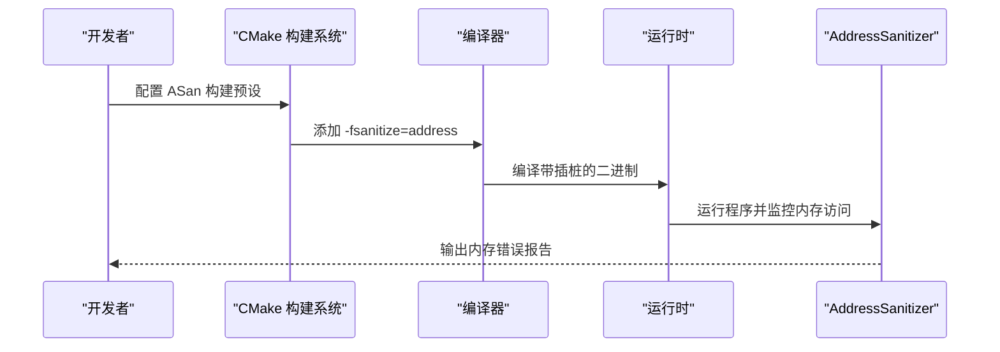
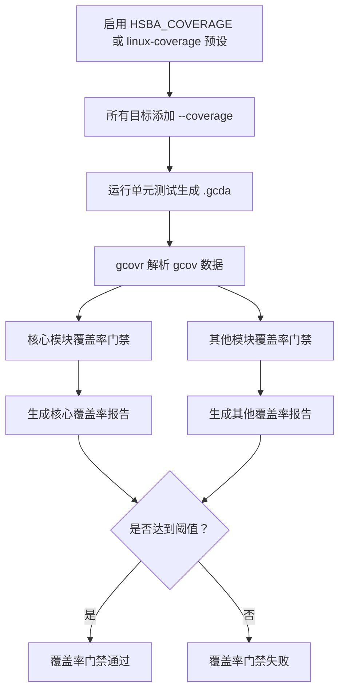
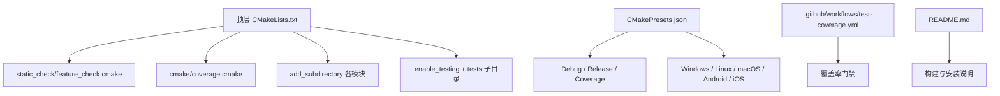

# 调试工具和技巧

<cite>
**本文引用的文件**   
- [.clang-format](file://.clang-format)
- [cpp_analyzer.py](file://static_check/cpp_analyzer.py)
- [feature_check.cmake](file://static_check/feature_check.cmake)
- [CMakeLists.txt](file://CMakeLists.txt)
- [coverage.cmake](file://cmake/coverage.cmake)
- [CMakePresets.json](file://CMakePresets.json)
- [README.md](file://README.md)
- [copilot-instructions.md](file://.github/copilot-instructions.md)
- [test-coverage.yml](file://.github/workflows/test-coverage.yml)
</cite>

## 目录
1. [引言](#引言)
2. [项目结构中的调试相关位置](#项目结构中的调试相关位置)
3. [静态代码分析工具](#静态代码分析工具)
4. [动态调试方法](#动态调试方法)
5. [内存泄漏检测与运行时检查](#内存泄漏检测与运行时检查)
6. [性能剖析与覆盖率分析](#性能剖析与覆盖率分析)
7. [实际调试案例](#实际调试案例)
8. [开发环境配置](#开发环境配置)
9. [依赖关系与构建选项总览](#依赖关系与构建选项总览)
10. [结论](#结论)

## 引言
本指南面向 HsBaSlicer 项目的开发者与维护者，目标是提供一套可操作的调试工具和技巧文档。内容覆盖：
- 静态代码分析：Clang-Format 格式化、自定义 C++ 静态检查脚本、编译器特性兼容性验证。
- 动态调试：GDB/LLDB 使用思路、断点与变量监视策略。
- 内存问题诊断：Valgrind、AddressSanitizer 等工具的集成思路和使用场景。
- 性能剖析：CPU 热点识别、内存使用分析与覆盖率门禁。
- 实际调试案例：从复现到定位再到修复的完整流程。
- 开发环境配置：IDE 调试器、远程调试、自动化测试与覆盖率门禁。

HsBaSlicer 是一个面向 3D 打印切片的高性能 C++ 框架，模块化程度高、跨平台支持强，因此调试工作既要关注核心算法模块，也要关注多后端（CGAL、IGL、OpenCascade、OpenVDB 等）和不同平台（Windows、Linux、macOS、Android、iOS）的差异。

## 项目结构中的调试相关位置
在仓库中，与调试、质量保障和构建配置直接相关的文件主要集中在以下位置：
- 根目录 `.clang-format`：统一 C++ 代码风格。
- `static_check/`：静态检查脚本和编译器特性探测脚本。
- `cmake/coverage.cmake`：基于 gcov/gcovr 的代码覆盖率门禁逻辑。
- 顶层 `CMakeLists.txt`：全局编译标准、特性检查、测试开关、输出目录、安装规则等。
- `CMakePresets.json`：Windows/Linux/macOS/iOS 等平台预设，包含 Debug、Release、Coverage 等构建模式。
- `.github/workflows/test-coverage.yml`：CI 覆盖率门禁任务。
- `.github/copilot-instructions.md`：推荐的构建、测试命令和测试约定。
- `README.md`：项目说明、构建要求和常用命令。

**图表来源**
- [.clang-format:1-99](file://.clang-format#L1-L99)
- [cpp_analyzer.py:1-383](file://static_check/cpp_analyzer.py#L1-L383)
- [feature_check.cmake:1-123](file://static_check/feature_check.cmake#L1-L123)
- [CMakeLists.txt:1-120](file://CMakeLists.txt#L1-L120)
- [coverage.cmake:1-173](file://cmake/coverage.cmake#L1-L173)
- [CMakePresets.json:1-110](file://CMakePresets.json#L1-L110)
- [README.md:41-94](file://README.md#L41-L94)
- [copilot-instructions.md:13-24](file://.github/copilot-instructions.md#L13-L24)
- [test-coverage.yml:1-31](file://.github/workflows/test-coverage.yml#L1-L31)

**章节来源**
- [.clang-format:1-99](file://.clang-format#L1-L99)
- [CMakeLists.txt:1-120](file://CMakeLists.txt#L1-L120)
- [CMakePresets.json:1-110](file://CMakePresets.json#L1-L110)
- [README.md:41-94](file://README.md#L41-L94)

## 静态代码分析工具

### Clang-Format 代码格式化
`.clang-format` 定义了 C++17 风格的格式化规则，采用 Allman 大括号风格，缩进宽度为 4，列限制为 120，指针与引用左对齐，并启用了包含排序、命名空间处理、空格控制等常见规则。该配置文件适合团队统一代码风格，减少因格式差异导致的代码审查噪音。

建议实践：
- 在 IDE 中启用保存时自动格式化，确保提交前代码符合 `.clang-format`。
- 对新增或重构的核心算法模块优先格式化，避免引入不一致风格。
- 将格式化作为预提交钩子的一部分，防止格式问题进入主干。

**章节来源**
- [.clang-format:1-99](file://.clang-format#L1-L99)

### C++ 静态检查脚本
`static_check/cpp_analyzer.py` 是一个 Python 实现的 C/C++ 静态检查脚本，主要能力包括：
- 跳过 `.gitignore`、`tests`、`examples` 等内容。
- 禁止 `catch(...)`。
- 禁止 `using namespace`，但允许命名空间名中包含 `Literals` 的情况。
- 标记不安全函数如 `gets`、`strcpy`、`strcat`、`sprintf`、`vsprintf`。
- 检测魔法数字，排除常量定义、注释、字符串、已知安全数值等。
- 智能内存泄漏检测：扫描 `new`、`malloc`、`calloc`、`realloc`，判断附近是否存在配对释放，同时忽略智能指针、Qt/Boost 智能指针、放置 new 等常见豁免场景。
- 圈复杂度检测：默认阈值 10，超过阈值的函数会被报告。
- 输出结构化报告，支持按文件分组、行号列号定位、导出报告文件。

**图表来源**
- [cpp_analyzer.py:17-41](file://static_check/cpp_analyzer.py#L17-L41)
- [cpp_analyzer.py:43-193](file://static_check/cpp_analyzer.py#L43-L193)
- [cpp_analyzer.py:197-339](file://static_check/cpp_analyzer.py#L197-L339)
- [cpp_analyzer.py:342-383](file://static_check/cpp_analyzer.py#L342-L383)

使用建议：
- 在本地开发时，对修改过的模块运行该脚本，快速发现高风险编码问题。
- 在 CI 中将该脚本加入质量门禁，阻止明显不安全的代码合并。
- 对于误报，优先通过重构代码消除风险，而不是简单忽略。

**章节来源**
- [cpp_analyzer.py:1-383](file://static_check/cpp_analyzer.py#L1-L383)

### 编译器特性兼容性验证
`static_check/feature_check.cmake` 提供了多个 C/C++ 特性探测函数，例如：
- C 语言 `_Generic`。
- C++ Concepts、Ranges、`std::source_location`。
- 非类型模板参数：类类型、浮点数。
- 模板模板参数匹配。
- C++ Coroutines、显式对象参数 `explicit this`。
- C++20 Modules 支持检测。
- C23 constexpr 风格支持检测。

顶层 `CMakeLists.txt` 会调用这些函数，并根据结果设置编译宏或报错。例如，如果编译器不支持 Concepts、Ranges、`std::source_location`、类类型非类型模板参数、模板模板参数匹配，则会在配置阶段失败；如果不支持浮点数非类型模板参数，则给出警告并定义回退宏。

**图表来源**
- [feature_check.cmake:1-123](file://static_check/feature_check.cmake#L1-L123)
- [CMakeLists.txt:48-104](file://CMakeLists.txt#L48-L104)

使用建议：
- 升级编译器或调整工具链以满足必需特性要求。
- 对可选特性使用条件编译宏，保证旧工具链仍可构建基础功能。
- 在 CI 中固定编译器版本，避免特性支持波动导致构建不稳定。

**章节来源**
- [feature_check.cmake:1-123](file://static_check/feature_check.cmake#L1-L123)
- [CMakeLists.txt:48-104](file://CMakeLists.txt#L48-L104)

## 动态调试方法

### GDB 与 LLDB 调试器使用思路
虽然仓库中没有直接嵌入 GDB/LLDB 的配置脚本，但项目明确支持 Linux、Windows、macOS 等多平台，且 README 和 copilot 指令中提到了构建与测试命令。动态调试通常遵循以下通用流程：
- 使用 Debug 构建生成带调试符号的二进制文件。
- 在关键入口或异常路径设置断点，例如模型加载、切片流水线、路径生成、支撑生成等。
- 使用变量监视观察中间数据结构，例如多边形、网格、路径点集、参数存储。
- 使用线程视图排查多线程竞争、死锁、栈溢出等问题。
- 结合日志输出定位问题上下文，再缩小到具体函数或数据流。

由于 HsBaSlicer 大量使用第三方库（Boost、Eigen、Protobuf、Lua、OpenCV、CGAL、OpenVDB 等），调试时应注意：
- 第三方库可能没有调试符号，需要单独安装 debug 包或使用系统包管理器提供的符号文件。
- 多线程环境下，优先锁定主业务线程，再逐步扩展到其他线程。
- 对 Lua 脚本调用的 C++ 接口，应结合 Lua 层日志和 C++ 层断点联合定位。

### 断点设置技巧
- 在流水线入口设置条件断点，仅当输入模型或参数满足特定条件时触发。
- 在异常抛出或错误返回路径设置断点，快速捕获失败分支。
- 对高频循环（如多边形填充、路径优化）使用采样断点或性能计数器，避免打断正常执行。
- 对内存分配密集区域，结合 AddressSanitizer 或 Valgrind 进行内存问题定位。

### 变量监视方法
- 监视关键结构体字段，例如模型顶点、面片、层信息、路径坐标。
- 对容器类型（vector、list、map）使用可视化查看元素数量、容量、迭代状态。
- 对智能指针使用解引用后检查空指针、悬垂指针。
- 对 Lua 绑定对象，先确认 Lua 侧参数是否正确传递到 C++ 侧。

[本节为通用调试方法论，不直接分析具体源码文件]

## 内存泄漏检测与运行时检查

### Valgrind 使用场景
Valgrind 适合在 Linux 环境下检测内存泄漏、非法内存访问、未初始化内存使用等问题。建议在 Debug 构建下运行单元测试或最小复现程序，重点关注：
- 长时间运行的流水线。
- 频繁分配释放的对象。
- 第三方库封装层。
- Lua 与 C++ 边界的数据生命周期。

典型步骤：
- 构建 Debug 目标。
- 使用 Valgrind 运行测试或示例程序。
- 分析输出中的泄漏路径、非法读写、重复释放。
- 结合静态检查脚本和 AddressSanitizer 交叉验证。

### AddressSanitizer 集成思路
仓库中的技能文档示例展示了如何在 CMake 中启用 AddressSanitizer，例如通过选项 `ENABLE_ASAN` 控制编译器和链接器标志。虽然当前顶层 `CMakeLists.txt` 没有直接暴露 ASAN 选项，但可以借鉴该模式在项目现有构建体系中增加 ASAN 构建预设。

建议方案：
- 新增一个 CMake 预设，启用 `-fsanitize=address`。
- 在 Windows 上使用 MSVC 的 `/fsanitize=address`。
- 在 macOS 上使用 Xcode 或 clang 的 ASan 支持。
- 在 CI 中运行 ASan 测试，阻断内存安全问题合并。

**图表来源**
- [.agents\skills\cmake\SKILL.md:154-165](file://.agents/skills/cmake/SKILL.md#L154-L165)
- [.github\skills\cmake\SKILL.md:154-165](file://.github/skills/cmake/SKILL.md#L154-L165)

**章节来源**
- [.agents\skills\cmake\SKILL.md:154-165](file://.agents/skills/cmake/SKILL.md#L154-L165)
- [.github\skills\cmake\SKILL.md:154-165](file://.github/skills/cmake/SKILL.md#L154-L165)

## 性能剖析与覆盖率分析

### 覆盖率门禁：gcov 与 gcovr
项目已内置完整的覆盖率支持，通过 `HSBA_COVERAGE` 选项和 `linux-coverage` 预设启用。启用后：
- 所有目标以 `--coverage` 编译和链接。
- 运行 Boost.Test 测试后生成 `.gcda` 数据。
- `coverage` 目标使用 gcovr 聚合数据，并按核心模块与非核心模块分别检查行覆盖率阈值。
- 若覆盖率低于阈值，构建失败，便于 CI 门禁。

核心模块包括 `base`、`2D`、`utils`、`cipher`、`meshmodel`、`paths`、`preprocess`、`support`、`LibHsBaSlicer`；其他模块使用较低阈值。排除目录包括 `tests`、`samples`、`static_tests`、`static_check`、`third_parts_without_vcpkg`、`docs`、`out`、`build` 等。

**图表来源**
- [coverage.cmake:1-173](file://cmake/coverage.cmake#L1-L173)
- [CMakePresets.json:83-110](file://CMakePresets.json#L83-L110)
- [test-coverage.yml:1-31](file://.github/workflows/test-coverage.yml#L1-L31)

### CPU 性能分析与热点识别
虽然仓库没有直接集成 perf、VTune、Instruments 等工具的配置，但可结合以下策略：
- 使用 Release 构建配合性能分析工具，避免 Debug 优化干扰。
- 对热点函数设置采样断点或性能计数器。
- 对多边形填充、路径优化、支撑生成等计算密集型模块进行专项分析。
- 结合日志记录关键阶段耗时，定位瓶颈。

### 内存使用分析
- 使用 Valgrind 或 ASan 检测内存泄漏和非法访问。
- 使用系统工具（如 Linux `top`、`htop`、`valgrind --tool=massif`）观察进程内存增长。
- 对内存池、对象池、协程自定义分配器等关键组件进行基准测试，对比普通 `new/delete` 的性能与内存碎片情况。

**章节来源**
- [coverage.cmake:1-173](file://cmake/coverage.cmake#L1-L173)
- [CMakePresets.json:83-110](file://CMakePresets.json#L83-L110)
- [test-coverage.yml:1-31](file://.github/workflows/test-coverage.yml#L1-L31)

## 实际调试案例

### 案例一：静态检查发现潜在内存泄漏
现象：
- 新增一段手动分配内存的代码，未使用智能指针。
- 静态检查脚本报告在某行存在 `new` 或 `malloc`，附近 20 行内未发现配对释放。

诊断流程：
1. 打开静态检查报告，定位文件、行号、列号。
2. 检查该段代码是否确实存在资源释放遗漏。
3. 若确认为泄漏，改为智能指针或 RAII 管理。
4. 重新运行静态检查脚本，确认问题消失。

解决方向：
- 使用 `std::unique_ptr`、`std::shared_ptr`、`QScopedPointer`、`QSharedPointer` 等智能指针。
- 对 C 风格分配使用 RAII 包装。
- 避免在复杂控制流中手动管理原始指针。

**章节来源**
- [cpp_analyzer.py:43-193](file://static_check/cpp_analyzer.py#L43-L193)
- [cpp_analyzer.py:197-339](file://static_check/cpp_analyzer.py#L197-L339)

### 案例二：编译器特性缺失导致配置失败
现象：
- 在新机器上配置项目时报错，提示不支持 C++ Concepts 或 Ranges。

诊断流程：
1. 查看 `feature_check.cmake` 中对应特性检查函数。
2. 查看顶层 `CMakeLists.txt` 中对必需特性的失败逻辑。
3. 升级编译器或切换工具链。
4. 重新配置并构建。

解决方向：
- 使用支持 C++20 的 GCC、Clang 或 MSVC。
- 若必须兼容旧工具链，使用条件编译宏降级实现。

**章节来源**
- [feature_check.cmake:1-123](file://static_check/feature_check.cmake#L1-L123)
- [CMakeLists.txt:48-104](file://CMakeLists.txt#L48-L104)

### 案例三：覆盖率门禁失败
现象：
- CI 中覆盖率门禁失败，核心模块或非核心模块覆盖率低于阈值。

诊断流程：
1. 查看 `linux-coverage` 预设和 `coverage.cmake` 的阈值配置。
2. 本地运行覆盖率目标，查看 HTML/XML 报告。
3. 补充缺失的测试用例，提高关键路径覆盖率。
4. 避免无意义地扩大阈值，保持回归基线。

解决方向：
- 针对未覆盖分支编写单元测试。
- 对复杂逻辑拆分函数，降低圈复杂度，提升可测性。
- 在 CI 中固定覆盖率阈值，防止退化。

**章节来源**
- [CMakePresets.json:83-110](file://CMakePresets.json#L83-L110)
- [coverage.cmake:27-65](file://cmake/coverage.cmake#L27-L65)
- [test-coverage.yml:1-31](file://.github/workflows/test-coverage.yml#L1-L31)

## 开发环境配置

### IDE 调试器设置
- Windows：Visual Studio 2022+ 配合 CMake 预设，选择 `x64-debug` 或 `windows-debug` 预设进行调试。
- Linux：VS Code 或 CLion 配合 Ninja 生成器，使用 `linux-debug` 预设。
- macOS：Xcode 或 CLion，使用 `macos-debug` 预设。
- iOS：Xcode 构建 iOS Release 预设，调试需结合设备或模拟器。

### 远程调试配置
CMakePresets 中包含了 Visual Studio Remote Settings 的配置片段，可用于远程开发场景。远程调试时需注意：
- 确保远程机器有相同的项目结构和依赖。
- 配置正确的工具链文件和环境变量。
- 使用相同的构建预设，保证二进制一致。

### 自动化测试集成
项目使用 Boost.Test，并通过 CTest 统一管理测试。推荐命令：
- 配置：`cmake -B build -S . -G Ninja -DCMAKE_TOOLCHAIN_FILE=/path/to/vcpkg/scripts/buildsystems/vcpkg.cmake`
- 构建：`cmake --build build --config Release`
- 运行测试：`cd build && ctest --output-on-failure --parallel 2`

覆盖率门禁可通过 `linux-coverage` 预设和 `coverage` 目标完成，CI 中已有对应 workflow。

**章节来源**
- [CMakePresets.json:1-110](file://CMakePresets.json#L1-L110)
- [copilot-instructions.md:13-24](file://.github/copilot-instructions.md#L13-L24)
- [README.md:41-94](file://README.md#L41-L94)

## 依赖关系与构建选项总览

**图表来源**
- [CMakeLists.txt:1-120](file://CMakeLists.txt#L1-L120)
- [CMakeLists.txt:392-440](file://CMakeLists.txt#L392-L440)
- [CMakeLists.txt:667-695](file://CMakeLists.txt#L667-L695)
- [CMakePresets.json:1-110](file://CMakePresets.json#L1-L110)
- [test-coverage.yml:1-31](file://.github/workflows/test-coverage.yml#L1-L31)
- [README.md:41-94](file://README.md#L41-L94)

**章节来源**
- [CMakeLists.txt:1-120](file://CMakeLists.txt#L1-L120)
- [CMakeLists.txt:392-440](file://CMakeLists.txt#L392-L440)
- [CMakeLists.txt:667-695](file://CMakeLists.txt#L667-L695)
- [CMakePresets.json:1-110](file://CMakePresets.json#L1-L110)
- [test-coverage.yml:1-31](file://.github/workflows/test-coverage.yml#L1-L31)
- [README.md:41-94](file://README.md#L41-L94)

## 结论
HsBaSlicer 项目在静态检查、编译器特性验证、覆盖率门禁方面已有较完善的工程化基础。调试工作应围绕以下主线展开：
- 用 Clang-Format 统一代码风格，减少协作摩擦。
- 用 `cpp_analyzer.py` 提前发现不安全编码和潜在内存问题。
- 用 `feature_check.cmake` 确保编译器特性满足项目需求。
- 用 Debug 构建配合 GDB/LLDB 进行动态调试，结合日志和断点定位问题。
- 用 Valgrind 和 AddressSanitizer 检测内存问题，结合静态检查交叉验证。
- 用覆盖率门禁保证核心模块质量，防止回归。
- 用 CMakePresets 和 CI 工作流统一构建、测试、覆盖率门禁流程。

通过上述工具和方法的组合，开发者可以更高效地定位问题、提升代码质量、稳定发布版本。