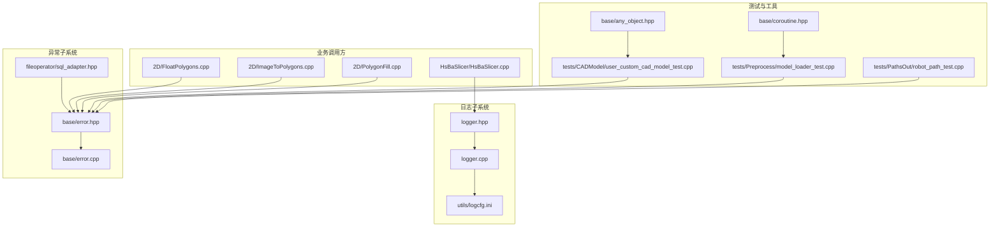
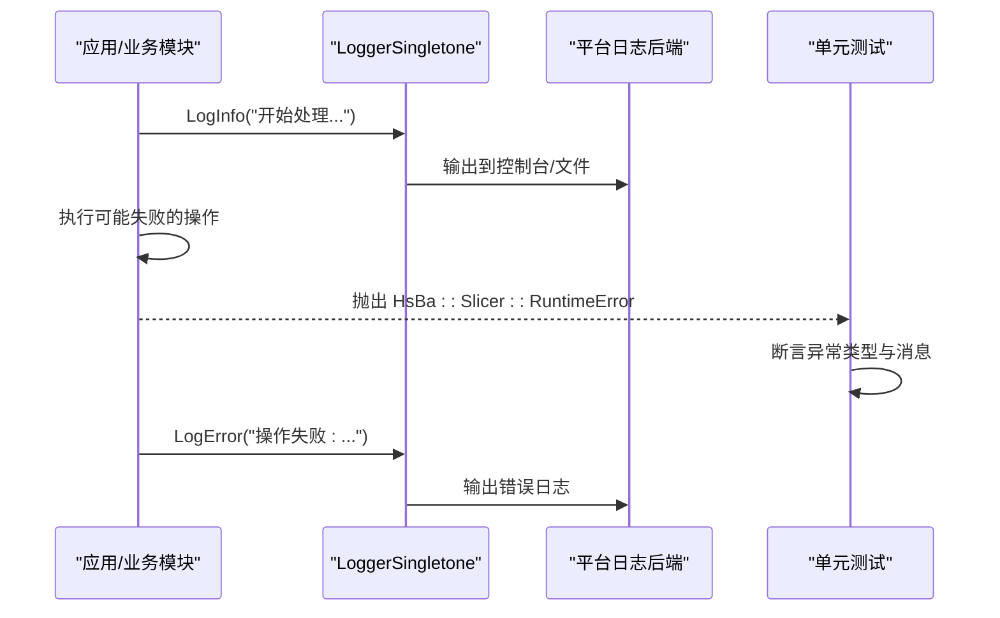
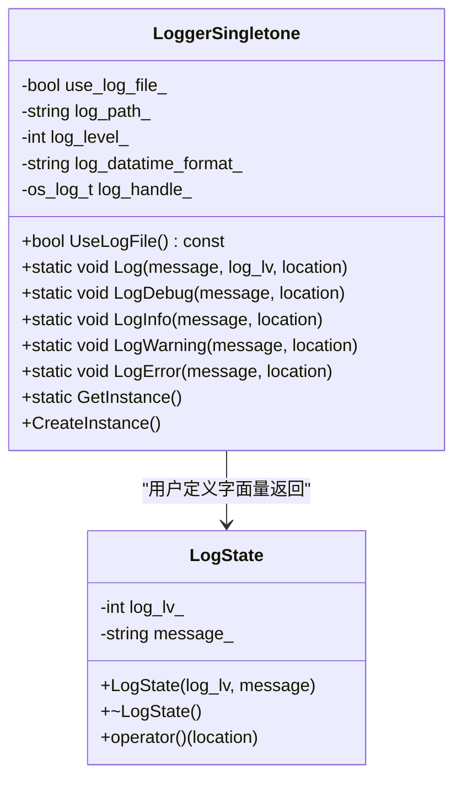
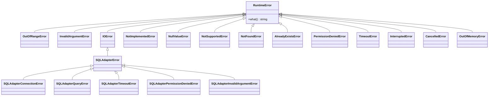
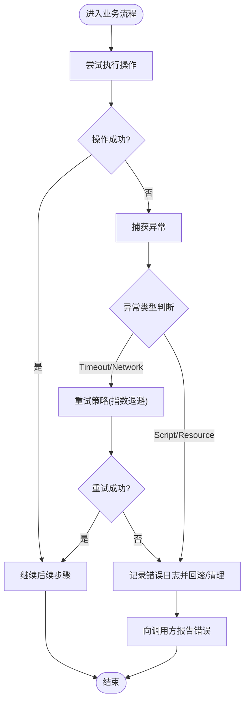
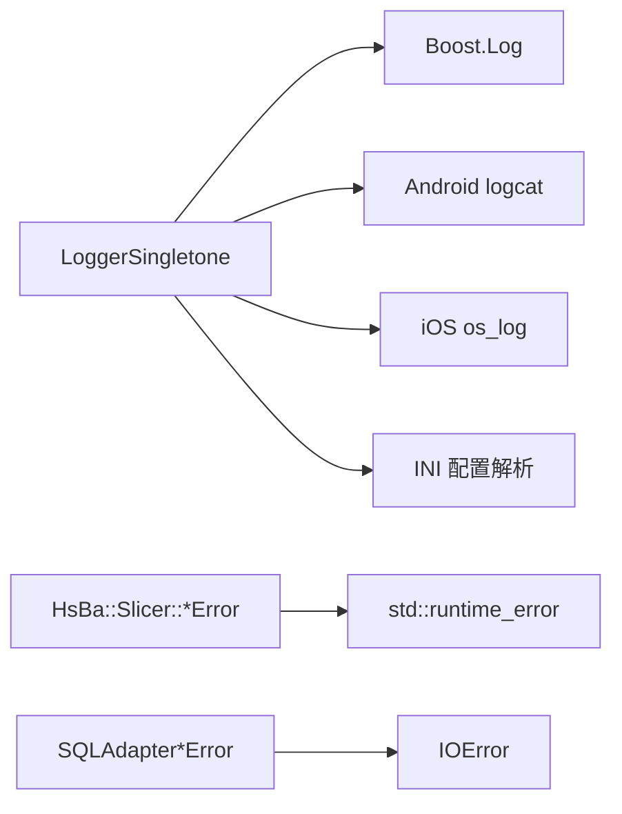
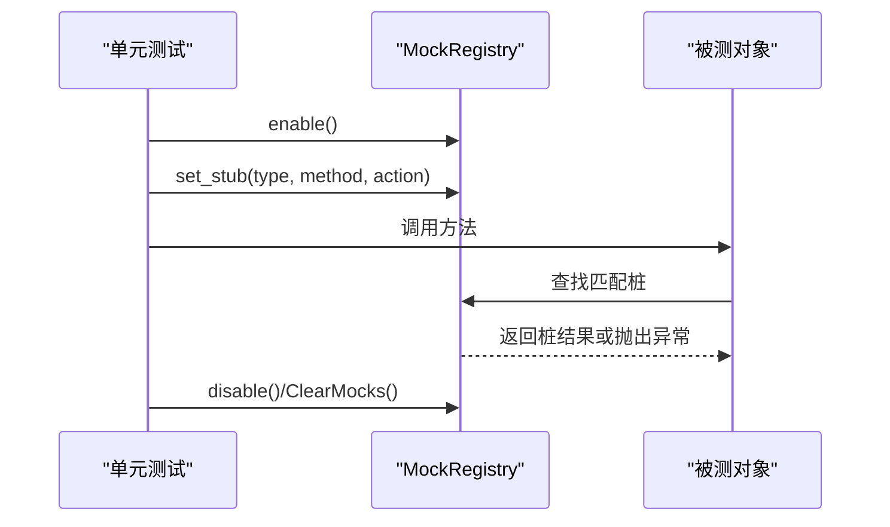
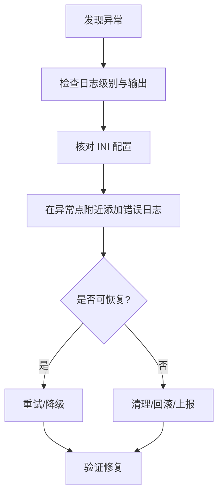

# 错误处理和调试

<cite>
**本文引用的文件**   
- [logger.hpp](file://logger/logger.hpp)
- [logger.cpp](file://logger/logger.cpp)
- [error.hpp](file://base/error.hpp)
- [error.cpp](file://base/error.cpp)
- [logcfg.ini](file://utils/logcfg.ini)
- [sql_adapter.hpp](file://fileoperator/sql_adapter.hpp)
- [HsBaSlicer.cpp](file://HsBaSlicer/HsBaSlicer.cpp)
- [FloatPolygons.cpp](file://2D/FloatPolygons.cpp)
- [ImageToPolygons.cpp](file://2D/ImageToPolygons.cpp)
- [PolygonFill.cpp](file://2D/PolygonFill.cpp)
- [user_custom_cad_model_test.cpp](file://tests/CADModel/user_custom_cad_model_test.cpp)
- [model_loader_test.cpp](file://tests/Preprocess/model_loader_test.cpp)
- [robot_path_test.cpp](file://tests/PathsOut/robot_path_test.cpp)
- [any_object.hpp](file://base/any_object.hpp)
- [coroutine.hpp](file://base/coroutine.hpp)
</cite>

## 目录
1. [引言](#引言)
2. [项目结构](#项目结构)
3. [核心组件](#核心组件)
4. [架构总览](#架构总览)
5. [详细组件分析](#详细组件分析)
6. [依赖关系分析](#依赖关系分析)
7. [性能与并发特性](#性能与并发特性)
8. [调试与诊断指南](#调试与诊断指南)
9. [单元测试与模拟对象](#单元测试与模拟对象)
10. [常见错误模式与排障流程](#常见错误模式与排障流程)
11. [结论](#结论)

## 引言
本指南面向 HsBaSlicer 的错误处理与调试，目标是帮助开发者快速定位问题、稳定地捕获异常、高效地使用日志系统，并在多线程和跨平台环境下进行可靠的故障排除。文档覆盖以下主题：
- 日志系统：Logger 类设计、日志级别、输出格式、线程安全与多平台适配
- 异常框架：自定义异常类型、错误码语义、异常传播与恢复策略
- 调试技巧：静态检查、动态调试、内存泄漏检测与性能剖析
- 单元测试：测试框架使用、用例编写规范、模拟对象与测试数据管理
- 常见问题：错误模式识别、诊断流程与实战案例

## 项目结构
围绕错误处理与调试的关键代码分布在以下模块：
- logger：跨平台单例日志器，支持 Boost.Log、Android logcat、iOS os_log
- base：通用基础库，包含自定义异常体系、协程任务异常处理等
- fileoperator：SQL 适配器扩展了业务异常类型
- 2D：大量使用自定义异常抛出 Lua 或资源相关错误
- tests：基于 Boost.Test 的单元测试，验证异常行为与路径导出逻辑
- utils：提供默认日志配置文件示例

图表来源
- [logger.hpp:1-196](file://logger/logger.hpp#L1-L196)
- [logger.cpp:1-422](file://logger/logger.cpp#L1-L422)
- [logcfg.ini:1-8](file://utils/logcfg.ini#L1-L8)
- [error.hpp:1-147](file://base/error.hpp#L1-L147)
- [error.cpp:1-5](file://base/error.cpp#L1-L5)
- [sql_adapter.hpp:136-202](file://fileoperator/sql_adapter.hpp#L136-L202)
- [HsBaSlicer.cpp:34-41](file://HsBaSlicer/HsBaSlicer.cpp#L34-L41)
- [FloatPolygons.cpp:351-361](file://2D/FloatPolygons.cpp#L351-L361)
- [ImageToPolygons.cpp:422-532](file://2D/ImageToPolygons.cpp#L422-L532)
- [PolygonFill.cpp:1293-1400](file://2D/PolygonFill.cpp#L1293-L1400)
- [user_custom_cad_model_test.cpp:50-82](file://tests/CADModel/user_custom_cad_model_test.cpp#L50-L82)
- [model_loader_test.cpp:1-46](file://tests/Preprocess/model_loader_test.cpp#L1-L46)
- [robot_path_test.cpp:181-214](file://tests/PathsOut/robot_path_test.cpp#L181-L214)
- [any_object.hpp:262-304](file://base/any_object.hpp#L262-L304)
- [coroutine.hpp:421-455](file://base/coroutine.hpp#L421-L455)

章节来源
- [logger.hpp:1-196](file://logger/logger.hpp#L1-L196)
- [logger.cpp:1-422](file://logger/logger.cpp#L1-L422)
- [error.hpp:1-147](file://base/error.hpp#L1-L147)
- [sql_adapter.hpp:136-202](file://fileoperator/sql_adapter.hpp#L136-L202)

## 核心组件
本节聚焦两个核心子系统：日志系统与异常体系。

- 日志系统（LoggerSingletone）
  - 单例实现，全局唯一实例，线程安全
  - 支持多级日志：trace/debug/info/warning/error/fatal
  - 自动捕获源码位置信息（C++20 source_location）
  - 多平台后端：Boost.Log（桌面）、Android logcat、iOS os_log
  - 通过 INI 配置控制日志级别、是否写文件、日志路径与时间格式
  - 提供便捷的用户定义字面量语法（_log_debug/_log_info/_log_warning/_log_error）

- 异常体系（HsBa::Slicer::*Error）
  - 以 RuntimeError 为基类，派生出多种领域错误类型
  - 统一继承 std::runtime_error，便于上层 catch(std::exception)
  - 业务层广泛使用这些异常表达失败场景
  - SQL 适配器进一步细分连接、查询、权限等错误类型

章节来源
- [logger.hpp:27-122](file://logger/logger.hpp#L27-L122)
- [logger.cpp:136-222](file://logger/logger.cpp#L136-L222)
- [error.hpp:15-145](file://base/error.hpp#L15-L145)
- [sql_adapter.hpp:136-202](file://fileoperator/sql_adapter.hpp#L136-L202)

## 架构总览
下图展示日志与异常在系统中的交互关系：业务模块抛出异常，同时记录关键日志；日志系统根据配置输出到控制台或文件；测试用例断言异常类型与行为。

图表来源
- [HsBaSlicer.cpp:34-41](file://HsBaSlicer/HsBaSlicer.cpp#L34-L41)
- [logger.cpp:242-343](file://logger/logger.cpp#L242-L343)
- [user_custom_cad_model_test.cpp:50-82](file://tests/CADModel/user_custom_cad_model_test.cpp#L50-L82)

## 详细组件分析

### 日志系统（LoggerSingletone）
- 功能特性
  - 单例初始化：首次访问时惰性创建，使用 call_once 保证线程安全
  - 日志级别映射：内部整数级别映射到平台后端等级
  - 源码位置：自动附加文件名、行号与函数名
  - 输出格式：时间戳、严重级别、消息文本
  - 文件轮转：按大小和时间点轮转日志文件
  - 配置读取：从 INI 文件加载日志级别、是否写文件、日志路径与时间格式

- 线程安全机制
  - 使用 shared_mutex 保护读操作（如 UseLogFile）
  - 使用 once_flag 确保单例只创建一次
  - 日志输出在不同平台分别调用底层 API，避免竞争

- 多平台适配
  - 桌面端：Boost.Log，支持控制台与文件输出
  - Android：__android_log_print
  - iOS：os_log_with_type

- 配置项说明（INI）
  - [log] 段：log_level、log_level_debug、use_log_file、log_file
  - [log_format] 段：log_datatime_format、log_time_format

图表来源
- [logger.hpp:35-122](file://logger/logger.hpp#L35-L122)
- [logger.hpp:130-159](file://logger/logger.hpp#L130-L159)
- [logger.cpp:136-222](file://logger/logger.cpp#L136-L222)
- [logger.cpp:345-408](file://logger/logger.cpp#L345-L408)

章节来源
- [logger.hpp:1-196](file://logger/logger.hpp#L1-L196)
- [logger.cpp:1-422](file://logger/logger.cpp#L1-L422)
- [logcfg.ini:1-8](file://utils/logcfg.ini#L1-L8)

### 异常体系（HsBa::Slicer::*Error）
- 类型层次
  - 根异常：RuntimeError（继承 std::runtime_error）
  - 常用派生：OutOfRangeError、InvalidArgumentError、IOError、NotImplementedError、NullValueError、NotSupportedError、NotFoundError、AlreadyExistsError、PermissionDeniedError、TimeoutError、InterruptedError、CancelledError、OutOfMemoryError
  - 业务扩展：SQLAdapterError 及其子类（连接、查询、超时、权限、参数等）

- 使用建议
  - 在资源不可用、Lua 脚本错误、模型加载失败等场景抛出具体异常类型
  - 上层统一 catch(std::exception) 或 catch(HsBa::Slicer::RuntimeError) 做兜底
  - 对可恢复错误（如网络超时）结合重试策略

图表来源
- [error.hpp:15-145](file://base/error.hpp#L15-L145)
- [sql_adapter.hpp:136-202](file://fileoperator/sql_adapter.hpp#L136-L202)

章节来源
- [error.hpp:1-147](file://base/error.hpp#L1-L147)
- [error.cpp:1-5](file://base/error.cpp#L1-L5)
- [sql_adapter.hpp:136-202](file://fileoperator/sql_adapter.hpp#L136-L202)

### 异常传播与恢复策略
- 传播路径
  - 2D 模块中多处抛出 RuntimeError，用于 Lua 状态创建失败、脚本加载失败、函数未找到、返回值类型不匹配等
  - CAD 模型测试断言 Load 失败抛出 RuntimeError
  - 机器人路径导出在 Lua 脚本错误时抛出 RuntimeError

- 恢复策略
  - 对于可重试错误（如超时），可在上层捕获后实施指数退避重试
  - 对于不可恢复错误（如 Lua 脚本语法错误），应记录错误日志并终止当前流程，向用户反馈
  - 数据库事务场景中，捕获 SQLAdapterError 后执行 ROLLBACK，再向上抛出或转换为业务异常

图表来源
- [ImageToPolygons.cpp:422-532](file://2D/ImageToPolygons.cpp#L422-L532)
- [PolygonFill.cpp:1293-1400](file://2D/PolygonFill.cpp#L1293-L1400)
- [user_custom_cad_model_test.cpp:50-82](file://tests/CADModel/user_custom_cad_model_test.cpp#L50-L82)
- [robot_path_test.cpp:181-214](file://tests/PathsOut/robot_path_test.cpp#L181-L214)

章节来源
- [ImageToPolygons.cpp:422-532](file://2D/ImageToPolygons.cpp#L422-L532)
- [PolygonFill.cpp:1293-1400](file://2D/PolygonFill.cpp#L1293-L1400)
- [user_custom_cad_model_test.cpp:50-82](file://tests/CADModel/user_custom_cad_model_test.cpp#L50-L82)
- [robot_path_test.cpp:181-214](file://tests/PathsOut/robot_path_test.cpp#L181-L214)

## 依赖关系分析
- 日志系统依赖
  - Boost.Log（桌面端）：用于控制台与文件输出、格式化、过滤
  - Android/iOS 原生日志 API：用于移动端日志输出
  - INI 配置解析：用于加载日志级别、文件开关、路径与时间格式

- 异常体系依赖
  - std::runtime_error：所有自定义异常的基类
  - SQL 适配器：扩展出更细粒度的业务异常类型

图表来源
- [logger.cpp:17-27](file://logger/logger.cpp#L17-L27)
- [logger.cpp:29-35](file://logger/logger.cpp#L29-L35)
- [logger.cpp:147-183](file://logger/logger.cpp#L147-L183)
- [error.hpp:15-145](file://base/error.hpp#L15-L145)
- [sql_adapter.hpp:136-202](file://fileoperator/sql_adapter.hpp#L136-L202)

章节来源
- [logger.cpp:1-422](file://logger/logger.cpp#L1-L422)
- [error.hpp:1-147](file://base/error.hpp#L1-L147)
- [sql_adapter.hpp:136-202](file://fileoperator/sql_adapter.hpp#L136-L202)

## 性能与并发特性
- 日志写入性能
  - 桌面端使用 Boost.Log，支持文件轮转与过滤器，减少无关日志开销
  - 移动端使用系统日志 API，避免额外开销
  - 建议在发布版本提高日志级别，降低 I/O 压力

- 线程安全
  - 单例初始化使用 call_once，避免重复构造
  - UseLogFile 使用 shared_lock 提升并发读性能
  - 日志输出在各平台后端各自保证线程安全

- 内存与资源
  - 日志文件按大小与时间点轮转，防止无限增长
  - 避免在高频路径中频繁构造大字符串，建议使用轻量级消息

章节来源
- [logger.cpp:185-209](file://logger/logger.cpp#L185-L209)
- [logger.cpp:224-240](file://logger/logger.cpp#L224-L240)

## 调试与诊断指南

### 静态代码分析
- 使用 clang-format 与 cpp_analyzer.py 进行风格与潜在问题检查
- 启用 CMake feature_check.cmake 进行特性可用性检查

### 动态调试
- 在桌面端使用 GDB/LLDB 设置断点于抛出异常的位置
- 在 Android 使用 logcat 查看日志，注意 LoggerSingletone 已输出警告提示使用内核日志
- 在 iOS 使用 Console.app 查看 os_log 输出

### 内存泄漏检测
- Linux：Valgrind 或 AddressSanitizer
- Windows：Visual Studio CRT Debug Heap 或 Dr. Memory
- macOS：Instruments Leaks

### 性能剖析
- Linux：perf、gprof
- Windows：Visual Studio Profiler、VTune
- macOS：Instruments Time Profiler

### 日志最佳实践
- 在关键入口与出口处记录 Info/Debug 日志
- 在异常分支记录 Error 日志，附带上下文信息（如文件名、行号由日志系统自动附加）
- 合理设置日志级别，避免生产环境产生过多日志

章节来源
- [logger.cpp:212-221](file://logger/logger.cpp#L212-L221)
- [HsBaSlicer.cpp:34-41](file://HsBaSlicer/HsBaSlicer.cpp#L34-L41)

## 单元测试与模拟对象

### 测试框架
- 使用 Boost.Test（BOOST_TEST_MODULE、BOOST_AUTO_TEST_CASE）
- 测试用例断言异常类型与行为，例如：
  - CAD 模型测试断言 Load 失败抛出 RuntimeError
  - 机器人路径导出断言 Lua 脚本错误抛出 RuntimeError

### 模拟对象与 Mock
- AnyObject 提供内置 Mockit-style 方法桩注册能力（HSBA_ANY_OBJECT_ENABLE_MOCK）
- MockRegistry 提供 enable/disable、规则与动作工厂（Return/Throw/Do）
- 线程安全的 Mock 注册，支持并行测试

图表来源
- [any_object.hpp:262-304](file://base/any_object.hpp#L262-L304)
- [user_custom_cad_model_test.cpp:50-82](file://tests/CADModel/user_custom_cad_model_test.cpp#L50-L82)
- [robot_path_test.cpp:181-214](file://tests/PathsOut/robot_path_test.cpp#L181-L214)

章节来源
- [user_custom_cad_model_test.cpp:50-82](file://tests/CADModel/user_custom_cad_model_test.cpp#L50-L82)
- [model_loader_test.cpp:1-46](file://tests/Preprocess/model_loader_test.cpp#L1-L46)
- [robot_path_test.cpp:181-214](file://tests/PathsOut/robot_path_test.cpp#L181-L214)
- [any_object.hpp:262-304](file://base/any_object.hpp#L262-L304)

## 常见错误模式与排障流程

### 常见错误模式
- Lua 脚本相关错误
  - 创建 Lua 状态失败
  - 加载脚本失败
  - 函数未找到
  - 返回值类型不匹配
- 资源与 IO 错误
  - 字体文件加载失败
  - 模型文件不存在或无法打开
- 运行时逻辑错误
  - 参数无效
  - 不支持的功能
  - 空值引用

### 诊断流程
1. 确认日志级别与输出目标是否正确（控制台/文件）
2. 检查 INI 配置中的日志级别、文件路径与时间格式
3. 在异常抛出点附近增加 LogError 日志，记录上下文
4. 使用断点或日志定位异常来源
5. 针对可恢复错误实施重试或降级策略
6. 对不可恢复错误进行清理与回滚，并向用户反馈

图表来源
- [logger.cpp:147-183](file://logger/logger.cpp#L147-L183)
- [ImageToPolygons.cpp:422-532](file://2D/ImageToPolygons.cpp#L422-L532)
- [PolygonFill.cpp:1293-1400](file://2D/PolygonFill.cpp#L1293-L1400)
- [FloatPolygons.cpp:351-361](file://2D/FloatPolygons.cpp#L351-L361)

章节来源
- [logger.cpp:147-183](file://logger/logger.cpp#L147-L183)
- [ImageToPolygons.cpp:422-532](file://2D/ImageToPolygons.cpp#L422-L532)
- [PolygonFill.cpp:1293-1400](file://2D/PolygonFill.cpp#L1293-L1400)
- [FloatPolygons.cpp:351-361](file://2D/FloatPolygons.cpp#L351-L361)

## 结论
HsBaSlicer 的错误处理与调试体系以统一的异常类型与灵活的日志系统为核心，结合单元测试与模拟对象，形成完整的可观测性与可测试性保障。开发者应遵循以下最佳实践：
- 使用 LoggerSingletone 记录关键流程与异常信息
- 使用 HsBa::Slicer::*Error 表达明确的错误语义
- 在测试中验证异常行为与恢复策略
- 在生产环境中合理配置日志级别与输出目标
- 借助静态分析与动态调试工具快速定位问题