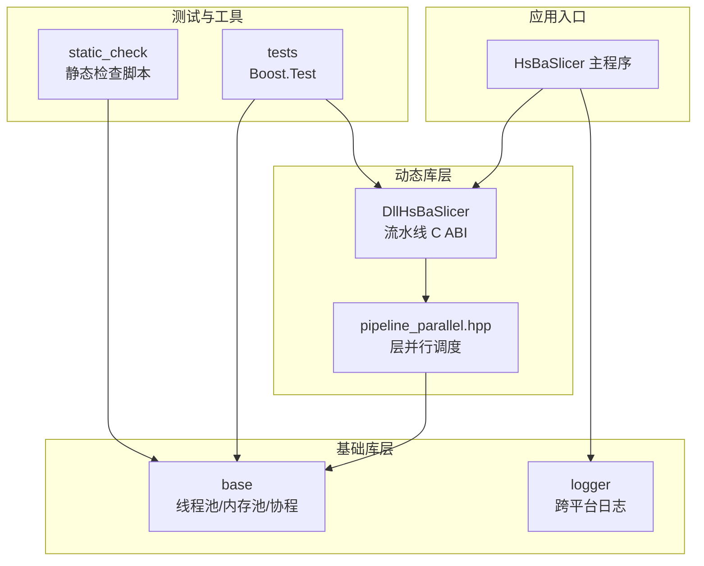
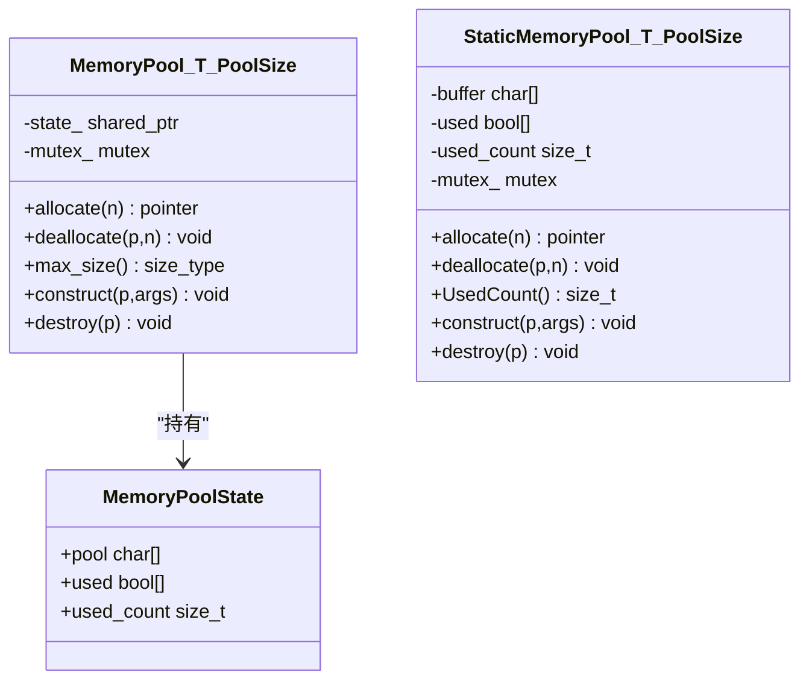
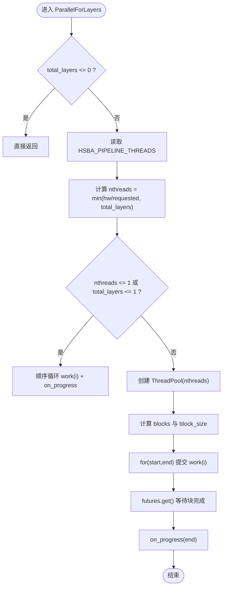
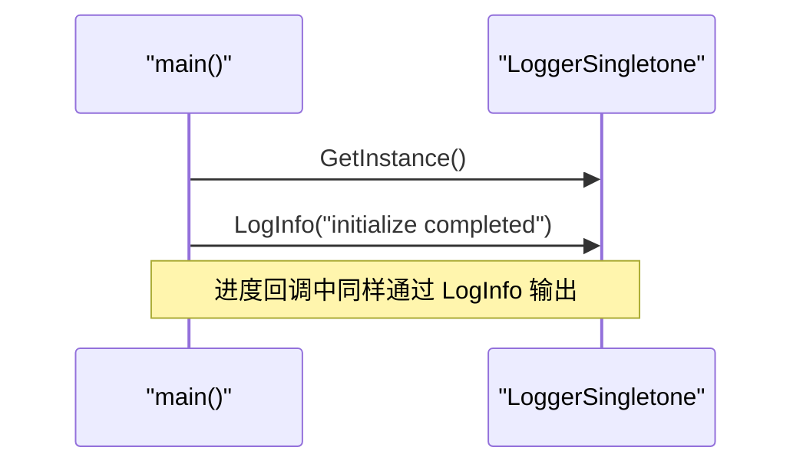
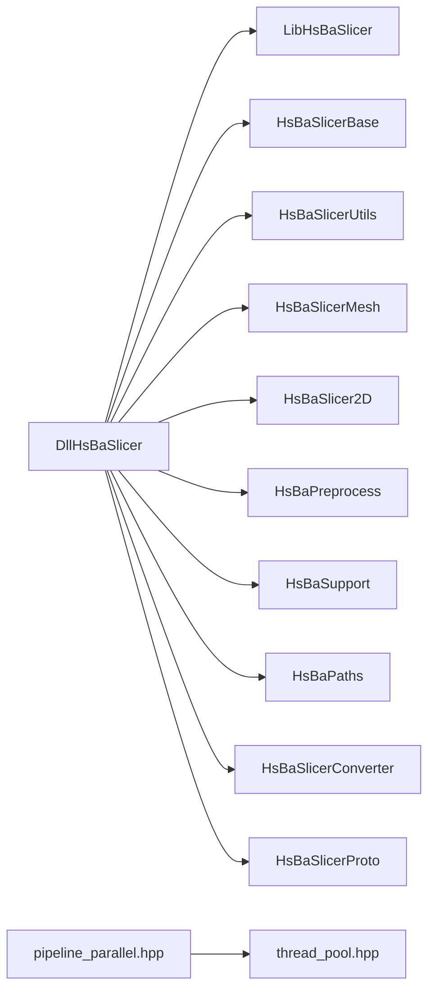
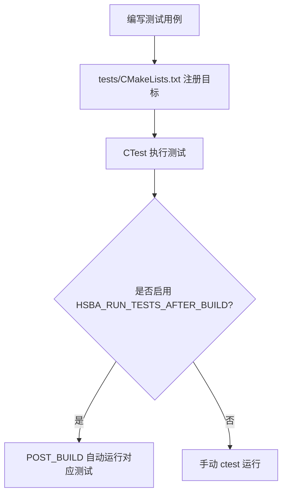

# 高级主题

<cite>
**本文引用的文件**   
- [README.md](file://README.md)
- [thread_pool.hpp](file://base/thread_pool.hpp)
- [memory_pool.hpp](file://base/memory_pool.hpp)
- [pipeline_parallel.hpp](file://DllHsBaSlicer/pipeline_parallel.hpp)
- [logger.hpp](file://logger/logger.hpp)
- [logger.cpp](file://logger/logger.cpp)
- [CMakeLists.txt](file://CMakeLists.txt)
- [tests/CMakeLists.txt](file://tests/CMakeLists.txt)
- [memory_pool_test.cpp](file://tests/Pool/memory_pool_test.cpp)
- [thread_pool_test.cpp](file://tests/Pool/thread_pool_test.cpp)
- [copilot-instructions.md](file://.github/copilot-instructions.md)
- [cpp_analyzer.py](file://static_check/cpp_analyzer.py)
- [clang-format-batch.py](file://static_check/clang-format-batch.py)
- [feature_check.cmake](file://static_check/feature_check.cmake)
- [HsBaSlicer.cpp](file://HsBaSlicer/HsBaSlicer.cpp)
</cite>

## 目录
1. [引言](#引言)
2. [项目结构](#项目结构)
3. [核心组件](#核心组件)
4. [架构总览](#架构总览)
5. [详细组件分析](#详细组件分析)
6. [依赖关系分析](#依赖关系分析)
7. [性能考量与优化策略](#性能考量与优化策略)
8. [错误处理与调试技巧](#错误处理与调试技巧)
9. [测试与验证框架](#测试与验证框架)
10. [静态代码分析与质量门禁](#静态代码分析与质量门禁)
11. [性能监控与问题诊断](#性能监控与问题诊断)
12. [结论](#结论)

## 引言
本“高级主题”文档面向高级开发者与架构师，聚焦 HsBaSlicer 在多线程、内存管理、算法并行化、日志系统、测试与验证、静态分析与性能调优等方面的深度实践。内容基于仓库现有实现与构建配置，提供可操作的优化建议、架构图示与故障排查指南。

## 项目结构
HsBaSlicer 采用模块化设计：基础能力（线程池、内存池、单例等）位于 base；上层流水线接口由 DllHsBaSlicer 暴露 C ABI；日志子系统独立为 logger 模块；测试集中于 tests；静态检查工具位于 static_check。



图示来源
- [README.md:25-39](file://README.md#L25-L39)
- [pipeline_parallel.hpp:1-40](file://DllHsBaSlicer/pipeline_parallel.hpp#L1-L40)
- [thread_pool.hpp:25-40](file://base/thread_pool.hpp#L25-L40)
- [logger.hpp:27-42](file://logger/logger.hpp#L27-L42)

章节来源
- [README.md:25-39](file://README.md#L25-L39)

## 核心组件
- 线程池 ThreadPool：任务队列 + 工作线程 + 条件变量，支持提交任务、等待全部完成、统计活跃/待执行任务数，并提供可选的协程执行器适配。
- 内存池 MemoryPool / StaticMemoryPool：固定大小池分配器，兼容标准容器与智能指针，支持协程自定义分配器注入。
- 层并行调度 ParallelForLayers：按层粒度并行切片/填充，块状提交以控制进度回调频率，支持环境变量 HSBA_PIPELINE_THREADS 控制并发度。
- 日志 LoggerSingletone：跨平台单例日志，桌面端使用 Boost.Log，Android/iOS 走系统日志通道，提供 fluent 字面量 API。

章节来源
- [thread_pool.hpp:25-162](file://base/thread_pool.hpp#L25-L162)
- [memory_pool.hpp:19-208](file://base/memory_pool.hpp#L19-L208)
- [memory_pool.hpp:209-372](file://base/memory_pool.hpp#L209-L372)
- [pipeline_parallel.hpp:19-117](file://DllHsBaSlicer/pipeline_parallel.hpp#L19-L117)
- [logger.hpp:27-122](file://logger/logger.hpp#L27-L122)

## 架构总览
下图展示从应用入口到流水线并行、再到线程池与日志的关键调用链。

```mermaid
sequenceDiagram
participant App as "应用入口"
participant DLL as "DllHsBaSlicer"
participant Par as "ParallelForLayers"
participant TP as "ThreadPool"
participant Log as "LoggerSingletone"
App->>DLL : 初始化并运行流水线
DLL->>Par : 并行处理各层
Par->>TP : submit(work(i))
TP-->>Par : future.get() 阻塞直到块完成
Par-->>DLL : on_progress(累计完成层数)
App->>Log : 记录进度/状态信息
```

图示来源
- [HsBaSlicer.cpp:283-303](file://HsBaSlicer/HsBaSlicer.cpp#L283-L303)
- [pipeline_parallel.hpp:41-117](file://DllHsBaSlicer/pipeline_parallel.hpp#L41-L117)
- [thread_pool.hpp:67-111](file://base/thread_pool.hpp#L67-L111)
- [logger.hpp:50-89](file://logger/logger.hpp#L50-L89)

## 详细组件分析

### 线程池 ThreadPool
- 设计要点
  - 构造时创建固定数量工作线程，析构时安全停止并 join。
  - submit 返回 std::future，内部用 packaged_task 包装任务，异常在 worker 中捕获但不吞掉 active_tasks 计数。
  - WaitAll 通过条件变量等待队列为空且无活跃任务。
  - 可选协程执行器 ThreadPoolExecutor 支持设置默认线程池，便于与协程 Task 集成。
- 复杂度与性能
  - 任务入队/出队 O(1)，活跃任务计数原子操作 O(1)。
  - 锁粒度集中在任务队列与状态更新，适合中等粒度任务。
- 最佳实践
  - 合理设置线程数，避免远大于硬件并发导致上下文切换开销。
  - 将细粒度任务合并为块（block）提交，减少锁竞争与调度开销。
  - 在 UI 或进度回调中避免频繁 I/O，批量刷新。

```mermaid
classDiagram
class ThreadPool {
+submit(f, args...) future
+PendingTasks() size_t
+ActiveTasks() size_t
+WaitAll() void
-WorkerLoop() void
-workers_ vector<thread>
-tasks_ queue<function<void()> >
-queue_mutex_ mutex
-condition_ condition_variable
-finished_condition_ condition_variable
-stop_ atomic<bool>
-active_tasks_ atomic<size_t>
}
class ThreadPoolExecutor {
+execute(func) void
+SetDefaultPool(pool) void
-pool_ ThreadPool*
-default_pool_ ThreadPool*
}
ThreadPoolExecutor --> ThreadPool : "使用"
```

图示来源
- [thread_pool.hpp:29-162](file://base/thread_pool.hpp#L29-L162)
- [thread_pool.hpp:164-207](file://base/thread_pool.hpp#L164-L207)

章节来源
- [thread_pool.hpp:25-207](file://base/thread_pool.hpp#L25-L207)

### 内存池 MemoryPool 与 StaticMemoryPool
- 设计要点
  - MemoryPool：实例级共享池，通过 shared_ptr 共享状态，适合多容器共享同一池。
  - StaticMemoryPool：全局静态池，is_always_equal=true，所有实例等价，适合跨线程/对象共享。
  - 两者均实现 Allocator 接口，可与 std::vector/list/shared_ptr 配合。
  - 支持协程自定义分配器注入，使协程内部分配走内存池。
- 复杂度与性能
  - 分配/释放为线性扫描 used 位图，时间复杂度 O(PoolSize/alignof(T))，空间局部性好，减少堆碎片。
  - 互斥保护保证线程安全，但高并发下可能成为瓶颈；适合中小粒度、短生命周期对象。
- 最佳实践
  - 预估 PoolSize，避免频繁 bad_alloc。
  - 对高频小对象优先使用 StaticMemoryPool，降低拷贝/移动开销。
  - 与容器配合时注意 propagate_on_container_* 语义差异。



图示来源
- [memory_pool.hpp:21-34](file://base/memory_pool.hpp#L21-L34)
- [memory_pool.hpp:43-208](file://base/memory_pool.hpp#L43-L208)
- [memory_pool.hpp:215-372](file://base/memory_pool.hpp#L215-L372)

章节来源
- [memory_pool.hpp:19-372](file://base/memory_pool.hpp#L19-L372)

### 层并行调度 ParallelForLayers
- 设计要点
  - 根据 total_layers 与硬件并发决定线程数，支持环境变量 HSBA_PIPELINE_THREADS 覆盖。
  - 将层索引分块提交至 ThreadPool，每块完成后统一触发 on_progress，避免频繁跨线程回调。
  - 串行回退路径保证单核/单层场景行为一致。
- 关键流程



图示来源
- [pipeline_parallel.hpp:41-117](file://DllHsBaSlicer/pipeline_parallel.hpp#L41-L117)

章节来源
- [pipeline_parallel.hpp:1-122](file://DllHsBaSlicer/pipeline_parallel.hpp#L1-L122)

### 日志系统 LoggerSingletone
- 设计要点
  - 单例模式，线程安全；桌面端使用 Boost.Log，Android/iOS 走系统日志。
  - 提供 LogDebug/Info/Warning/Error 及 fluent 字面量 "_log_info()" 等便捷 API。
  - UseLogFile 在不同平台有不同默认行为。
- 使用方式
  - 在应用入口获取实例并输出日志；示例入口展示了进度回调中的日志输出。



图示来源
- [logger.hpp:35-122](file://logger/logger.hpp#L35-L122)
- [logger.cpp:236-348](file://logger/logger.cpp#L236-L348)
- [HsBaSlicer.cpp:283-303](file://HsBaSlicer/HsBaSlicer.cpp#L283-L303)

章节来源
- [logger.hpp:1-196](file://logger/logger.hpp#L1-L196)
- [logger.cpp:210-348](file://logger/logger.cpp#L210-L348)
- [HsBaSlicer.cpp:283-303](file://HsBaSlicer/HsBaSlicer.cpp#L283-L303)

## 依赖关系分析
- DllHsBaSlicer 仅通过 C ABI 调用 LibHsBaSlicer 导出函数，保持高层与核心解耦。
- pipeline_parallel.hpp 依赖 base/thread_pool.hpp。
- 测试用例依赖 Boost.Test 与各功能模块。



图示来源
- [DllHsBaSlicer/CMakeLists.txt:84-100](file://DllHsBaSlicer/CMakeLists.txt#L84-L100)
- [pipeline_parallel.hpp:17-17](file://DllHsBaSlicer/pipeline_parallel.hpp#L17-L17)

章节来源
- [DllHsBaSlicer/CMakeLists.txt:84-100](file://DllHsBaSlicer/CMakeLists.txt#L84-L100)

## 性能考量与优化策略
- 多线程处理
  - 使用 ThreadPool 进行任务并行，结合 ParallelForLayers 的块状提交减少锁竞争与回调开销。
  - 通过 HSBA_PIPELINE_THREADS 控制并发度，便于基准对比串行与并行结果一致性。
- 内存管理
  - 对高频小对象使用 StaticMemoryPool，降低堆分配次数与碎片。
  - 将容器与智能指针与内存池绑定，确保对象生命周期与池一致。
- 算法优化
  - 层间数据相互独立，天然适合并行；将层内不可并行的步骤尽量外提，减少同步点。
  - 在 UI/IO 密集场景中，将进度回调聚合到块级别，避免频繁跨线程调用。
- 构建与链接
  - 根据目标平台选择静态/动态库（Windows 默认动态，Linux/Android 默认静态），减少运行时依赖。

章节来源
- [pipeline_parallel.hpp:49-72](file://DllHsBaSlicer/pipeline_parallel.hpp#L49-L72)
- [memory_pool.hpp:209-372](file://base/memory_pool.hpp#L209-L372)
- [CMakeLists.txt:371-386](file://CMakeLists.txt#L371-L386)

## 错误处理与调试技巧
- 线程池
  - 向已停止的线程池提交任务会抛出运行时异常；worker 中异常被捕获但仍会递减活跃计数，需在上层通过 future.get() 捕获并重抛。
- 内存池
  - 越界释放或超出池容量会抛出 invalid_argument/bad_alloc；建议在单元测试中覆盖边界情况。
- 日志
  - 使用 LogError/LogFatal 输出严重错误；在 Android/iOS 上分别走系统日志通道，便于平台侧收集。
- 调试建议
  - 启用 HSBA_PIPELINE_THREADS=1 强制串行路径，用于回归对比与定位并行相关缺陷。
  - 在进度回调中输出阶段性指标（如每块耗时、层数），辅助定位热点层。

章节来源
- [thread_pool.hpp:77-89](file://base/thread_pool.hpp#L77-L89)
- [thread_pool.hpp:140-153](file://base/thread_pool.hpp#L140-L153)
- [memory_pool.hpp:111-142](file://base/memory_pool.hpp#L111-L142)
- [memory_pool.hpp:156-175](file://base/memory_pool.hpp#L156-L175)
- [logger.cpp:310-348](file://logger/logger.cpp#L310-L348)

## 测试与验证框架
- 测试框架
  - 使用 Boost.Test，测试集位于 tests/，通过 CTest 统一管理。
  - 顶层 CMakeLists.txt 定义 HSBA_SLICER_USE_TESTS 选项，tests/CMakeLists.txt 注册具体测试目标。
- 单元测试
  - 线程池：验证任务提交、结果获取、WaitAll 与协程执行器集成。
  - 内存池：验证与 std 容器/智能指针的兼容性、协程自定义分配器注入。
- 集成测试
  - 通过 samples 与 HsBaSlicer 主程序演示 FDM/SLA/SLS 等流水线调用，结合日志输出验证端到端流程。
- 性能基准
  - 使用 HSBA_PIPELINE_THREADS 环境变量对比串行与并行性能，确保结果一致性与吞吐提升。



图示来源
- [tests/CMakeLists.txt:1-39](file://tests/CMakeLists.txt#L1-L39)
- [tests/CMakeLists.txt:918-936](file://tests/CMakeLists.txt#L918-L936)
- [tests/CMakeLists.txt:1143-1163](file://tests/CMakeLists.txt#L1143-L1163)

章节来源
- [tests/CMakeLists.txt:1-39](file://tests/CMakeLists.txt#L1-L39)
- [tests/CMakeLists.txt:918-936](file://tests/CMakeLists.txt#L918-L936)
- [tests/CMakeLists.txt:1143-1163](file://tests/CMakeLists.txt#L1143-L1163)
- [memory_pool_test.cpp:1-100](file://tests/Pool/memory_pool_test.cpp#L1-L100)
- [thread_pool_test.cpp:1-87](file://tests/Pool/thread_pool_test.cpp#L1-L87)

## 静态代码分析与质量门禁
- 工具与脚本
  - clang-format-batch.py：批量格式化代码风格。
  - cpp_analyzer.py：项目特定的静态分析脚本。
  - feature_check.cmake：CMake 集成的特性检查。
- 集成建议
  - 在 CI 中先执行 clang-format 检查，再运行 cpp_analyzer，最后执行测试与覆盖率收集。
  - 将静态检查结果作为 PR 门禁，失败则阻断合并。

章节来源
- [clang-format-batch.py](file://static_check/clang-format-batch.py)
- [cpp_analyzer.py](file://static_check/cpp_analyzer.py)
- [feature_check.cmake](file://static_check/feature_check.cmake)

## 性能监控与问题诊断
- 监控指标
  - 线程池 PendingTasks/ActiveTasks 用于观察负载与背压。
  - 内存池 UsedCount 用于观察池占用趋势，预防溢出。
  - 日志中记录每块处理时间与层数，识别热点层。
- 诊断方法
  - 使用 HSBA_PIPELINE_THREADS=1 复现串行路径，确认并行引入的问题。
  - 在关键路径添加分层日志，结合平台日志（Android/iOS）收集现场。
  - 针对异常重抛路径，检查 future.get() 的异常类型与堆栈。

章节来源
- [thread_pool.hpp:94-111](file://base/thread_pool.hpp#L94-L111)
- [memory_pool.hpp:358-365](file://base/memory_pool.hpp#L358-L365)
- [pipeline_parallel.hpp:88-117](file://DllHsBaSlicer/pipeline_parallel.hpp#L88-L117)
- [logger.cpp:236-348](file://logger/logger.cpp#L236-L348)

## 结论
HsBaSlicer 在多线程与内存管理方面提供了成熟的基础设施：线程池与层并行调度有效利用多核资源，内存池显著降低分配开销并与协程生态良好集成。日志系统跨平台、易用，便于生产环境排障。借助 Boost.Test 与 CTest 的测试体系，以及 clang-format 与 cpp_analyzer 的静态检查，项目具备完善的工程化保障。建议在持续集成中固化这些质量门禁，并结合 HSBA_PIPELINE_THREADS 与日志指标进行性能基线与回归监控，确保切片流水线在高负载下的稳定性与可扩展性。