# 高级主题

<cite>
**本文引用的文件**   
- [README.md](file://README.md)
- [pipeline_types.h](file://pipelinetypes/pipeline_types.h)
- [dllexport.h](file://DllHsBaSlicer/dllexport.h)
- [export.h](file://LibHsBaSlicer/export.h)
- [fdm_pipeline.h](file://DllHsBaSlicer/fdm_pipeline.h)
- [sla_pipeline.h](file://DllHsBaSlicer/sla_pipeline.h)
- [model_preprocess.hpp](file://LibHsBaSlicer/Preprocess/model_preprocess.hpp)
- [mesh_slice.hpp](file://LibHsBaSlicer/Slice/mesh_slice.hpp)
- [fdm_support.hpp](file://LibHsBaSlicer/Support/fdm_support.hpp)
- [polygon_fill.hpp](file://LibHsBaSlicer/Fill/polygon_fill.hpp)
</cite>

## 目录
1. [引言](#引言)
2. [项目结构](#项目结构)
3. [核心组件](#核心组件)
4. [架构总览](#架构总览)
5. [详细组件分析](#详细组件分析)
6. [依赖关系分析](#依赖关系分析)
7. [性能与优化](#性能与优化)
8. [故障排除指南](#故障排除指南)
9. [结论](#结论)
10. [附录：多技术流水线配置速查](#附录多技术流水线配置速查)

## 引言
本“高级主题”文档聚焦 HsBaSlicer 的高级能力，面向需要深入理解并扩展切片引擎、填充算法、路径生成器以及跨语言 C ABI 层的工程师。内容覆盖：
- LibHsBaSlicer 核心库的完整 API 边界与职责划分（预处理、切片、支撑、填充、路径）。
- DllHsBaSlicer C ABI 层接口设计、同步/异步调用机制与内存管理约定。
- 多技术流水线（FDM/SLA/SLS/SLM/LOM/TDP/WAAM）的配置要点与差异。
- 多线程、内存池、几何计算等性能优化策略与最佳实践。
- 高级配置项与 Lua 自定义扩展点的使用方式。

## 项目结构
HsBaSlicer 采用模块化分层组织：
- base/utils/logger/cipher/fileoperator 提供基础类型、工具、日志与文件能力。
- meshmodel/cadmodel/pointcloud 提供网格/CAD/点云模型后端。
- paths/support 提供路径输出与支撑生成。
- LibHsBaSlicer 封装核心切片流程（预处理、切片、支撑、填充、路径、SLA 地板/导出、参数存储、Lua 扩展）。
- DllHsBaSlicer 暴露 C ABI，提供 FDM/SLA/SLS/SLM/LOM/TDP/WAAM/文件传输/自定义 Lua 流水线的对外接口。
- ModuleHsBaSlicer 提供 C++20 module 封装；samples/tests/docs 提供示例、测试与文档。

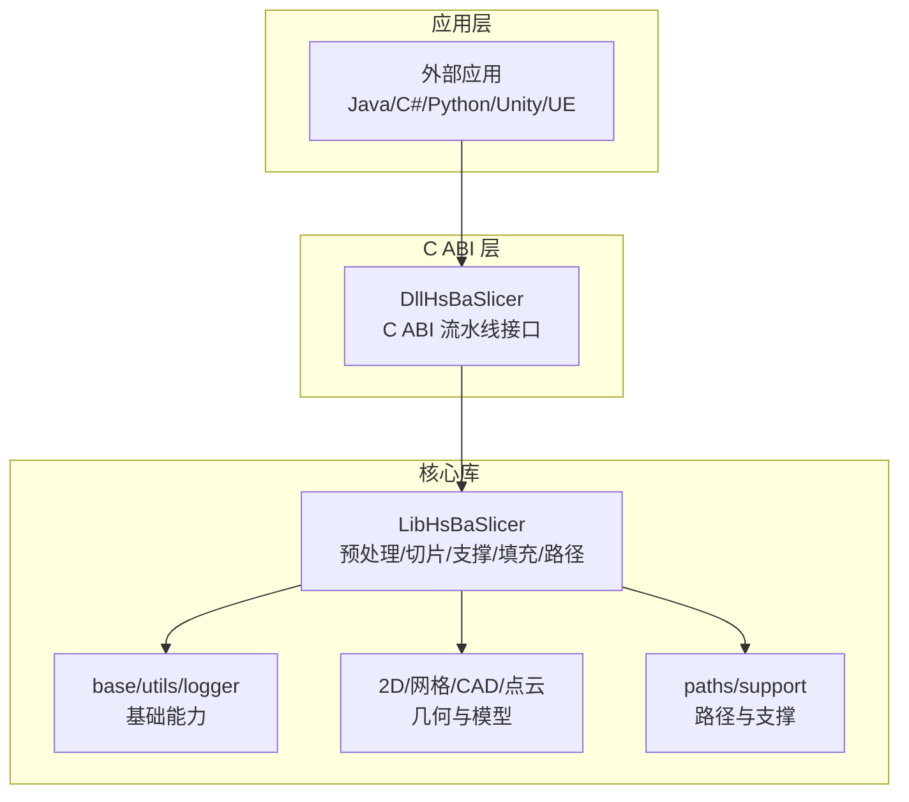

图表来源
- [README.md:100-124](file://README.md#L100-L124)
- [dllexport.h:1-23](file://DllHsBaSlicer/dllexport.h#L1-L23)
- [export.h:1-22](file://LibHsBaSlicer/export.h#L1-L22)

章节来源
- [README.md:100-124](file://README.md#L100-L124)

## 核心组件
LibHsBaSlicer 的核心能力由以下子模块构成：
- 预处理（Model Preprocess）：模型加载、变换、信息查询、布尔运算与抽壳。
- 切片（Mesh Slice）：Z 轴平面切片，支持安全/不安全切片与可复用拓扑构建。
- 支撑（Support）：FDM/SLA/Lua 自定义支撑截面生成。
- 填充（Polygon Fill）：线型/锯齿/边框填充与 Lua 自定义填充。
- 路径（Path Generation）：从层数据生成 G-code 路径，包含前置区域路径优化。
- SLA Floor/Export：底座生成、层图渲染与打包。
- 参数存储（ParamStore）：工艺参数持久化与复用。
- 扩展（Extends）：Lua 函数注册、事件回调与 C++ 事件源。

章节来源
- [model_preprocess.hpp:1-192](file://LibHsBaSlicer/Preprocess/model_preprocess.hpp#L1-L192)
- [mesh_slice.hpp:1-108](file://LibHsBaSlicer/Slice/mesh_slice.hpp#L1-L108)
- [fdm_support.hpp:1-72](file://LibHsBaSlicer/Support/fdm_support.hpp#L1-L72)
- [polygon_fill.hpp:1-58](file://LibHsBaSlicer/Fill/polygon_fill.hpp#L1-L58)

## 架构总览
LibHsBaSlicer 与 DllHsBaSlicer 的职责分离清晰：
- DllHsBaSlicer 负责 C ABI 暴露、参数校验、协程调度、进度回调与结果释放。
- LibHsBaSlicer 负责具体算法实现与管线编排。
- 各技术流水线通过统一的配置结构体（HsBa*PipelineConfig_t）驱动，并通过 Lua 脚本扩展关键步骤。

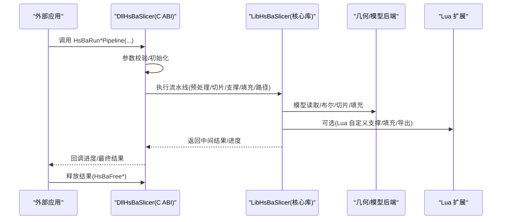

图表来源
- [fdm_pipeline.h:17-61](file://DllHsBaSlicer/fdm_pipeline.h#L17-L61)
- [sla_pipeline.h:17-56](file://DllHsBaSlicer/sla_pipeline.h#L17-L56)
- [pipeline_types.h:115-141](file://pipelinetypes/pipeline_types.h#L115-L141)

## 详细组件分析

### LibHsBaSlicer 核心 API 概览
- 预处理 API：LoadModel/TranslateModel/RotateModel/ScaleModel/GetModelInfo/BooleanUnion/Difference/Intersection/Xor/ThickSolidModel 等。
- 切片 API：Slice/UnSafeSlice/SliceLua/UnSafeSliceLua/NormalizeUnSafePolygons/BuildSliceTopology/SliceLayer。
- 支撑 API：GenerateFdmSupport/GenerateAllFdmSupport/GenerateAllSlaSupport/GenerateAllLuaSupport。
- 填充 API：FillPolygon/FillWithBorder/LuaCustomFillByFile。

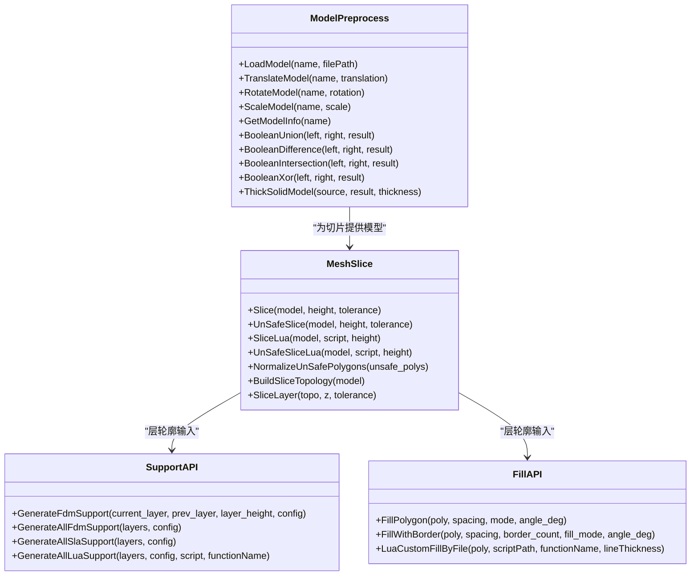

图表来源
- [model_preprocess.hpp:22-187](file://LibHsBaSlicer/Preprocess/model_preprocess.hpp#L22-L187)
- [mesh_slice.hpp:22-103](file://LibHsBaSlicer/Slice/mesh_slice.hpp#L22-L103)
- [fdm_support.hpp:19-67](file://LibHsBaSlicer/Support/fdm_support.hpp#L19-L67)
- [polygon_fill.hpp:17-53](file://LibHsBaSlicer/Fill/polygon_fill.hpp#L17-L53)

章节来源
- [model_preprocess.hpp:1-192](file://LibHsBaSlicer/Preprocess/model_preprocess.hpp#L1-L192)
- [mesh_slice.hpp:1-108](file://LibHsBaSlicer/Slice/mesh_slice.hpp#L1-L108)
- [fdm_support.hpp:1-72](file://LibHsBaSlicer/Support/fdm_support.hpp#L1-L72)
- [polygon_fill.hpp:1-58](file://LibHsBaSlicer/Fill/polygon_fill.hpp#L1-L58)

### DllHsBaSlicer C ABI 层接口设计
- 统一导出宏 HSBA_SLICER_API 用于 Windows 与非 Windows 平台的符号导出/导入控制。
- 每个流水线提供：默认配置创建、同步运行、异步运行、结果释放。
- 进度回调与结果回调支持非阻塞调用，内部使用协程调度。

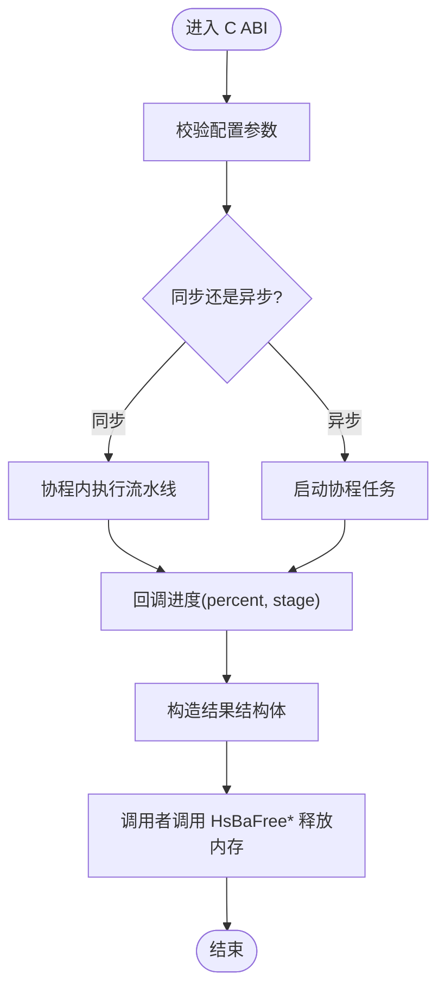

图表来源
- [dllexport.h:1-23](file://DllHsBaSlicer/dllexport.h#L1-L23)
- [fdm_pipeline.h:17-61](file://DllHsBaSlicer/fdm_pipeline.h#L17-L61)
- [sla_pipeline.h:17-56](file://DllHsBaSlicer/sla_pipeline.h#L17-L56)
- [pipeline_types.h:115-141](file://pipelinetypes/pipeline_types.h#L115-L141)

章节来源
- [dllexport.h:1-23](file://DllHsBaSlicer/dllexport.h#L1-L23)
- [fdm_pipeline.h:1-68](file://DllHsBaSlicer/fdm_pipeline.h#L1-L68)
- [sla_pipeline.h:1-63](file://DllHsBaSlicer/sla_pipeline.h#L1-L63)
- [pipeline_types.h:115-141](file://pipelinetypes/pipeline_types.h#L115-L141)

### 多技术流水线详解与配置要点

#### FDM（熔融沉积成型）
- 流水线：预处理 -> 切片 -> 支撑 -> 填充 -> 路径生成。
- 关键配置：层高、首层层高、填充间距/模式/角度、壁厚、顶/底层数、密度、支撑开关/悬垂角/间隙/直径/密度/图案、打印速度/移动速度/挤出倍率、GCode 固件目标、喷嘴/耗材直径、温度、回抽、首层速度、螺旋外壁模式、Lua 自定义支撑/填充脚本。
- 输出：G-code 文本或文件。

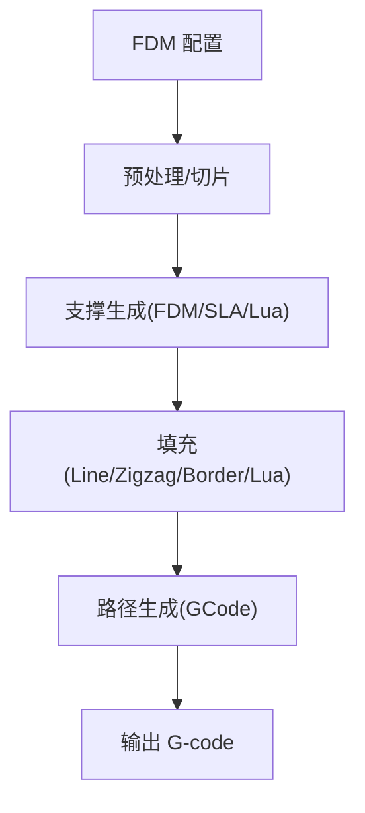

图表来源
- [pipeline_types.h:23-127](file://pipelinetypes/pipeline_types.h#L23-L127)
- [fdm_pipeline.h:23-35](file://DllHsBaSlicer/fdm_pipeline.h#L23-L35)

章节来源
- [pipeline_types.h:23-127](file://pipelinetypes/pipeline_types.h#L23-L127)
- [fdm_pipeline.h:17-61](file://DllHsBaSlicer/fdm_pipeline.h#L17-L61)

#### SLA（立体光刻）
- 流水线：预处理 -> 切片 -> 地板/底座 -> 支撑 -> 导出（zip）。
- 关键配置：层高、首层层高、曝光时间（底部/正常）、抬升距离/速度、回抽速度、地板偏移/边框宽度/填充间距/角度/边框数量/凸包选项、支撑开关/悬垂角/间隙/直径/密度/图案、Lua 自定义支撑/地板/导出脚本、图像格式/尺寸、输出 zip 路径。

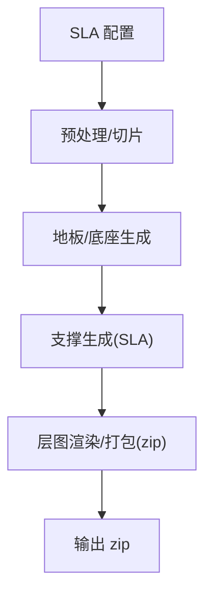

图表来源
- [pipeline_types.h:146-232](file://pipelinetypes/pipeline_types.h#L146-L232)
- [sla_pipeline.h:23-34](file://DllHsBaSlicer/sla_pipeline.h#L23-L34)

章节来源
- [pipeline_types.h:146-232](file://pipelinetypes/pipeline_types.h#L146-L232)
- [sla_pipeline.h:17-56](file://DllHsBaSlicer/sla_pipeline.h#L17-L56)

#### SLS（选择性激光烧结）
- 特点：粉末床无需地板/支撑；输出完全由 Lua 导出脚本决定。
- 关键配置：层高、首层层高、激光功率/扫描速度/ Hatch 间距/旋转、粉床温度、Lua 导出脚本/函数、输出路径。

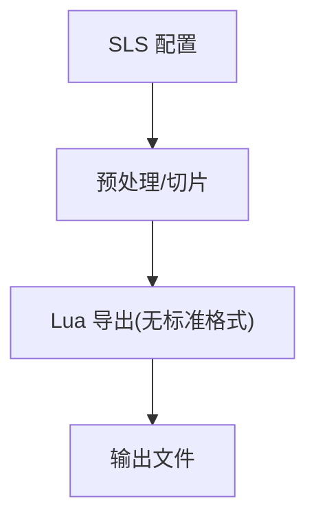

图表来源
- [pipeline_types.h:248-297](file://pipelinetypes/pipeline_types.h#L248-L297)

章节来源
- [pipeline_types.h:248-297](file://pipelinetypes/pipeline_types.h#L248-L297)

#### SLM（金属粉末床熔化）
- 特点：与 SLS 流程一致，但增加材料/能量源/保护气体等金属相关参数。
- 关键配置：层高、首层层高、激光功率/扫描速度/Hatch 间距/旋转、粉床温度、材料枚举、光源类型、保护气体、Lua 导出脚本/函数、输出路径。

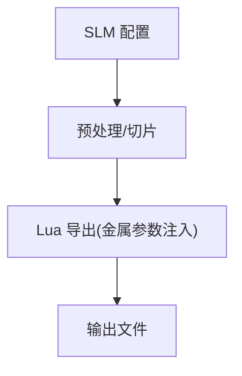

图表来源
- [pipeline_types.h:312-401](file://pipelinetypes/pipeline_types.h#L312-L401)

章节来源
- [pipeline_types.h:312-401](file://pipelinetypes/pipeline_types.h#L312-L401)

#### LOM（叠层实体制造）
- 特点：片材粘合+切割；支持轮廓/半色调切割模式。
- 关键配置：层高、首层层高、切割速度/余量/功率、粘合温度/压力/时间、封边、切割模式、Lua 导出脚本/函数、输出路径。

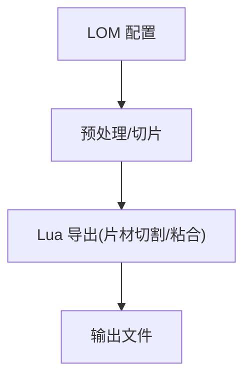

图表来源
- [pipeline_types.h:403-461](file://pipelinetypes/pipeline_types.h#L403-L461)

章节来源
- [pipeline_types.h:403-461](file://pipelinetypes/pipeline_types.h#L403-L461)

#### TDP（粘结剂喷射 3DP）
- 特点：粉末床+液体粘结剂；支持全彩/单通道/烧结模式。
- 关键配置：层高、首层层高、喷头数量/滴落间距/饱和度和固化时间、粉床温度、粘结模式、Lua 导出脚本/函数、输出路径、螺旋外轮廓模式。

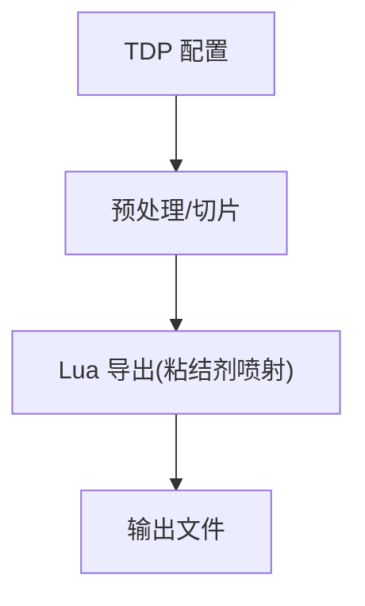

图表来源
- [pipeline_types.h:463-521](file://pipelinetypes/pipeline_types.h#L463-L521)

章节来源
- [pipeline_types.h:463-521](file://pipelinetypes/pipeline_types.h#L463-L521)

#### WAAM（电弧增材制造）
- 特点：机器人沉积路径输出（ABB/KUKA/FANUC），非层 zip。
- 关键配置：层高、首层层高、焊道宽度/行走速度/送丝速度/电流/电压/气体流量、材料、焊接工艺、保护方式、保护气体、层间温度、机器人类型、Lua 路径脚本/函数、输出路径、螺旋外壁模式。

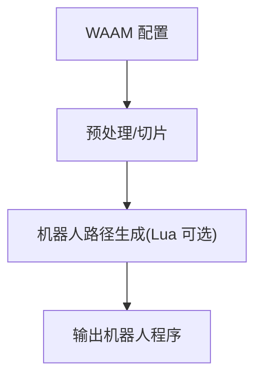

图表来源
- [pipeline_types.h:523-625](file://pipelinetypes/pipeline_types.h#L523-L625)

章节来源
- [pipeline_types.h:523-625](file://pipelinetypes/pipeline_types.h#L523-L625)

### 高级配置与自定义扩展点
- Lua 自定义支撑/填充：通过 HsBaFdmPipelineConfig_t 的 support_lua_script/support_lua_func/infill_lua_script/infill_lua_func 字段指定脚本路径与函数名，替换内置算法。
- SLA 自定义地板/支撑/导出：HsBaSlaPipelineConfig_t 提供 floor_lua_script/floor_lua_func/support_lua_script/support_lua_func/export_lua_script/export_lua_func。
- SLS/SLM/LOM/TDP/WAAM：均通过 export_lua_script/export_lua_func 或 path_lua_script/path_lua_func 进行导出/路径定制。
- 自定义流水线：HsBaCustomPipelineConfig_t 允许完全由 Lua 定义流水线阶段顺序与内容，C++ 侧仅暴露构建块（模型加载、切片、支撑、填充、路径、打包）。

章节来源
- [pipeline_types.h:104-113](file://pipelinetypes/pipeline_types.h#L104-L113)
- [pipeline_types.h:204-218](file://pipelinetypes/pipeline_types.h#L204-L218)
- [pipeline_types.h:276-283](file://pipelinetypes/pipeline_types.h#L276-L283)
- [pipeline_types.h:373-376](file://pipelinetypes/pipeline_types.h#L373-L376)
- [pipeline_types.h:433-436](file://pipelinetypes/pipeline_types.h#L433-L436)
- [pipeline_types.h:492-496](file://pipelinetypes/pipeline_types.h#L492-L496)
- [pipeline_types.h:596-600](file://pipelinetypes/pipeline_types.h#L596-L600)
- [pipeline_types.h:689-704](file://pipelinetypes/pipeline_types.h#L689-L704)

## 依赖关系分析
- DllHsBaSlicer 依赖 pipelinetypes/pipeline_types.h 中的 POD 配置结构体与回调类型，确保 C ABI 稳定。
- LibHsBaSlicer 依赖 2D 几何（FloatPolygons/IntPolygon/PolygonFill）、meshmodel/FullTopoModel、support/SupportConfig、paths 等。
- 导出头 dllexport.h/export.h 分别控制共享库与静态库的符号可见性。

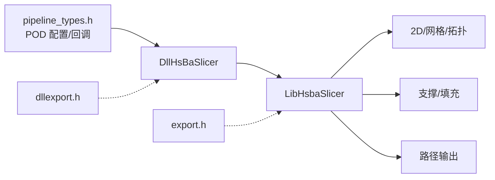

图表来源
- [pipeline_types.h:1-141](file://pipelinetypes/pipeline_types.h#L1-L141)
- [dllexport.h:1-23](file://DllHsBaSlicer/dllexport.h#L1-L23)
- [export.h:1-22](file://LibHsBaSlicer/export.h#L1-L22)

章节来源
- [pipeline_types.h:1-141](file://pipelinetypes/pipeline_types.h#L1-L141)
- [dllexport.h:1-23](file://DllHsBaSlicer/dllexport.h#L1-L23)
- [export.h:1-22](file://LibHsBaSlicer/export.h#L1-L22)

## 性能与优化
- 多线程处理
  - 使用线程池（base/thread_pool.hpp）并行处理层间任务（如每层独立切片/填充/支撑）。
  - 对 BuildSliceTopology 的结果在多线程中只读访问，避免重复拓扑重建。
- 内存管理
  - 使用对象池/内存池减少频繁分配/释放开销。
  - 遵循 C ABI 结果释放约定（HsBaFreePipelineResult/HsBaFreeSlaPipelineResult 等），避免内存泄漏。
- 几何计算优化
  - 优先使用 NormalizeUnSafePolygons 清理无效多边形，降低后续计算复杂度。
  - 合理设置 tolerance 以平衡精度与性能。
  - 对于大模型，优先使用 BuildSliceTopology + SliceLayer 复用拓扑，避免每层 O(total_faces) 重建。
- I/O 与序列化
  - 批量写入 G-code/zip，减少系统调用次数。
  - 使用连接池（RemoteExecutorConnectionPool）进行远程文件传输，提升吞吐。

章节来源
- [mesh_slice.hpp:79-103](file://LibHsBaSlicer/Slice/mesh_slice.hpp#L79-L103)
- [pipeline_types.h:631-674](file://pipelinetypes/pipeline_types.h#L631-L674)

## 故障排除指南
- 常见问题
  - 未释放结果内存：务必在获取 HsBaFdmPipelineResult_t/HsBaSlaPipelineResult_t 后调用对应释放函数。
  - Lua 脚本路径错误：检查 pipeline_lua_script/export_lua_script/path_lua_script 是否为空且路径有效。
  - 切片失败：确认模型闭合性与 tolerance 设置；必要时使用 UnSafeSlice + NormalizeUnSafePolygons。
  - 支撑/填充异常：核对 SupportConfig/FillMode 参数范围，检查 Lua 函数签名与返回值。
- 调试建议
  - 启用日志（logger）记录关键阶段耗时与错误信息。
  - 使用 samples 中的最小复现用例逐步定位问题。

章节来源
- [fdm_pipeline.h:53-61](file://DllHsBaSlicer/fdm_pipeline.h#L53-L61)
- [sla_pipeline.h:49-56](file://DllHsBaSlicer/sla_pipeline.h#L49-L56)
- [mesh_slice.hpp:67-77](file://LibHsBaSlicer/Slice/mesh_slice.hpp#L67-L77)

## 结论
HsBaSlicer 通过 LibHsBaSlicer 提供稳定的核心切片能力，并通过 DllHsBaSlicer 暴露跨语言 C ABI，支持 FDM/SLA/SLS/SLM/LOM/TDP/WAAM 等多技术流水线。借助 Lua 扩展点与完善的配置体系，用户可在不修改核心代码的情况下定制支撑、填充、导出与路径生成逻辑。结合多线程、内存池与几何优化策略，可实现高性能、可扩展的生产级切片解决方案。

## 附录：多技术流水线配置速查
- FDM：关注层高/填充/支撑/路径/GCode 固件/温度/回抽/螺旋外壁模式。
- SLA：关注曝光/抬升/地板/支撑/图像格式/导出 zip。
- SLS/SLM：关注激光/扫描/Hatch/粉床温度/材料/光源/保护气体/导出脚本。
- LOM：关注切割速度/余量/功率/粘合参数/封边/切割模式。
- TDP：关注喷头/滴落/饱和度/固化/粘结模式/螺旋外轮廓。
- WAAM：关注焊道/速度/电流/电压/气体/材料/工艺/保护/机器人类型/路径脚本/螺旋外壁。

章节来源
- [pipeline_types.h:23-127](file://pipelinetypes/pipeline_types.h#L23-L127)
- [pipeline_types.h:146-232](file://pipelinetypes/pipeline_types.h#L146-L232)
- [pipeline_types.h:248-401](file://pipelinetypes/pipeline_types.h#L248-L401)
- [pipeline_types.h:403-625](file://pipelinetypes/pipeline_types.h#L403-L625)