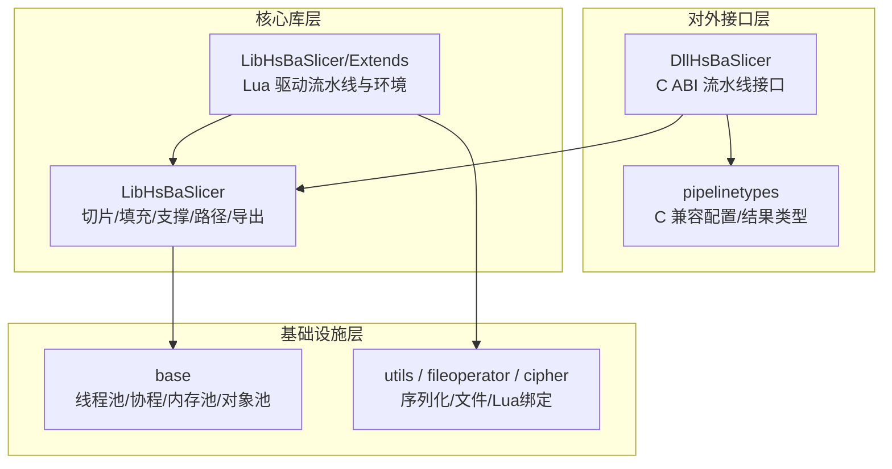
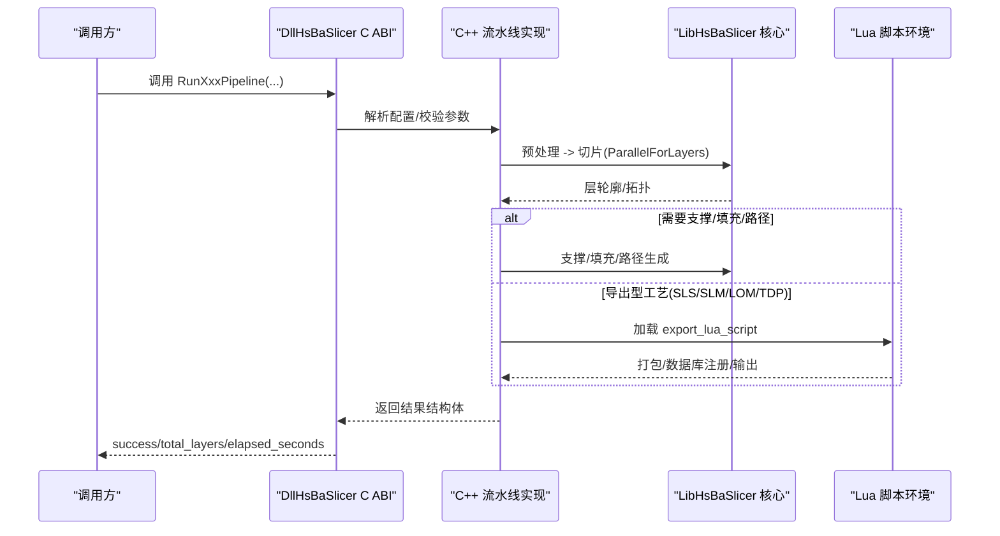
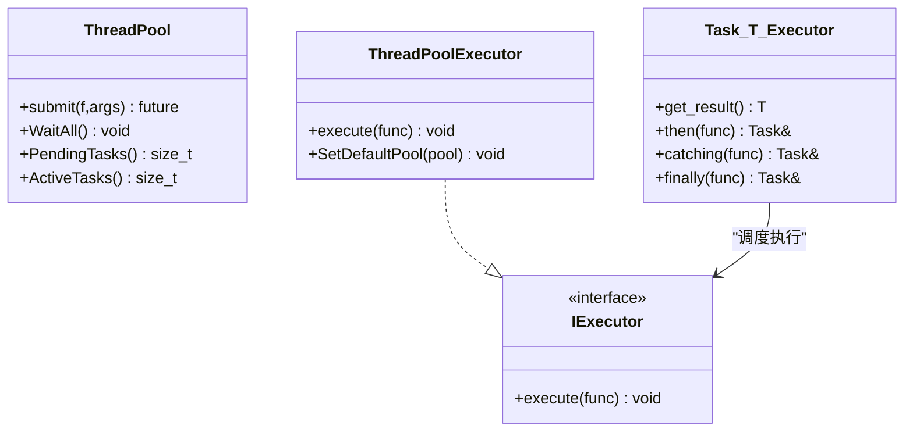
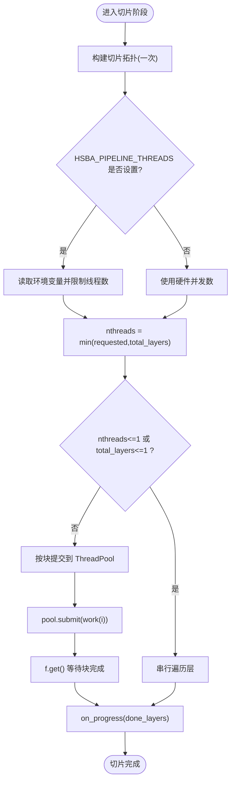
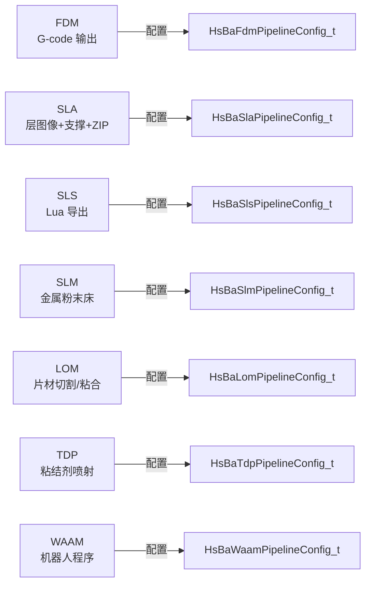
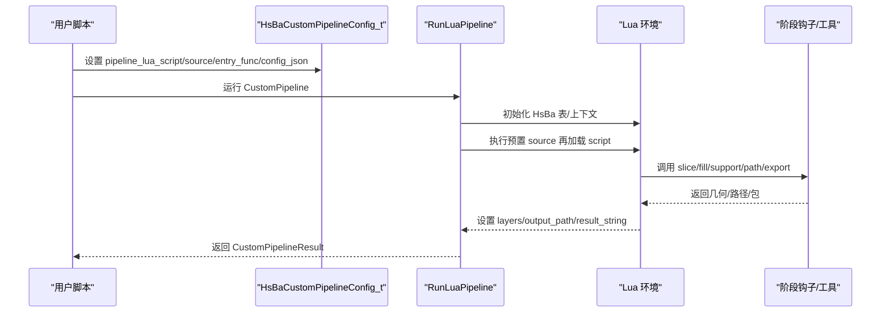
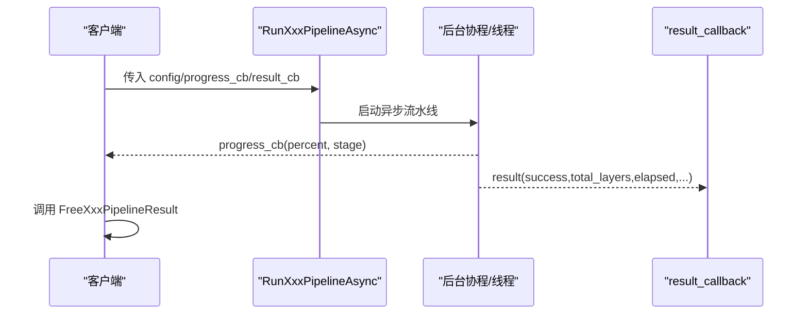
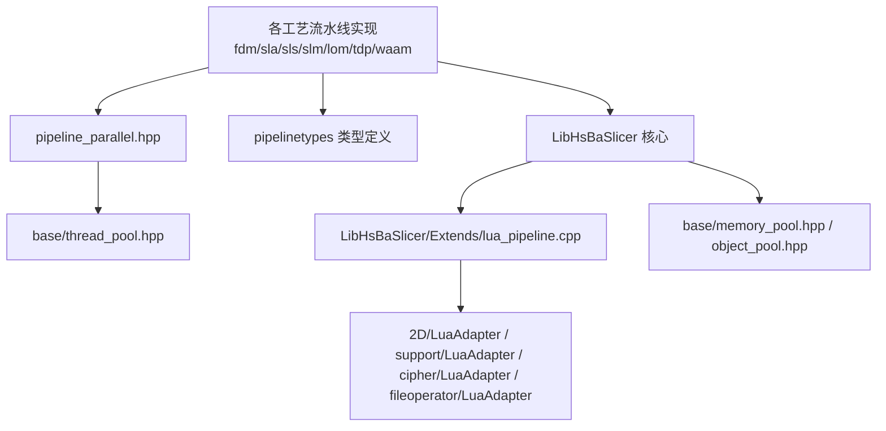

# 高级主题

<cite>
**本文引用的文件**   
- [README.md](file://README.md)
- [base/thread_pool.hpp](file://base/thread_pool.hpp)
- [base/coroutine.hpp](file://base/coroutine.hpp)
- [base/memory_pool.hpp](file://base/memory_pool.hpp)
- [base/object_pool.hpp](file://base/object_pool.hpp)
- [DllHsBaSlicer/pipeline_parallel.hpp](file://DllHsBaSlicer/pipeline_parallel.hpp)
- [DllHsBaSlicer/fdm_pipeline.h](file://DllHsBaSlicer/fdm_pipeline.h)
- [DllHsBaSlicer/sla_pipeline.h](file://DllHsBaSlicer/sla_pipeline.h)
- [DllHsBaSlicer/slm_pipeline.h](file://DllHsBaSlicer/slm_pipeline.h)
- [DllHsBaSlicer/sls_pipeline.h](file://DllHsBaSlicer/sls_pipeline.h)
- [DllHsBaSlicer/tdp_pipeline.h](file://DllHsBaSlicer/tdp_pipeline.h)
- [DllHsBaSlicer/waam_pipeline.h](file://DllHsBaSlicer/waam_pipeline.h)
- [DllHsBaSlicer/lom_pipeline.h](file://DllHsBaSlicer/lom_pipeline.h)
- [pipelinetypes/pipeline_types.h](file://pipelinetypes/pipeline_types.h)
- [DllHsBaSlicer/fdm_pipeline.cpp](file://DllHsBaSlicer/fdm_pipeline.cpp)
- [DllHsBaSlicer/sla_pipeline.cpp](file://DllHsBaSlicer/sla_pipeline.cpp)
- [DllHsBaSlicer/sls_pipeline.cpp](file://DllHsBaSlicer/sls_pipeline.cpp)
- [DllHsBaSlicer/waam_pipeline.cpp](file://DllHsBaSlicer/waam_pipeline.cpp)
- [DllHsBaSlicer/custom_pipeline.cpp](file://DllHsBaSlicer/custom_pipeline.cpp)
- [LibHsBaSlicer/Extends/lua_pipeline.cpp](file://LibHsBaSlicer/Extends/lua_pipeline.cpp)
- [ModuleHsBaSlicer/hsba_slicer.cppm](file://ModuleHsBaSlicer/hsba_slicer.cppm)
- [proto/custom_pipeline.proto](file://proto/custom_pipeline.proto)
- [samples/Custom/scripts/my_fdm_pipeline.lua](file://samples/Custom/scripts/my_fdm_pipeline.lua)
- [samples/SLM/main.cpp](file://samples/SLM/main.cpp)
</cite>

## 目录
1. [引言](#引言)
2. [项目结构](#项目结构)
3. [核心组件](#核心组件)
4. [架构总览](#架构总览)
5. [详细组件分析](#详细组件分析)
6. [依赖关系分析](#依赖关系分析)
7. [性能与调优](#性能与调优)
8. [故障排除指南](#故障排除指南)
9. [结论](#结论)
10. [附录](#附录)

## 引言
本页面聚焦 HsBaSlicer 的高级能力，面向有经验的开发者，围绕以下目标展开：多技术栈支持机制、异步处理架构、并行计算优化、性能调优策略；不同增材制造技术的特殊处理逻辑；流水线扩展机制与自定义算法集成；线程池使用模式、协程编程实践、内存管理优化与缓存策略；并提供基准测试思路、优化案例与最佳实践。文档严格基于源码实证，所有实现细节均指向具体源文件。

## 项目结构
HsBaSlicer 采用模块化设计，核心切片能力集中在 LibHsBaSlicer，对外 C ABI 接口在 DllHsBaSlicer，基础并发与内存设施在 base，Lua 脚本系统与扩展点在 LibHsBaSlicer/Extends 与 utils/fileoperator 等模块中。顶层 README 明确了主要模块职责与安装导出目标，便于下游通过 CMake find_package 引用。

**图示来源**
- [README.md:25-39](file://README.md#L25-L39)
- [pipelinetypes/pipeline_types.h:1-12](file://pipelinetypes/pipeline_types.h#L1-L12)

**章节来源**
- [README.md:25-39](file://README.md#L25-L39)

## 核心组件
本节梳理与“高级主题”直接相关的基础设施与流水线抽象：

- 线程池与协程执行器
  - ThreadPool：任务队列 + 工作线程 + future 结果 + WaitAll 同步点；提供 IExecutor 适配以接入 C++20 协程调度。
  - Task/CustomAllocatorTask：基于 promise_type 的协程任务封装，支持 then/catching/finally 链式回调与异常传播。
- 层并行执行器
  - ParallelForLayers：按层分块提交到 ThreadPool，保证 on_progress 在主线程串行调用，work 仅写各自层索引槽位。
- 内存与对象池
  - MemoryPool/StaticMemoryPool：固定大小内存池分配器，减少频繁 new/delete 开销。
  - NamedObjectPool：命名共享对象池，支持最大容量、惰性清理 inactive 对象、读写锁保护。
- 多技术栈流水线配置
  - FDM/SLA/SLS/SLM/LOM/TDP/WAAM/FileTransfer/CustomPipeline：统一的 C 兼容配置/结果结构体，定义默认值、回调与输出语义。

**章节来源**
- [base/thread_pool.hpp:29-162](file://base/thread_pool.hpp#L29-L162)
- [base/coroutine.hpp:47-73](file://base/coroutine.hpp#L47-L73)
- [base/coroutine.hpp:205-382](file://base/coroutine.hpp#L205-L382)
- [base/coroutine.hpp:563-772](file://base/coroutine.hpp#L563-L772)
- [DllHsBaSlicer/pipeline_parallel.hpp:22-117](file://DllHsBaSlicer/pipeline_parallel.hpp#L22-L117)
- [base/memory_pool.hpp:43-208](file://base/memory_pool.hpp#L43-L208)
- [base/memory_pool.hpp:215-372](file://base/memory_pool.hpp#L215-L372)
- [base/object_pool.hpp:22-283](file://base/object_pool.hpp#L22-L283)
- [pipelinetypes/pipeline_types.h:56-127](file://pipelinetypes/pipeline_types.h#L56-L127)
- [pipelinetypes/pipeline_types.h:170-232](file://pipelinetypes/pipeline_types.h#L170-L232)
- [pipelinetypes/pipeline_types.h:259-297](file://pipelinetypes/pipeline_types.h#L259-L297)
- [pipelinetypes/pipeline_types.h:359-388](file://pipelinetypes/pipeline_types.h#L359-L388)
- [pipelinetypes/pipeline_types.h:419-448](file://pipelinetypes/pipeline_types.h#L419-L448)
- [pipelinetypes/pipeline_types.h:480-508](file://pipelinetypes/pipeline_types.h#L480-L508)
- [pipelinetypes/pipeline_types.h:578-612](file://pipelinetypes/pipeline_types.h#L578-L612)
- [pipelinetypes/pipeline_types.h:689-719](file://pipelinetypes/pipeline_types.h#L689-L719)

## 架构总览
HsBaSlicer 的多技术栈流水线由“C ABI 入口 + C++ 实现 + Lua 可扩展阶段”组成。FDM/SLA 提供内置支撑/填充/路径生成；SLS/SLM/LOM/TDP 将导出交给 Lua 脚本；WAAM 输出机器人语言程序；CustomPipeline 完全由 Lua 编排阶段顺序。

**图示来源**
- [DllHsBaSlicer/fdm_pipeline.h:17-61](file://DllHsBaSlicer/fdm_pipeline.h#L17-L61)
- [DllHsBaSlicer/sla_pipeline.h:17-56](file://DllHsBaSlicer/sla_pipeline.h#L17-L56)
- [DllHsBaSlicer/sls_pipeline.h:17-56](file://DllHsBaSlicer/sls_pipeline.h#L17-L56)
- [DllHsBaSlicer/slm_pipeline.h:17-56](file://DllHsBaSlicer/slm_pipeline.h#L17-L56)
- [DllHsBaSlicer/lom_pipeline.h:17-56](file://DllHsBaSlicer/lom_pipeline.h#L17-L56)
- [DllHsBaSlicer/tdp_pipeline.h:17-56](file://DllHsBaSlicer/tdp_pipeline.h#L17-L56)
- [DllHsBaSlicer/waam_pipeline.h:17-57](file://DllHsBaSlicer/waam_pipeline.h#L17-L57)
- [DllHsBaSlicer/custom_pipeline.cpp:123-159](file://DllHsBaSlicer/custom_pipeline.cpp#L123-L159)
- [LibHsBaSlicer/Extends/lua_pipeline.cpp:960-994](file://LibHsBaSlicer/Extends/lua_pipeline.cpp#L960-L994)

## 详细组件分析

### 多线程与协程执行模型
- ThreadPool 提供 submit/WaitAll/PendingTasks/ActiveTasks，内部用 condition_variable 协调 worker 循环，异常被捕获但不影响其他任务。
- ThreadPoolExecutor 实现 IExecutor，可将协程调度委派给线程池；若未显式设置默认池，则创建基于硬件并发数的静态实例。
- Task/CustomAllocatorTask 提供协程任务抽象，支持 await_transform 嵌套任务、on_completed 回调、then/catching/finally 链式控制流。

**图示来源**
- [base/thread_pool.hpp:29-162](file://base/thread_pool.hpp#L29-L162)
- [base/thread_pool.hpp:170-207](file://base/thread_pool.hpp#L170-L207)
- [base/coroutine.hpp:47-73](file://base/coroutine.hpp#L47-L73)
- [base/coroutine.hpp:205-382](file://base/coroutine.hpp#L205-L382)

**章节来源**
- [base/thread_pool.hpp:29-162](file://base/thread_pool.hpp#L29-L162)
- [base/thread_pool.hpp:170-207](file://base/thread_pool.hpp#L170-L207)
- [base/coroutine.hpp:47-73](file://base/coroutine.hpp#L47-L73)
- [base/coroutine.hpp:205-382](file://base/coroutine.hpp#L205-L382)

### 层并行切片与进度回传
各工艺（FDM/SLA/SLS/WAAM）在切片阶段统一使用 ParallelForLayers 对独立层进行并行切片，并通过 on_progress 在主线程汇报进度。

**图示来源**
- [DllHsBaSlicer/pipeline_parallel.hpp:41-117](file://DllHsBaSlicer/pipeline_parallel.hpp#L41-L117)
- [DllHsBaSlicer/fdm_pipeline.cpp:259-279](file://DllHsBaSlicer/fdm_pipeline.cpp#L259-L279)
- [DllHsBaSlicer/sla_pipeline.cpp:338-358](file://DllHsBaSlicer/sla_pipeline.cpp#L338-L358)
- [DllHsBaSlicer/sls_pipeline.cpp:229-242](file://DllHsBaSlicer/sls_pipeline.cpp#L229-L242)
- [DllHsBaSlicer/waam_pipeline.cpp:208-231](file://DllHsBaSlicer/waam_pipeline.cpp#L208-L231)

**章节来源**
- [DllHsBaSlicer/pipeline_parallel.hpp:41-117](file://DllHsBaSlicer/pipeline_parallel.hpp#L41-L117)
- [DllHsBaSlicer/fdm_pipeline.cpp:259-279](file://DllHsBaSlicer/fdm_pipeline.cpp#L259-L279)
- [DllHsBaSlicer/sla_pipeline.cpp:338-358](file://DllHsBaSlicer/sla_pipeline.cpp#L338-L358)
- [DllHsBaSlicer/sls_pipeline.cpp:229-242](file://DllHsBaSlicer/sls_pipeline.cpp#L229-L242)
- [DllHsBaSlicer/waam_pipeline.cpp:208-231](file://DllHsBaSlicer/waam_pipeline.cpp#L208-L231)

### 多技术栈特殊处理逻辑
- FDM：Preprocess → Slice → Support → Fill → Path Generation，输出 G-code；支持螺旋模式（vase mode）跳过 per-layer infill/support。
- SLA：Preprocess → Slice → Floor → Support → Export(zip)，支持 PNG/JPEG/SVG 层图像格式。
- SLS/SLM：Preprocess → Slice → Lua 导出（zip+数据库），SLM 额外包含金属粉末材料、能量源、保护气体等元数据。
- LOM：Preprocess → Slice → Lua 导出，层为片材厚度，含切割/粘合参数。
- TDP：Preprocess → Slice → Lua 导出，含粘结剂喷射模式、头数量、固化时间等。
- WAAM：Preprocess → Slice → 机器人路径导出（ABB/KUKA/FANUC），非层 zip 归档。

**图示来源**
- [pipelinetypes/pipeline_types.h:56-127](file://pipelinetypes/pipeline_types.h#L56-L127)
- [pipelinetypes/pipeline_types.h:170-232](file://pipelinetypes/pipeline_types.h#L170-L232)
- [pipelinetypes/pipeline_types.h:259-297](file://pipelinetypes/pipeline_types.h#L259-L297)
- [pipelinetypes/pipeline_types.h:359-388](file://pipelinetypes/pipeline_types.h#L359-L388)
- [pipelinetypes/pipeline_types.h:419-448](file://pipelinetypes/pipeline_types.h#L419-L448)
- [pipelinetypes/pipeline_types.h:480-508](file://pipelinetypes/pipeline_types.h#L480-L508)
- [pipelinetypes/pipeline_types.h:578-612](file://pipelinetypes/pipeline_types.h#L578-L612)

**章节来源**
- [DllHsBaSlicer/fdm_pipeline.h:17-61](file://DllHsBaSlicer/fdm_pipeline.h#L17-L61)
- [DllHsBaSlicer/sla_pipeline.h:17-56](file://DllHsBaSlicer/sla_pipeline.h#L17-L56)
- [DllHsBaSlicer/sls_pipeline.h:17-56](file://DllHsBaSlicer/sls_pipeline.h#L17-L56)
- [DllHsBaSlicer/slm_pipeline.h:17-56](file://DllHsBaSlicer/slm_pipeline.h#L17-L56)
- [DllHsBaSlicer/lom_pipeline.h:17-56](file://DllHsBaSlicer/lom_pipeline.h#L17-L56)
- [DllHsBaSlicer/tdp_pipeline.h:17-56](file://DllHsBaSlicer/tdp_pipeline.h#L17-L56)
- [DllHsBaSlicer/waam_pipeline.h:17-57](file://DllHsBaSlicer/waam_pipeline.h#L17-L57)
- [pipelinetypes/pipeline_types.h:56-127](file://pipelinetypes/pipeline_types.h#L56-L127)
- [pipelinetypes/pipeline_types.h:170-232](file://pipelinetypes/pipeline_types.h#L170-L232)
- [pipelinetypes/pipeline_types.h:259-297](file://pipelinetypes/pipeline_types.h#L259-L297)
- [pipelinetypes/pipeline_types.h:359-388](file://pipelinetypes/pipeline_types.h#L359-L388)
- [pipelinetypes/pipeline_types.h:419-448](file://pipelinetypes/pipeline_types.h#L419-L448)
- [pipelinetypes/pipeline_types.h:480-508](file://pipelinetypes/pipeline_types.h#L480-L508)
- [pipelinetypes/pipeline_types.h:578-612](file://pipelinetypes/pipeline_types.h#L578-L612)

### 流水线扩展机制与自定义算法集成
- 内置阶段可被 Lua 替换或增强：FDM 支持 support_lua_script/infill_lua_script；SLA 支持 floor/support/export Lua；SLS/SLM/LOM/TDP 强制使用 export_lua_script。
- CustomPipeline 完全由 Lua 编排阶段顺序，C++ 仅提供构建块（loadModel/slice/fill/fdmSupport/toGcode/saveSlsPackage 等）。
- 扩展函数注册：通过 initialize/lua_register 暴露 HsBaAdd2DFunction/HsBaAdd3DFunction/HsBaAddFileFunction 等，注入到对应阶段的 Lua 环境。

**图示来源**
- [pipelinetypes/pipeline_types.h:689-719](file://pipelinetypes/pipeline_types.h#L689-L719)
- [DllHsBaSlicer/custom_pipeline.cpp:123-159](file://DllHsBaSlicer/custom_pipeline.cpp#L123-L159)
- [LibHsBaSlicer/Extends/lua_pipeline.cpp:960-994](file://LibHsBaSlicer/Extends/lua_pipeline.cpp#L960-L994)
- [ModuleHsBaSlicer/hsba_slicer.cppm:445-479](file://ModuleHsBaSlicer/hsba_slicer.cppm#L445-L479)
- [proto/custom_pipeline.proto:1-25](file://proto/custom_pipeline.proto#L1-L25)

**章节来源**
- [pipelinetypes/pipeline_types.h:689-719](file://pipelinetypes/pipeline_types.h#L689-L719)
- [DllHsBaSlicer/custom_pipeline.cpp:123-159](file://DllHsBaSlicer/custom_pipeline.cpp#L123-L159)
- [LibHsBaSlicer/Extends/lua_pipeline.cpp:960-994](file://LibHsBaSlicer/Extends/lua_pipeline.cpp#L960-L994)
- [ModuleHsBaSlicer/hsba_slicer.cppm:445-479](file://ModuleHsBaSlicer/hsba_slicer.cppm#L445-L479)
- [proto/custom_pipeline.proto:1-25](file://proto/custom_pipeline.proto#L1-L25)

### 异步处理与回调契约
- 每个工艺均提供同步与异步入口：同步阻塞直到结果就绪；异步通过 result_callback 返回结果。
- 进度回调：progress_callback 在各阶段报告百分比与阶段描述，便于 UI 更新与日志记录。
- 资源释放：必须调用对应的 Free 函数释放结果中的字符串字段。

**图示来源**
- [DllHsBaSlicer/fdm_pipeline.h:34-61](file://DllHsBaSlicer/fdm_pipeline.h#L34-L61)
- [DllHsBaSlicer/sla_pipeline.h:33-56](file://DllHsBaSlicer/sla_pipeline.h#L33-L56)
- [DllHsBaSlicer/sls_pipeline.h:33-56](file://DllHsBaSlicer/sls_pipeline.h#L33-L56)
- [DllHsBaSlicer/slm_pipeline.h:36-56](file://DllHsBaSlicer/slm_pipeline.h#L36-L56)
- [DllHsBaSlicer/lom_pipeline.h:36-56](file://DllHsBaSlicer/lom_pipeline.h#L36-L56)
- [DllHsBaSlicer/tdp_pipeline.h:36-56](file://DllHsBaSlicer/tdp_pipeline.h#L36-L56)
- [DllHsBaSlicer/waam_pipeline.h:37-57](file://DllHsBaSlicer/waam_pipeline.h#L37-L57)

**章节来源**
- [DllHsBaSlicer/fdm_pipeline.h:34-61](file://DllHsBaSlicer/fdm_pipeline.h#L34-L61)
- [DllHsBaSlicer/sla_pipeline.h:33-56](file://DllHsBaSlicer/sla_pipeline.h#L33-L56)
- [DllHsBaSlicer/sls_pipeline.h:33-56](file://DllHsBaSlicer/sls_pipeline.h#L33-L56)
- [DllHsBaSlicer/slm_pipeline.h:36-56](file://DllHsBaSlicer/slm_pipeline.h#L36-L56)
- [DllHsBaSlicer/lom_pipeline.h:36-56](file://DllHsBaSlicer/lom_pipeline.h#L36-L56)
- [DllHsBaSlicer/tdp_pipeline.h:36-56](file://DllHsBaSlicer/tdp_pipeline.h#L36-L56)
- [DllHsBaSlicer/waam_pipeline.h:37-57](file://DllHsBaSlicer/waam_pipeline.h#L37-L57)

## 依赖关系分析
- DllHsBaSlicer 依赖 pipelinetypes 提供的 C 兼容结构体，避免下游模块耦合 DLL。
- 各工艺流水线实现依赖 LibHsBaSlicer 的核心能力（切片、填充、支撑、路径、导出）。
- Lua 驱动流水线依赖 LibHsBaSlicer/Extends 的环境搭建与工具表，同时复用 2D/LuaAdapter、support/LuaAdapter、cipher/LuaAdapter、fileoperator/LuaAdapter 等。
- 并发与内存设施被上层广泛复用：ThreadPool 用于层并行；Task/CustomAllocatorTask 用于协程任务；MemoryPool/StaticMemoryPool 用于高频小对象分配；NamedObjectPool 用于命名共享对象生命周期管理。

**图示来源**
- [DllHsBaSlicer/fdm_pipeline.cpp:259-279](file://DllHsBaSlicer/fdm_pipeline.cpp#L259-L279)
- [DllHsBaSlicer/sla_pipeline.cpp:338-358](file://DllHsBaSlicer/sla_pipeline.cpp#L338-L358)
- [DllHsBaSlicer/sls_pipeline.cpp:229-242](file://DllHsBaSlicer/sls_pipeline.cpp#L229-L242)
- [DllHsBaSlicer/waam_pipeline.cpp:208-231](file://DllHsBaSlicer/waam_pipeline.cpp#L208-L231)
- [DllHsBaSlicer/pipeline_parallel.hpp:41-117](file://DllHsBaSlicer/pipeline_parallel.hpp#L41-L117)
- [base/thread_pool.hpp:29-162](file://base/thread_pool.hpp#L29-L162)
- [LibHsBaSlicer/Extends/lua_pipeline.cpp:960-994](file://LibHsBaSlicer/Extends/lua_pipeline.cpp#L960-L994)
- [base/memory_pool.hpp:43-208](file://base/memory_pool.hpp#L43-L208)
- [base/object_pool.hpp:22-283](file://base/object_pool.hpp#L22-L283)

**章节来源**
- [DllHsBaSlicer/fdm_pipeline.cpp:259-279](file://DllHsBaSlicer/fdm_pipeline.cpp#L259-L279)
- [DllHsBaSlicer/sla_pipeline.cpp:338-358](file://DllHsBaSlicer/sla_pipeline.cpp#L338-L358)
- [DllHsBaSlicer/sls_pipeline.cpp:229-242](file://DllHsBaSlicer/sls_pipeline.cpp#L229-L242)
- [DllHsBaSlicer/waam_pipeline.cpp:208-231](file://DllHsBaSlicer/waam_pipeline.cpp#L208-L231)
- [DllHsBaSlicer/pipeline_parallel.hpp:41-117](file://DllHsBaSlicer/pipeline_parallel.hpp#L41-L117)
- [base/thread_pool.hpp:29-162](file://base/thread_pool.hpp#L29-L162)
- [LibHsBaSlicer/Extends/lua_pipeline.cpp:960-994](file://LibHsBaSlicer/Extends/lua_pipeline.cpp#L960-L994)
- [base/memory_pool.hpp:43-208](file://base/memory_pool.hpp#L43-L208)
- [base/object_pool.hpp:22-283](file://base/object_pool.hpp#L22-L283)

## 性能与调优
- 层并行与线程数控制
  - 通过 HSBA_PIPELINE_THREADS 环境变量强制线程数，便于同二进制下串行/并行对比验证。
  - nthreads 上限受 total_layers 约束，避免无意义并行。
  - 建议：在高 CPU 核数机器上，根据层数与每层复杂度调整线程数；对于 IO 密集导出阶段，适当降低线程数以减少竞争。
- 协程与任务链
  - 使用 Task.then/catching/finally 组织异步阶段，避免回调地狱；异常在 get_or_throw 时抛出，便于集中处理。
  - 建议使用 ThreadPoolExecutor 将协程调度到线程池，避免 std::async 默认行为不可控。
- 内存与对象池
  - 对高频小对象（如层轮廓、中间几何）优先使用 MemoryPool/StaticMemoryPool 作为容器分配器，减少碎片与系统分配开销。
  - 对跨阶段共享对象（如模型、拓扑、配置）使用 NamedObjectPool，配合惰性清理 inactive 对象，避免手动释放遗漏。
- 缓存策略
  - 切片拓扑 BuildSliceTopology 只构建一次，供所有层并行切片使用，避免重复计算。
  - 对重复使用的几何（如支撑模板、填充模板）可考虑缓存到 NamedObjectPool，按名称复用。
- 基准测试建议
  - 使用 elapsed_seconds 字段统计端到端耗时；对切片阶段单独计时（利用 on_progress 分段统计）。
  - 对比 HSBA_PIPELINE_THREADS=1 与默认值的吞吐差异，评估并行收益与开销。
  - 针对导出阶段（SLS/SLM/LOM/TDP）分别测量 Lua 脚本执行时间与 IO 写入时间，定位瓶颈。

**章节来源**
- [DllHsBaSlicer/pipeline_parallel.hpp:49-72](file://DllHsBaSlicer/pipeline_parallel.hpp#L49-L72)
- [base/coroutine.hpp:205-382](file://base/coroutine.hpp#L205-L382)
- [base/memory_pool.hpp:43-208](file://base/memory_pool.hpp#L43-L208)
- [base/object_pool.hpp:22-283](file://base/object_pool.hpp#L22-L283)
- [DllHsBaSlicer/fdm_pipeline.cpp:264-279](file://DllHsBaSlicer/fdm_pipeline.cpp#L264-L279)
- [DllHsBaSlicer/sla_pipeline.cpp:343-358](file://DllHsBaSlicer/sla_pipeline.cpp#L343-L358)
- [DllHsBaSlicer/sls_pipeline.cpp:229-242](file://DllHsBaSlicer/sls_pipeline.cpp#L229-L242)
- [DllHsBaSlicer/waam_pipeline.cpp:214-231](file://DllHsBaSlicer/waam_pipeline.cpp#L214-L231)

## 故障排除指南
- 线程池提交失败
  - 现象：提交任务时报错或无法提交。
  - 排查：确认线程池未停止；检查 num_threads > 0；查看 PendingTasks/ActiveTasks 监控队列状态。
- 协程任务异常
  - 现象：then/catching 未触发或结果未返回。
  - 排查：确保 await_resume/get_result 正确消费；使用 catching 捕获异常；finally 用于清理。
- 层并行进度不更新
  - 现象：UI 进度卡住。
  - 排查：确认 on_progress 仅在调用线程调用；work 仅写自身层索引槽位；检查 HSBA_PIPELINE_THREADS 是否误设为 1。
- Lua 脚本错误
  - 现象：CustomPipeline 失败或导出为空。
  - 排查：检查 pipeline_lua_script/source 是否存在；entry_func 是否正确；config_json 是否有效；查看 error_message。
- 资源泄漏
  - 现象：进程退出后仍有内存占用。
  - 排查：确保调用 FreeXxxPipelineResult；检查 NamedObjectPool 是否及时 CleanupInactiveObjects。

**章节来源**
- [base/thread_pool.hpp:67-90](file://base/thread_pool.hpp#L67-L90)
- [base/coroutine.hpp:221-233](file://base/coroutine.hpp#L221-L233)
- [base/coroutine.hpp:338-358](file://base/coroutine.hpp#L338-L358)
- [DllHsBaSlicer/pipeline_parallel.hpp:41-117](file://DllHsBaSlicer/pipeline_parallel.hpp#L41-L117)
- [DllHsBaSlicer/custom_pipeline.cpp:123-159](file://DllHsBaSlicer/custom_pipeline.cpp#L123-L159)
- [base/object_pool.hpp:262-279](file://base/object_pool.hpp#L262-L279)

## 结论
HsBaSlicer 通过清晰的 C ABI 分层、可插拔的 Lua 扩展机制、稳定的线程池与协程框架，以及完善的内存与对象池工具，提供了高性能、可扩展、跨技术栈的切片流水线。开发者可在不修改核心代码的前提下，通过 Lua 脚本定制阶段顺序与输出格式，或通过 C++ 扩展函数注入新能力。结合层并行与可调线程数，可在多核平台上获得显著加速；配合内存池与对象池，可有效降低分配开销与碎片化。建议在真实场景中建立基准测试流程，量化并行收益与 Lua 脚本开销，持续优化关键路径。

## 附录
- 示例参考
  - FDM 自定义脚本：[samples/Custom/scripts/my_fdm_pipeline.lua](file://samples/Custom/scripts/my_fdm_pipeline.lua)
  - SLM 同步/异步调用示例：[samples/SLM/main.cpp](file://samples/SLM/main.cpp)
- 配置与消息定义
  - CustomPipeline Proto 定义：[proto/custom_pipeline.proto](file://proto/custom_pipeline.proto)
  - 各工艺 C 兼容配置/结果：[pipelinetypes/pipeline_types.h](file://pipelinetypes/pipeline_types.h)

**章节来源**
- [samples/Custom/scripts/my_fdm_pipeline.lua:86-121](file://samples/Custom/scripts/my_fdm_pipeline.lua#L86-L121)
- [samples/SLM/main.cpp:117-158](file://samples/SLM/main.cpp#L117-L158)
- [proto/custom_pipeline.proto:1-25](file://proto/custom_pipeline.proto#L1-L25)
- [pipelinetypes/pipeline_types.h:689-719](file://pipelinetypes/pipeline_types.h#L689-L719)