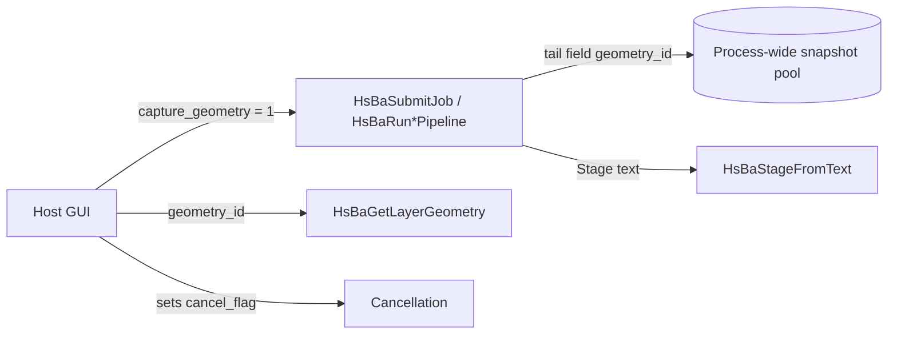

# GUI Support API (Structured Progress / Layer Geometry / Job Cancellation)

This document describes three additions to DllHsBaSlicer for graphical hosts. Together they remove the "slicing is opaque to the GUI" problem:

| Capability | Header | What it solves |
| --- | --- | --- |
| Structured progress stages | `progress_stage.h` | Progress arrives as mutable English text; a GUI needs a stable enumeration and identifier for colouring, timelines and i18n |
| Layer geometry snapshots | `geometry_export.h` | Contours / infill / support cross-sections only exist inside the pipeline, so a GUI cannot draw per-layer previews |
| Job handles and cancellation | `job_control.h` | The nine synchronous entries block the calling thread, the historical "async" entries blocked it as well, and neither could be stopped midway |

The three capabilities interlock: the stage enumeration expresses the cancelled state, and the job handle reports both the stage and the geometry id back to the host.

> Prerequisite: [DllHsBaSlicer Module](./README.md). The signatures and configuration fields of the nine `HsBaRun*Pipeline` entries are not repeated here.

## ABI Change Notice (read before upgrading)

All three capabilities are attached by **appending fields to the end of the structs**, which makes this one concentrated ABI break:

| Struct | New tail fields | Meaning |
| --- | --- | --- |
| All 9 `HsBa*PipelineConfig_t` | `int capture_geometry;` | 0 = do not capture layer geometry (default); 1 = capture |
| All 9 `HsBa*PipelineConfig_t` | `const void* cancel_flag;` | Address of a host-owned `std::atomic<bool>`; `NULL` = this run cannot be cancelled |
| All 9 `HsBa*PipelineResult_t` | `long long geometry_id;` | Snapshot handle; 0 = no snapshot (`filetransfer` and `custom` are always 0) |

Consequences and constraints:

1. **Every C host must be recompiled**, and the mirrored structs on the P/Invoke / ctypes / JNI side must gain the same tail fields; a host compiled against the old header reads misaligned data from the new DLL.
2. The three new fields are **not registered in the `param_reflect` field table**, so they never appear in the configuration JSON, the `default-config` response, the protobuf messages or the parameter wide table — `?geometry=1` (REST) and `HsBaJobResultView_t` (native) are their only outward channels.
3. Both `HsBaCreateDefault*Config()` and the inline initializers `HsBa*ConfigDefault()` in `pipeline_types.h` write `capture_geometry = 0` / `cancel_flag = 0` explicitly; callers that `memset` a struct or leave it uninitialised on the stack must zero it themselves, because a garbage `cancel_flag` is dereferenced as a valid pointer.



## 1. Structured Progress Stages

The `const char* stage` text of the existing `HsBaProgressCallback` is unchanged (old hosts keep working); the new functions only classify that text, and classification never fails: unrecognised text falls back to `HSBA_STAGE_UNKNOWN`, whose stable name is `"unknown"`.

```c
HSBA_SLICER_API HsBaStage_t HsBaStageFromText(const char* stage);   // Text to enum (stage may be NULL)
HSBA_SLICER_API const char* HsBaStageName(HsBaStage_t stage);       // Enum to stable snake_case identifier
HSBA_SLICER_API const char* HsBaStageLabel(HsBaStage_t stage);      // Enum to English display label (static string)
```

Identifiers and labels are **API surface**: they are only ever added, never renumbered or renamed.

| Value | Enumeration | `HsBaStageName` | `HsBaStageLabel` |
| --- | --- | --- | --- |
| 0 | `HSBA_STAGE_UNKNOWN` | `unknown` | Unknown |
| 1 | `HSBA_STAGE_LOAD_MODEL` | `model.loading` | Loading model |
| 2 | `HSBA_STAGE_MODEL_LOADED` | `model.loaded` | Model loaded |
| 3 | `HSBA_STAGE_SLICING` | `slicing.start` | Slicing |
| 4 | `HSBA_STAGE_SLICING_LAYER` | `slicing.layer` | Slicing layer |
| 5 | `HSBA_STAGE_SLICE_DONE` | `slicing.done` | Slicing complete |
| 6 | `HSBA_STAGE_FLOOR` | `floor.start` | Generating floor |
| 7 | `HSBA_STAGE_FLOOR_DONE` | `floor.done` | Floor complete |
| 8 | `HSBA_STAGE_SUPPORT` | `support.start` | Generating supports |
| 9 | `HSBA_STAGE_SUPPORT_DONE` | `support.done` | Supports complete |
| 10 | `HSBA_STAGE_SUPPORT_DISABLED` | `support.skipped` | Supports skipped |
| 11 | `HSBA_STAGE_FILL` | `fill.start` | Generating fills |
| 12 | `HSBA_STAGE_FILLING_LAYER` | `fill.layer` | Filling layer |
| 13 | `HSBA_STAGE_FILL_DONE` | `fill.done` | Fills complete |
| 14 | `HSBA_STAGE_PATH` | `path.start` | Generating tool path |
| 15 | `HSBA_STAGE_WRITE_FILE` | `file.write` | Writing output file |
| 16 | `HSBA_STAGE_EXPORT` | `export` | Exporting |
| 17 | `HSBA_STAGE_DONE` | `done` | Complete |
| 18 | `HSBA_STAGE_CANCELLED` | `cancelled` | Cancelled |

Enumeration values outside the declared range (an out-of-range integer from an older host, for instance) always render as `"unknown"` / `"Unknown"`.

### Matching rules

Classification first normalises the text without allocating: trailing `.` and spaces are dropped (`"Slicing layer..."` → `"Slicing layer"`), then the text is cut at `" ("` (`"Support disabled (spiral mode)"` → `"Support disabled"`). The **exact table** is consulted next, and only then the **prefix table**:

| Prefix | Stage | Why it exists |
| --- | --- | --- |
| `Slicing bead` / `Slicing sheet` / `Slicing layer` | `SLICING_LAYER` | Each process words its per-layer tick differently |
| `Exporting` | `EXPORT` | The tail carries a script or package name |
| `Writing ` | `WRITE_FILE` | The tail carries a file name |
| `Support disabled` | `SUPPORT_DISABLED` | Parenthetical qualifier |
| `Loading model` | `LOAD_MODEL` | The tail carries a model name |
| `Pipeline complete` | `DONE` | The tail carries elapsed time |
| `Cancelled` | `CANCELLED` | The tail carries the reason |

> **Text from a `custom` (Lua) pipeline is almost always classified as `UNKNOWN`**: what the script reports is the host's own choice. To get stage semantics for a GUI, reuse one of the English texts from the table above inside the Lua script, or drive the progress bar from `HsBaJobGetProgress` percentages only.

## 2. Job Handles and Cancellation

`HsBaSubmitJob` is the **real non-blocking entry**: before it returns it deep-copies the configuration (including every string, so the caller's buffers may be freed right after the call), starts a dedicated thread and hands back an opaque handle.

```c
typedef struct HsBaJob* HsBaJobHandle;

typedef enum HsBaJobState
{
    HSBA_JOB_PENDING = 0, HSBA_JOB_RUNNING = 1, HSBA_JOB_SUCCEEDED = 2,
    HSBA_JOB_FAILED = 3,  HSBA_JOB_CANCELLED = 4
} HsBaJobState_t;

typedef void (*HsBaProgressCallbackEx)(int percent, HsBaStage_t stage, const char* stage_text, void* user_data);
typedef void (*HsBaJobDoneCallback)(HsBaJobHandle job, void* user_data);

HSBA_SLICER_API HsBaJobHandle HsBaSubmitJob(HsBaPipelineKind kind, const void* config,
                                            HsBaProgressCallbackEx on_progress, void* progress_user_data,
                                            HsBaJobDoneCallback on_done, void* done_user_data);
HSBA_SLICER_API int           HsBaCancelJob(HsBaJobHandle job);
HSBA_SLICER_API int           HsBaWaitJob(HsBaJobHandle job, long long timeout_ms);
HSBA_SLICER_API HsBaJobState_t HsBaJobGetState(HsBaJobHandle job);
HSBA_SLICER_API int           HsBaJobGetProgress(HsBaJobHandle job, int* percent, HsBaStage_t* stage,
                                                 char* text_out, int text_cap);
HSBA_SLICER_API long long     HsBaJobGeometryId(HsBaJobHandle job);
HSBA_SLICER_API int           HsBaJobCopyResult(HsBaJobHandle job, HsBaJobResultView_t* out);
HSBA_SLICER_API void          HsBaFreeJobResultView(HsBaJobResultView_t* view);
HSBA_SLICER_API void          HsBaReleaseJob(HsBaJobHandle job);
```

Every function tolerates a `NULL` handle (`HsBaCancelJob/WaitJob/CopyResult` return 0, `HsBaJobGetState` returns `HSBA_JOB_FAILED`, the rest are no-ops), so a GUI does not need branches on the "cleanup even when submitting failed" path.

| Function | Return semantics |
| --- | --- |
| `HsBaSubmitJob` | `NULL` when the kind is out of range or `config == NULL`; a returned handle may be polled from another thread immediately |
| `HsBaCancelJob` | 1 = request recorded; 0 = the job was already final (or the handle is invalid) |
| `HsBaWaitJob` | 1 = final; 0 = timed out; `timeout_ms < 0` waits without limit |
| `HsBaJobGetProgress` | 1 = written; all four output arguments may be `NULL`, `text_out` is always NUL-terminated |
| `HsBaJobCopyResult` | 1 = result copied out; returns 0 with `out` zeroed while the job is still running |
| `HsBaJobGeometryId` | Snapshot id; 0 when nothing was captured or the handle is invalid |

### Threading contract

- Progress and completion callbacks run on **the job's own thread**, never on the submitting thread; the host must marshal into its UI thread itself.
- `HsBaJobGetProgress` / `HsBaJobGetState` / `HsBaJobCopyResult` are thread-safe and may be polled straight from a UI timer — hosts that do not want callbacks can poll only.
- A callback must **not** use the handle after calling `HsBaReleaseJob` in it; during the callback the library reference is already dropped but the host reference remains, so reading the result is safe.

### Lifetime and reference counting

A submitted job holds **2 references**: one for the running work, one for the caller. The library reference is dropped automatically when the completion callback fires.

- A fire-and-forget host (reads the result only inside `on_done` and never touches the handle again) must **still** call `HsBaReleaseJob` once, otherwise the host reference leaks;
- A host that keeps the handle across threads (for instance in a member variable for the "Cancel" button) keeps it valid simply by not calling `HsBaReleaseJob`;
- The last reference destroys the job, releasing its result-view strings and its geometry snapshot reference with it.

```c
// Polling style (no callbacks)
HsBaJobHandle job = HsBaSubmitJob(HSBA_PIPELINE_FDM, &cfg, NULL, NULL, NULL, NULL);
if (job) {
    while (!HsBaWaitJob(job, 0)) {          // Already final?
        TickUi();                            // Read progress meanwhile
        int pct; HsBaStage_t st; char text[64];
        if (HsBaJobGetProgress(job, &pct, &st, text, sizeof text)) {
            PaintBar(pct, HsBaStageName(st));
        }
    }
    HsBaJobResultView_t view = {0};
    if (HsBaJobCopyResult(job, &view)) {
        printf("%s\n", view.error_message ? view.error_message : "ok");
        HsBaFreeJobResultView(&view);        // The three strings are malloc'ed
    }
    HsBaReleaseJob(job);
}
```

### The unified result view

`HsBaJobResultView_t` is the common shape of the nine per-kind result structs (defined in `pipelinetypes/pipeline_types.h`); its strings are `malloc`-allocated:

```c
typedef struct HsBaJobResultView {
    int success; int total_layers; long long geometry_id;
    char* inline_content; char* output_path; char* error_message;
    double elapsed_seconds; int files_transferred; int total_files;
} HsBaJobResultView_t;
```

`inline_content` carries the G-code or the Custom result string, `output_path` the exported artefact; `files_transferred` / `total_files` only mean something for `filetransfer`. **Copy first, then `HsBaFreeJobResultView`**, and never pass a pointer from the view to any `HsBaFree*PipelineResult`.

### Behaviour change of the legacy `HsBaRun*PipelineAsync`

The signatures are unchanged; the implementation now delegates to the job machinery. That makes two facts true that behaved differently before and were not documented:

1. The old implementation joined inside the coroutine executor, i.e. it **blocked the calling thread just like the synchronous entry**; it now really returns immediately.
2. The old implementation required `config` and its strings to stay valid for the whole run; the configuration is now deep-copied, so **it may be released as soon as the call returns**.

If your code relied on "Async actually blocks" (reading the output file straight after the call, for example), switch to `HsBaWaitJob` or the result callback.

### Cancellation granularity

Cancellation is **cooperative**: `HsBaCancelJob` only sets an internal atomic flag, and the pipeline throws at its next checkpoint, unwinding into `HSBA_JOB_CANCELLED`. The checkpoints sit at stage boundaries and inside the per-layer loops:

| Process | Checkpoints |
| --- | --- |
| FDM | After the slicing loop, before support, before infill, **inside the per-layer tool-path loop**, before writing the file |
| SLA | After the slicing loop, before floor, before support, before export |
| SLS / SLM / LOM / TDP | After the slicing loop |
| WAAM | After the slicing loop, before the robot path |
| Custom / FileTransfer | Once before the Lua call (or transfer) and once after it returns |

So **a single long step cannot be interrupted**: mesh loading (`HsBaLoadModel`), one Lua callback, or a zip compression must finish first. Across the C ABI the cancellation is expressed by the `"Cancelled"` prefix in `error_message` (the result structs have no state field); the job machinery turns that into `HSBA_JOB_CANCELLED` and the REST layer into the `cancelled` state.

The synchronous entries support cancellation just as well: keep your own `std::atomic<bool>`, put its address into `cfg.cancel_flag`, and set it from another thread; with `NULL` the run is not cancellable.

## 3. Layer Geometry Snapshots

Only when `cfg.capture_geometry != 0` does the pipeline copy the layer contours into the process-wide snapshot pool at its end and write the `geometry_id` into the result's tail field.

```c
typedef struct HsBaRing { int point_count; const double* xy; int closed; } HsBaRing_t;

typedef struct HsBaLayerGeometry {
    int layer_index; double z_height;
    int outline_count;          const HsBaRing_t* outlines;
    int fill_count;             const HsBaRing_t* fills;
    int support_count;          const HsBaRing_t* supports;
    double bounds_min[2]; double bounds_max[2];
} HsBaLayerGeometry_t;

HSBA_SLICER_API int         HsBaGeometryLayerCount(long long geometry_id);
HSBA_SLICER_API int         HsBaGetLayerGeometry(long long geometry_id, int layer_index, HsBaLayerGeometry_t* out);
HSBA_SLICER_API void        HsBaFreeLayerGeometry(HsBaLayerGeometry_t* geom);
HSBA_SLICER_API long long   HsBaRetainGeometrySnapshot(long long geometry_id);
HSBA_SLICER_API void        HsBaReleaseGeometrySnapshot(long long geometry_id);

typedef struct HsBaGeometryPath {
    int point_count;          /* xyz triples held by this snapshot; 0 when none was stored */
    const double* xyz;        /* x0,y0,z0,x1,y1,z1,...; length 3 * point_count */
    double bounds_min[2]; double bounds_max[2];   /* min/max over x and y */
    double z_min; double z_max;                   /* lowest and highest point of the line */
} HsBaGeometryPath_t;

HSBA_SLICER_API int         HsBaGeometryPathPointCount(long long geometry_id);
HSBA_SLICER_API int         HsBaGetGeometryPath(long long geometry_id, HsBaGeometryPath_t* path);
HSBA_SLICER_API void        HsBaFreeGeometryPath(HsBaGeometryPath_t* path);
```

Coordinates are in millimetres and `xy` is a flat array of length `2 * point_count` (`x0,y0,x1,y1,...`). `closed == 1` marks a contour that repeats its first vertex, `0` an open polyline (a fill line). `bounds_min/max` span every ring of the layer so a GUI can auto-scale.

### The continuous toolpath

Per-layer rings are a cross-section: they say where a layer is, not in which order the machine visited it, and nothing in them connects one layer to the next. A run that extrudes one uninterrupted line (a spiral / vase run) additionally stores that line as a real 3D polyline, raised per point by its own `z`. Only `spiral_mode = 1` in the config of **FDM, TDP or WAAM** writes it; SLS, SLM, LOM, SLA and every non-spiral run leave the path empty, which `HsBaGeometryPathPointCount()` reports as 0 and `HsBaGetGeometryPath()` answers with a failure return. A polyline has no `closed` flag: it is one sequence of segments, and the caller draws the straight lines between consecutive points because those lines are what the nozzle travelled.

The path is exported with the same single-`malloc` contract as a layer (one `HsBaFreeGeometryPath()` call, no individual frees), and it lives in the same snapshot: retaining or releasing the snapshot keeps the path alive with it, and recycling the snapshot drops both together.

### Slots per process

| Process | `outlines` | `fills` | `supports` |
| --- | --- | --- | --- |
| FDM | Part contours (including holes) | Infill lines | Support cross-sections |
| SLA | Exposure contours | **Layer 0 only**: floor / raft; every other layer is empty | Support cross-sections |
| SLS / SLM / LOM / TDP / WAAM | Layer contours | Empty (`fill_count == 0`) | Empty (`support_count == 0`) |
| Custom / FileTransfer | No snapshot, `geometry_id` is always 0 | — | — |

### Memory ownership

`HsBaGetLayerGeometry` allocates the "ring arrays + all coordinate arrays" block with **one `malloc`**, and every pointer in `out` points inside it:

- Do not `free` any individual array, do not `realloc` them, do not reuse the pointers across layers;
- Call `HsBaFreeLayerGeometry(&geom)` exactly once when done: it frees the whole block and zeroes the struct (calling it again, or with `NULL`, is a no-op);
- Even an empty slot holds a valid address inside the block (the three arrays are consecutive sections), so test `*_count` rather than the pointers to decide whether a section has data.

### Lifetime and pool limit

The snapshot pool is process-wide and its capacity comes from the `HSBA_GEOMETRY_POOL_MAX` environment variable (parsed like `HSBA_PIPELINE_THREADS`: unset or non-positive keeps the default of **4**).

- Every snapshot owns 1 reference itself; when the limit is exceeded only the **oldest snapshot with a reference count of exactly 1** is recycled, and the snapshot that just triggered the check is never its own victim;
- When every snapshot is pinned (reference count above 1) the pool tolerates being over the limit instead of reclaiming data in use;
- `HsBaRetainGeometrySnapshot(id)` increments the count and returns the same id (0 when the snapshot is unknown or already gone); `HsBaReleaseGeometrySnapshot(id)` decrements it and reclaiming happens at zero.
- **The capture itself owns a reference**, so a host that releases without retaining drops the data immediately. To stay safe between reads, `Retain` first and then `Release` twice (yours plus the capture's), or simply release once.

```c
const long long gid = HsBaJobGeometryId(job);       // or result.geometry_id
const int layers = HsBaGeometryLayerCount(gid);     // 0 = unknown id / already recycled
if (layers > 0 && HsBaRetainGeometrySnapshot(gid) == gid) {
    HsBaLayerGeometry_t geom = {0};
    if (HsBaGetLayerGeometry(gid, layers - 1, &geom)) {
        for (int r = 0; r < geom.outline_count; ++r) {
            DrawPolyline(geom.outlines[r].xy, geom.outlines[r].point_count);
        }
        HsBaFreeLayerGeometry(&geom);
    }
    HsBaReleaseGeometrySnapshot(gid);   // the host reference
    HsBaReleaseGeometrySnapshot(gid);   // the capture reference: the id stops resolving afterwards
}
```

> **Memory cost**: capturing copies every layer's `FloatPolygons` as `double` (all three slots), so a 500-layer snapshot can be substantially larger than the G-code itself. `Retain` only while a preview widget is alive and `Release` when it closes; hosts that run many jobs should lower `HSBA_GEOMETRY_POOL_MAX` or leave `capture_geometry = 0`.

**Geometry is readable only once the job is final**: capture happens in the pipeline's last stages, so `HsBaJobGeometryId` is 0 while the job is `PENDING` or `RUNNING`.

The snapshot is taken **before** the exporter runs, from the same contours the exporter is about to consume; a spiral pipeline therefore computes the helix twice (once for the snapshot, once for the G-code). That is deliberate: `SpiralizeOuterWall` is a pure function of the layer rings and their heights, so both calls return the identical polyline, and the duplication buys a stable public signature for the exporters.

## 4. Failure Modes and Boundaries

| Symptom | Cause and handling |
| --- | --- |
| `HsBaGeometryLayerCount(id)` returns 0 although the job succeeded | `capture_geometry` was 0 at submission, or the snapshot was recycled by the pool (preview fewer jobs, or `Retain` first) |
| `HsBaGeometryPathPointCount(id)` returns 0 although the layer count is above 0 | The run was not a spiral one (`spiral_mode = 0`), or the pipeline has no such field (SLS / SLM / LOM / SLA); only layers are stored then |
| The Cancel button "does not take effect immediately" | Cooperative cancellation only fires at stage/layer checkpoints; the step in progress is mesh loading or one Lua callback |
| A cancelled job reads an empty result | `HsBaJobCopyResult` was called before waiting; call `HsBaWaitJob` first, or read only inside `on_done` |
| `error_message` starts with `Cancelled` yet the job is reported as failed | The result structs have no state field, so a synchronous entry can only signal cancellation by prefix; use `HsBaJobGetState` or the REST `state` |
| Fields read back as garbage after upgrading | Tail-added struct fields: recompile against the new header and let the default initializers zero them |
| Every stage of a Lua job is `unknown` | Custom pipelines report their own texts, which are not in the classification table; expected behaviour |

## 5. Tests and Verification

```
tests/GuiApi/progress_stage_test.cpp   -> gui_progress_stage_test    Text-to-enum coverage, normalising, out-of-range fallback
tests/GuiApi/geometry_store_test.cpp   -> gui_geometry_store_test    Slot mapping, LRU limit, reference counting, empty capture, continuous path round-trip
tests/GuiApi/job_control_test.cpp      -> gui_job_control_test       Non-blocking submit, cancellation state machine, callback thread, geometry read-back
```

The three targets are defined by the `if(TARGET DllHsBaSlicer)` section of `tests/CMakeLists.txt`: `gui_progress_stage_test` and `gui_job_control_test` link the exported DllHsBaSlicer, while `gui_geometry_store_test` compiles the internal `DllHsBaSlicer/geometry_store.cpp` straight into the test (the snapshot pool is not part of the C ABI, so a snapshot cannot be constructed through the DLL) and defines `HSBA_SLICER_EXPORTS` so the export macro compiles as dllexport.

The geometry case of `gui_job_control_test` needs a real mesh and only runs when the `HSBA_SAMPLE_MODEL` environment variable is set; the other cases use "model file does not exist" as a deterministic fixture and need no model data.

## Integration Guides

- **[DllHsBaSlicer Module](./README.md)** — The nine pipeline entries and every configuration field
- **[Qt / wxWidgets Desktop Integration](./qt_wxwidgets_integration.md)** — Wiring job handles into signal/slot or `CallAfter`
- **[Unity / Unreal Engine Integration](./game_engine_integration.md)** — P/Invoke struct layout for the new tail fields
