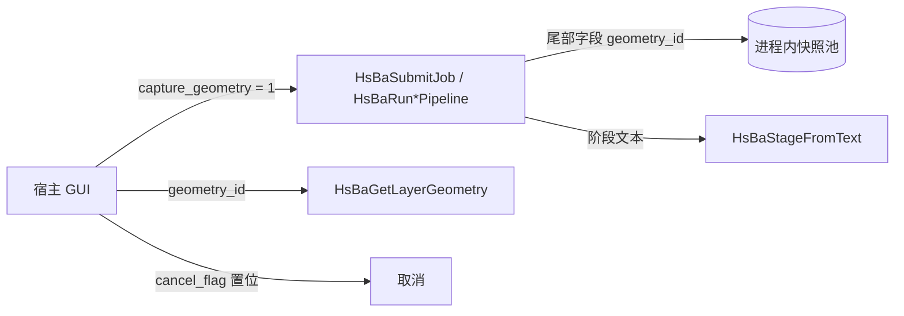

# GUI 支撑 API（结构化进度 / 层几何 / 作业取消）

本文档描述 DllHsBaSlicer 面向图形宿主的三项补充能力，它们共同解决"切片过程对 GUI 不透明"的问题：

| 能力 | 头文件 | 解决什么 |
| --- | --- | --- |
| 结构化进度阶段 | `progress_stage.h` | 进度文本是会变的英文串，GUI 需要稳定的枚举与标识符来做配色、时间线、i18n |
| 层几何快照 | `geometry_export.h` | 轮廓 / 填充 / 支撑只在流水线内部存在，GUI 无法绘制逐层预览 |
| 作业句柄与取消 | `job_control.h` | 九个同步入口阻塞调用线程，旧"异步"入口历史上同样阻塞，且无法中途取消 |

三者互相咬合：阶段枚举是取消状态的表达形式，作业句柄把阶段与几何的 id 一并回传给宿主。

> 前置阅读：[DllHsBaSlicer 模块总览](./README.md)。九个 `HsBaRun*Pipeline` 同步入口的签名与配置字段不在本文重复。

## ABI 变更声明（升级必读）

三项能力全部通过**在结构体尾部追加字段**接入，因此这是一次集中的 ABI 破坏：

| 结构体 | 尾部新字段 | 含义 |
| --- | --- | --- |
| 全部 9 个 `HsBa*PipelineConfig_t` | `int capture_geometry;` | 0 = 不采集层几何（默认）；1 = 采集 |
| 全部 9 个 `HsBa*PipelineConfig_t` | `const void* cancel_flag;` | 指向宿主持有的 `std::atomic<bool>`；`NULL` = 本次运行不可取消 |
| 全部 9 个 `HsBa*PipelineResult_t` | `long long geometry_id;` | 快照句柄；0 = 无快照（`filetransfer`、`custom` 恒为 0） |

约束与后果：

1. **所有 C 宿主必须重新编译**，P/Invoke / ctypes / JNI 侧的镜像结构体必须同步补齐尾部字段；用旧头文件编译的宿主读取新 DLL 会错位。
2. 三个新字段**没有注册进 `param_reflect` 字段表**，因此它们不出现在配置 JSON、`default-config` 响应、protobuf 消息和参数宽表中——`?geometry=1`（REST）与 `HsBaJobResultView_t`（原生）是它们唯一的对外通道。
3. `HsBaCreateDefault*Config()` 与 `pipeline_types.h` 里的内联初始化器 `HsBa*ConfigDefault()` 都已显式写入 `capture_geometry = 0` / `cancel_flag = 0`；自行 `memset` 或栈上未初始化结构体的调用方需自己置零，`cancel_flag` 的垃圾值会被当作有效指针解引用。



## 一、结构化进度阶段

原有 `HsBaProgressCallback` 的 `const char* stage` 文本保持不变（旧宿主不受影响），新接口只做"文本 → 枚举"的分类，分类永不失败：未识别文本回落 `HSBA_STAGE_UNKNOWN`，其稳定名是 `"unknown"`。

```c
HSBA_SLICER_API HsBaStage_t HsBaStageFromText(const char* stage);   // 文本 → 枚举（stage 可为 NULL）
HSBA_SLICER_API const char* HsBaStageName(HsBaStage_t stage);       // 枚举 → 稳定 snake_case 标识符
HSBA_SLICER_API const char* HsBaStageLabel(HsBaStage_t stage);      // 枚举 → 英文显示标签（静态串）
```

标识符与标签是 **API 表面**：只增不改不重编号。

| 值 | 枚举 | `HsBaStageName` | `HsBaStageLabel` |
| --- | --- | --- | --- |
| 0 | `HSBA_STAGE_UNKNOWN` | `unknown` | Unknown |
| 1 | `HSBA_STAGE_LOAD_MODEL` | `model.loading` | Loading model |
| 2 | `HSBA_STAGE_MODEL_LOADED` | `model.loaded` | Model loaded |
| 3 | `HSBA_STAGE_SLICING` | `slicing.start` | Slicing |
| 4 | `HSBA_STAGE_SLICING_LAYER` | `slicing.layer` | Slicing layer |
| 5 | `HSBA_STAGE_SLICE_DONE` | `slicing.done` | Slicing complete |
| 6 | `HSBA_STAGE_FLOOR` | `floor.start` | Generating floor |
| 7 | `HSBA_STAGE_FLOOR_DONE` | `floor.done` | Floor complete |
| 8 | `HSBA_STAGE_SUPPORT` | `support.start` | Generating supports |
| 9 | `HSBA_STAGE_SUPPORT_DONE` | `support.done` | Supports complete |
| 10 | `HSBA_STAGE_SUPPORT_DISABLED` | `support.skipped` | Supports skipped |
| 11 | `HSBA_STAGE_FILL` | `fill.start` | Generating fills |
| 12 | `HSBA_STAGE_FILLING_LAYER` | `fill.layer` | Filling layer |
| 13 | `HSBA_STAGE_FILL_DONE` | `fill.done` | Fills complete |
| 14 | `HSBA_STAGE_PATH` | `path.start` | Generating tool path |
| 15 | `HSBA_STAGE_WRITE_FILE` | `file.write` | Writing output file |
| 16 | `HSBA_STAGE_EXPORT` | `export` | Exporting |
| 17 | `HSBA_STAGE_DONE` | `done` | Complete |
| 18 | `HSBA_STAGE_CANCELLED` | `cancelled` | Cancelled |

超出枚举范围的取值（例如旧宿主传入的越界整数）一律返回 `"unknown"` / `"Unknown"`。

### 匹配规则

分类前先做无分配的**归一化**：去掉右侧的 `.` 与空格（`"Slicing layer..."` → `"Slicing layer"`），再在 `" ("` 处截断（`"Support disabled (spiral mode)"` → `"Support disabled"`）。随后按**精确表**匹配，未命中再按**前缀表**匹配：

| 前缀 | 阶段 | 存在原因 |
| --- | --- | --- |
| `Slicing bead` / `Slicing sheet` / `Slicing layer` | `SLICING_LAYER` | 各工艺的逐层文案不同 |
| `Exporting` | `EXPORT` | 尾部会带脚本名或包名 |
| `Writing ` | `WRITE_FILE` | 尾部带文件名 |
| `Support disabled` | `SUPPORT_DISABLED` | 括号限定语 |
| `Loading model` | `LOAD_MODEL` | 尾部带模型名 |
| `Pipeline complete` | `DONE` | 尾部带耗时 |
| `Cancelled` | `CANCELLED` | 尾部带原因 |

> **`custom` 流水线（Lua）的文本几乎必然分类为 `UNKNOWN`**：脚本报什么是宿主自己决定的。若要 GUI 得到阶段语义，请在 Lua 里复用上面表中的英文文案，或走 `HsBaJobGetProgress` 只取百分比。

## 二、作业句柄与取消

`HsBaSubmitJob` 是**真正的非阻塞入口**：它在返回前深拷贝配置（含所有字符串，因此调用方的缓冲区返回后即可释放），启动一条专用线程，并交回一个不透明句柄。

```c
typedef struct HsBaJob* HsBaJobHandle;

typedef enum HsBaJobState
{
    HSBA_JOB_PENDING = 0, HSBA_JOB_RUNNING = 1, HSBA_JOB_SUCCEEDED = 2,
    HSBA_JOB_FAILED = 3,  HSBA_JOB_CANCELLED = 4
} HsBaJobState_t;

typedef void (*HsBaProgressCallbackEx)(int percent, HsBaStage_t stage, const char* stage_text, void* user_data);
typedef void (*HsBaJobDoneCallback)(HsBaJobHandle job, void* user_data);

HSBA_SLICER_API HsBaJobHandle HsBaSubmitJob(HsBaPipelineKind kind, const void* config,
                                            HsBaProgressCallbackEx on_progress, void* progress_user_data,
                                            HsBaJobDoneCallback on_done, void* done_user_data);
HSBA_SLICER_API int           HsBaCancelJob(HsBaJobHandle job);
HSBA_SLICER_API int           HsBaWaitJob(HsBaJobHandle job, long long timeout_ms);
HSBA_SLICER_API HsBaJobState_t HsBaJobGetState(HsBaJobHandle job);
HSBA_SLICER_API int           HsBaJobGetProgress(HsBaJobHandle job, int* percent, HsBaStage_t* stage,
                                                 char* text_out, int text_cap);
HSBA_SLICER_API long long     HsBaJobGeometryId(HsBaJobHandle job);
HSBA_SLICER_API int           HsBaJobCopyResult(HsBaJobHandle job, HsBaJobResultView_t* out);
HSBA_SLICER_API void          HsBaFreeJobResultView(HsBaJobResultView_t* view);
HSBA_SLICER_API void          HsBaReleaseJob(HsBaJobHandle job);
```

所有函数都可与 `NULL` 句柄共处（`HsBaCancelJob/WaitJob/CopyResult` 返回 0，`HsBaJobGetState` 返回 `HSBA_JOB_FAILED`，其余为空操作），GUI 在"提交失败也要走同一条清理路径"时可以省掉分支。

| 函数 | 返回语义 |
| --- | --- |
| `HsBaSubmitJob` | `NULL` 表示 kind 越界或 `config == NULL`；成功返回的句柄立即可被另一线程轮询 |
| `HsBaCancelJob` | 1 = 请求已记录；0 = 作业已终态（或句柄非法） |
| `HsBaWaitJob` | 1 = 已终态；0 = 超时；`timeout_ms < 0` 表示无限等待 |
| `HsBaJobGetProgress` | 1 = 写入成功；四个输出参数均可为 `NULL`，`text_out` 保证以 `\0` 结尾 |
| `HsBaJobCopyResult` | 1 = 结果已拷出；作业仍在运行时返回 0 且 `out` 被清零 |
| `HsBaJobGeometryId` | 快照 id，未采集 / 非法句柄为 0 |

### 线程契约

- 进度与完成回调都在**作业自己的线程**上触发，绝不在提交线程；宿主必须自行调度回 UI 线程。
- `HsBaJobGetProgress` / `HsBaJobGetState` / `HsBaJobCopyResult` 是线程安全的，可在 UI 定时器里直接轮询——不想接回调的宿主可以只用轮询。
- 回调里**不得**调用 `HsBaReleaseJob` 后立即使用句柄；回调期间库引用已释放，但宿主引用仍在，可安全读取结果。

### 生命周期与引用计数

一个已提交的作业持有 **2 个引用**：1 个给运行中的工作，1 个给调用方。完成回调触发时库引用自动 -1。

- 用完即弃的宿主（只在 `on_done` 里取结果，之后不再碰句柄）**必须**仍调用一次 `HsBaReleaseJob`，否则宿主引用泄漏；
- 需要跨线程长期持有句柄（例如存进成员变量供"取消"按钮使用）的宿主，只要不调 `HsBaReleaseJob`，句柄就一直有效；
- 最后一个引用释放时作业对象被销毁，其结果视图字符串与几何快照引用一并回收。

```c
// 轮询风格（无需回调）
HsBaJobHandle job = HsBaSubmitJob(HSBA_PIPELINE_FDM, &cfg, NULL, NULL, NULL, NULL);
if (job) {
    while (!HsBaWaitJob(job, 0)) {          // 已经终态？
        TickUi();                            // 期间可读进度
        int pct; HsBaStage_t st; char text[64];
        if (HsBaJobGetProgress(job, &pct, &st, text, sizeof text)) {
            PaintBar(pct, HsBaStageName(st));
        }
    }
    HsBaJobResultView_t view = {0};
    if (HsBaJobCopyResult(job, &view)) {
        printf("%s\n", view.error_message ? view.error_message : "ok");
        HsBaFreeJobResultView(&view);        // 三个字符串由 malloc 持有
    }
    HsBaReleaseJob(job);
}
```

### 统一结果视图

`HsBaJobResultView_t` 是九个 per-kind 结果结构体的公共形状（在 `pipelinetypes/pipeline_types.h` 中定义），字符串由 `malloc` 分配：

```c
typedef struct HsBaJobResultView {
    int success; int total_layers; long long geometry_id;
    char* inline_content; char* output_path; char* error_message;
    double elapsed_seconds; int files_transferred; int total_files;
} HsBaJobResultView_t;
```

`inline_content` 装 G-code / Custom 结果串，`output_path` 装导出文件路径，两者互不冲突；`files_transferred` / `total_files` 只对 `filetransfer` 有意义。**先拷贝再 `HsBaFreeJobResultView`**，且不要把视图里的指针传给任何 `HsBaFree*PipelineResult`。

### 旧 `HsBaRun*PipelineAsync` 的行为变更

签名不变，实现改为内部委托作业机制。由此带来两点与历史行为不同、且文档此前未澄清的事实：

1. 旧实现在协程执行器里 join，**等价于阻塞调用线程**；现在它真正立即返回。
2. 旧实现要求 `config` 及其字符串在整个运行期间保持有效；现在配置被深拷贝，**返回后即可释放**。

如果你的代码此前依赖"Async 其实会阻塞"这一事实（例如紧接着读取结果文件），请改为使用 `HsBaWaitJob` 或结果回调。

### 取消粒度

取消是**协作式**的：`HsBaCancelJob` 只置位内部原子标志，流水线在下一个检查点抛出取消异常并展开为 `HSBA_JOB_CANCELLED`。检查点位于阶段边界与逐层循环内部：

| 工艺 | 检查点 |
| --- | --- |
| FDM | 切片循环后、支撑前、填充前、**路径生成逐层循环内**、写文件前 |
| SLA | 切片循环后、地板前、支撑前、导出前 |
| SLS / SLM / LOM / TDP | 切片循环后 |
| WAAM | 切片循环后、机器人路径前 |
| Custom / FileTransfer | Lua 调用（或传输）前与返回后各一次 |

因此**单个长步骤无法被硬中断**：网格加载（`HsBaLoadModel`）、一次 Lua 回调、zip 压缩必须跑完。跨 C ABI 时取消语义体现在 `error_message` 的 `"Cancelled"` 前缀上（结果结构体没有状态字段），作业层把它翻译成 `HSBA_JOB_CANCELLED`，REST 层翻译成 `cancelled` 状态。

同步入口同样支持取消：自己准备一个 `std::atomic<bool>` 并把地址写入 `cfg.cancel_flag`，从另一线程置位即可；置 `NULL` 则该次运行不可取消。

## 三、层几何快照

只有 `cfg.capture_geometry != 0` 时流水线才在末尾把层轮廓拷进进程内快照池，并把 `geometry_id` 写入结果尾部字段。

```c
typedef struct HsBaRing { int point_count; const double* xy; int closed; } HsBaRing_t;

typedef struct HsBaLayerGeometry {
    int layer_index; double z_height;
    int outline_count;          const HsBaRing_t* outlines;
    int fill_count;             const HsBaRing_t* fills;
    int support_count;          const HsBaRing_t* supports;
    double bounds_min[2]; double bounds_max[2];
} HsBaLayerGeometry_t;

HSBA_SLICER_API int         HsBaGeometryLayerCount(long long geometry_id);
HSBA_SLICER_API int         HsBaGetLayerGeometry(long long geometry_id, int layer_index, HsBaLayerGeometry_t* out);
HSBA_SLICER_API void        HsBaFreeLayerGeometry(HsBaLayerGeometry_t* geom);
HSBA_SLICER_API long long   HsBaRetainGeometrySnapshot(long long geometry_id);
HSBA_SLICER_API void        HsBaReleaseGeometrySnapshot(long long geometry_id);

typedef struct HsBaGeometryPath {
    int point_count;          /* 本快照持有的三元组个数，未写入时为 0 */
    const double* xyz;        /* x0,y0,z0,x1,y1,z1,...；长度 3 * point_count */
    double bounds_min[2]; double bounds_max[2];   /* 对 x 与 y 取 min/max */
    double z_min; double z_max;                   /* 折线最低点与最高点 */
} HsBaGeometryPath_t;

HSBA_SLICER_API int         HsBaGeometryPathPointCount(long long geometry_id);
HSBA_SLICER_API int         HsBaGetGeometryPath(long long geometry_id, HsBaGeometryPath_t* path);
HSBA_SLICER_API void        HsBaFreeGeometryPath(HsBaGeometryPath_t* path);
```

坐标单位毫米，`xy` 是长度 `2 * point_count` 的扁平数组（`x0,y0,x1,y1,...`）。`closed == 1` 表示首尾顶点重复的闭合轮廓，`0` 表示开放折线（填充线）。`bounds_min/max` 覆盖该层所有环，供 GUI 做自适应缩放。

### 连续工具路径

按层给出的环只是横截面：它们说明某一层在哪里，却不说明机器按什么顺序走过它，也没有任何东西把相邻两层连起来。对于一次连续挤出（螺旋 / 花瓶模式）的作业，额外把那条线本身存成真正的三维折线，每个点带上它自己的 `z`。只有 **FDM、TDP、WAAM** 配置里的 `spiral_mode = 1` 会写入；SLS、SLM、LOM、SLA 以及所有非螺旋作业的路径为空——`HsBaGeometryPathPointCount()` 返回 0，`HsBaGetGeometryPath()` 返回失败。折线没有 `closed` 标志：它就是一串线段，调用方直接把相邻点连成直线，因为那些直线正是喷嘴走过的轨迹。

路径导出与单层快照遵守同样的**一次 `malloc`** 契约（只调用一次 `HsBaFreeGeometryPath()`，不单独 free 任何数组），并且住在同一个快照里：`Retain` / `Release` 快照时路径随之存活或回收，不会各自计数。

### 各工艺的槽位

| 工艺 | `outlines` | `fills` | `supports` |
| --- | --- | --- | --- |
| FDM | 主轮廓（含内孔） | 填充线 | 支撑截面 |
| SLA | 曝光轮廓 | **仅 layer 0** 放地板 / 筏层，其余层为空 | 支撑截面 |
| SLS / SLM / LOM / TDP / WAAM | 层轮廓 | 空（`fill_count == 0`） | 空（`support_count == 0`） |
| Custom / FileTransfer | 无快照，`geometry_id` 恒为 0 | — | — |

### 内存所有权

`HsBaGetLayerGeometry` 用**一次 `malloc`** 分配"环数组 + 全部坐标数组"的连续块，`out` 内所有指针都指向这块内部：

- 不要单独 `free` 任何一个数组，也不要 `realloc` 或跨层复用指针；
- 用完调用一次 `HsBaFreeLayerGeometry(&geom)`，它整体 `free` 并把结构体清零（重复调用、传 `NULL` 均为空操作）；
- 即使某个槽位为空，其指针也指向块内有效地址（因为三个数组是连续段），判空请用 `*_count` 而不是指针。

### 生命周期与池上限

快照池是进程级的，容量由环境变量 `HSBA_GEOMETRY_POOL_MAX` 决定（解析方式同 `HSBA_PIPELINE_THREADS`：未设置或非正数取默认 **4**）。

- 每个快照自身持有 1 个引用；超限时**只淘汰引用数为 1 且最旧**的快照，刚采集的那一个永远不会被自己挤出；
- 若全部快照都被钉住（引用数 > 1），池允许临时超限而不是回收正在使用的数据；
- `HsBaRetainGeometrySnapshot(id)` 把引用数 +1 并返回同一 id（快照已回收则返回 0）；`HsBaReleaseGeometrySnapshot(id)` 把引用数 -1，归零即回收。
- **采集本身占一个引用**，所以宿主"不 Retain 就直接 Release"会立即回收数据。要在多次读取之间保命，请先 `Retain` 再 `Release` 两次（自己那次 + 采集那次），或者干脆只 Release 一次。

```c
const long long gid = HsBaJobGeometryId(job);       // 或 result.geometry_id
const int layers = HsBaGeometryLayerCount(gid);     // 0 = id 未知 / 已被回收
if (layers > 0 && HsBaRetainGeometrySnapshot(gid) == gid) {
    HsBaLayerGeometry_t geom = {0};
    if (HsBaGetLayerGeometry(gid, layers - 1, &geom)) {
        for (int r = 0; r < geom.outline_count; ++r) {
            DrawPolyline(geom.outlines[r].xy, geom.outlines[r].point_count);
        }
        HsBaFreeLayerGeometry(&geom);
    }
    HsBaReleaseGeometrySnapshot(gid);   // 宿主引用
    HsBaReleaseGeometrySnapshot(gid);   // 采集引用：此后 id 不再可用
}
```

> **内存代价**：采集是把每层的 `FloatPolygons` 全量复制为 `double`（三层槽位都拷），一个 500 层模型的快照可比 G-code 本身更大。只在预览窗口存活期间 `Retain`，关掉窗口就 `Release`；长期运行、多作业的宿主请调低 `HSBA_GEOMETRY_POOL_MAX` 或保持 `capture_geometry = 0`。

**几何只在作业终态后可读**：采集发生在流水线末尾，`PENDING` / `RUNNING` 阶段 `HsBaJobGeometryId` 恒为 0。

快照在**导出器运行之前**采集，取自导出器即将消费的同一批轮廓；因此螺旋流水线会把 helix 算两遍（一遍进快照，一遍进 G-code）。这是有意取舍：`SpiralizeOuterWall` 是只依赖层环与层高的纯函数，两次调用返回完全相同的折线，重复计算换来的是导出器公共签名保持不变。

## 四、常见错误与边界

| 现象 | 原因与处理 |
| --- | --- |
| `HsBaGeometryLayerCount(id)` 返回 0，但作业确实成功 | 提交时 `capture_geometry` 是 0，或快照已被池淘汰（调低并发预览数、或先 `Retain`） |
| `HsBaGeometryPathPointCount(id)` 返回 0，但层数大于 0 | 这次作业不是螺旋运行（`spiral_mode = 0`），或该流水线根本没有这个字段（SLS / SLM / LOM / SLA）——此时只存层快照 |
| 取消按钮"没有立即生效" | 协作式取消只在阶段/层边界起作用；正在进行的是网格加载或一次 Lua 回调，等它结束 |
| 取消后读到空结果 | 已终态但 `HsBaJobCopyResult` 在等待前被调用；先 `HsBaWaitJob`，或只在 `on_done` 里取 |
| `error_message` 以 `Cancelled` 开头却判定为失败 | 结果结构体没有状态字段，同步入口只能靠前缀识别取消；用 `HsBaJobGetState` 或 REST 的 `state` |
| 旧宿主升级后配置错位、字段读出垃圾 | 结构体尾部新增字段，必须用新头文件重编译，并让默认值初始化器写零 |
| Lua 作业的阶段全是 `unknown` | 自定义流水线自报文本不在分类表内，属预期行为 |

## 五、测试与验证

```
tests/GuiApi/progress_stage_test.cpp   -> gui_progress_stage_test    文本→枚举全覆盖、归一化、越界回落
tests/GuiApi/geometry_store_test.cpp   -> gui_geometry_store_test    槽位映射、LRU 上限、引用计数、空采集、连续路径往返
tests/GuiApi/job_control_test.cpp      -> gui_job_control_test       提交不阻塞、取消状态机、回调线程、几何读回
```

三个目标由 `tests/CMakeLists.txt` 中 `if(TARGET DllHsBaSlicer)` 段定义：`gui_progress_stage_test` 与 `gui_job_control_test` 链接导出的 DllHsBaSlicer，`gui_geometry_store_test` 则直接把内部 `DllHsBaSlicer/geometry_store.cpp` 编进测试（快照池不经 C ABI 导出，无法从 DLL 侧构造快照），并定义 `HSBA_SLICER_EXPORTS` 以保证导出宏按 dllexport 编译。

`gui_job_control_test` 的几何用例需要真实网格，仅在设置了环境变量 `HSBA_SAMPLE_MODEL` 时执行；其余用例用"模型文件不存在"作为确定性夹具，无需模型数据。

## 集成指南

- **[DllHsBaSlicer 模块总览](./README.md)** —— 九个流水线入口与全部配置字段
- **[Qt / wxWidgets 桌面框架集成](./qt_wxwidgets_integration.md)** —— 作业句柄接进信号槽 / `CallAfter`
- **[Unity / Unreal Engine 游戏引擎集成](./game_engine_integration.md)** —— 新尾部字段的 P/Invoke 结构体对照
